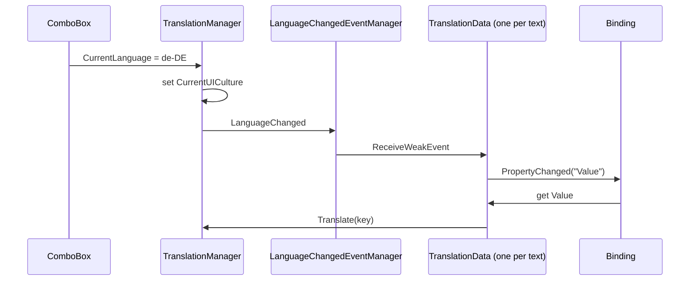

:::note[Retrospective]
Written in 2026, looking back at work from 2013. Part of the series [*From VB6 to self-defending codebases*](/series/from-vb6-to-self-defending-codebases/).
:::

Machine HMIs ship to many countries, and an operator has to be able to read the screen in front of them. In WPF there were several "official" answers, and none of them was obviously right.

My archive from the first half of 2013 is a small museum of that search: about ten folders, most of them dated within a few weeks of each other in March and April. Some are reference samples I downloaded and took apart. Others are my own prototypes and tools. This post goes through what the code shows, roughly in the order I explored it.

## Approach 1: LocBaml and the BAML route

Microsoft's own answer was LocBaml, a command-line sample that works on compiled XAML (BAML). The archive holds the LocBaml source plus a demo application set up for it. The workflow is visible in the files:

1. Set `<UICulture>en-US</UICulture>` in the project so the XAML resources go into a satellite assembly.
2. Give every element an `x:Uid` (`msbuild /t:updateuid` does this for you).
3. Run LocBaml to export every localizable property into a CSV, translate it, and compile a new satellite assembly per language.

The exported CSV shows the problem straight away:

```text
WpfLocalizationLocBaml.g.en-US.resources:startform.baml,frmStartMenuForm:System.Windows.Window.Title,Title,True,True,,WPF Localization Samples
WpfLocalizationLocBaml.g.en-US.resources:startform.baml,frmStartMenuForm:System.Windows.Window.WindowStyle,None,True,False,,SingleBorderWindow
WpfLocalizationLocBaml.g.en-US.resources:startform.baml,frmStartMenuForm:System.Windows.FrameworkElement.Height,None,False,True,,316
```

It doesn't just export text. It exports *everything*: window styles, heights, layout values. A translator gets a file where `316` sits next to the window title. It's powerful (you can even change layout per culture), but every rebuild can shift UIDs, nothing gets checked at compile time, and switching language means restarting the application. For an HMI where the operator changes language at the machine, that last point alone ruled it out.

## Approach 2: RESX plus a markup extension

The second family keeps texts in ordinary `.resx` files and pulls them into XAML through a markup extension. I tried the open-source WPFLocalizeExtension in two throwaway projects, `TestLoc` and `TestWpfLocalizeExtension`:

```xml
<Window xmlns:lex="http://wpflocalizeextension.codeplex.com"
        lex:LocalizeDictionary.DesignCulture="ru"
        lex:ResxLocalizationProvider.DefaultAssembly="TestWpfLocalizeExtension"
        lex:ResxLocalizationProvider.DefaultDictionary="Ressourcen">
    <Grid>
        <Label  Content="{lex:Loc From}" />
        <Button Content="{lex:Loc From}" />
    </Grid>
</Window>
```

The resource files covered `de-DE`, `en-US`, `en-GB`, `hu` and `ru`. Setting `DesignCulture` to Hungarian or Russian was a quick way to check, right in the designer, whether a layout survived much longer strings or a different script.

It worked, but I wanted to understand the mechanism rather than depend on a large library for something that, at its core, is small.

## Approach 3: my own TranslateExtension

[TranslationByMarkupExtension](https://github.com/RenePeuser/TranslationByMarkupExtension) is where I rebuilt the pattern myself. I started from a widely shared sample (its original is still in the `Backup` folder), then split it into `Contracts`, `Data`, `TranslationContext` and `TranslationProvider` folders and filled in the parts the sample had left open.

The trick is that the markup extension doesn't return a string. It returns a **binding** to a small notifying object:

```csharp
public class TranslateExtension : MarkupExtension
{
    public TranslateExtension(string key) { Key = key; }

    [ConstructorArgument("key")]
    public string Key { get; set; }

    public override object ProvideValue(IServiceProvider serviceProvider)
    {
        var binding = new Binding("Value") { Source = new TranslationData(Key) };
        return binding.ProvideValue(serviceProvider);
    }
}
```

### How the pieces fit together

Five small classes make up the whole thing. Here they are in the order you'd wire them up.

**1. The resource files.** One neutral file plus one per culture, all with the same keys. In the repo they live in a `Ressourcen` folder (yes, German spelling), so the base name becomes `TranslationByMarkupExtension.Ressourcen.strings`:

```text
Ressourcen/
  strings.resx          <- neutral fallback
  strings.de-DE.resx
  strings.en-US.resx
  strings.nl-BE.resx
```

```xml
<!-- strings.de-DE.resx -->
<data name="LocalizedByMarkupExtension" xml:space="preserve">
  <value>Dieser Wert wurde mit einer MarkupExtension übersetzt</value>
</data>
```

Each culture-specific file compiles into a satellite assembly in a folder named after the culture (`de-DE\`, `nl-BE\`, …). That folder layout matters later, because the provider uses it to find the available languages.

**2. A provider behind an interface.** The rest of the code only knows `ITranslationProvider`. The RESX version is a thin wrapper around `ResourceManager`:

```csharp
public interface ITranslationProvider
{
    object Translate(string key);
    IEnumerable<CultureInfo> Languages { get; }
}

public class ResxTranslationProvider : ITranslationProvider
{
    private readonly ResourceManager _resourceManager;

    public ResxTranslationProvider(string baseName, Assembly assembly)
    {
        _resourceManager = new ResourceManager(baseName, assembly);
    }

    public object Translate(string key) => _resourceManager.GetString(key);

    // Languages: see the folder scan below
}
```

`ResourceManager.GetString` uses `CurrentUICulture` by default, so the provider doesn't need to know which language is active. Setting the thread culture is enough.

**3. Registering it at startup.** `App.OnStartup` plugs the provider into the `TranslationManager` singleton before the first window is created: `TranslationManager.Instance.TranslationProvider = new ResxTranslationProvider("TranslationByMarkupExtension.Ressourcen.strings", Assembly.GetExecutingAssembly());`.

**4. Using it in XAML.** Map the CLR namespace and pass the key as the constructor argument. It works on any dependency property, not just `Text`:

```xml
<Window xmlns:translationExtension="clr-namespace:TranslationByMarkupExtension.TranslationExtension">
    <StackPanel>
        <ComboBox ItemsSource="{Binding Languages}" IsSynchronizedWithCurrentItem="True" />
        <TextBlock Text="{translationExtension:Translate LocalizedByMarkupExtension}" />
        <Button Content="{translationExtension:Translate LocalizedByMarkupExtension}" />
    </StackPanel>
</Window>
```

**5. Switching language.** The view model wraps the available cultures in an `ICollectionView`. When the combo box moves the current item, it sets the new culture:

```csharp
public class MainWindowViewModel
{
    public ICollectionView Languages { get; private set; }

    public MainWindowViewModel()
    {
        Languages = CollectionViewSource.GetDefaultView(TranslationManager.Instance.Languages);
        Languages.CurrentChanged += (s, e) =>
            TranslationManager.Instance.CurrentLanguage = (CultureInfo)Languages.CurrentItem;
    }
}
```

The test app opens a second window from a button, so you can watch texts in *both* windows switch at the same moment.

### Why every text updates

`TranslationData` listens for a `LanguageChanged` event through a `WeakEventManager` and raises `PropertyChanged("Value")`. Change the culture, and every bound text in every open window updates. No restart, and no strong references holding views alive:



The data object itself is tiny. It holds a key, registers with the weak event manager, and asks the manager for the text whenever the binding reads `Value`:

```csharp
public class TranslationData : IWeakEventListener, INotifyPropertyChanged
{
    private readonly string _key;

    public TranslationData(string key)
    {
        _key = key;
        LanguageChangedEventManager.AddListener(TranslationManager.Instance, this);
    }

    public object Value => TranslationManager.Instance.Translate(_key);

    public bool ReceiveWeakEvent(Type managerType, object sender, EventArgs e)
    {
        if (managerType != typeof(LanguageChangedEventManager)) return false;
        PropertyChanged?.Invoke(this, new PropertyChangedEventArgs(nameof(Value)));
        return true;
    }

    public event PropertyChangedEventHandler PropertyChanged;
}
```

The weak event manager is the part people skip, and it's what keeps closed windows from leaking. A plain `TranslationManager.Instance.LanguageChanged += ...` would make the singleton hold every `TranslationData`, and with it every binding and every view that ever showed a translated text.

The manager sets the culture and raises the event:

```csharp
public CultureInfo CurrentLanguage
{
    get { return Thread.CurrentThread.CurrentUICulture; }
    set
    {
        if (value != Thread.CurrentThread.CurrentUICulture)
        {
            Thread.CurrentThread.CurrentUICulture = value;
            OnLanguageChanged();
        }
    }
}
```

A missing key comes back as `!Key!` rather than an empty string, so untranslated texts stand out on screen. The original sample had a `// TODO: Resolve the available languages` that hard-coded `de` and `en`. My version found the languages by scanning for satellite-assembly folders next to the executable:

```csharp
var cultures = CultureInfo.GetCultures(CultureTypes.AllCultures);
foreach (var directory in new DirectoryInfo(Environment.CurrentDirectory).GetDirectories())
{
    var culture = new CultureInfo(directory.Name);
    if (cultures.Contains(culture))
        availableCultures.Add(culture);
}
```

I also added a `"Key".Translate()` string extension, so view models could use the same lookup as XAML.

:::caution[A bug I can see now]
While restructuring, the finalizer `~TranslationData()` lost its tilde and became a private parameterless constructor. So the `RemoveListener` call in it never ran. The weak event manager covered for it, but it's a reminder that moving code around is also a change.
:::

## The cleanup problem: ResxCheckAndReplace

Once texts live in RESX files, the files grow. Keys pile up, and nobody dares to delete one. In mid-April 2013 I wrote a WPF tool for exactly that. Its header comment is honest: *"At the beginning this tool was programmed quick and dirty, it's not perfect but it works."*

It had two jobs:

1. **Find unused keys.** For every non-default `.resx` in a solution folder, read it with `ResXResourceReader`. Search all `*.cs` files for `<ResourceClass>.<Key>`, and write a new resource file that contains only the keys actually used.
2. **Inline a resource class.** Replace every `ResourceClass.Key` in the code with the literal value. This needed escaping, because a RESX value isn't a C# string literal (line breaks become `\n`, quotes need escaping).

The second job had a trap, which the comment explains with an example:

```csharp
// MessageBox.Show(ResxTexte.Text)
// MessageBox.Show(ResxTexte.Text1)
// MessageBox.Show(ResxTexte.TextAbc)
// If you start replacing with the key "Text" you have troubles,
// because it will replace all calls.
```

The comment says to sort keys by length, descending. The code actually sorts the keys in descending string order:

```csharp
return (from item in resultDictionary orderby item.Key descending select item).ToList();
```

That works too, for a reason I find quite neat: any key that extends a prefix sorts *after* the prefix in ascending order, so descending order always handles `TextAbc` before `Text`. Plain text search instead of real parsing is crude, but for a one-off migration over a known code base it did the job. Progress went to the UI through a tiny generic `MessageBroker<TMessage>`, an idea I came back to later.

## Moving into the IDE: LocalizeStrings

Cleaning up afterwards is the expensive way. Two months later, in June 2013, I tried to stop hard-coded strings at the source with [LocalizeStrings](https://github.com/RenePeuser/LocalizeStrings), a Visual Studio add-in (`IDTExtensibility2`, still the old add-in model). You selected a string literal in a C# file and ran the command:

```csharp
public static void TryLocalizeString(DTE2 applicationObject)
{
    CheckActiveDocument(applicationObject);                       // must be a .cs file
    var selectedText = applicationObject.ActiveDocument.Selection as TextSelection;
    var stringToLocalize = ConvertSelectionToLocalizeString(selectedText);
    if (!EditKey(stringToLocalize)) return;                        // WPF dialog, key editable
    WriteLocalizeStringToXml(stringToLocalize);
    ReplaceSelectionText(selectedText, stringToLocalize);
}
```

It suggested a key built from the letters and digits of the text, XML-escaped the value, and swapped the literal for the key. It was clearly a prototype. The target file was still a hard-coded test path.

## Where it ended up (2018)

The idea came back years later as a private `WPF_Localization` solution: a proper VSPackage command, a dialog for the key, and formatters that knew what to generate depending on the language of the active document:

```csharp
switch (currentTextSelection.Document.Language)
{
    case "CSharp": return cSharpTextFormatter.Localize(textToLocalize);
    case "XAML":   return xamlTextFormatter.Localize(textToLocalize);
    default:       return null;
}
```

In C# the selection became a `TranslatableText` field holding key and developer text. In XAML the formatter emitted a `{TranslateByKey ...}` markup extension. The command also wrote the new entry into the resource file and added a property to a generated wrapper class. The runtime side was recognisably the 2013 design: a markup extension that binds to a notifying `TranslationData`, a weak `LanguageChangedEventManager`, and an `ITranslationProvider`, which was now backed by per-culture XML files instead of RESX.

The resource files became deliberately boring, one file per culture in a `Resources` folder next to the executable:

```xml
<!-- Resources/de-de.xml -->
<Texte>
  <Text Key="Hallo" Value="Hallo" />
  <Text Key="Next_Generation_Of_Localization" Value="Test" />
</Texte>
```

The provider loads all of them once and keeps one dictionary per culture. Switching language is just swapping which dictionary is active:

```csharp
public XMLTranslationProvider(Assembly assembly)
{
    var currentDirectory = new FileInfo(assembly.Location).Directory;
    var resourceDirectory = new DirectoryInfo(Path.Combine(currentDirectory.FullName, "Resources"));
    _resourceDictionary = GetLanguageResources(resourceDirectory.EnumerateFiles("*.xml"))
        .ToDictionary(item => item.Key, item => item.Value);   // culture -> (key -> text)

    Languages = _resourceDictionary.Keys.ToList();
}

public CultureInfo CurrentLanguage
{
    get { return Get<CultureInfo>(); }
    set { if (Set(value)) _activeTextDictionary = _resourceDictionary[value]; }
}
```

The markup extension gained two things compared with 2013: a named `Key` property instead of a constructor argument, and a design-time shortcut, so views stay readable in the designer instead of showing `!Key!` everywhere:

```csharp
public class TranslateTextByExtension : MarkupExtension
{
    public string Key { get; set; }

    public override object ProvideValue(IServiceProvider serviceProvider)
    {
        if (DesignerProperties.GetIsInDesignMode(new DependencyObject()))
            return Key;

        var binding = new Binding("Value") { Source = new TranslationData(Key), Mode = BindingMode.OneWay };
        return binding.ProvideValue(serviceProvider);
    }
}
```

In XAML that reads `Text="{localization:TranslateTextBy Key='Hallo'}"`. The language switch became a plain two-way `SelectedItem` binding to `CurrentLanguage` on an injected `ITranslationService`, with no more `ICollectionView` plumbing and no more static singleton in the view model. And the generated wrapper class gave C# code strongly typed keys with a small `[CallerMemberName]` trick, where every property simply returns its own name:

```csharp
public static class TextResource
{
    public static string Hallo { get; } = Get();
    public static string Next_Generation_Of_Localization { get; } = Get();
    // public static string $Property$ { get; } = Get();   <- insertion point for the VS command

    private static string Get([CallerMemberName] string callerMemberName = null) => callerMemberName;
}
```

A typo in `TextResource.Hallo` is a compile error. A typo in `"Hallo"` is a `!Hallo!` on a machine panel somewhere.

:::caution[What the 2018 code still got wrong]
The finalizer had its tilde back, so the 2013 bug was fixed. But two new gaps are visible. The sample `de-de.xml` contains the key `Test` twice, and `ToDictionary` throws on duplicate keys, so one copy-paste in a resource file takes down the whole application at startup. And the IDE formatter writes `{TranslateByKey DeveloperValue=..., TranslationKey=...}`, while the runtime extension is called `TranslateTextBy` and has a single `Key` property. The tool and the runtime had drifted apart. Both are exactly the kind of mismatch a single automated check would catch.
:::

## Lessons that stuck

- **Localization is a runtime feature for HMIs.** Anything that needs a restart to switch language is the wrong tool when the operator switches at the machine.
- **Return bindings, not values.** A markup extension that hands back a binding to a notifying object gets live updates almost for free.
- **Make missing translations visible.** `!Key!` on screen beats an empty label every time.
- **Resource files need tooling, not discipline.** Unused keys and hard-coded strings don't go away through code review. They go away when a tool finds them, or better, when the IDE makes doing it right the easiest option.

What I'd do today is push that last point further: generate strongly typed accessors from the resource files and add a build-time or Roslyn check that fails on unused keys and on new string literals in view code. That's the same instinct as `ResxCheckAndReplace`, moved from a tool you remember to run into a rule the build enforces.

The cheapest version of that check is a plain unit test. This one is a 2026 sketch, not code from the archive. It compares every culture file against the neutral one and fails on duplicate or missing keys. Point it at `Descendants("Text")` and the `Key` attribute, and the same test covers the 2018 XML files and their duplicate `Test` key:

```csharp
[TestMethod]
public void All_cultures_define_exactly_the_neutral_keys()
{
    static List<string> KeysOf(string file) =>
        XDocument.Load(file).Descendants("data").Select(d => (string)d.Attribute("name")).ToList();

    var neutral = KeysOf("Ressourcen/strings.resx");
    foreach (var file in Directory.GetFiles("Ressourcen", "strings.*.resx"))
    {
        var keys = KeysOf(file);
        CollectionAssert.AllItemsAreUnique(keys, $"Duplicate keys in {file}");
        CollectionAssert.AreEquivalent(neutral, keys, $"{file} is out of sync with strings.resx");
    }
}
```

It's ten lines and runs in milliseconds, and it turns "please keep the resource files in sync" from a review comment into a red build.
