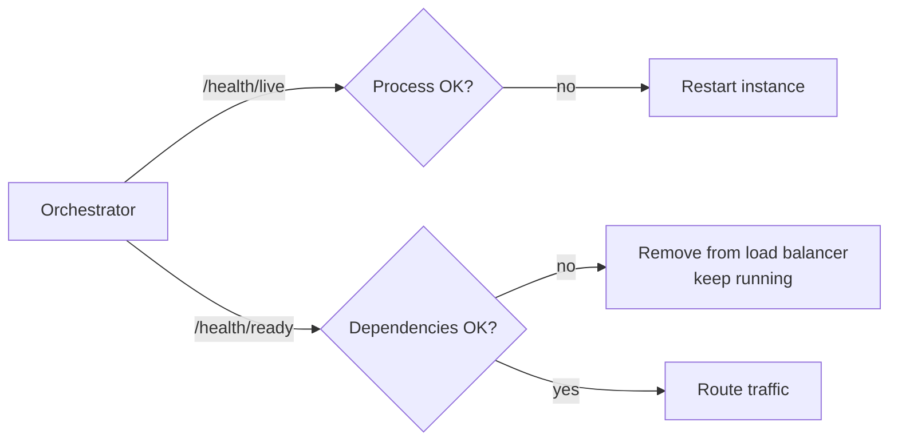

:::note[Series]
Part of the series [*ASP.NET Core from the ground up*](/series/aspnetcore-from-the-ground-up/).
:::

Here's a health endpoint I've seen in more than one codebase, nearly verbatim:

```csharp
[ApiController]
[Route("health")]
[AllowAnonymous]
public sealed class HealthController : ControllerBase
{
    [HttpGet]
    public HealthResponse Get() => new(HealthStatus.Healthy);   // always
}
```

In one of them, the handler behind it even had an honest comment: *we currently have no state-based
information*. The platform's health check pointed at `/health`. Think about what that means: the
platform gets a green light every time, so it keeps routing traffic to an instance even if its
database connection has been dead for an hour.

An endpoint that always says "healthy" isn't a health check. It's a "the process is running and
Kestrel answers" check, which is useful, but only if everyone knows that's all it means.

## Two questions, not one

Orchestrators (Kubernetes, Azure App Service, container apps, load balancers) ask two different
questions, and mixing them up causes most health check incidents:

| | Liveness | Readiness |
|---|---|---|
| Question | Is the process stuck? | Can this instance serve traffic right now? |
| On failure | **Restart** the instance | **Stop routing** traffic to it |
| Should check | The process itself | Things this instance needs to do its job |
| Should **not** check | Databases, downstream APIs | Things outside its control that every instance shares |

The always-healthy endpoint is a perfectly fine **liveness** probe. The mistake is using it as the
only signal.

The opposite mistake is just as bad: putting a database check into the **liveness** probe. The
database has a two-minute hiccup, every instance fails liveness at the same time, the orchestrator
restarts all of them, and now you have a database hiccup **plus** a cold start of the whole fleet
right when the database comes back.



## The built-in health checks

ASP.NET Core has a health check framework. Use it instead of a controller:

```csharp
builder.Services.AddHealthChecks()
    .AddCheck("self", () => HealthCheckResult.Healthy(), tags: ["live"])
    .AddDbContextCheck<ShopDbContext>("database", tags: ["ready"])
    .AddCheck<CatalogApiHealthCheck>("catalog-api", tags: ["ready"]);

var app = builder.Build();

app.MapHealthChecks("/health/live", new HealthCheckOptions
{
    Predicate = check => check.Tags.Contains("live")
}).AllowAnonymous();

app.MapHealthChecks("/health/ready", new HealthCheckOptions
{
    Predicate = check => check.Tags.Contains("ready")
}).AllowAnonymous();
```

`AddDbContextCheck` comes from `Microsoft.Extensions.Diagnostics.HealthChecks.EntityFrameworkCore`.
The community packages `AspNetCore.HealthChecks.*` cover SQL Server, Redis, Service Bus, Key Vault
and many more.

`AllowAnonymous()` matters: with the fallback policy from the JWT post, health endpoints would
otherwise require a token, and the platform doesn't send one. One API guideline I worked with made
this explicit: no authentication and no scopes on the health route, because the platform calls it.

## A custom check

For a downstream HTTP API, check something cheap that proves you can reach it and authenticate:

```csharp
internal sealed class CatalogApiHealthCheck(IHttpClientFactory httpClientFactory) : IHealthCheck
{
    public async Task<HealthCheckResult> CheckHealthAsync(HealthCheckContext context, CancellationToken ct = default)
    {
        using var cts = CancellationTokenSource.CreateLinkedTokenSource(ct);
        cts.CancelAfter(TimeSpan.FromSeconds(2));

        try
        {
            var client = httpClientFactory.CreateClient("catalog");
            using var response = await client.GetAsync("health/live", cts.Token);

            return response.IsSuccessStatusCode
                ? HealthCheckResult.Healthy()
                : HealthCheckResult.Degraded($"Catalog API returned {(int)response.StatusCode}");
        }
        catch (Exception ex) when (ex is HttpRequestException or OperationCanceledException)
        {
            return HealthCheckResult.Unhealthy("Catalog API not reachable", ex);
        }
    }
}
```

Yes, that's a `try/catch`, and it's one of the legitimate ones: a health check's whole job is to turn
a failure into a status. (The post on try/catch in endpoints comes later in the series.)

Three rules for custom checks:

- **Short timeouts.** A health check that takes 30 seconds is a health check that times out at the
  orchestrator and fails anyway.
- **Cheap operations.** `SELECT 1`, a HEAD request, a `PING`. Not "load the first page of orders".
- **Degraded is a real state.** An optional dependency that's down means "degraded", not
  "unhealthy". Readiness still returns 200 for degraded by default, which is usually what you want.

## Should readiness check downstream APIs?

This is where it gets nuanced. If *your* database is down, this instance genuinely can't serve
requests, and all instances share that fate. Taking them all out of rotation gives clients a fast
503 from the load balancer instead of slow timeouts. That's reasonable.

If a **downstream API** used by one endpoint out of fifty is down, removing every instance from
rotation turns a partial outage into a full one. For those, I report `Degraded` and let resilience
handlers and circuit breakers deal with it at request time.

My rule of thumb: **readiness checks what this service cannot work without at all.** Everything else
is degraded at most, and visible in monitoring rather than in routing decisions.

## A response someone can read

The default response is the plain text `Healthy`. For humans and dashboards, a JSON body with the
individual checks is more useful:

```csharp
app.MapHealthChecks("/health/ready", new HealthCheckOptions
{
    Predicate = check => check.Tags.Contains("ready"),
    ResponseWriter = (http, report) => http.Response.WriteAsJsonAsync(new
    {
        status = report.Status.ToString(),
        durationMs = report.TotalDuration.TotalMilliseconds,
        checks = report.Entries.Select(e => new
        {
            name = e.Key,
            status = e.Value.Status.ToString(),
            durationMs = e.Value.Duration.TotalMilliseconds
        })
    })
}).AllowAnonymous();
```

Note what's **not** in there: exception messages and descriptions. A public health endpoint that
returns "Login failed for user 'shop_app' on server 'sql-prod-01'" is an information leak. Keep the
details in the logs, or expose a detailed variant only on an internal port or behind authentication.

## Wiring it to the platform

- **Kubernetes:** `livenessProbe` → `/health/live`, `readinessProbe` → `/health/ready`, and a
  `startupProbe` if the app needs time to warm up.
- **Azure App Service:** one health check path. Point it at **readiness**: App Service removes
  unhealthy instances from the load balancer and replaces them only after they stay unhealthy for a
  while.
- **Load balancers / gateways:** readiness.

Many teams set the platform's path once in infrastructure code (`health_check_path = "/health"`) and
never revisit it. When you split live and ready, update the infrastructure too.

## Pitfalls

**Health checks in telemetry.** A probe every 10 seconds per instance produces a lot of request
telemetry and skews your latency percentiles. Filter health endpoints out of request tracing.

**Rate limiting and security filters.** Make sure the rate limiter and the query parameter filter
from the security post don't apply to health endpoints, or the platform gets a 429 and takes you out.

**Running expensive checks on every probe.** If a check is costly, cache the result for a few seconds
or run it in the background with a health check publisher (`IHealthCheckPublisher`).

**HTTPS redirection.** Some probes call over HTTP. A 307 redirect can count as a failure.

## How to test it

```csharp
[TestMethod]
public async Task Readiness_reports_unhealthy_when_database_is_down()
{
    await using var factory = new WebApplicationFactory<Program>().WithWebHostBuilder(b =>
        b.UseSetting("ConnectionStrings:Shop", "Server=127.0.0.1,1;Database=x;Connect Timeout=1"));
    using var client = factory.CreateClient();

    var live  = await client.GetAsync("/health/live");
    var ready = await client.GetAsync("/health/ready");

    Assert.AreEqual(HttpStatusCode.OK, live.StatusCode);                    // process is fine
    Assert.AreEqual(HttpStatusCode.ServiceUnavailable, ready.StatusCode);   // but don't route to it
}
```

That one test documents the whole liveness/readiness contract.

## Summary

- An endpoint that **always returns Healthy** is a liveness probe at best. Don't let it be your only
  signal.
- Split **liveness** (restart if stuck, checks only the process) from **readiness** (route traffic
  only if this instance can work).
- **Never put shared dependencies into liveness**: one database hiccup restarts the whole fleet.
- Use the **built-in health checks** with tags, short timeouts and cheap operations; report optional
  dependencies as **Degraded**.
- Health endpoints are **anonymous**, excluded from rate limiting and telemetry noise, and don't leak
  error details.

*Previous: [Setting up Swagger / OpenAPI](/blog/2026-swagger-and-openapi-setup/) ·
Next: [Controllers vs. minimal APIs](/blog/2026-controllers-vs-minimal-apis/)*
