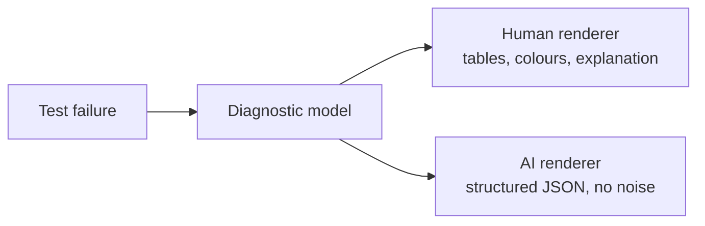

Watch a coding agent work on a codebase for an hour and you'll notice where it loses time. It's not
writing code. It's the loop after a red test: read the output, guess what it means, open five files
to find context, try a fix, run again. If the failure message says `Assert.IsTrue failed.`, the
agent does exactly what any of us does with that message: it guesses.

That made me look at failure messages differently. For years, a test answered one question: *did
something break?* Today, the person (or agent) reading the failure needs answers to five:

1. **What** is broken?
2. **Why** is it broken?
3. **Where** is it broken?
4. **How** do I fix it?
5. **What does correct look like?**

A test that answers all five makes humans faster and makes agents dramatically more likely to fix the
problem on the first attempt. This post is about how to build those tests.

## The problem: failures that only say "no"

Three failures I've seen in real pipelines, slightly neutralized:

```text
Assert.IsTrue failed.
```

```text
Expected type OrderResponse, actual type UnknownResponse.
```

```text
Missing pricing configuration.
```

Each one is technically correct and practically useless. For the second one, you still need to find
the endpoint, the test, the line with the wrong type, what the endpoint actually returns and what the
correct assertion looks like. All of that information **existed at the moment the test failed**. The
test just threw it away.

Most debugging time isn't spent fixing. It's spent reconstructing context the test already had.

## Three generations of test output

I find it useful to think about failure output in generations:

| Generation | Question answered | Example |
|---|---|---|
| 1. Detection | Did something break? | `Assert.AreEqual failed. Expected:<201>. Actual:<200>.` |
| 2. Diagnostics | What, why, where, how to fix? | Root cause, file and line, expected vs actual, suggested fix, curl to reproduce |
| 3. AI-native | Can a machine act on it? | The same diagnostic as structured data: error code, location, a concrete replacement |

Most suites are still at generation 1. Generation 2 helps humans and agents alike. Generation 3 is
where things get interesting.

## Example 1: an HTTP contract mismatch

Here's a test that asserts the wrong response type:

```csharp
[TestMethod]
public Task Should_Create_Order() =>
    Client.AssertPostAsync<UnknownResponse>("api/v1/orders", "Orders/Payloads/TwoLines.json", HttpStatusCode.Created);
```

A generation-2 failure looks like this:

```text
══════════════════════════════════════════════════════════════
❌ HTTP RESPONSE TYPE MISMATCH                    [TEST-HTTP-002]
══════════════════════════════════════════════════════════════
Test     : MyShop.Api.Tests.Orders.CreateOrder_Tests.Should_Create_Order
Location : tests/MyShop.Api.Tests/Orders/CreateOrder_Tests.cs:24
Request  : POST api/v1/orders → 201 Created
Endpoint : MyShop.Orders.Create.CreateOrderEndpoint

┌─────────────┬──────────────────────┬────────────────────┬───────┐
│ Status code │ Endpoint declares    │ Test expects       │ Match │
├─────────────┼──────────────────────┼────────────────────┼───────┤
│ 201         │ OrderResponse        │ UnknownResponse    │ ✗     │
└─────────────┴──────────────────────┴────────────────────┴───────┘

Why: this is a success test, but none of the endpoint's 2xx responses
     returns 'UnknownResponse'.

✅ Fix: change the type argument in CreateOrder_Tests.cs:24
     Client.AssertPostAsync<OrderResponse>("api/v1/orders", ...)

🔁 Reproduce:
     curl --request POST 'https://localhost:5001/api/v1/orders' \
       --header 'Content-Type: application/json' --data-raw '{...}'
```

Nothing in there is guesswork. The test knows its own location (caller info attributes), the request
it sent, and, because the API runs in-process, the **endpoint metadata**. That last part is what
makes the fix suggestion possible:

```csharp
public static IReadOnlyList<(int StatusCode, Type? Type)> DeclaredResponses(
    IServiceProvider services, string method, string route)
{
    var endpoint = services.GetRequiredService<EndpointDataSource>().Endpoints
        .OfType<RouteEndpoint>()
        .Single(e => RouteMatches(e.RoutePattern, route)
                  && (e.Metadata.GetMetadata<IHttpMethodMetadata>()?.HttpMethods.Contains(method) ?? false));

    return endpoint.Metadata.GetOrderedMetadata<IProducesResponseTypeMetadata>()
        .Select(m => (m.StatusCode, m.Type))
        .ToList();
}
```

The endpoint says "201 returns `OrderResponse`", the test says `UnknownResponse`, so the suggested fix
is deterministic. Not a guess, a lookup.

## Example 2: a convention violation

The second kind of failure is about conventions. Say every domain event must have exactly one
handler. A convention test checks that:

```csharp
[TestMethod]
public void Should_Have_A_Handler_For_Every_Domain_Event()
{
    var missing = DomainEvents.All().Where(e => !Handlers.Exist(e)).ToList();

    Assert.AreEqual(0, missing.Count, $"Missing handlers: {string.Join(", ", missing.Select(e => e.Name))}");
}
```

That's generation 1 with a list. Generation 2 uses what the test knows about the codebase:

```text
══════════════════════════════════════════════════════════════
❌ MISSING DOMAIN EVENT HANDLER                   [CONV-EVT-001]
══════════════════════════════════════════════════════════════
Event    : MyShop.Invoicing.InvoiceCancelled
Declared : src/MyShop.Invoicing/Events/InvoiceCancelled.cs:5

Why: every domain event needs exactly one IEventHandler<T>.
     Without it, the event is published and silently dropped.

✅ Fix: create src/MyShop.Invoicing/Handlers/InvoiceCancelledHandler.cs

     public sealed class InvoiceCancelledHandler : IEventHandler<InvoiceCancelled>
     {
         public Task HandleAsync(InvoiceCancelled @event, CancellationToken ct)
         {
             // ...
         }
     }

📚 Example of an existing handler: src/MyShop.Invoicing/Handlers/InvoicePaidHandler.cs
```

Where the handler goes follows from the folder convention. What it looks like follows from the
interface. Which existing file to copy from is the nearest sibling. An agent reading this doesn't
need to explore the codebase at all.

## The principles

From these examples, six rules I now apply to every assertion helper and convention test I write:

1. **Explain the root cause.** Not "validation failed", but "no handler registered for
   `InvoiceCancelled`".
2. **Include exact locations.** Project, class, method, file, line. Use `[CallerFilePath]` and
   `[CallerLineNumber]` in your assert helpers, and print **repository-relative** paths, not
   `D:\Users\...`.
3. **Show expected vs actual**, side by side, for the thing that differs, not the whole object.
4. **Give a fix strategy.** "Add the missing registration", "change the type argument", "update the
   snapshot if the change was intended".
5. **Provide example code** when the fix is deterministic. Ready to copy beats "see documentation".
6. **Provide reproduction information.** A curl command, the payload file, the snapshot path, the
   configuration key.

The guideline that sums it up:

> Every failure message should be actionable by a human developer **and** by an AI agent, without
> additional investigation.

## Human mode, AI mode, hybrid

Here's the catch: the box-drawing output above is great for humans and mediocre for machines. An
agent can parse it, but it has to *interpret* layout. What a machine really wants is structure:

```json
{
  "code": "TEST-HTTP-002",
  "title": "HTTP response type mismatch",
  "test": "MyShop.Api.Tests.Orders.CreateOrder_Tests.Should_Create_Order",
  "file": "tests/MyShop.Api.Tests/Orders/CreateOrder_Tests.cs",
  "line": 24,
  "expected": "OrderResponse",
  "actual": "UnknownResponse",
  "fix": { "kind": "replace", "file": "tests/MyShop.Api.Tests/Orders/CreateOrder_Tests.cs", "line": 24,
           "find": "AssertPostAsync<UnknownResponse>", "replace": "AssertPostAsync<OrderResponse>" }
}
```

Two audiences, two formats. The mistake would be to build them separately. The right design is
**one diagnostic model, two renderers**:



```csharp
public sealed record TestDiagnostic(
    string Code,
    string Title,
    string RootCause,
    SourceLocation Location,
    string? Expected,
    string? Actual,
    FixSuggestion? Fix,
    string? Reproduce);

public sealed record SourceLocation(string Test, string File, int Line);
public sealed record FixSuggestion(string Description, string? File, int? Line, string? Find, string? Replace, string? ExampleCode);
```

```csharp
public static class Diagnose
{
    public static OutputMode Mode { get; } =
        Enum.TryParse<OutputMode>(Environment.GetEnvironmentVariable("TEST_OUTPUT_MODE"), ignoreCase: true, out var mode)
            ? mode
            : OutputMode.Human;

    [DoesNotReturn]
    public static void Fail(TestDiagnostic diagnostic)
    {
        var message = Mode switch
        {
            OutputMode.Ai     => JsonSerializer.Serialize(diagnostic, JsonOptions.Indented),
            OutputMode.Hybrid => HumanRenderer.Render(diagnostic) + Environment.NewLine
                                 + "--- machine-readable ---" + Environment.NewLine
                                 + JsonSerializer.Serialize(diagnostic, JsonOptions.Indented),
            _                 => HumanRenderer.Render(diagnostic)
        };

        throw new AssertFailedException(message);
    }
}

public enum OutputMode { Human, Ai, Hybrid }
```

An assert helper builds the diagnostic and calls `Diagnose.Fail`. The developer in the IDE gets the
readable version. The agent's environment sets `TEST_OUTPUT_MODE=ai` and gets clean JSON. CI uses
hybrid, so the human reading the log and the bot commenting on the pull request read the same
failure.

I've been building this into my own [test SDK](/projects/testing-sdk/) as structured
`because`/`fix` assertions. But the pattern doesn't need a library. Any team can start with the
record above and one renderer.

## Comparison

| | Traditional failure | Diagnostic failure | Diagnostic model with human + AI renderers |
|---|---|---|---|
| Root cause | Manual investigation | ✅ stated | ✅ stated |
| Location | Stack trace | ✅ file and line | ✅ file and line, machine-readable |
| Fix | Reader's job | ✅ described | ✅ described and structured |
| Agent fixes on first attempt | Unlikely | Often | Most likely |
| Onboarding a new developer | Hard | Easier | Easier |
| Cost to build | None | Per assert helper | Per assert helper, plus one renderer |

The cost column is honest: rich diagnostics are work. But it's work in a few shared helpers that every
test benefits from, not work per test.

## Pitfalls

**Wrong fix suggestions.** A confident but wrong "fix" is worse than none, especially for an agent
that will apply it. Only suggest concrete code when the fix is deterministic (a lookup, a convention).
Otherwise describe the strategy and stop.

**Noise.** Emojis and boxes help scanning in moderation. A forty-line banner for a one-line problem
doesn't. Keep the human renderer dense, and keep decoration out of the AI renderer entirely.

**Secrets in diagnostics.** Reproduction info is valuable, tokens in it are not. Redact
`Authorization` headers and connection strings in every renderer, see
[testing with specific user tokens](/blog/2026-testing-with-specific-user-tokens/).

**Machine-specific paths.** `file:///D:/Users/someone/repos/...` is useless on a build agent and leaks
details about someone's machine. Print paths relative to the repository root.

**Unstable error codes.** If agents or scripts start keying on `TEST-HTTP-002`, that code is now an
API. Don't renumber.

## How to check you're getting there

- **The "message only" review.** Pick a few recent test failures and ask: could I have fixed this
  from the failure message alone, without opening a file? If not, improve the helper that produced it.
- **Watch the agent loop.** When an agent needs several attempts for a red test, look at the failure
  it read. Usually the missing information is obvious in hindsight, and adding it helps the next
  human too.
- **Treat convention tests like analyzers.** A convention test with a fix suggestion is halfway to a
  Roslyn code fix. That's the path described in
  [self-defending codebases](/blog/2026-self-defending-codebases/), where AI writes rules and
  humans set the bar.

## Summary

- A test failure should answer **what, why, where, how to fix and what correct looks like**, not only
  "something broke".
- Use what the test already knows: **caller location, the request, endpoint metadata, conventions**.
- Follow six rules: **root cause, exact location, expected vs actual, fix strategy, example code,
  reproduction info**.
- Build **one diagnostic model** and render it for **humans and AI agents**, switchable by environment.
- Suggest concrete fixes **only when they're deterministic**, and never leak secrets or local paths.
