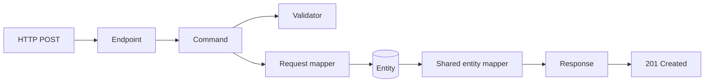

:::note[Series]
Part of the series [*Architecture in practice*](/series/architecture-in-practice/).
:::

The Minimal API sample in the docs is one line:

```csharp
app.MapPost("/orders", (Order order, ShopDbContext db) => { db.Add(order); db.SaveChanges(); return order; });
```

That's great for a demo. In a real backend the same endpoint needs validation with useful error
messages, a request type that isn't the database entity, a response that can grow without breaking
clients, OpenAPI documentation that tells consumers what can go wrong, authorization, cancellation,
and a test. Put all of that into the lambda and you have a 200-line method that nobody wants to
touch.

This post takes one endpoint, *place an order*, and goes through every part of it. It's the
structure I use for every endpoint in a feature-sliced API (see
[*Folder structure*](/blog/2026-folder-structure-by-feature/) for the folders around it).

```text
Api/Orders/V1
├── _Shared_
│   ├── Order.cs
│   └── OrderEntityMapper.cs
└── Place
    ├── PlaceOrderRequest.cs
    ├── PlaceOrderResponse.cs
    ├── PlaceOrderRequestValidator.cs
    ├── PlaceOrderRequestMapper.cs
    ├── PlaceOrderCommand.cs
    ├── PlaceOrderEndpoint.cs
    └── Documentations
        ├── Summary.md
        └── Description.md
```



## 1. Shared: the API domain model

`_Shared_` holds what several actions of the same domain need. The most important piece is the
**API domain model**, the shape of an order as the API presents it:

```csharp
namespace MyShop.Api.Orders.V1;

public sealed record Order
{
    public required int Id { get; init; }
    public required int CustomerId { get; init; }
    public required DateTimeOffset PlacedAt { get; init; }
    public required OrderStatus Status { get; init; }
    public IImmutableList<OrderLine> Lines { get; init; } = ImmutableList<OrderLine>.Empty;
}

public sealed record OrderLine(string ProductId, int Quantity, decimal UnitPrice);

public enum OrderStatus { Placed, Paid, Shipped, Cancelled }
```

Rules for this model: plain records, immutable, no attributes from Entity Framework or any other
infrastructure, no third-party types. It's a neutral data container. Don't suffix it with `Dto`; it's
the order, as the API knows it.

Next to it lives the `OrderEntityMapper`, which converts the database entity to this model. It's
shared because *place*, *get by id* and *search* all return orders.

## 2. Request: what the client sends

Every endpoint gets its own request type, even if it looks almost like `Order`:

```csharp
namespace MyShop.Api.Orders.V1;

public sealed record PlaceOrderRequest
{
    public required int CustomerId { get; init; }
    public required IImmutableList<PlaceOrderLine> Lines { get; init; }
    public string? VoucherCode { get; init; }
}

public sealed record PlaceOrderLine(string ProductId, int Quantity);
```

The client doesn't send an `Id`, `Status` or `UnitPrice`, so they don't exist here. With a shared
`Order` as input, every one of those properties would be a potential over-posting hole, and you'd
have to document "ignored on create" for each of them.

Endpoints without a body get request types too. `GetOrderByIdRequest` with a single `Id` looks like
overkill, but it keeps every endpoint consistent and gives validation a type to hang on to. Minimal
APIs bind such records from route and query with `[AsParameters]`.

## 3. Response: what the client gets back

```csharp
namespace MyShop.Api.Orders.V1;

public sealed record PlaceOrderResponse(Order Order);
```

Why wrap the `Order` instead of returning it directly? Because one day you'll want to return more:
a payment link, a warning that one product ships later, a correlation id. With a wrapper you add a
property. Without it, you either change the domain model for one endpoint, or you break the contract.

## 4. Validation: reject bad input with all errors at once

```csharp
namespace MyShop.Api.Orders.V1;

internal sealed class PlaceOrderRequestValidator
{
    public IDictionary<string, string[]> Validate(PlaceOrderRequest request)
    {
        var errors = new Dictionary<string, string[]>();

        if (request.CustomerId <= 0)
            errors["customerId"] = ["Must be a positive number."];

        if (request.Lines.Count == 0)
            errors["lines"] = ["An order needs at least one line."];

        for (var i = 0; i < request.Lines.Count; i++)
        {
            var line = request.Lines[i];
            if (string.IsNullOrWhiteSpace(line.ProductId))
                errors[$"lines[{i}].productId"] = ["Must not be empty."];
            if (line.Quantity is < 1 or > 999)
                errors[$"lines[{i}].quantity"] = ["Must be between 1 and 999."];
        }

        return errors;
    }
}
```

Two rules I'm strict about:

- **Collect all errors, then fail.** Stopping at the first error means a client with three mistakes
  needs three round trips to find them. That's a terrible experience for anyone integrating your API.
- **Validate the request, not the world.** "Is the quantity positive?" belongs here. "Does the
  customer exist?" doesn't, because the command needs to load the customer anyway, and you'd load it
  twice. Business checks that need data belong in the command.

Since .NET 10, Minimal APIs also support DataAnnotations-based validation via
`builder.Services.AddValidation()`. That's fine for simple property rules. I still prefer an explicit
validator class once rules depend on each other, because it's plain C# that's easy to read and test.

## 5. Mapping: request to entity

```csharp
namespace MyShop.Api.Orders.V1;

internal sealed class PlaceOrderRequestMapper(TimeProvider time)
{
    public OrderEntity ToEntity(PlaceOrderRequest request, IReadOnlyDictionary<string, decimal> prices) => new()
    {
        CustomerId  = request.CustomerId,
        PlacedAtUtc = time.GetUtcNow().UtcDateTime,
        Status      = "placed",
        Lines       = request.Lines
            .Select(l => new OrderLineEntity
            {
                Sku       = l.ProductId,
                Quantity  = l.Quantity,
                UnitPrice = prices[l.ProductId]
            })
            .ToList()
    };
}
```

The API says `ProductId`, the database says `Sku`. The API uses an enum, the database stores a string.
The mapper is the only place that knows both. This is an **anti-corruption layer**, and it gets its
own post: [*Mapping as an anti-corruption layer*](/blog/2026-mapping-as-anti-corruption-layer/).

## 6. Command: the actual work

```csharp
namespace MyShop.Api.Orders.V1;

internal static class PlaceOrderCommandExtensions
{
    public static IServiceCollection AddPlaceOrderCommand(this IServiceCollection services)
    {
        services.TryAddSingleton<PlaceOrderRequestValidator>();
        services.TryAddSingleton<PlaceOrderRequestMapper>();
        services.TryAddSingleton<OrderEntityMapper>();
        services.TryAddScoped<PlaceOrderCommand>();
        return services;
    }
}

internal sealed class PlaceOrderCommand(
    ShopDbContext db,
    ICatalogClient catalog,
    PlaceOrderRequestValidator validator,
    PlaceOrderRequestMapper requestMapper,
    OrderEntityMapper entityMapper)
{
    public async Task<PlaceOrderResponse> ExecuteAsync(PlaceOrderRequest request, CancellationToken ct)
    {
        // 1. Validate the request
        var errors = validator.Validate(request);
        if (errors.Count > 0)
            throw new RequestValidationException(errors);

        // 2. Business checks that need data
        var prices = await catalog.GetPricesAsync(request.Lines.Select(l => l.ProductId), ct);
        var unknown = request.Lines.Where(l => !prices.ContainsKey(l.ProductId)).ToList();
        if (unknown.Count > 0)
            throw new RequestValidationException(new Dictionary<string, string[]>
            {
                ["lines"] = [$"Unknown products: {string.Join(", ", unknown.Select(u => u.ProductId))}"]
            });

        // 3. Map, persist, map back
        var entity = requestMapper.ToEntity(request, prices);
        db.Orders.Add(entity);
        await db.SaveChangesAsync(ct);

        return new PlaceOrderResponse(entityMapper.ToOrder(entity));
    }
}
```

The registration extension sits in the same file as the command. Whoever registers the command
doesn't need to know what it depends on. `TryAdd*` makes double registration harmless when several
commands share a mapper.

The command knows nothing about HTTP. No `HttpContext`, no `IResult`. That makes it callable from a
background job or a test, and it keeps the endpoint thin. `RequestValidationException` is mapped to a
`400 ValidationProblemDetails` once, centrally, by an `IExceptionHandler`.

Whether you call the command directly or through MediatR is a separate decision. This example calls it
directly. The MediatR variant is in
[*CQRS with MediatR, without the ceremony*](/blog/2026-cqrs-with-mediatr-without-ceremony/).

## 7. Endpoint: HTTP and nothing else

```csharp
namespace MyShop.Api.Orders.V1;

internal static class PlaceOrderEndpoint
{
    public static IServiceCollection AddPlaceOrderEndpoint(this IServiceCollection services)
    {
        services.AddPlaceOrderCommand();
        services.AddSingleton<IEndpoint, PlaceOrderEndpointMapping>();
        return services;
    }

    private sealed class PlaceOrderEndpointMapping : IEndpoint
    {
        public void Map(IEndpointRouteBuilder group) =>
            group.MapPost("orders", HandleAsync)
                 .WithName("placeOrderV1")
                 .WithTags("Orders")
                 .WithSummaryFromFile("Orders/V1/Place/Documentations/Summary.md")
                 .WithDescriptionFromFile("Orders/V1/Place/Documentations/Description.md")
                 .Produces<PlaceOrderResponse>(StatusCodes.Status201Created)
                 .ProducesValidationProblem()
                 .ProducesProblem(StatusCodes.Status401Unauthorized)
                 .ProducesProblem(StatusCodes.Status403Forbidden)
                 .ProducesProblem(StatusCodes.Status500InternalServerError)
                 .RequireAuthorization("orders:write");
    }

    private static async Task<Created<PlaceOrderResponse>> HandleAsync(
        PlaceOrderRequest request,
        PlaceOrderCommand command,
        CancellationToken ct)
    {
        var response = await command.ExecuteAsync(request, ct);
        return TypedResults.Created($"/v1/orders/{response.Order.Id}", response);
    }
}
```

The endpoint maps a route to a command and a result to an HTTP status. That's all.

`IEndpoint` is a tiny interface that lets every endpoint map itself, so `Program.cs` never lists
routes:

```csharp
public interface IEndpoint
{
    void Map(IEndpointRouteBuilder group);
}

public static class EndpointExtensions
{
    public static WebApplication MapApi(this WebApplication app)
    {
        var v1 = app.MapGroup("v1");   // or an API versioning group
        foreach (var endpoint in app.Services.GetServices<IEndpoint>())
            endpoint.Map(v1);
        return app;
    }
}
```

:::caution[Inject commands into the handler, not into the endpoint]
`IEndpoint` implementations are resolved once at startup, so they're effectively singletons. If you
inject a command into the endpoint's constructor and the command depends on a scoped `DbContext`,
you get either a scope validation error or, worse, one `DbContext` shared by every request. Take
the command as a **parameter of the handler delegate** as shown above. Minimal APIs resolve it from
the request scope.
:::

## 8. Documentation: next to the code

`Summary.md` is one sentence: *"Places a new order for an existing customer."*
`Description.md` is the long version: what the endpoint does, what each field means, which status
codes can come back and why, which permission is required, and one or two typical use cases.

Keeping them as files in the action folder has two benefits. They're reviewed in the same pull
request as the code change. And they're Markdown, which OpenAPI renders, so you can write
proper lists and code examples instead of fighting with string escaping in C#.

`WithSummaryFromFile` and `WithDescriptionFromFile` are small extensions over the built-in
`WithSummary` and `WithDescription`. They read an embedded resource at startup:

```csharp
public static RouteHandlerBuilder WithDescriptionFromFile(this RouteHandlerBuilder builder, string relativePath)
{
    var assembly = typeof(EndpointExtensions).Assembly;
    var resourceName = assembly.GetManifestResourceNames()
        .Single(n => n.EndsWith(relativePath.Replace('/', '.'), StringComparison.Ordinal));

    using var stream = assembly.GetManifestResourceStream(resourceName)!;
    using var reader = new StreamReader(stream);
    return builder.WithDescription(reader.ReadToEnd());
}
```

With `<EmbeddedResource Include="Api\**\Documentations\*.md" />` in the project file, every
documentation file is compiled into the assembly. Because the resource is resolved at startup, a
missing or misnamed file fails immediately when the app starts, not when someone opens the docs.

The `Produces*` calls are documentation too. List every status code the endpoint can return,
including the ones that come from infrastructure (401, 403, 500). Consumers generating clients from
your OpenAPI document depend on that list.

## Why split it that way?

It's technically possible to put all of this into one file. I don't, for these reasons:

| Concern | Lives in | Changes when... |
|---|---|---|
| HTTP route, status codes, auth | Endpoint | the HTTP contract changes |
| Shape of the input | Request | clients need to send something new |
| Shape of the output | Response | clients need to get something new |
| Input rules | Validator | rules change |
| API ↔ database translation | Mapper | either side changes its shape |
| Business flow | Command | the use case changes |
| Consumer documentation | Markdown files | behaviour or wording changes |

Each part changes for a different reason. That's the single responsibility principle applied at the
file level. The practical benefit: when something breaks, the type of bug tells you which file to
open.

## Pitfalls

**The entity as request.** Binding `OrderEntity` directly from the body is the fastest way to ship
and the fastest way to get over-posting bugs and a database schema you can never change again.

**Logic in the endpoint.** Once the handler has an `if`, ask whether it belongs to the command. The
endpoint should stay boring.

**One giant shared mapper.** `_Shared_` gets the entity-to-model mapper that several actions use.
The request-to-entity mapper belongs to its action, because every action's request is different.

**Undocumented error codes.** If the endpoint can return 409, but the OpenAPI document doesn't say so,
every generated client treats it as an unexpected exception.

## Make it testable

The natural test for this structure is an API test with `WebApplicationFactory<Program>`. It tests
endpoint, validation, command and mapping together, through the same contract a client uses:

```csharp
[TestMethod]
public async Task Place_order_with_invalid_lines_returns_all_errors()
{
    var request = new PlaceOrderRequest
    {
        CustomerId = 42,
        Lines = [new("", 0), new("SKU-1", 5000)]
    };

    var response = await Client.PostAsJsonAsync("v1/orders", request);

    Assert.AreEqual(HttpStatusCode.BadRequest, response.StatusCode);
    var problem = await response.Content.ReadFromJsonAsync<HttpValidationProblemDetails>();
    CollectionAssert.AreEquivalent(
        new[] { "lines[0].productId", "lines[0].quantity", "lines[1].quantity" },
        problem!.Errors.Keys.ToArray());
}
```

Unit tests for the validator or the mapper are cheap to add when the logic is non-trivial. They're not
required for every endpoint.

## Summary

- One endpoint consists of **request, response, validator, mapper, command, endpoint and
  documentation**, plus shared models for the domain.
- Each part has one reason to change. The endpoint only does HTTP; the command does the work.
- Use **dedicated request and response types**, never the entity. Wrap responses so they can grow.
- **Collect all validation errors** and keep data-dependent checks in the command.
- Let endpoints **map themselves** via a small `IEndpoint` interface, and inject scoped services into
  the handler, not the endpoint.
- Keep **documentation as Markdown next to the code**, and list every status code with `Produces*`.
