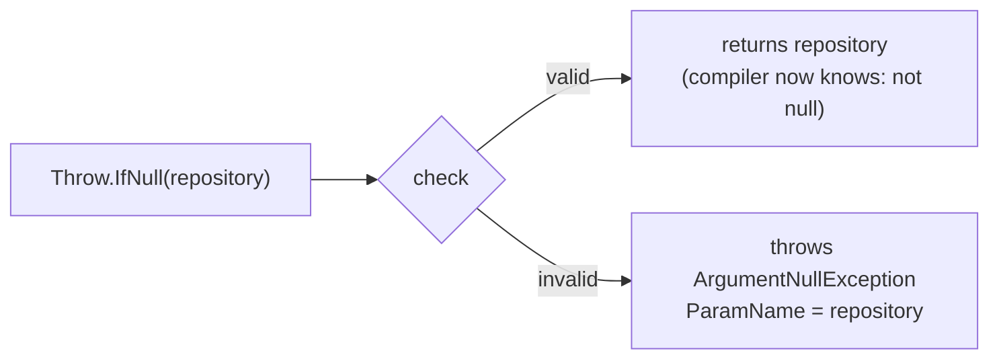

Open almost any service class in a mature .NET codebase and look at the constructor. More often
than not, the real work is three assignments, and in front of them sit fifteen lines of
`if (x == null) throw new ArgumentNullException(nameof(x));`. Every one of those lines is correct.
Together they bury the one thing a reader wants to know: *what does this class need?*

[Argument.Check](https://github.com/RenePeuser/Argument.Check) is my answer to that. It's a small
library ([NuGet](https://www.nuget.org/packages/Argument.Check)) with one static class, `Throw`, and
one idea: **a guard clause is a single line that checks, throws a standard exception with the right
parameter name, and hands the value back.** This post is the getting-started guide. The rest of the
series covers [the full catalogue of checks](/blog/2026-argument-check-the-throw-catalogue/), [what a
guard clause costs](/blog/2026-argument-check-what-a-guard-costs/) and [how it compares to the guards
built into .NET](/blog/2026-argument-check-vs-built-in-guards/).

## The "before": guard clauses that outweigh the code

Here's a constructor from a typical shop backend. Nothing in it is wrong:

```csharp
public sealed class InvoiceExporter
{
    private readonly IInvoiceRepository _repository;
    private readonly IPdfRenderer _renderer;
    private readonly DirectoryInfo _targetDirectory;
    private readonly string _companyName;
    private readonly int _batchSize;

    public InvoiceExporter(
        IInvoiceRepository repository,
        IPdfRenderer renderer,
        DirectoryInfo targetDirectory,
        string companyName,
        int batchSize)
    {
        if (repository == null)
        {
            throw new ArgumentNullException(nameof(repository));
        }

        if (renderer == null)
        {
            throw new ArgumentNullException(nameof(renderer));
        }

        if (targetDirectory == null)
        {
            throw new ArgumentNullException(nameof(targetDirectory));
        }

        if (!targetDirectory.Exists)
        {
            throw new ArgumentException(
                $"The directory '{targetDirectory.FullName}' does not exist.", nameof(targetDirectory));
        }

        if (string.IsNullOrWhiteSpace(companyName))
        {
            throw new ArgumentException("Company name must not be empty.", nameof(companyName));
        }

        if (batchSize < 1 || batchSize > 500)
        {
            throw new ArgumentOutOfRangeException(nameof(batchSize), batchSize, "Batch size must be 1–500.");
        }

        _repository = repository;
        _renderer = renderer;
        _targetDirectory = targetDirectory;
        _companyName = companyName;
        _batchSize = batchSize;
    }
}
```

That's 40 lines for five dependencies. And the cost isn't only length:

- **Every message is hand-written**, so every team member words them differently, and some
  forget the value that caused the failure.
- **Copy-paste drifts.** Duplicate the `renderer` block, rename the variable in the condition, forget
  the `nameof`, and the exception names the wrong parameter. The compiler is perfectly happy.
- **Checks and assignments are separate.** Nothing guarantees that the field you assign is the one
  you checked.

## The "after": one line per argument

The same constructor with Argument.Check:

```csharp
using Argument.Check;

public sealed class InvoiceExporter
{
    private readonly IInvoiceRepository _repository;
    private readonly IPdfRenderer _renderer;
    private readonly FileSystemInfo _targetDirectory;
    private readonly string _companyName;
    private readonly int _batchSize;

    public InvoiceExporter(
        IInvoiceRepository repository,
        IPdfRenderer renderer,
        DirectoryInfo targetDirectory,
        string companyName,
        int batchSize)
    {
        _repository = Throw.IfNull(repository);
        _renderer = Throw.IfNull(renderer);
        _targetDirectory = Throw.IfNotExists(targetDirectory);
        _companyName = Throw.IfNullOrWhiteSpace(companyName);
        _batchSize = Throw.IfOutOfRange(batchSize, 1, 500);
    }
}
```

Five dependencies, five lines. The check and the assignment are now the same statement, so they
can't drift apart. And each line reads like the rule it enforces: *throw if null*, *throw if it
doesn't exist*, *throw if it's out of range*.

:::note
`Throw.IfNotExists` returns a `FileSystemInfo`, because it works for files and directories alike.
That's why the field above is typed `FileSystemInfo`. If you need the `DirectoryInfo`, keep the
parameter and call the check as a statement: `Throw.IfNotExists(targetDirectory);`.
:::

Install it with:

```bash
dotnet add package Argument.Check
```

The package targets `netstandard2.0`, `netstandard2.1`, `net6.0` and `net8.0`, and it's marked
AOT-compatible on .NET 8. It runs on .NET Framework and Unity as well as on current .NET.

## What every `Throw.*` call does for you

Every helper in the library follows the same contract. Knowing it once is enough to use all of them.



### 1. The parameter name comes from your code, not from a string

Here's the complete implementation of `Throw.IfNull`, straight from the repository:

```csharp
public static T IfNull<T>([NotNull] T? argument,
                          [CallerArgumentExpression(nameof(argument))] string argumentName = "")
    where T : class
{
    if (argument is null)
    {
        throw new ArgumentNullException(argumentName);
    }

    return argument;
}
```

`[CallerArgumentExpression]` tells the compiler to pass the **source text of the argument** as
`argumentName`. You never type a name, so a rename can't leave a stale one behind. It also means the
name is a string constant baked in at compile time: no reflection, no stack walking, no `nameof`.

Because it captures the *expression*, not just an identifier, member access works too:

```csharp
Throw.IfNull(order.Customer);
// ArgumentNullException: Value cannot be null. (Parameter 'order.Customer')
```

In a log file, `order.Customer` tells you far more than a bare `order` would.

### 2. The exceptions are the standard ones

There's no `ArgumentCheckException` to catch. The library throws `ArgumentNullException`,
`ArgumentException` and `ArgumentOutOfRangeException`, with `ParamName` set. Existing `catch`
blocks, ProblemDetails mappings and test assertions keep working.

The messages include the offending value wherever that helps. These are real outputs:

```text
ArgumentOutOfRangeException: Value: '150' is not in expected range from '1' to '100'. (Parameter 'maxItems')
ArgumentException:           The file: 'C:\import\prices.json' does not exists. (Parameter 'file')
ArgumentException:           The argument 'CHF' is not contained in the enumeration. (Parameter 'currency')
```

### 3. It returns the checked value

Every helper returns its argument, which is what makes the one-line style possible. It also composes
with expression-bodied members and object initializers:

```csharp
public PriceList(IEnumerable<PriceEntry> entries) =>
    _entries = Throw.IfNullOrEmpty(entries).ToList();
```

### 4. Nullable analysis knows the value is safe afterwards

The `[NotNull]` attribute on the parameter tells the compiler's flow analysis that after
`Throw.IfNull(x)` returns, `x` isn't null. So the check removes the warning on the next line, even
when you call it as a statement:

```csharp
public void Export(Invoice? invoice)
{
    Throw.IfNull(invoice);

    _renderer.Render(invoice.Number);   // no CS8602 warning: the compiler knows invoice is not null
}
```

### 5. The debugger stops in your code, not in the guard

In release builds, every public method in the library carries `[DebuggerHidden]`. When a check
fails, Visual Studio and Rider break **on your line**, `_batchSize = Throw.IfOutOfRange(...)`, not
inside `Throw.IfOutOfRange`. The call stack looks as if you'd written the `throw` yourself.

The library doesn't rely on discipline for that. Its own test suite contains an architecture test
that parses the source with [Solution.Parser](https://github.com/RenePeuser/Solution.Parser) and fails
when a `Throw` method lacks the attribute:

```csharp
[TestMethod]
public void All_Methods_Must_Be_Decorated_With_The_DebuggerHidden_Attribute()
{
    var missingHiddenAttribute = from syntaxTree in SyntaxTrees
                                 from @class in syntaxTree.Classes
                                 where @class.Name.Contains("Throw")
                                 from method in @class.Methods
                                 where method.Attributes.All(a => a.Name.DoesNotContain("DebuggerHidden"))
                                 select new AnalyzeResult(syntaxTree.FileName, method.Name);

    Assert.IsFalse(missingHiddenAttribute.Any(), ToMessage(missingHiddenAttribute));
}
```

A sibling test checks that only `Throw.*` methods are public. Everything else is `internal`, so the
public surface stays exactly what this post describes.

## Not only for parameters

The name says "argument", but nothing restricts the checks to parameters. Results from calls are
just as good candidates, and `CallerArgumentExpression` names them correctly:

```csharp
public InvoiceExporter(IInvoiceRepository repository, IConfiguration configuration)
{
    _repository = Throw.IfNull(repository);

    var exportPath = configuration["Export:TargetDirectory"];
    Throw.IfNullOrWhiteSpace(exportPath);
    // ArgumentNullException: Value cannot be null. (Parameter 'exportPath')
}
```

That's a nicer failure at startup than a `NullReferenceException` twenty calls later.

## Where guard clauses belong

A guard library makes checks cheap to write. That's no reason to put them everywhere:

| Place | Guard? | Why |
| --- | --- | --- |
| Public constructors and methods of a library or shared package | **Yes** | You don't control the callers, and their compilers may not run nullable analysis. |
| Constructors of DI-registered services | **Yes, briefly** | One line per dependency documents what's required and fails fast at startup. |
| Configuration and options values at startup | **Yes** | Turns a misconfiguration into a clear message instead of a late crash. |
| `private` methods called from already-checked code | No | You'd check the same value twice. Nullable reference types cover this. |
| Validating user input in an API | **No** | Bad input is an expected case and should become a 400 with details, not an exception. Use validation (e.g. FluentValidation) for that. |

The last row matters most. Guard clauses protect your code against **programming errors**. They're
not a validation framework for business rules.

## Pitfalls

**Don't pass the name yourself.** `argumentName` is an optional parameter only so the compiler can
fill it in. `Throw.IfNull(customer, "customer")` compiles, and the next rename will make it lie.

**`IfEmpty` is not `IfNullOrEmpty`.** `Throw.IfEmpty(name)` checks for an empty string. If `name`
can also be null, it does throw, but with the helper's internal parameter name (`'argument'`),
not yours. When null is possible, use `IfNullOrEmpty` or `IfNullOrWhiteSpace`. More on this kind of
detail in [the catalogue post](/blog/2026-argument-check-the-throw-catalogue/).

**It needs a C# 10 compiler.** `CallerArgumentExpression` is a compiler feature. On older SDKs the
attribute is ignored and `argumentName` stays empty. Any SDK from .NET 6 on is fine, including when
you target .NET Framework.

## Summary

- Argument.Check turns a guard clause into **one line** that checks, throws a **standard exception**
  and **returns the value**, so checks and assignments can't drift apart.
- The parameter name comes from **`CallerArgumentExpression`**. It's a compile-time constant, survives
  renames and even reports member paths like `order.Customer`.
- `[NotNull]` feeds nullable analysis, and `[DebuggerHidden]` makes the debugger stop **at your call
  site**. An architecture test in the repo enforces the latter.
- Use guards at **trust boundaries**: public APIs, DI constructors, configuration. Keep user input
  validation separate.
- Next in the series: [the full catalogue of checks](/blog/2026-argument-check-the-throw-catalogue/)
  and the pitfalls hidden in a few of them. If you're curious how the library got here, the
  retrospective [Roslyn analyzers and argument checks](/blog/2017-roslyn-analyzers-and-argument-checks/)
  tells the story from 2017 to today.
