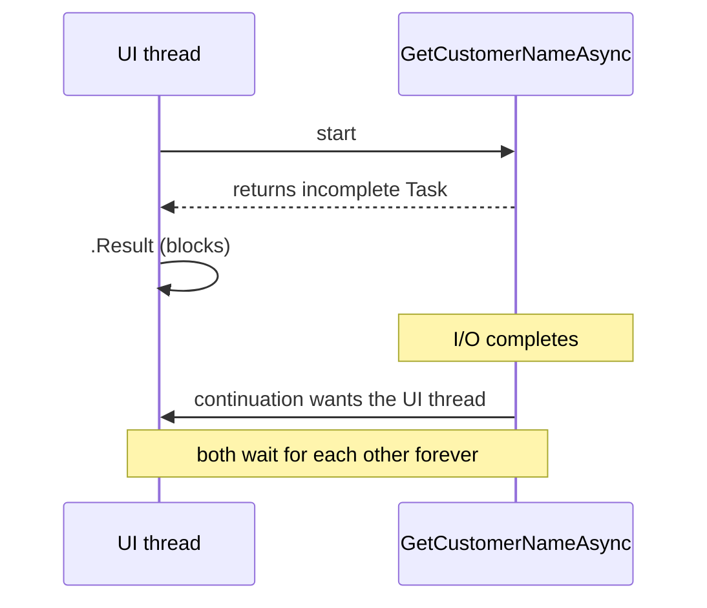

`async`/`await` is more than ten years old, and it's still the area where I find the most bugs in
code reviews. Not because people don't know the keywords. Because the broken version **compiles,
runs and usually works**. It fails under load, during shutdown, or only on the one machine that has a
synchronization context.

This post collects the six async mistakes I see most often, why each one hurts, and what to do
instead. At the end there's a list of analyzers that turn most of them into build warnings.

## Mistake 1: async void

```csharp
public async void SendConfirmation(Order order)   // fire and pray
{
    await mailer.SendAsync(order.CustomerEmail, "Thanks for your order!");
}
```

An `async void` method can't be awaited, so the caller has no idea when it's done. Worse: an exception
thrown inside it isn't stored in a `Task`. It's rethrown on the synchronization context, or on the
thread pool if there is none, and **an unhandled exception on the thread pool terminates the
process**. In an ASP.NET Core app that means one failing e-mail can take down the whole service.

The same bug hides in lambdas, where it's much harder to spot:

```csharp
orders.ForEach(async order => await mailer.SendAsync(order));    // Action<T> → async void
Parallel.ForEach(orders, async order => await ProcessAsync(order)); // same thing
```

`List<T>.ForEach` and `Parallel.ForEach` take an `Action<T>`. An async lambda passed to them becomes
`async void`. The loop "finishes" immediately, while the actual work runs unobserved in the
background.

**The rule:** `async void` is only for event handlers, where the signature is forced on you. Everything
else returns `Task` or `ValueTask`. For the loop cases, use `foreach` with `await`, or
`Parallel.ForEachAsync` if you want bounded parallelism (see mistake 4).

## Mistake 2: blocking with .Result, .Wait() and GetAwaiter().GetResult()

```csharp
public string GetCustomerName(int id)
{
    return GetCustomerNameAsync(id).Result;   // sync over async
}
```

In an app with a single-threaded synchronization context (WinForms, WPF, classic ASP.NET, Blazor), this
deadlocks. The calling thread blocks and waits for the task. The task can't finish because its
continuation wants to run on exactly that blocked thread.



"But we're on ASP.NET Core, there's no synchronization context." True, so there's no classic deadlock.
You still block a thread-pool thread for the whole duration of the I/O. Under load, enough blocked
threads cause **thread-pool starvation**: requests queue up, latency explodes, and the pool injects new
threads only slowly. It looks like the database is slow, when really your app can't schedule the
continuations.

`GetAwaiter().GetResult()` is often recommended as the "better" variant. It does throw the original
exception instead of wrapping it in an `AggregateException`, which makes stack traces nicer. It
blocks exactly the same way.

**The rule:** async all the way. If a method calls something async, it becomes async itself, up to the
entry point. `Main` can be `async Task<int>`, controllers and minimal API handlers can be async,
`BackgroundService.ExecuteAsync` is async. In 2026 there's almost no place left where you're forced to
block.

If you only pass a task through, you don't even need `async`:

```csharp
public Task<string> GetCustomerNameAsync(int id, CancellationToken ct) =>
    customers.GetNameAsync(id, ct);   // no state machine, no await needed
```

Be careful with this shortcut when there's a `using` or a `try` block around the call. Then the
resource is disposed before the task completes, and you need the `await` after all.

## Mistake 3: fire-and-forget

```csharp
app.MapPost("/orders", async (PlaceOrder cmd, OrderService orders, AuditService audit) =>
{
    var order = await orders.PlaceAsync(cmd);
    _ = audit.WriteAsync(order);   // "the user doesn't need to wait for this"
    return Results.Created($"/orders/{order.Id}", order);
});
```

Three things go wrong here:

1. **Exceptions disappear.** Nobody observes the task, so a failed audit write is silently lost.
2. **The scope is gone.** `AuditService` most likely depends on a scoped `DbContext`. The request
   finishes, the scope is disposed, and the background write runs against a disposed context. Sometimes.
   It depends on timing, which is the worst kind of bug.
3. **Shutdown kills it.** On deployment or scale-in, the host doesn't know about this work and won't
   wait for it.

If the work has to happen, hand it to something that owns it. A `Channel<T>` plus a `BackgroundService`
is the lightweight in-process option:

```csharp
public sealed class AuditQueue
{
    private readonly Channel<AuditEntry> _channel =
        Channel.CreateBounded<AuditEntry>(new BoundedChannelOptions(1_000)
        {
            FullMode = BoundedChannelFullMode.Wait
        });

    public ValueTask EnqueueAsync(AuditEntry entry, CancellationToken ct) =>
        _channel.Writer.WriteAsync(entry, ct);

    public IAsyncEnumerable<AuditEntry> ReadAllAsync(CancellationToken ct) =>
        _channel.Reader.ReadAllAsync(ct);
}

public sealed class AuditWorker(AuditQueue queue, IServiceScopeFactory scopes, ILogger<AuditWorker> logger)
    : BackgroundService
{
    protected override async Task ExecuteAsync(CancellationToken stoppingToken)
    {
        await foreach (var entry in queue.ReadAllAsync(stoppingToken))
        {
            try
            {
                await using var scope = scopes.CreateAsyncScope();   // own scope per item
                var audit = scope.ServiceProvider.GetRequiredService<AuditService>();
                await audit.WriteAsync(entry, stoppingToken);
            }
            catch (Exception ex) when (ex is not OperationCanceledException)
            {
                logger.LogError(ex, "Audit write failed for order {OrderId}", entry.OrderId);
            }
        }
    }
}
```

```csharp
builder.Services.AddSingleton<AuditQueue>();
builder.Services.AddHostedService<AuditWorker>();
```

The endpoint now awaits `EnqueueAsync`, which is cheap. Errors are logged, every item gets its own
scope, and the worker participates in graceful shutdown. If the work must survive a crash, an
in-process channel isn't enough. Then you need an outbox table or a real message broker.

## Mistake 4: Task.WhenAll used naively

`Task.WhenAll` is the right tool for independent I/O. A few details catch people out, though.

**Only the first exception is thrown.** `await Task.WhenAll(...)` rethrows the first exception. The
others are still there, in the `Exception` property of the returned task:

```csharp
var all = Task.WhenAll(tasks);
try
{
    await all;
}
catch
{
    foreach (var inner in all.Exception!.InnerExceptions)
        logger.LogError(inner, "Import step failed");
    throw;
}
```

**Unbounded fan-out.** `Task.WhenAll(ids.Select(id => client.GetAsync(id)))` with 5,000 IDs fires
5,000 requests at once. That's a load test against your downstream service, not an optimization. Use
bounded parallelism instead:

```csharp
await Parallel.ForEachAsync(productIds,
    new ParallelOptions { MaxDegreeOfParallelism = 8, CancellationToken = ct },
    async (id, token) =>
    {
        var product = await catalog.GetProductAsync(id, token);
        await index.UpdateAsync(product, token);
    });
```

**Shared non-thread-safe state.** A `DbContext` doesn't support concurrent operations. Two queries
started on the same context and awaited with `WhenAll` throw *"A second operation was started on this
context instance"*. Either run them sequentially, or give each one its own context
(`IDbContextFactory<T>`).

**async is not parallel.** `await`ing three calls one after the other is sequential. They only overlap
if you start them first and await them afterwards. Conversely, `async` doesn't help CPU-bound work at
all. For number crunching, use `Parallel.For` or PLINQ, and keep `async` for I/O.

Since .NET 9 there's also `Task.WhenEach`, which hands you tasks in completion order with
`await foreach`. That's handy when you want to process results as they arrive.

## Mistake 5: ValueTask treated like Task

`ValueTask<T>` avoids an allocation when the result is often available synchronously, for example on a
cache hit. The price is a set of rules that `Task` doesn't have. A `ValueTask` may be backed by a
pooled object that gets reused once it's consumed. So:

```csharp
var pending = cache.GetAsync(key);   // returns ValueTask<Product?>

var a = await pending;
var b = await pending;               // ❌ awaited twice: undefined behaviour

var c = cache.GetAsync(key).Result;  // ❌ blocking on an incomplete ValueTask is not allowed

var tasks = keys.Select(k => cache.GetAsync(k));
await Task.WhenAll(tasks);           // ❌ doesn't compile; and storing them is the same trap
```

**The rule:** consume a `ValueTask` exactly once, directly with `await`. If you need anything else
(awaiting twice, `WhenAll`, caching it), call `.AsTask()` once and work with that.

And don't return `ValueTask` "because it's faster". For methods that almost always do real I/O, it
gains nothing and makes the API harder to use correctly. `Task` is the default. `ValueTask` is for
measured hot paths.

## Mistake 6: Thread.Sleep in async code

```csharp
for (var attempt = 1; attempt <= 3; attempt++)
{
    if (await TrySyncAsync(ct)) break;
    Thread.Sleep(TimeSpan.FromSeconds(2));   // blocks a pool thread for 2 seconds
}
```

`Thread.Sleep` blocks the thread for the full duration, which is mistake 2 in disguise. `await
Task.Delay(TimeSpan.FromSeconds(2), ct)` frees the thread and can be cancelled. For retries against
remote services, don't write the loop at all. Use a resilience pipeline
(`Microsoft.Extensions.Resilience` / Polly v8) with backoff and jitter.

## Overview

| Pattern | Symptom | Use instead |
|---|---|---|
| `async void` | Crashes the process, work not awaited | `async Task` (event handlers excepted) |
| `.Result` / `.Wait()` | Deadlocks (UI), thread-pool starvation (server) | `await` all the way up |
| `_ = DoAsync()` | Lost exceptions, disposed scopes | `Channel<T>` + `BackgroundService`, outbox |
| `WhenAll` over thousands of calls | Overloaded downstream, swallowed errors | `Parallel.ForEachAsync` with a limit, inspect `InnerExceptions` |
| `ValueTask` awaited twice / stored | Random corruption | Await once, or `.AsTask()` |
| `Thread.Sleep` | Blocked threads | `Task.Delay`, resilience pipeline |

## Let the build catch it

These mistakes are mechanical, so let a tool find them:

- **CS4014** (built-in): a call to an async method isn't awaited. Treat it as an error.
- **CA2012** (built-in): `ValueTask` used incorrectly.
- **[Microsoft.VisualStudio.Threading.Analyzers](https://www.nuget.org/packages/Microsoft.VisualStudio.Threading.Analyzers)**:
  `VSTHRD100` (avoid `async void`), `VSTHRD101` (async lambdas passed as `void` delegates), `VSTHRD002`
  (synchronous waits), `VSTHRD103` (calling sync methods when an async overload exists), `VSTHRD110`
  (observe the result of async calls).
- **BannedApiAnalyzers** for `Thread.Sleep` in projects that should never block.

```ini
# .editorconfig
[*.cs]
dotnet_diagnostic.CS4014.severity = error
dotnet_diagnostic.CA2012.severity = error
dotnet_diagnostic.VSTHRD100.severity = error
dotnet_diagnostic.VSTHRD101.severity = error
dotnet_diagnostic.VSTHRD002.severity = warning
```

At runtime, thread-pool starvation is visible in `dotnet-counters monitor System.Runtime`: a steadily
growing **ThreadPool Queue Length** combined with a rising **ThreadPool Thread Count** almost always
means something is blocking. That's the counter I check first when a service gets slow under load
"for no reason".

## Summary

- **No `async void`** except for event handlers, and watch out for async lambdas passed to `Action<T>`.
- **Never block** on async code. On a UI it deadlocks, on a server it starves the thread pool.
- **No fire-and-forget.** Hand background work to a `BackgroundService` with its own scope, or to an outbox.
- **`Task.WhenAll`** rethrows only the first exception and doesn't limit concurrency. Use
  `Parallel.ForEachAsync` for large fan-outs.
- **`ValueTask`**: await exactly once, and only use it where it's been measured to help.
- **`Task.Delay`**, not `Thread.Sleep`.
- Turn on the **analyzers**. They know these rules better than any wiki page.
