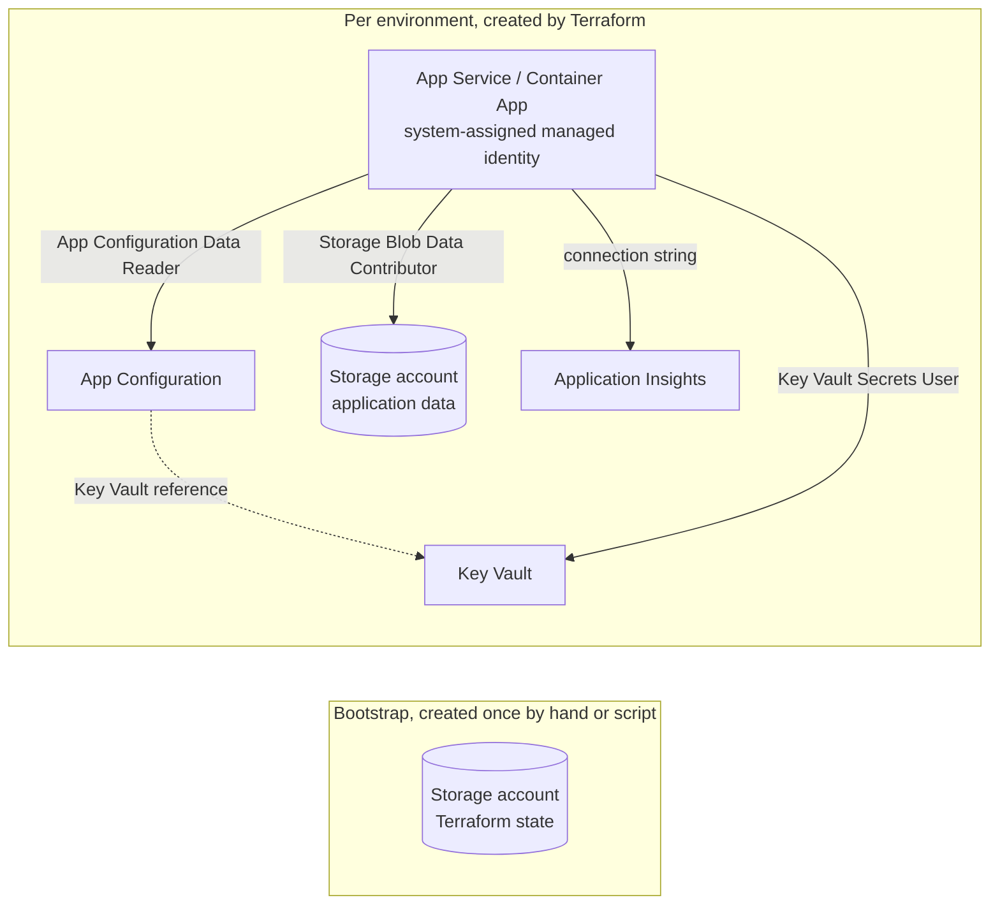

:::note[Series]
Part of the series [*Cloud, DevOps & observability*](/series/cloud-devops-observability/).
:::

The first week of a new service decides a lot. If secrets end up in pipeline variables, they stay there
for years. If the Terraform state shares a storage account with application data, someone will delete
the wrong container one day. If the first deployment happens after three months of coding, the first
deployment is a project of its own.

In one Azure organization I worked with, the team kept a "Setup 101" wiki page: a numbered list of
everything a new service needed before the first line of business code. It covered storage for
Terraform, pipeline libraries, service connections, Key Vault, App Configuration, Application Insights
and Redis. This post is my modernized version of the parts that matter most, because some of the
original advice (access keys, access policies, instrumentation keys, secrets in token-replaced app
settings) has aged.

## The target picture



Three rules hold the whole picture together:

1. **No secrets in pipelines or app settings.** The app authenticates with its **managed identity**.
2. **Configuration lives in App Configuration**, secrets in Key Vault, and App Configuration only
   *references* them.
3. **Terraform state is isolated** from everything the application touches.

## 0. Infra first: a walking skeleton

The original checklist had a step I'd put at the very top: before you write business code, deploy an
empty API with nothing but a health check, through the real pipeline, with the real Terraform, to every
environment.

```csharp
var builder = WebApplication.CreateBuilder(args);
builder.Services.AddHealthChecks();

var app = builder.Build();
app.MapHealthChecks("/health");
app.Run();
```

That's a day of work and it removes the biggest risk of the project: finding out in month three that
the service principal can't create role assignments, or that the naming convention collides with an
existing resource. Every following section gets added to that skeleton, one by one, and deployed each
time.

## 1. The storage account for Terraform state

Terraform can't create the storage account that holds its own state. That's the chicken-and-egg problem
behind the `ContainerNotFound` error in [Terraform errors I keep seeing](/blog/2026-terraform-errors-and-how-to-fix-them/).
So this one account is created once, by hand or with a small bootstrap script:

```bash
az group create -n rg-shop-tfstate -l westeurope

az storage account create -n stshoptfstate -g rg-shop-tfstate -l westeurope \
  --sku Standard_ZRS --kind StorageV2 \
  --min-tls-version TLS1_2 \
  --allow-blob-public-access false \
  --allow-shared-key-access false

az storage account blob-service-properties update -n stshoptfstate -g rg-shop-tfstate \
  --enable-versioning true --enable-delete-retention true --delete-retention-days 30

az storage container create -n tfstate --account-name stshoptfstate --auth-mode login
```

The rules for this account:

- **Use it for Terraform state only.** The original team's rule, and a good one: application data goes
  into a separate storage account managed by Terraform. Then nothing the app does can damage the state,
  and nobody with access to app data automatically has access to the state (which contains secrets in
  plain text).
- **No public blob access, no shared keys.** The original setup authenticated the backend with the
  storage **access key** from a pipeline variable. Use Entra ID instead: `use_azuread_auth = true` in the
  backend and the *Storage Blob Data Contributor* role for the pipeline identity.
- **Versioning and soft delete on.** If a state file is ever corrupted or deleted, you can restore the
  previous version in a minute.
- **Naming.** Storage account names are 3 to 24 characters, lowercase letters and digits only, and
  globally unique. The original convention filled spaces with `1` (`shop1orders1tf1dev`). That works, but
  I find plain concatenation easier to read (`stshopordtfdev`). Pick one and write it down.

```hcl
terraform {
  backend "azurerm" {
    resource_group_name  = "rg-shop-tfstate"
    storage_account_name = "stshoptfstate"
    container_name       = "tfstate"
    key                  = "orders-api-dev.tfstate"   # one key per service and environment
    use_azuread_auth     = true
  }
}
```

## 2. Key Vault: RBAC, not access policies

The original Terraform used Key Vault **access policies**. They still work, but Azure RBAC is the
recommended model: the same role assignment mechanism as everything else, auditable, and manageable at
scale.

```hcl
data "azurerm_client_config" "current" {}

resource "azurerm_key_vault" "main" {
  name                       = "kv-shop-orders-${var.environment}"   # 3-24 chars, globally unique
  location                   = azurerm_resource_group.main.location
  resource_group_name        = azurerm_resource_group.main.name
  tenant_id                  = data.azurerm_client_config.current.tenant_id
  sku_name                   = "standard"

  enable_rbac_authorization  = true   # named rbac_authorization_enabled in newer 4.x provider versions
  soft_delete_retention_days = 90
  purge_protection_enabled   = var.environment == "prod"
}

resource "azurerm_role_assignment" "api_reads_secrets" {
  scope                = azurerm_key_vault.main.id
  role_definition_name = "Key Vault Secrets User"
  principal_id         = azurerm_linux_web_app.api.identity[0].principal_id
}
```

Two notes:

- **Purge protection** prevents anyone (including an attacker with your credentials) from permanently
  deleting secrets during the retention period. Turn it on for production. Keep it off in dev if you
  regularly destroy and recreate environments, because a purge-protected vault name stays reserved.
- **The pipeline identity needs *Key Vault Secrets Officer*** if Terraform writes secrets into the vault.
  The app only ever needs *Secrets User*.

## 3. App Configuration with Key Vault references

The original setup had a long `app_settings` block in Terraform, with values like
`"#{Auth__ClientSecret}#"` replaced from a pipeline library at deploy time. That means every secret is
in the pipeline, in the Terraform state, and in the App Service configuration blade. Three copies, three
places to leak.

App Configuration fixes that. Plain settings live there directly. Secrets stay in Key Vault, and App
Configuration only stores a **reference**.

```hcl
resource "azurerm_app_configuration" "main" {
  name                = "appcs-shop-orders-${var.environment}"
  location            = azurerm_resource_group.main.location
  resource_group_name = azurerm_resource_group.main.name
  sku                 = "standard"
  local_auth_enabled  = false   # Entra ID only, no access keys
}

resource "azurerm_app_configuration_key" "catalog_url" {
  configuration_store_id = azurerm_app_configuration.main.id
  key                    = "Orders:Catalog:BaseUrl"
  label                  = var.environment
  value                  = "https://catalog.example.com/"
}

resource "azurerm_app_configuration_key" "payment_secret" {
  configuration_store_id = azurerm_app_configuration.main.id
  key                    = "Orders:Payment:ClientSecret"
  label                  = var.environment
  type                   = "vault"
  vault_key_reference    = azurerm_key_vault_secret.payment_client_secret.versionless_id
}

resource "azurerm_role_assignment" "api_reads_config" {
  scope                = azurerm_app_configuration.main.id
  role_definition_name = "App Configuration Data Reader"
  principal_id         = azurerm_linux_web_app.api.identity[0].principal_id
}
```

The application side:

```csharp
var credential = new DefaultAzureCredential();

builder.Configuration.AddAzureAppConfiguration(options =>
{
    options.Connect(new Uri(builder.Configuration["AppConfig:Endpoint"]!), credential)
           .Select("Orders:*", labelFilter: builder.Environment.EnvironmentName.ToLowerInvariant())
           .ConfigureKeyVault(kv => kv.SetCredential(credential))
           .ConfigureRefresh(refresh => refresh
               .Register("Orders:Sentinel", refreshAll: true)
               .SetRefreshInterval(TimeSpan.FromMinutes(5)));
});

builder.Services.AddAzureAppConfiguration();
builder.Services.AddOptions<PaymentOptions>().BindConfiguration("Orders:Payment").ValidateOnStart();

var app = builder.Build();
app.UseAzureAppConfiguration();   // enables the refresh middleware
```

The only app setting left in Terraform is the endpoint, which isn't a secret:

```hcl
app_settings = {
  "AppConfig__Endpoint"                   = azurerm_app_configuration.main.endpoint
  "APPLICATIONINSIGHTS_CONNECTION_STRING" = azurerm_application_insights.main.connection_string
}
```

What changes:

- **No secret ever passes through the pipeline.** Terraform creates the reference. The value is set in
  Key Vault (by Terraform from a secure source, or by a person with the right role).
- **Configuration changes without redeploying.** Update a key, then the sentinel, and all instances
  reload within the refresh interval.
- **One place to look** for "what's the configuration of prod?".
- **Locally**, `DefaultAzureCredential` uses your Visual Studio or Azure CLI login, so developers read
  the dev store with their own identity. No more secrets in `secrets.json` that were copied from a
  library.

## 4. Application Insights: connection string, not instrumentation key

The original setup passed `ApplicationInsights__InstrumentationKey` to the app. Instrumentation-key-only
ingestion has been retired. Use the **connection string**, which includes the regional ingestion
endpoint, and make the resource workspace-based:

```hcl
resource "azurerm_application_insights" "main" {
  name                = "appi-shop-orders-${var.environment}"
  location            = azurerm_resource_group.main.location
  resource_group_name = azurerm_resource_group.main.name
  workspace_id        = azurerm_log_analytics_workspace.main.id
  application_type    = "web"
}
```

`APPLICATIONINSIGHTS_CONNECTION_STRING` as an app setting is picked up automatically by both the classic
SDK and the Azure Monitor OpenTelemetry distro.

## 5. The application storage account

Separate from the state account, managed by Terraform, accessed by identity:

```hcl
resource "azurerm_storage_account" "data" {
  name                            = "stshoporders${var.environment}"
  resource_group_name             = azurerm_resource_group.main.name
  location                        = azurerm_resource_group.main.location
  account_tier                    = "Standard"
  account_replication_type        = "ZRS"
  min_tls_version                 = "TLS1_2"
  allow_nested_items_to_be_public = false
  shared_access_key_enabled       = false
}

resource "azurerm_role_assignment" "api_blob" {
  scope                = azurerm_storage_account.data.id
  role_definition_name = "Storage Blob Data Contributor"
  principal_id         = azurerm_linux_web_app.api.identity[0].principal_id
}
```

```csharp
builder.Services.AddAzureClients(clients =>
{
    clients.AddBlobServiceClient(new Uri(builder.Configuration["Orders:Storage:BlobEndpoint"]!));
    clients.UseCredential(new DefaultAzureCredential());
});
```

## Before and after

| Concern | Original setup | Modern setup |
|---|---|---|
| State backend auth | storage access key in a pipeline variable | `use_azuread_auth`, RBAC |
| State storage | dedicated account ✅ | dedicated account, versioning, no shared keys |
| Key Vault permissions | access policies | Azure RBAC roles |
| App secrets | pipeline library → token replacement → app settings | Key Vault, referenced from App Configuration |
| App authentication to Azure | keys and connection strings | managed identity |
| Telemetry | instrumentation key | connection string, workspace-based |
| Config changes | redeploy | sentinel refresh |

## Pitfalls

- **Role assignment propagation.** A fresh role assignment can take a few minutes to become effective.
  The first start after `terraform apply` may fail with 403. Retries or a short wait in the pipeline
  help. It's not a misconfiguration.
- **The deploying identity needs permission to assign roles.** *Contributor* can't create role
  assignments. The pipeline needs *User Access Administrator* or *Role Based Access Control
  Administrator* (ideally constrained to specific roles) on the resource group.
- **Free tier of App Configuration** has low request quotas and no SLA. Fine for dev, not for prod.
- **`DefaultAzureCredential` in production** tries several credential types in order. That's convenient
  locally and slow and surprising in production. Use `ManagedIdentityCredential` there, or set
  `AZURE_TOKEN_CREDENTIALS=prod` to restrict the chain.
- **Secrets in Terraform state.** Anything Terraform writes (including Key Vault secrets it creates) is
  in the state in plain text. Another reason the state account is locked down.

## How to check it

- Search your pipeline variables and Terraform for `Secret`, `Password`, `Key` and `ConnectionString`.
  Anything left that isn't an endpoint or a reference is a candidate to move.
- Azure Policy can enforce most of this: deny storage accounts with shared key access, deny Key Vaults
  without RBAC, deny App Configuration stores with local auth.
- Deploy the walking skeleton to a fresh subscription once in a while. If it doesn't come up from zero
  with one bootstrap script and one pipeline run, something manual has crept in.

## Summary

- Start with an **infra-first walking skeleton**: health check, pipeline, Terraform, all environments.
- A **dedicated, locked-down storage account** for Terraform state, with versioning and Entra ID auth.
- **Key Vault with RBAC** and **managed identities**: the app has no secrets to authenticate with.
- **App Configuration** for settings, **Key Vault references** for secrets, sentinel-based refresh.
- Application Insights via **connection string**. No secrets in pipeline libraries or app settings.
