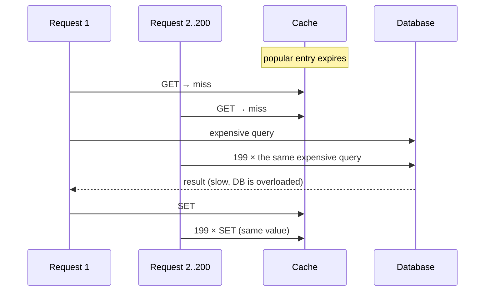

:::note[Series]
Part of the series [*Caching & data*](/series/caching-and-data/).
:::

In one codebase I worked on, a code review uncovered **four different caching interfaces**: one for
"secondary" caching, a generic Redis cache, a request cache and a caching service. None of them was
wrong. They had simply grown over the years, each one wrapping the previous one to stay compatible.
New developers had no way of knowing which one to use, so they picked the one they found first in
the code next to theirs.

The team's conclusion was short: **one interface, only the methods that are really needed.** This
post is about what that one interface should look like today, now that .NET has `HybridCache`, and
about the problem most hand-written caching layers ignore: the cache stampede.

## The "before": cache-aside, copy-pasted

This is cache-aside as it appears in most codebases, repeated in every service that caches
something:

```csharp
public async Task<ProductDto?> GetProductAsync(int tenantId, int productId, CancellationToken ct)
{
    var key = $"shop:tenant:{tenantId}:product:{productId}";

    var cached = await distributedCache.GetStringAsync(key, ct);
    if (cached is not null)
        return JsonSerializer.Deserialize<ProductDto>(cached);

    var product = await repository.GetProductAsync(tenantId, productId, ct);

    await distributedCache.SetStringAsync(key, JsonSerializer.Serialize(product),
        new DistributedCacheEntryOptions { AbsoluteExpirationRelativeToNow = TimeSpan.FromMinutes(10) }, ct);

    return product;
}
```

It works. It also has five problems that only show up later:

1. **It's duplicated** everywhere, and every copy differs slightly: one forgets the expiry, one uses
   a different serializer, one catches Redis exceptions and one doesn't.
2. **A `null` result is cached as `"null"`**, or not at all, depending on who wrote it.
3. **Every call goes over the network**, even for data that's read a thousand times per second and
   changes once a day.
4. **Redis down means the app is down**, because nothing handles the exception.
5. **The stampede.** When a popular entry expires, every concurrent request misses at the same time
   and every one of them goes to the database.

## The cache stampede

The fifth problem deserves a picture, because it's the one that turns a cache into a liability:



A cache exists so the database doesn't have to handle peak load. During a stampede, the database
gets **the peak load plus extra**, exactly when the cache was supposed to protect it. The fix is
**request coalescing**: for a given key, only one caller runs the factory, and everybody else waits
for its result.

Neither `IMemoryCache.GetOrCreateAsync` nor `IDistributedCache` does that. `GetOrCreateAsync`
on the memory cache looks atomic, but it isn't: concurrent callers all run the factory.

## The built-in options

| | `IMemoryCache` | `IDistributedCache` (Redis) | `HybridCache` (.NET 9+) |
|---|---|---|---|
| Where data lives | Process memory | Redis (or SQL, etc.) | Both: L1 in memory, L2 distributed |
| Speed | Nanoseconds | Network round trip + deserialization | L1 hit: nanoseconds |
| Shared across instances | ❌ | ✅ | ✅ (via L2) |
| Survives a deployment | ❌ | ✅ | ✅ (via L2) |
| API | Objects, `GetOrCreate` | `byte[]` / string only | Typed `GetOrCreateAsync` |
| Stampede protection | ❌ | ❌ | ✅ per key, per instance |
| Serialization | None (stores references) | Your problem | Built in, pluggable |
| Tag-based invalidation | ❌ | ❌ | ✅ `RemoveByTagAsync` |

`IMemoryCache` is unbeatable for small, hot, rarely changing data in a single instance. One team I
worked with used it deliberately for exactly two things, user-to-project access checks and secrets
from the vault, both for ten minutes, and only cached *positive* access results. Everything else
went to Redis.

`IDistributedCache` is the lowest common denominator: it gives you a shared store, and nothing else.

## HybridCache: the abstraction .NET was missing

`HybridCache` (package `Microsoft.Extensions.Caching.Hybrid`, generally available since 2025 and
usable from .NET 8 onwards) combines both levels behind one typed API and adds stampede protection.

```csharp
builder.Services.AddStackExchangeRedisCache(options =>
{
    options.Configuration = builder.Configuration.GetConnectionString("Redis");
    options.InstanceName = "shop:";                       // key prefix for every entry
});

builder.Services.AddHybridCache(options =>
{
    options.MaximumPayloadBytes = 1024 * 1024;            // larger entries are not cached (and logged)
    options.DefaultEntryOptions = new HybridCacheEntryOptions
    {
        Expiration = TimeSpan.FromMinutes(10),            // L2 (Redis)
        LocalCacheExpiration = TimeSpan.FromMinutes(1),   // L1 (memory), keep this short
    };
});
```

`AddHybridCache` picks up the registered `IDistributedCache` automatically as L2. Without one, it
works as an in-memory cache with stampede protection, which is already an improvement over
`IMemoryCache`.

The service from above shrinks to this:

```csharp
public sealed class ProductService(HybridCache cache, IProductRepository repository)
{
    public ValueTask<ProductDto?> GetProductAsync(int tenantId, int productId, CancellationToken ct) =>
        cache.GetOrCreateAsync(
            $"tenant:{tenantId}:product:{productId}",
            (repository, tenantId, productId),                                   // state, avoids a closure
            static (s, token) => new ValueTask<ProductDto?>(
                s.repository.GetProductAsync(s.tenantId, s.productId, token)),
            tags: [$"tenant:{tenantId}", $"product:{productId}"],
            cancellationToken: ct);

    public ValueTask InvalidateProductAsync(int productId, CancellationToken ct) =>
        cache.RemoveByTagAsync($"product:{productId}", ct);
}
```

What you get:

- **L1 hits** never touch the network.
- **Concurrent misses for the same key** on one instance run the factory once.
- **Serialization** is handled (System.Text.Json by default; plug in your own with
  `.AddSerializer<T, TSerializer>()`).
- **Tags** let you invalidate groups of entries without tracking keys yourself, which replaces the
  hand-written index sets from the [key conventions](/blog/2026-redis-key-conventions/) post for
  many cases.
- **Oversized payloads** above `MaximumPayloadBytes` simply aren't cached, instead of blowing up
  Redis.

## A thin abstraction on top

I still don't inject `HybridCache` everywhere. A small interface of my own gives me three things
`HybridCache` doesn't: a **"bypass the cache" switch**, **hit/miss information** for the response
and for metrics, and a **"should this be cached at all?"** rule.

The first two come straight from a pattern I've seen work well: every cached result carried a small
`CacheInfo` with "came from cache: yes/no" and the key, and every read accepted a `useCache` flag.
With `useCache: false` the factory always runs, and the **fresh result is written back** to the
cache. So the switch doubles as a manual refresh.

```csharp
public sealed record CacheResult<T>(T Value, bool FromCache, string Key);

public interface ICacheService
{
    ValueTask<CacheResult<T>> GetOrAddAsync<T>(
        string key,
        Func<CancellationToken, ValueTask<T>> factory,
        CacheOptions? options = null,
        CancellationToken ct = default);

    ValueTask InvalidateAsync(string tag, CancellationToken ct = default);
}

public sealed record CacheOptions(
    bool UseCache = true,
    TimeSpan? Expiration = null,
    IReadOnlyCollection<string>? Tags = null);
```

```csharp
public sealed class HybridCacheService(HybridCache cache, CacheMetrics metrics) : ICacheService
{
    public async ValueTask<CacheResult<T>> GetOrAddAsync<T>(
        string key, Func<CancellationToken, ValueTask<T>> factory,
        CacheOptions? options = null, CancellationToken ct = default)
    {
        options ??= new CacheOptions();
        var factoryCalled = false;

        var entryOptions = new HybridCacheEntryOptions
        {
            Expiration = options.Expiration,
            // useCache: false → skip both reads, but still write the fresh value
            Flags = options.UseCache
                ? HybridCacheEntryFlags.None
                : HybridCacheEntryFlags.DisableLocalCacheRead | HybridCacheEntryFlags.DisableDistributedCacheRead,
        };

        var value = await cache.GetOrCreateAsync(key, async token =>
        {
            factoryCalled = true;
            return await factory(token);
        }, entryOptions, options.Tags, ct);

        metrics.Record(hit: !factoryCalled);
        return new CacheResult<T>(value, FromCache: !factoryCalled, key);
    }

    public ValueTask InvalidateAsync(string tag, CancellationToken ct = default) =>
        cache.RemoveByTagAsync(tag, ct);
}
```

`FromCache` is slightly approximate: a caller that waited for *another* caller's factory reports a
hit. For metrics and debugging that's exactly the right answer, because that caller didn't cause
any load.

### "Only cache it if it's small enough"

One team I worked with had a list endpoint whose result size depended heavily on the filters. Most
results were small. A few were huge and ran into the per-item size limit of their managed Redis. The
proper fix would have been a redesign of the query. The quick fix that went live was a predicate:
**only write to the cache if the result has fewer than 1,000 items.**

`MaximumPayloadBytes` covers the byte-size version of that rule. If you need a rule based on the
content, you can build it with the flags. Read without running a factory, then decide:

```csharp
public async ValueTask<T> GetOrAddIfAsync<T>(
    string key, Func<CancellationToken, ValueTask<T>> factory, Func<T, bool> shouldCache, CancellationToken ct)
{
    var readOnly = new HybridCacheEntryOptions { Flags = HybridCacheEntryFlags.DisableUnderlyingData };
    var cached = await cache.GetOrCreateAsync<T?>(key, _ => default, readOnly, cancellationToken: ct);
    if (cached is not null) return cached;

    var value = await factory(ct);
    if (shouldCache(value))
        await cache.SetAsync(key, value, cancellationToken: ct);

    return value;
}

// usage
var page = await GetOrAddIfAsync(key, ct => repository.SearchAsync(query, ct), p => p.Items.Count < 1_000, ct);
```

You lose the stampede protection on this path, so keep it for the exceptions that need it, and treat
it as the quick fix it is.

## Pitfalls

**L1 is per instance, and nothing tells the other instances.** `RemoveAsync` and `RemoveByTagAsync`
clear the local cache of the instance that calls them, plus Redis. Other instances keep serving
their local copy until `LocalCacheExpiration` runs out. There's no built-in backplane. Keep L1 short
(seconds to a minute) for data that changes, or disable it per entry with
`HybridCacheEntryFlags.DisableLocalCache`. If you need cross-instance L1 invalidation, the open-source
[FusionCache](https://github.com/ZiggyCreatures/FusionCache) has a Redis backplane and a fail-safe
mode that serves stale data when the source is down.

**Stampede protection is per instance.** Ten instances can still run the factory ten times. That's
usually fine. If it isn't, you need a distributed lock, and you should ask whether a background
refresh would be the better design.

**Mutable cached objects.** `IMemoryCache` returns **the same instance** to every caller. One caller
modifying it changes it for everyone. `HybridCache` deserializes a fresh copy on every L1 hit by
default, which is safe but costs CPU. It reuses instances only for types that are `sealed` and marked
`[ImmutableObject(true)]`. Records with init-only properties are a good fit for that.

**Negative results.** Decide explicitly whether "not found" or "access denied" is cached, and for
how long. A pattern I've seen work: cache "access granted" for 15 minutes and "access denied" for 5.
Denied results are still cached, so a flood of requests for a resource someone can't access doesn't
hit the database every time, but a newly granted permission shows up quickly.

**Keys that miss an input.** Tenant, user, role, language, paging. If it changes the result, it
belongs in the key. See the [key conventions](/blog/2026-redis-key-conventions/) post.

**A public "bypass the cache" switch.** `useCache=false` as a query parameter is handy for debugging.
Exposed to everyone, it's an invitation to hit your database as hard as anyone likes. Restrict it to
administrators or internal callers.

**Redis outages.** `HybridCache` treats L2 failures as misses and logs them, so a Redis outage
degrades to "slower" instead of "down". If you write your own layer on top of `IDistributedCache`,
make sure you do the same.

## How to measure it

- **Hit ratio.** Count hits and misses with a `System.Diagnostics.Metrics.Counter<long>` in the
  wrapper (that's what `CacheMetrics` above does) and export it via OpenTelemetry. A hit ratio that
  suddenly drops after a deployment usually means a key changed.
- **Factory calls under concurrency.** A test proves the stampede protection on your setup:

```csharp
[TestMethod]
public async Task Concurrent_misses_run_the_factory_once()
{
    var services = new ServiceCollection();
    services.AddHybridCache();
    await using var provider = services.BuildServiceProvider();
    var cache = provider.GetRequiredService<HybridCache>();

    var calls = 0;
    var requests = Enumerable.Range(0, 50).Select(_ =>
        cache.GetOrCreateAsync("tenant:9:product:1", async ct =>
        {
            Interlocked.Increment(ref calls);
            await Task.Delay(100, ct);
            return new ProductDto(1, "Tent");
        }).AsTask());

    await Task.WhenAll(requests);

    Assert.AreEqual(1, calls);
}
```

- **Database load per request.** Dependency spans in OpenTelemetry or Application Insights show
  whether the cache actually removes database calls. If a cached endpoint still makes the same number
  of queries, the cache isn't doing what you think.

## Summary

- Many interfaces for caching is a smell. Aim for **one abstraction** with only the methods you need.
- Hand-written cache-aside is duplicated, inconsistent and **vulnerable to cache stampedes**.
- `IMemoryCache` is fast but local; `IDistributedCache` is shared but bare. **`HybridCache`**
  combines both, adds typed `GetOrCreateAsync`, stampede protection, tags and payload limits.
- A thin wrapper on top adds **`useCache` bypass with refresh**, **hit/miss info** and **conditional
  caching**.
- Keep **L1 short**, decide on **negative caching** explicitly, and measure the **hit ratio**.
