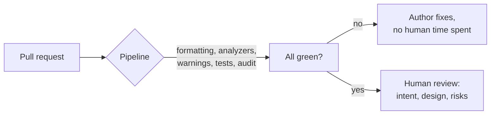

:::note[Series]
Part of the series [*Code quality & tooling*](/series/code-quality-and-tooling/).
:::

Every team I've worked with had a code review checklist somewhere. Usually it was a wiki page with a dozen
sections and fifty questions: "Are variable names descriptive?", "Is the code properly indented?", "Are edge
cases handled?". All correct, all generic, and in practice nobody opened it during a review.

The checklists that actually worked had three things in common: they said **why** we review, they said
explicitly what reviews are **not** for, and they were short because everything a machine could check was
already checked by a machine. This post is my version of that.

## Why we review

Before any checklist, a team should agree on what reviews are supposed to achieve. Mine:

1. **Increase software quality.** Catch defects, design problems and security issues before they're merged.
2. **Share knowledge, technical and domain.** After a review, at least two people understand the change. Reviews
   are the cheapest training program a team has.
3. **Encourage people to do their best work.** Knowing that a colleague will read your code with interest, not
   suspicion, is a strong intrinsic motivator.

## What reviews are not

Just as important, and the part most checklists leave out:

- **Not for blaming.** A bug found in review is a success, not an accusation.
- **Not for personal criticism.** Comments are about the code, never about the person.
- **Not for imposing your personal style.** If the code follows the team's conventions and best practices, the
  author's way of writing it is fine, even if you'd have written it differently. "I would have used a `switch`
  expression here" is not a review finding.
- **Not for things a tool can check.** Formatting, naming conventions, warnings, known vulnerable packages,
  failing tests. If a human has to comment on whitespace, the tooling is missing.

That last point changes what a checklist looks like.

## Split the checklist: machine vs. human



**The pipeline checks**, before a human looks at anything:

| Check | How | Post |
|---|---|---|
| Formatting and code style | `dotnet format --verify-no-changes`, `.editorconfig` | [Consistent formatting](/blog/2026-consistent-formatting-locally-and-in-ci/) |
| No warnings | `TreatWarningsAsErrors` | [Directory.Build.props](/blog/2026-directory-build-props/) |
| Analyzer findings | .NET analyzers, Roslynator | [Analyzers in CI](/blog/2026-roslynator-and-analyzers-in-ci/) |
| Vulnerable dependencies | NuGet audit | [NuGet audit](/blog/2026-nuget-audit-and-transitive-dependencies/) |
| Security patterns | CodeQL | [CodeQL best practices](/blog/2026-codeql-best-practices/) |
| Team-specific rules | architecture tests, custom analyzers | [Self-defending codebases](/blog/2026-self-defending-codebases/) |
| Tests pass | `dotnet test` | |

A human review only starts when that's green. Reviewer time is the most expensive resource in the process.
Don't spend it on things a build agent does for free.

## The human checklist

What's left is what tools can't judge. I keep it to these questions.

### 1. Do I understand what problem this solves?

If I can't tell from the PR title, description and linked work item what the change is supposed to achieve, the
review stops here. That's not pedantry: without knowing the intent, I can only review whether the code is
*pretty*, not whether it's *right*.

### 2. Do the tests describe the behaviour?

Not "are there tests" (coverage tools can tell you that), but: do the new tests describe the feature or the bug
in a way that someone reading them later understands what's expected? A bug fix without a test that fails before
the fix and passes after is incomplete.

### 3. Is every input validated and every call authorized?

At every boundary (controllers, minimal API endpoints, message handlers): is the incoming data validated, is the
caller authenticated, and is the caller allowed to access *this specific resource*? Resource-level authorization
("may this user see order 42?") is the one that's missing most often, because the endpoint-level `[Authorize]` looks
like it's enough.

### 4. Is shared state safe?

In ASP.NET Core, most services in a typical codebase are singletons. A singleton with mutable state is a race
condition waiting for load:

```csharp
public sealed class PriceCache(ICatalogClient catalog)   // registered as singleton
{
    private readonly Dictionary<int, decimal> _prices = new();   // ❌ not thread-safe

    public async Task<decimal> GetAsync(int productId, CancellationToken ct)
    {
        if (!_prices.TryGetValue(productId, out var price))
        {
            price = await catalog.GetPriceAsync(productId, ct);
            _prices[productId] = price;   // concurrent writes can corrupt the dictionary
        }
        return price;
    }
}
```

The fix might be a `ConcurrentDictionary`, `HybridCache` or no state at all. The review question is simply: **is
this service stateless, and if not, is the state safe for concurrent access?** The same goes for the
[HttpClient lifetime traps](/blog/2026-httpclient-you-are-using-it-wrong/), which also hide in singletons.

### 5. Is data access safe and efficient?

Two things to look for. First, injection: any SQL built with string concatenation or interpolation instead of
parameters.

```csharp
// ❌ injectable
var orders = await db.QueryAsync<Order>($"SELECT * FROM Orders WHERE CustomerName = '{name}'");

// ✅ parameterized
var orders = await db.QueryAsync<Order>(
    "SELECT * FROM Orders WHERE CustomerName = @name", new { name });
```

Second, repeated fetching: does the change load the same data that's already been loaded earlier in the request?
That's an N+1 problem across services, and it's invisible in a diff unless you look for it. I've written about
that in the [Request Context Builder post](/blog/2026-request-context-builder/).

### 6. Can I find my way around?

Is the code organized by domain first and technical layer second, like a city map where you find the "orders"
district before you look for the "services" street? Are classes and methods small enough that I don't have to read
everything to understand what one of them does? If I need the author to explain the structure to me, so will the
next person.

### 7. What happens when it fails?

Are errors handled where they can be handled, and propagated otherwise? Is there logging with enough context to
debug it in production? And for user-facing errors: does the message help the user help themselves, or at least
tell them what to tell support?

### 8. Is known debt made visible?

Sometimes a necessary refactoring can't happen in this PR. That's fine, as long as it's not silently forgotten: a
work item, linked from a comment at the exact spot in the code.

```csharp
// TECH-DEBT(#1234): replace with the bulk endpoint once catalog API v3 is live.
```

## How to give feedback

The checklist decides *what* to look at. How you say it decides whether the review helps or hurts.

- **Label your comments.** "nit:", "question:", "suggestion:" and "blocking:" make the weight clear. An author
  shouldn't have to guess which of fifteen comments must be addressed before merge.
- **Ask, don't tell.** "What happens if `customer` is null here?" leads to a better conversation than "this will
  crash".
- **Talk when it's big.** If a review turns up a fundamental issue, don't write an essay in the PR. A short call or a
  walkthrough with the author is faster and much friendlier.
- **Approve with comments.** If only nits are left, approve and trust the author to address them.
- **Review promptly.** A PR that waits two days for a first look costs more than any finding saves.

## Put the checklist where reviews happen

A checklist in a wiki is forgotten. A pull request template is in front of everyone, every time:

```markdown
<!-- .github/pull_request_template.md -->
## What and why
<!-- Which problem does this solve? Link the work item. -->

## How to verify
<!-- Tests added, manual steps, screenshots for UI changes -->

## Reviewer focus
- [ ] Tests describe the expected behaviour (bug fixes: test fails without the fix)
- [ ] Inputs validated, resource-level authorization checked
- [ ] Singletons are stateless or thread-safe
- [ ] SQL is parameterized, no repeated fetching of the same data
- [ ] Errors are handled and logged with context
- [ ] Known debt has a work item linked in the code
```

## Checklist styles compared

| | Generic 50-question wiki page | Short human checklist + automated gates | No checklist |
|---|---|---|---|
| Actually used during reviews | rarely | ✅ in the PR template | — |
| Reviewer time spent on mechanics | high | low | high |
| Consistent across reviewers | ❌ | ✅ | ❌ |
| Adapts to recurring findings | slowly | ✅ promote findings to rules | ❌ |

## Pitfalls

**Rubber-stamping.** Large PRs get approved faster than small ones, because nobody wants to read 1,500 lines.
Keep PRs small, and treat a huge PR as a finding in itself.

**The same comment, again and again.** If you write the same review comment for the third time, it shouldn't be a
comment any more. Turn it into an analyzer, an architecture test or an `.editorconfig` rule. That's the core idea of
[self-defending codebases](/blog/2026-self-defending-codebases/).

**Reviews as gatekeeping.** If one senior person has to approve everything, reviews become a bottleneck and a power
structure. Spread reviews across the team. That's how knowledge actually gets shared.

**Checklists that only grow.** Review the checklist itself every few months. Remove what tools now cover, add what
keeps slipping through.

## Measure the process

You don't need a dashboard, but a few numbers keep the process honest: **time to first review**, **PR size**, and
**which comments keep recurring**. The first two show whether reviews are a bottleneck. The third one is your backlog
of rules to automate.

## Summary

- Agree on **why** you review: quality, knowledge sharing, motivation.
- Say explicitly what reviews are **not** for: blame, personal criticism, personal style, and anything a tool can
  check.
- Let the **pipeline** handle formatting, warnings, analyzers, vulnerabilities and tests before a human looks.
- Keep the **human checklist short**: intent, tests, validation and authorization, shared state, data access, structure,
  failure handling, visible debt.
- **Label comments**, ask instead of tell, and talk when it's big.
- Put the checklist in the **PR template**, and turn recurring comments into **automated rules**.
