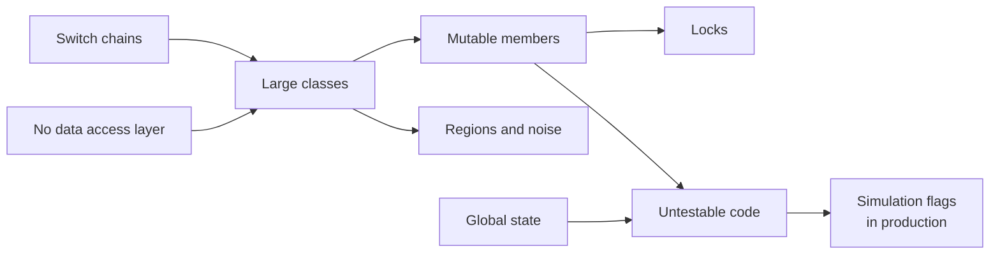

Most teams I've worked with had some kind of "problems and solutions" page in their wiki. Usually it
started as a good idea: someone collected the mistakes they kept seeing in reviews and wrote down what
to do instead. Then the page aged. The advice was written for an older .NET, some of the code samples
didn't compile, and a few recommendations (wrap everything in `Task.Run`, retry every failed HTTP
call) had turned from good intentions into bugs.

This series is my attempt at a version that holds up in 2026: the same practical
**problem → solution** format, but with modern C#, updated advice and an explanation of *why*
each smell hurts. This post is the index. Every row links to a post that goes into the details.

## Why smells matter

A smell isn't a bug. The code compiles, the tests pass, the feature ships. Smells are what make the
*next* change expensive: code that's hard to read, hard to test, unsafe under concurrency, or that
only works because everybody remembers an unwritten rule.

Clean code isn't a goal in itself. It's how you keep development cost down, onboard new people
quickly, refactor without fear and still enjoy working in a codebase after a few years. And one rule
sits above all others: **code is read far more often than it's written.** Optimize for the reader.

## The cheat sheet

### Async and concurrency

| Smell | Symptom | Fix | Details |
|---|---|---|---|
| Event- or callback-based APIs | Callback pyramids, no cancellation, lost exceptions | Wrap with `TaskCompletionSource<T>` and expose `async` methods | [Event-based APIs to tasks](/blog/2026-event-based-apis-to-tasks/) |
| `async void`, `.Result`, `Thread.Sleep`, fire-and-forget | Crashes, deadlocks, thread-pool starvation | `async` all the way, `Task.Delay`, background services | [async/await pitfalls](/blog/2026-async-await-pitfalls/) |
| `BlockingCollection<T>` / hand-written queues | Blocked threads, no backpressure, home-made race conditions | `System.Threading.Channels` | [Producer/consumer with channels](/blog/2026-producer-consumer-with-channels/) |
| Hundreds of raw events per second | UI freezes, CPU load, events processed one by one | Rx `Sample`/`Throttle`/`Buffer` or channels | [Taming high-frequency events](/blog/2026-taming-high-frequency-events/) |
| Returning `Task<IEnumerable<T>>` for streams | Everything loaded before the first item | `IAsyncEnumerable<T>` | [IAsyncEnumerable done right](/blog/2026-iasyncenumerable-done-right/) |
| Race conditions "fixed" with home-made locking | Deadlocks, rare corrupt state | Concurrent collections, `Channel<T>`, small owning types | [State is the enemy](/blog/2026-state-is-the-enemy/) |

### Design and state

| Smell | Symptom | Fix | Details |
|---|---|---|---|
| Global / static mutable state | Flaky tests, hidden dependencies | Pass values in, explicit dependencies, `TimeProvider` | [State is the enemy](/blog/2026-state-is-the-enemy/) |
| Mutable members | Order-dependent methods, races in singletons | Pure functions, records, `with` | [State is the enemy](/blog/2026-state-is-the-enemy/) |
| Large classes, locks in large classes | Low cohesion, ten-dependency constructors, deadlocks | Split by responsibility, composition | [State is the enemy](/blog/2026-state-is-the-enemy/) |
| Deep inheritance hierarchies | Behaviour spread over five base classes | Composition over inheritance | [State is the enemy](/blog/2026-state-is-the-enemy/) |
| Long `switch`/`if-else` chains on a type or mode | Every new case touches the same method | Strategy pattern, keyed services | [Replace switch chains with strategies](/blog/2026-replace-switch-chains-with-strategies/) |
| `out` parameters, `Try…` everywhere | Double checks, side effects, awkward async | Records, tuples, `Result` types | [Out parameters vs. result types](/blog/2026-out-parameters-vs-result-types/) |
| `null` returns and null checks everywhere | `NullReferenceException`, defensive noise | Null object pattern, nullable reference types | [Null object pattern and NRTs](/blog/2026-null-object-pattern-and-nullable-reference-types/), [Nullability warnings](/blog/2026-nullability-warnings/) |
| Objects initialized "later", before use | Half-constructed objects, `null` until `Init()` runs | Required constructor parameters, immutability | [Null object pattern and NRTs](/blog/2026-null-object-pattern-and-nullable-reference-types/) |
| Hand-rolled singletons, `Lazy<T>` misuse | Cached failures, thread-safety bugs | DI singletons, the right `LazyThreadSafetyMode` | [Lazy and singletons done right](/blog/2026-lazy-and-singletons-done-right/) |
| Everybody references everybody (A → B → C) | Tangled projects, impossible to replace parts | Dependency inversion, interfaces at the boundary, clear domains | [DI lifetimes and service registration](/blog/2026-di-lifetimes-and-service-registration/), [Vertical slices](/blog/2026-vertical-slices/) |

### Testability and production code

| Smell | Symptom | Fix | Details |
|---|---|---|---|
| `if (simulationMode)` in production code | Test paths shipped to customers, branches everywhere | Pick real or fake implementation at the composition root | [No simulation flags in production code](/blog/2026-no-simulation-flags-in-production-code/) |
| Test helpers in production assemblies | Test code deployed, accidental use in prod | Separate test projects and fakes | [No simulation flags in production code](/blog/2026-no-simulation-flags-in-production-code/) |
| Static methods with state, I/O without abstraction | Code can only be tested end to end | Interfaces where things must be replaceable, `TimeProvider`, file system abstractions | [State is the enemy](/blog/2026-state-is-the-enemy/) |

### Data access

| Smell | Symptom | Fix | Details |
|---|---|---|---|
| No data access layer, SQL everywhere | Drifting rules, persistence types in the UI | Repository for writes, query objects for reads | [Repository or query object?](/blog/2026-repository-vs-query-object/) |
| Business logic in the DAL or stored procedures | Rules bypassed by the next code path | Rules in the domain or handler, DAL only loads and saves | [Repository or query object?](/blog/2026-repository-vs-query-object/) |
| Untyped `DataSet`/`DataTable` | `object` everywhere, hard to mock, slow | Domain types, an O/R mapper or Dapper, explicit mapping | [Dapper in practice](/blog/2026-dapper-in-practice/), [Mapping as an anti-corruption layer](/blog/2026-mapping-as-anti-corruption-layer/) |
| Same data loaded several times per request | Needless round trips, inconsistent snapshots | Gather once, pass an immutable context | [Request Context Builder](/blog/2026-request-context-builder/) |

### Error handling, logging and resilience

| Smell | Symptom | Fix | Details |
|---|---|---|---|
| Empty `catch` blocks | Failures vanish silently | Catch what you can handle, let the rest bubble | [Exception handling best practices](/blog/2026-exception-handling-best-practices/) |
| Lots of logging to understand the flow | Log noise, the real error buried | Clean code, proper error handling, log centrally | [Error logging](/blog/2026-error-logging/) |
| Hand-written retry loops, retrying on 404 | Load on failing services, retries that can't succeed | Standard resilience handler, retry only transient errors | [HttpClient — you're using it wrong](/blog/2026-httpclient-you-are-using-it-wrong/) |

### Readability

| Smell | Symptom | Fix | Details |
|---|---|---|---|
| Obvious, empty or wrong comments | Readers skip all comments | Good names, comments explain *why* | [Code noise](/blog/2026-code-noise/) |
| `#region` everywhere, `partial` classes without a generator | Clicking before reading, hidden large classes | Smaller classes | [Code noise](/blog/2026-code-noise/) |
| Hungarian notation, prefixes, abbreviations (`var ret = co.Temp;`) | Decoding instead of reading | .NET naming conventions, full words | [Code noise](/blog/2026-code-noise/) |
| `for i` and `List.Add` in high-level code | Index noise, off-by-one, re-enumeration | LINQ, `yield return` | [Code noise](/blog/2026-code-noise/) |

### Build and reuse

| Smell | Symptom | Fix | Details |
|---|---|---|---|
| Shared code as checked-in DLLs | Unknown versions, no source, manual updates | Packages (NuGet, npm, container images), project references locally | [Creating NuGet packages](/blog/2026-creating-nuget-packages/), [Central package management](/blog/2026-central-package-management/) |
| Slow list processing | Long-running loops on big collections | Better algorithm first, then measure, `AsParallel()` only when it helps | — |

## How the smells connect

Many of these aren't independent. They feed each other:

That's why I usually start with the class that's too large. Splitting it by responsibility tends to
remove the regions, reduce the mutable state, shrink or remove the locks and make the pieces testable
without a `simulationMode` flag.

## Don't fight smells by hand

A cheat sheet is a good start for a discussion. It's a bad enforcement mechanism. Most rows above can
be checked automatically:

- **Compiler and analyzer warnings** for async misuse, nullability, naming, unused code and
  complexity. See [Roslynator and analyzers in CI](/blog/2026-roslynator-and-analyzers-in-ci/) and
  [consistent formatting locally and in CI](/blog/2026-consistent-formatting-locally-and-in-ci/).
- **Architecture tests** for boundaries like "only the persistence layer touches the `DbContext`" or
  "no test types in production assemblies".
- **Custom Roslyn rules** for what's specific to your team, as described in
  [self-defending codebases](/blog/2026-self-defending-codebases/).
- **The review checklist** for everything a tool can't judge: see the
  [code review checklist](/blog/2026-code-review-checklist/).

## Summary

- Smells don't break the build. They make the next change expensive.
- Old wiki advice deserves a second look. Some of it was written for a .NET that no longer exists.
- Use the tables above as a quick lookup during reviews, and follow the links for the reasoning.
- Large classes and shared mutable state are at the root of many other smells. Fix those first.
- Turn as many rules as possible into analyzers and tests, so the codebase enforces them instead of
  people.
