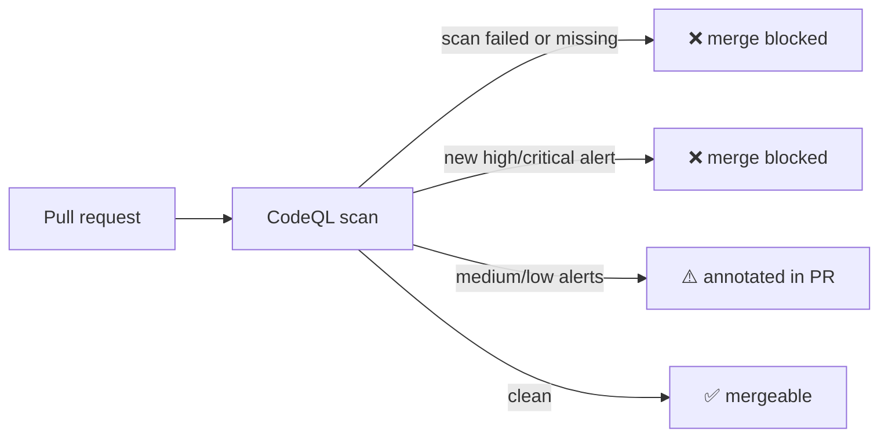

:::note[Series]
Part of the series [*Code quality & tooling*](/series/code-quality-and-tooling/).
:::

Turning on CodeQL in a GitHub repository takes about two minutes. That's both its biggest strength and its
biggest problem. In many organizations I've seen, CodeQL is "enabled" in the sense that a workflow file exists.
Whether it runs on every PR, whether anyone reads the alerts, and whether a high-severity finding can be merged
anyway is a different question.

In one setup I worked with, PR security scanning had quietly **stopped working altogether** on the self-hosted
Windows runners. The workflow failed while downloading the CodeQL bundle, and because the check wasn't required,
PRs kept being merged without anyone noticing that no scan was happening.

This post covers how I set up CodeQL for .NET repositories so that it's fast, consistent, and an actual gate.

## What CodeQL is (and isn't)

CodeQL turns your code into a database and runs queries against it that look for vulnerability patterns: SQL
injection, path traversal, unsafe deserialization, missing validation of redirect targets, insecure cryptography,
and many more. Its strength is **data-flow analysis**: it can follow user input from a controller parameter through
several method calls to the point where it ends up in a SQL string.

It complements, not replaces, the other layers:

| | Roslyn analyzers | CodeQL | NuGet audit / Dependabot |
|---|---|---|---|
| Finds | code smells, correctness, style, some security | vulnerability patterns with data flow across methods and files | known vulnerable packages |
| Runs | every build, in the IDE | in CI, minutes per scan | every restore |
| Feedback speed | as you type | per PR | per restore / per advisory |
| Covers your own code | ✅ | ✅ | ❌ |
| Covers dependencies | ❌ | ❌ | ✅ |

The analyzers are covered in [Roslynator and analyzers in CI](/blog/2026-roslynator-and-analyzers-in-ci/), the
dependencies in [NuGet audit](/blog/2026-nuget-audit-and-transitive-dependencies/). CodeQL is the layer in between.

## Principles

Before the YAML, the rules I apply to every repository:

1. **Scan on every pull request, every push to `main`, and on a schedule.** The schedule matters because the query
   packs get updated: new queries find old bugs in code nobody touches.
2. **Same workflow layout in every repository**, unless there's a documented reason. Consistency makes it
   reviewable and maintainable across dozens of repos.
3. **Keep it fast.** A scan that takes 30 minutes gets disabled. Scan only what you ship.
4. **Make results visible** in the PR, not only in a security tab nobody opens.
5. **Make it a required check.** A scan that may fail without consequence will eventually fail without anyone
   noticing.

## The workflow

GitHub's **default setup** (enabled in the repository settings, no YAML) is a good start for small repositories.
For anything that needs consistent configuration across repositories, I use the **advanced setup** with a workflow
file:

```yaml
# .github/workflows/codeql.yml
name: CodeQL

on:
  pull_request:
    branches: [main]
  push:
    branches: [main]
  schedule:
    - cron: '30 4 * * 1'   # weekly, picks up new queries

jobs:
  analyze:
    name: Analyze (${{ matrix.language }})
    runs-on: ubuntu-latest
    permissions:
      security-events: write   # upload results
      contents: read
      actions: read
      packages: read           # private query packs, if any

    strategy:
      fail-fast: false
      matrix:
        include:
          - language: csharp
            build-mode: none
          - language: actions
            build-mode: none

    steps:
      - uses: actions/checkout@v4

      - uses: github/codeql-action/init@v4
        with:
          languages: ${{ matrix.language }}
          build-mode: ${{ matrix.build-mode }}
          config-file: ./.github/codeql/codeql-config.yml

      - uses: github/codeql-action/analyze@v4
        with:
          category: "/language:${{ matrix.language }}"
```

Two choices worth explaining:

**`build-mode: none` for C#.** CodeQL can analyze C# without building it, by extracting the source directly. It's much
faster and doesn't break when the build needs secrets, private feeds or a specific SDK. For most ASP.NET Core services
it's what I'd start with. Switch to `manual` (with your own `dotnet build` step) only if you see missing results, for
example because a lot of relevant code is produced by source generators.

**`actions` as a language.** CodeQL also scans your GitHub Actions workflows for things like script injection through
untrusted PR titles. Your pipelines are code too, and they often hold the most powerful credentials in the repository.

### The configuration file

```yaml
# .github/codeql/codeql-config.yml
name: MyShop CodeQL config

queries:
  - uses: security-extended

paths-ignore:
  - '**/bin/**'
  - '**/obj/**'
  - '**/Migrations/**'
  - '**/*.g.cs'
  - '**/node_modules/**'
  - 'tests/**'
```

`security-extended` adds more security queries to the default set, at the cost of a few more false positives.
`security-and-quality` adds code quality queries on top. I go with `security-extended`: quality is better handled by
analyzers in the build, where the feedback is faster.

`paths-ignore` keeps generated code, build output, vendored dependencies and test code out of the scan. That reduces
noise and scan time. With `manual` builds, compiled languages are extracted from what the build actually compiles, so
check the docs for how `paths-ignore` behaves in that mode. (There's no `.codeqlignore` file, by the way, even though you'll find it recommended in some
internal docs. Exclusions belong in the config file.) Whether to exclude tests is a judgment call: test code isn't
deployed, but test helpers sometimes are copied into production code later.

## Making it a gate

A workflow that reports findings is information. A workflow that blocks merges is a gate. You need both pieces:

- **Require the CodeQL check** in a branch ruleset, so a PR can't merge if the scan **fails or doesn't run**. This is
  what would have caught the silent outage from the beginning.
- **Enable code scanning merge protection** in the ruleset, with a severity threshold. I block on **high and
  critical security alerts** and let everything below be visible but non-blocking.



High findings then have two ways forward: fix it, or **dismiss it with a reason** ("false positive", "used in tests",
"won't fix") in the alert itself. A dismissal is visible, attributed and auditable. That's very different from a
suppression comment buried in the code.

## The Windows self-hosted runner trap

Back to the outage. The failing step looked like this:

```
Unable to download and extract CodeQL CLI:
The process 'C:\Windows\system32\tar.exe' failed with exit code 1
```

The CodeQL action downloads its CLI bundle as an archive and extracts it with whatever `tar` it finds first on the
`PATH`. On those Windows runners, that was the `tar.exe` that ships with Windows, and it couldn't extract the bundle
used by the newer action. Self-hosted runners make this kind of thing more likely: custom `PATH` settings, missing
tools, and proxies that occasionally deliver truncated downloads.

The fix that worked: put the `tar` that comes with Git for Windows in front of the system one, before CodeQL
initializes.

```yaml
- name: Use Git's tar on Windows
  if: runner.os == 'Windows'
  shell: pwsh
  run: '"C:\Program Files\Git\usr\bin" | Out-File -FilePath $env:GITHUB_PATH -Append'
```

Pinning the action back to the previous major version also made the error go away, and that's what was done first. I'd
treat that only as a stopgap: older action versions get deprecated, and you don't want your security scanning to depend
on one. Better options, in order: fix the runner image so it has a compatible `tar`, or run the CodeQL job on a
GitHub-hosted Linux runner. With `build-mode: none`, C# analysis doesn't need your Windows build environment at all.

## Performance

- **`build-mode: none`** is the biggest lever for C#.
- **Exclude what you don't ship** via `paths-ignore`.
- **Only scan languages you use.** A JavaScript scan in a pure backend repository costs time and finds nothing.
- **Larger runners** for big solutions. CodeQL databases for large codebases need memory. If scans are slow or run out
  of memory on standard runners, a runner with more cores and RAM is cheaper than developers waiting.
- **Keep the tool cache on self-hosted runners**, so the CodeQL bundle isn't downloaded on every run. GitHub-hosted
  runners already have it cached.

## Pitfalls

**Not a required check.** Covered above, and the most common gap. If CodeQL can fail without blocking anything, you'll
find out it's broken months later.

**Suppressing instead of fixing.** Teach developers to read the alert (each one comes with an explanation and an example
fix) and fix the issue. Dismiss only with a real reason.

**Alert backlog on day one.** Enabling CodeQL on an old repository can produce dozens of alerts. Don't block all PRs on the
existing backlog. Merge protection applies to **new** alerts introduced by a PR. Triage the existing ones separately, by
severity, and make the backlog someone's job.

**Floating action versions.** Pin the action to a major version (`@v4`) at least, or to a commit SHA if your security
policy requires it, and let Dependabot keep it current.

**Assuming CodeQL covers everything.** It doesn't find vulnerable packages, misconfigured cloud resources or business logic
flaws like missing resource-level authorization. It's one layer, and the
[code review checklist](/blog/2026-code-review-checklist/) still matters.

## Keep an eye on it

- The **security overview** at organization level shows which repositories have code scanning enabled, which ones are
  failing, and how many open alerts each has. Check it regularly. A repository with zero alerts and no recent scan is a
  warning sign, not a success.
- Track **open high/critical alerts** and **time to fix** per team. Both should trend down.
- Re-check after **large refactorings or framework upgrades**, when code moves and new data flows appear.

## Summary

- CodeQL finds vulnerability patterns with **data-flow analysis**. It complements analyzers and NuGet audit.
- Scan on **PRs, pushes to `main` and a weekly schedule**, with the **same workflow** in every repository.
- For C#, use **`build-mode: none`**, add the **`actions`** language, and use **`security-extended`** with `paths-ignore`
  for generated code and build output.
- Make it a **required check** and enable **merge protection** for high and critical alerts. Dismiss with a reason, don't
  suppress.
- On **Windows self-hosted runners**, make sure a compatible `tar` comes first on the `PATH`, or move the scan to a Linux
  runner. Don't rely on pinning an old action version.
- Watch the **security overview** for repositories that stopped scanning.
