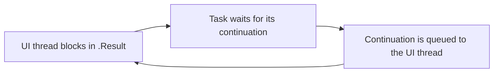

Few lines of C# cause as many review comments as `.ConfigureAwait(false)`. One reviewer asks for it on
every `await`. The next one says it's obsolete since ASP.NET Core. A third one adds it to "fix" a
deadlock, and the deadlock stays.

All three have a point, and all three are missing part of the picture. This post explains what
`ConfigureAwait(false)` really does, where it matters in 2026, where it's noise, and how to make the
decision once instead of in every pull request.

## What `await` does by default

When you `await` an incomplete task, the method returns to its caller, and the rest of the method
(the *continuation*) is scheduled to run once the task completes. The question is: **where** does the
continuation run?

By default, `await` captures the current `SynchronizationContext` (or, if there is none, the current
`TaskScheduler` if it isn't the default) and posts the continuation back to it.

- In **WinForms and WPF**, the context is the UI thread. That's why you can touch controls after an
  `await` without `Invoke`.
- In **classic ASP.NET** (System.Web), the context carried `HttpContext.Current` and allowed one thread
  at a time per request.
- In **Blazor**, the renderer has its own context, and component state may only be touched on it.
- In **ASP.NET Core, console apps, worker services and tests** with the usual runners, there is **no
  synchronization context**. Continuations run on any thread-pool thread.

`ConfigureAwait(false)` tells the awaiter: *don't capture the context, run the continuation wherever the
task completed.*

```csharp
public async Task<Invoice> LoadInvoiceAsync(int id, CancellationToken ct)
{
    var json = await http.GetStringAsync($"invoices/{id}", ct).ConfigureAwait(false);
    // from here on we're on a thread-pool thread, not on the caller's context
    return JsonSerializer.Deserialize<Invoice>(json)!;
}
```

## Why it was invented: the classic deadlock

The famous case is sync-over-async on a context with a single thread:

```csharp
// WPF button handler, written by someone in a hurry
private void OnRefreshClick(object sender, RoutedEventArgs e)
{
    var invoice = invoiceClient.LoadInvoiceAsync(42, CancellationToken.None).Result;  // blocks UI thread
    InvoiceView.DataContext = invoice;
}
```

If `LoadInvoiceAsync` awaits **without** `ConfigureAwait(false)`, its continuation wants to run on the UI
thread. The UI thread is blocked in `.Result`, waiting for that same continuation. Deadlock.



If the library uses `ConfigureAwait(false)` on **every** await, the continuations run on the thread
pool, the task completes, and `.Result` returns. The deadlock is gone, and the UI thread was still
frozen for the whole call. That's why I don't call `ConfigureAwait(false)` a deadlock *fix*. The fix is
not blocking (see [async/await pitfalls](/blog/2026-async-await-pitfalls/)). `ConfigureAwait(false)` in
a library is a protection against callers who block anyway.

## The rules of thumb

| Code runs in… | ConfigureAwait(false)? | Why |
|---|---|---|
| UI event handlers (WinForms, WPF, WinUI, MAUI) | **No** | You need the UI thread after the await |
| Blazor components | **No** | State changes and `StateHasChanged` must run on the renderer's context |
| Classic ASP.NET MVC / Web API actions | **No** | You need `HttpContext.Current` after the await |
| ASP.NET Core app code (controllers, handlers, services) | **Optional** | No synchronization context, so it changes nothing |
| Console apps, worker services | **Optional** | Same |
| **Libraries / NuGet packages** that may be used by any of the above | **Yes, on every await** | You don't know your caller's context |

The last row is the one that still matters in 2026. If you publish a library, someone will use it from
a WPF app or a legacy ASP.NET site, and someone will call `.Result` on it. Your library shouldn't be the
reason that deadlocks, and it shouldn't post hundreds of continuations to a busy UI thread for work
that has nothing to do with the UI.

### "Every await" really means every await

`ConfigureAwait(false)` only affects the one `await` it's attached to. And if the awaited task is
**already completed**, the method just continues synchronously on the current thread, and nothing
is switched at all.

```csharp
public async Task<Product> GetAsync(int id, CancellationToken ct)
{
    var cached = await cache.GetAsync(id, ct).ConfigureAwait(false);  // cache hit: completed synchronously
    if (cached is not null) return cached;

    return await db.LoadAsync(id, ct);   // ❌ still on the caller's context → can deadlock
}
```

The first `await` completed synchronously, so we're still on the UI thread. The second one captures it.
So "it's enough on the first await" is a myth. In library code, every `await` gets it.

## Why ASP.NET Core apps don't need it

ASP.NET Core has no `SynchronizationContext`. `HttpContext` is passed around explicitly, and request
state flows with `AsyncLocal` through the `ExecutionContext`, which `ConfigureAwait(false)` doesn't
affect. Adding it to application code in an ASP.NET Core app changes nothing at runtime.

It doesn't hurt either, apart from noise. The real cost is consistency: half the team adds it, the
other half doesn't, and every review becomes a discussion. Pick one rule per project and let a tool
enforce it.

My default:

- **Application projects** (APIs, workers, Blazor, UI apps): no `ConfigureAwait(false)` in app code.
- **Library projects**, including shared internal libraries that could end up in a UI or legacy app:
  `ConfigureAwait(false)` on every await, enforced by an analyzer.

:::caution[Don't hand-fix it]
In one codebase I worked on, the guideline said it plainly: since the call is optional in most places,
use an analyzer to add or remove it, and never fix it manually. That's exactly right. Manual edits
produce exactly the inconsistent half-and-half state that causes the review discussions in the first
place.
:::

## Not just Task: the other awaits

`ConfigureAwait` exists on more than `Task`:

```csharp
// async disposal
var connection = new SqlConnection(connectionString);
await using (connection.ConfigureAwait(false))
{
    await connection.OpenAsync(ct).ConfigureAwait(false);
    // ...
}

// async streams
await foreach (var order in orders.ReadAllAsync(ct).ConfigureAwait(false))
{
    // ...
}
```

For `await using` the syntax is clumsy, which is one more reason to keep `ConfigureAwait(false)` out
of application code where it buys nothing.

## New since .NET 8: ConfigureAwaitOptions

.NET 8 added an overload that takes flags instead of a bool:

```csharp
// await completion but don't throw (useful for "wait until the background task has stopped")
await backgroundTask.ConfigureAwait(ConfigureAwaitOptions.SuppressThrowing);

// always yield, even if the task is already complete
await task.ConfigureAwait(ConfigureAwaitOptions.ForceYielding);

// the classic behaviour, combined explicitly
await task.ConfigureAwait(ConfigureAwaitOptions.ContinueOnCapturedContext);
```

`ConfigureAwaitOptions.None` is the equivalent of `ConfigureAwait(false)`. `SuppressThrowing` is only
available on the non-generic `Task`, because there would be no result to return. It's a much cleaner way
to wait for a cancelled task than an empty `catch` block.

## Things ConfigureAwait(false) does not do

- **It doesn't make code run in the background.** The method still runs synchronously until the first
  incomplete await. If that part is expensive, use `Task.Run` explicitly, and only in apps, never in
  libraries.
- **It doesn't fix sync-over-async in your own app.** Your callers still block a thread.
- **It doesn't change `AsyncLocal` or the culture.** Those flow with the `ExecutionContext`, independent of
  the synchronization context.
- **It isn't faster in ASP.NET Core** in any meaningful way, because there's no context to capture.

## Enforce the decision

The built-in analyzer **CA2007** ("Do not directly await a Task") reports every `await` without
`ConfigureAwait`. Enable it only where it applies:

```ini
# .editorconfig at the solution root: off for applications
[*.cs]
dotnet_diagnostic.CA2007.severity = none
```

```ini
# src/Libraries/.editorconfig: on for everything below this folder
[*.cs]
dotnet_diagnostic.CA2007.severity = error
```

`.editorconfig` files are hierarchical, so the setting closer to the file wins. If your libraries and
apps aren't separated by folder, set the severity per project with a global analyzer config
(`<GlobalAnalyzerConfigFiles Include="libraries.globalconfig" />`) instead.

The IDE's code fix adds `ConfigureAwait(false)` for you, solution-wide. In application projects, remove
existing calls in one dedicated commit instead of mixing it into feature work. That keeps the diff
reviewable and ends the discussion for good.

If you really want it everywhere without the noise, there are IL weavers such as `ConfigureAwait.Fody`
that add it at build time. I prefer the analyzer: what you read in the source is what runs.

## Summary

- `ConfigureAwait(false)` means: **don't resume on the captured synchronization context.**
- It matters where a context exists: **UI frameworks, Blazor, classic ASP.NET**, and in **libraries** that
  might be called from those.
- In **ASP.NET Core app code** it changes nothing. Pick "never" for apps and stay consistent.
- In libraries, use it on **every** await. A synchronously completed first await doesn't protect the rest.
- It's a safety net for blocking callers, **not a deadlock fix**. The fix is not blocking.
- Since .NET 8, **`ConfigureAwaitOptions`** adds `SuppressThrowing` and `ForceYielding`.
- Let **CA2007** decide per project, not reviewers per pull request.
