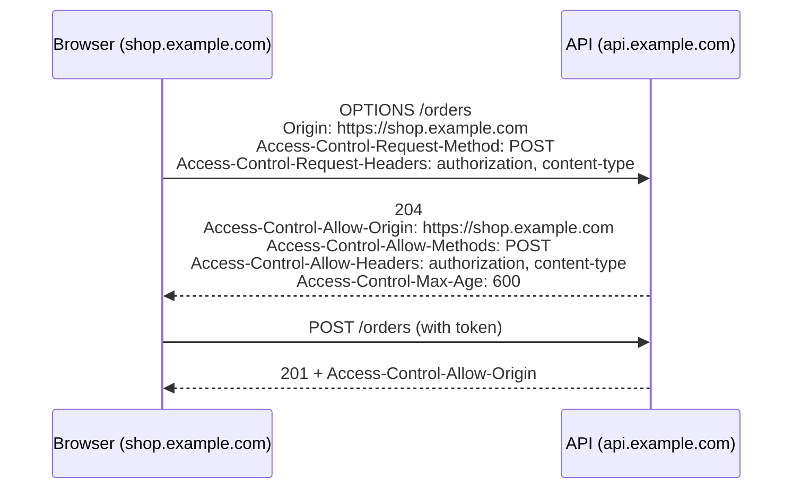

:::note[Series]
Part of the series [*ASP.NET Core from the ground up*](/series/aspnetcore-from-the-ground-up/).
:::

CORS is the topic where I've seen the most code written to solve a problem that the framework already
solves. In one codebase, the team had built a custom middleware that answered every `OPTIONS` request
by reflecting over the target controller, plus an `[HttpOptions]` attribute on every action. It
worked. It was also completely unnecessary, and the configuration next to it contained the single
most common CORS mistake there is.

Let's start with what CORS actually is, because most confusion comes from there.

## What CORS is (and isn't)

Browsers enforce the **same-origin policy**: JavaScript on `https://shop.example.com` may not read
responses from `https://api.example.com`, because the origins differ (scheme, host or port). CORS is
the mechanism by which the **API tells the browser** "this other origin may read my responses".

Three things follow from that:

- **CORS is not a security feature of your API.** It protects *users* from malicious websites using
  their browser session. `curl`, Postman and server-to-server calls ignore it completely.
- **CORS doesn't replace authentication.** An API that is "protected by CORS" is not protected.
- **CORS errors are reported by the browser, not the server.** The request often reaches your API
  and succeeds; the browser just refuses to hand the response to JavaScript.

## Simple requests and preflight

For "simple" requests (GET/HEAD/POST with only basic headers and form-like content types), the
browser sends the request directly with an `Origin` header and checks the response's
`Access-Control-Allow-Origin`.

Everything else gets a **preflight**: before the real request, the browser sends an `OPTIONS`
request asking for permission. A `POST` with `Content-Type: application/json` or an
`Authorization` header is **not** simple, so in a typical SPA almost every API call is preflighted.



Two important details:

1. **The preflight carries no credentials.** No `Authorization` header, no cookies. If your
   authentication middleware runs first and rejects it with 401, the browser reports a CORS error.
2. **The preflight is cacheable** via `Access-Control-Max-Age`. Without it, browsers repeat it often,
   doubling the request count for every API call.

## The setup

Settings first, because allowed origins differ per stage:

```csharp
public sealed class CorsOptions
{
    public const string SectionName = "Cors";

    [Required, MinLength(1)]
    public string[] AllowedOrigins { get; init; } = [];
}
```

```text
Cors__AllowedOrigins__0=https://shop.example.com
Cors__AllowedOrigins__1=https://admin.example.com
```

Then the policy:

```csharp
public static IServiceCollection AddApiCors(this IServiceCollection services, IConfiguration configuration)
{
    services.AddOptions<CorsOptions>()
            .BindConfiguration(CorsOptions.SectionName)
            .ValidateDataAnnotations()
            .ValidateOnStart();

    var origins = configuration.GetSection(CorsOptions.SectionName).Get<CorsOptions>()?.AllowedOrigins ?? [];

    services.AddCors(cors => cors.AddDefaultPolicy(policy => policy
        .WithOrigins(origins)
        .WithMethods("GET", "POST", "PUT", "PATCH", "DELETE")
        .WithHeaders("Authorization", "Content-Type", "X-Correlation-Id")
        .WithExposedHeaders("Location", "X-Correlation-Id")
        .SetPreflightMaxAge(TimeSpan.FromMinutes(10))));

    return services;
}
```

And the middleware, **before authentication**:

```csharp
app.UseCors();
app.UseAuthentication();
app.UseAuthorization();
```

That's it. The CORS middleware recognizes preflight requests, answers them with the right headers
and short-circuits the pipeline, so they never reach authentication or your endpoints. No
`[HttpOptions]` attributes, no custom middleware.

:::tip[Why the custom OPTIONS middleware wasn't needed]
The idea behind it was to return only the HTTP methods the target route really supports. But the
`Access-Control-Allow-Methods` header doesn't need to be that precise: if the browser is told "POST
is allowed" for a route that only has GET, the real request gets a 405 from routing. The policy
describes what the browser may *try*; routing and authorization still decide what *works*.
:::

## The classic mistake: wildcard plus credentials

The configuration I mentioned at the beginning looked like this:

```json
{
  "Cors": {
    "Origins": "*",
    "AllowCredentials": true
  }
}
```

The CORS specification forbids `Access-Control-Allow-Origin: *` together with
`Access-Control-Allow-Credentials: true`. Browsers reject that combination. In ASP.NET Core,
`AllowAnyOrigin().AllowCredentials()` throws at startup for the same reason.

Hand-written middleware doesn't throw, it just sends the invalid headers. What people then do is
"fix" it by **echoing back whatever `Origin` the request sent**. That passes the browser check and
means *any* website can make credentialed requests on behalf of your users. That's worse than no CORS
at all.

Do you even need credentials? `AllowCredentials` is about **cookies and HTTP authentication**. A SPA
that sends a bearer token in the `Authorization` header doesn't need it. Leave it off unless you use
cookie authentication.

## Per-endpoint policies

Global CORS is right for most APIs. If one endpoint group serves a different set of clients, use a
named policy:

```csharp
services.AddCors(cors => cors.AddPolicy("partners", p => p.WithOrigins("https://partners.example.com")
                                                         .WithMethods("GET")
                                                         .WithHeaders("Authorization")));

app.MapGroup("/partner-feed").RequireCors("partners");
```

One team I worked with explicitly decided against per-route CORS and handled the "who may call this
endpoint" question with scopes instead. I agree with that. CORS restricts browsers, scopes restrict
clients. Don't use the weaker tool for the stronger job.

## When the platform does CORS too

This one costs hours. Azure App Service has its own CORS setting, and API gateways (Azure API
Management, AWS API Gateway, nginx) often have one as well. If the platform handles CORS, it may
answer preflights itself and **your app's CORS configuration has no effect**, or both add headers and
the browser rejects the duplicated `Access-Control-Allow-Origin`.

Pick **one** place. I prefer the app, because the configuration is versioned with the code and works
the same locally. If a gateway sits in front, either let it pass `OPTIONS` through or configure CORS
only there.

## Pitfalls

**Trailing slashes.** `https://shop.example.com/` doesn't match the origin `https://shop.example.com`.
Origins never have a path.

**`SetIsOriginAllowed(_ => true)`.** Same as echoing every origin. If you need wildcard subdomains,
use `SetIsOriginAllowedToAllowWildcardSubdomains()` with an explicit `https://*.example.com`.

**Exceptions without CORS headers.** If an error response is produced by middleware that runs
*before* `UseCors`, it has no CORS headers, and the browser shows a CORS error instead of your
ProblemDetails. Keep the exception handler first, but make sure CORS runs before anything that can
short-circuit.

**Missing exposed headers.** JavaScript can only read a few response headers by default. `Location`
after a `201 Created` or a correlation ID need `WithExposedHeaders`.

## How to test it

CORS is easy to verify with an integration test, no browser needed:

```csharp
[TestMethod]
public async Task Preflight_from_allowed_origin_is_answered_without_authentication()
{
    using var client = factory.CreateClient();
    using var request = new HttpRequestMessage(HttpMethod.Options, "/orders");
    request.Headers.Add("Origin", "https://shop.example.com");
    request.Headers.Add("Access-Control-Request-Method", "POST");
    request.Headers.Add("Access-Control-Request-Headers", "authorization,content-type");

    var response = await client.SendAsync(request);

    Assert.AreEqual(HttpStatusCode.NoContent, response.StatusCode);
    Assert.AreEqual("https://shop.example.com",
        response.Headers.GetValues("Access-Control-Allow-Origin").Single());
}
```

Add a second test with an unknown origin that asserts the header is **absent**. Those two tests
catch the wrong middleware order, a wildcard that slipped in, and a broken stage configuration.

## Summary

- CORS lets **browsers** read cross-origin responses. It's not authentication and doesn't protect
  your API from non-browser clients.
- Almost every SPA call is **preflighted**. Preflights carry **no credentials**, so `UseCors()` goes
  **before** authentication.
- Use the built-in **CORS middleware**; it answers preflights for you. No custom OPTIONS handling.
- **Never** combine a wildcard (or an echoed origin) with credentials. Bearer tokens don't need
  `AllowCredentials`.
- Configure origins **per stage**, set **`SetPreflightMaxAge`**, and configure CORS in **one place**
  only, not in the app and the platform.

*Previous: [Authentication basics with JWT bearer tokens](/blog/2026-jwt-bearer-authentication-basics/) ·
Next: [Security filters](/blog/2026-security-filters/)*
