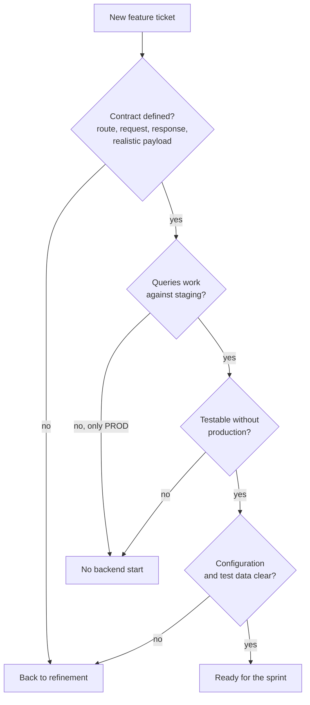

:::note[Series]
Part of the series [*Scrum in the real world*](/series/scrum-in-the-real-world/).
:::

Most of this series is about a project with six Scrum teams. This post takes one practice from a
different project, because it fills a gap the others leave open. Everyone talks about the Definition of
Done. Far fewer teams have a **Definition of Ready**: the checklist that says when a piece of work is
clear enough to start.

In that project, a backend team kept running into the same situation. A new feature started, and the
ticket simply didn't contain enough information, and the developers had to chase answers instead of
building. So the team agreed on a checklist: no backend development starts
before these points are clarified.

## The problem: starting with a title and good intentions

A ticket that says "Order volume summary for the report" sounds clear in a meeting. Then the developer
opens it and the questions start:

- Which URL? Which version?
- What does the request look like? Which filters are allowed?
- What exactly comes back?
- Where does the data come from? Does the query exist? Does it work on the test system?
- How do I test it? With which shop, which data, which configuration?

Each of these questions costs a round trip to someone who may be busy, on holiday or in another time
zone. Each answer can change the design. And a few of them, especially the last two, can turn out to have
no good answer at all.

## The checklist

Here's the checklist, translated into a neutral shop domain. For each point, a short example shows what
"ready" looks like.

### 1. The URL is specified

The route, including version and parameters, is agreed before development starts:

```csharp
[HttpPost("v{version:apiVersion}/shops/{shopId}/reports/{reportId}/summary/order-volume")]
```

This sounds trivial, but routes are part of the contract with the frontend and other consumers. Changing
them later means changing several teams' code.

### 2. The request payload is defined

```csharp
public sealed record OrderVolumeRequest
{
    public IImmutableList<FilterDto> FilterValues { get; init; } = [];
    public long? CampaignId { get; init; }
}
```

### 3. Realistic example payloads exist

Not just the shape, but **real example values** as JSON:

```json
{
  "filterValues": [
    {
      "id": 1201,
      "filterGroupId": 1200,
      "filterType": "SingleSelect",
      "values": [
        { "value": "4711", "label": "Spring sale", "column": "CampaignId", "isSelected": true }
      ]
    }
  ]
}
```

This point came from painful experience. Again and again, tests ran with **empty filters**, everything
looked fine, and nothing worked once real filters arrived, because there was no realistic use case to
test against. An empty filter list exercises almost none of the logic.

### 4. The response is defined

```csharp
public sealed record OrderVolumeResponse(
    long CampaignId,
    string Report,
    IImmutableList<OrderVolumeEntry> Entries);
```

### 5. The SQL exists and works against staging with realistic data

Depending on the feature, the queries can be developed in parallel. But they have to **run against the
staging environment with realistic data**. That was very important in this team, because parts of the code
were generated from the queries.

And then the hard rule: **if the SQL only works against production, the backend development doesn't
start.**

### 6. It's clear how the feature will be tested

- **Which test entity is used?** In the example: which shop and which report?
- **Can it be set up in code**, with its complete configuration, as part of the test? If not, is there an
  existing one that is fully configured?
- **Do we need production to test it?** If yes, automated tests aren't possible, and that has to be avoided.

The rule behind that last point: **features that can't be tested against staging can't go live**. No
tests, no guarantee that anything works.

### 7. The configuration is clear

- The configuration of the entity under test (the shop, in our example) is clear.
- The connection to the data source points to the correct database.
- All required resources are defined and set up.

## The checklist as a template

Here's the whole thing in a form you can paste into a ticket template:

| # | Ready when… | ✔ |
|---|---|---|
| 1 | Route, including version and parameters, is specified | ☐ |
| 2 | Request payload is defined | ☐ |
| 3 | At least one **realistic** example payload exists (no empty filters) | ☐ |
| 4 | Response is defined | ☐ |
| 5 | Queries exist (or are developed in parallel) and **run against staging with realistic data** | ☐ |
| 6 | Test entity is known, and it can be set up in code or already exists fully configured | ☐ |
| 7 | Testing doesn't require production | ☐ |
| 8 | Configuration, data source connection and resources are set up | ☐ |

Points 5 and 7 are **blockers**. If either isn't met, the work doesn't start.



## Why "no staging, no start" is the important rule

It's the rule people push back on the most. "The data only exists in production, we'll just test it there
carefully." It's also the rule that pays off the most:

- **Without staging, there are no automated tests.** Every change after go-live is a manual risk.
- **Without automated tests, there's no warranty.** You can't prove the feature works today, let alone
  after the next refactoring.
- **Testing in production has side effects.** Test data ends up in real reports, real customers see it, or
  you're too careful to test the interesting cases.

The rule forces the problem to be solved where it belongs: in the test data and environment setup, before
development, instead of in a late-night production check after go-live.

## And in the six-team project?

There, we never called it a Definition of Ready, but we had one in practice. A story could only go into
the sprint if certain things were in place by planning at the latest: the required fields in the work
tracker, including description and acceptance criteria, an effort estimate from refinement, all tasks set
up, and the test case already written, with "create test case" and "execute test case" tasks attached. It's
less technical than the backend checklist above, but the idea is the same: **clarify before you commit.**

## Definition of Ready vs. no Definition of Ready

| | No DoR | With a DoR |
|---|---|---|
| First sprint days spent | chasing information | building |
| Tests with realistic data | ⚠️ often empty filters | ✅ required up front |
| Features only testable in production | slip through | blocked before development |
| Risk of the DoR becoming a gate | none | ⚠️ real, see below |
| Contract changes late in the sprint | frequent | rare |

## Pitfalls

**The DoR becomes a bureaucratic gate.** A Definition of Ready shouldn't be used to reject work on
technicalities. It's a list of questions to answer together in refinement, not a form someone else has to
fill in perfectly.

**Everything must be 100 % specified.** Agile work is about learning during development. The DoR covers
what's needed to *start* responsibly, not every detail.

**The checklist is generic.** "Requirements are clear" helps nobody. The value of this checklist comes from
being concrete: routes, payloads, staging, test data. Write yours from your own recurring problems.

**Nobody owns the open points.** If a point isn't met, someone has to get it done before the sprint. Assign
it in refinement, not at the planning table.

## How to introduce it

1. Look at the last few features that started badly. What was missing on day one?
2. Turn each recurring gap into one checklist item, as concrete as possible.
3. Put the checklist into the ticket template, so it's there when a feature is created.
4. Go through it in refinement. Open points get an owner.
5. Mark the true blockers, like "works against staging", and stick to them.
6. Revisit the list in a retro after a few sprints. Drop what never helps, add what keeps hurting.

## Summary

- A **Definition of Ready** says when work is clear enough to start. It's the counterpart to the
  Definition of Done.
- Our backend checklist: route, request, **realistic example payloads**, response, queries that **work
  against staging**, a clear test setup and configuration.
- Hard rules: **if it only works against production, development doesn't start**, and **what can't be
  tested against staging doesn't go live**.
- Even without the name, a lightweight DoR (required fields, estimate, tasks and test cases before
  planning) makes a big difference.
- Keep it concrete, derived from your own recurring problems, and don't let it become a bureaucratic gate.
