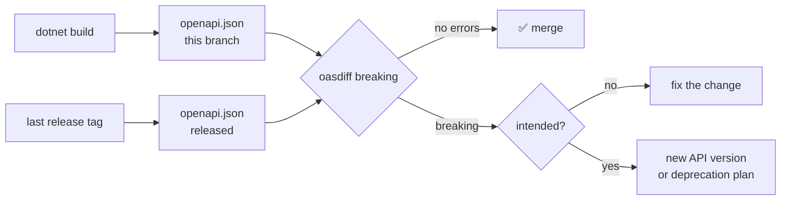

:::note[Series]
Part of the series [*REST & OpenAPI design*](/series/rest-and-openapi-design/).
:::

Here's a pull request that passes every check:

```diff
 public sealed record OrderDto(
     Guid Id,
-    string CustomerNumber,
+    string CustomerNo,
     decimal Total,
     OrderStatus Status);
```

The rename makes the code more consistent with the rest of the domain. All tests are green, because
the tests use the same DTO. The reviewer approves it, because the diff is one line. And the next
morning, the mobile app shows empty customer numbers, because the JSON property `customerNumber`
doesn't exist any more.

Unit and integration tests verify that your API does what *your* code expects. They don't verify
that it still does what your *consumers* expect. For that you need a test against the contract, and
the contract is the OpenAPI document.

## What counts as breaking?

The rules are mostly intuitive, with a few traps. The key is to think in **direction**: what the
server *accepts* (requests) versus what it *returns* (responses).

| Change | Breaking? | Why |
|---|---|---|
| Remove or rename an endpoint, path or method | ✅ yes | Existing calls get 404/405 |
| Remove or rename a response property | ✅ yes | Clients read a field that's gone |
| Remove or rename a query/path parameter | ✅ yes | Calls fail or the value is ignored |
| Make an optional request field/parameter **required** | ✅ yes | Old requests now get a 400 |
| Add a **required** request field or parameter | ✅ yes | Same |
| Change a type (`string` → `integer`, narrower format) | ✅ yes | Deserialization fails |
| Add a value to a response **`enum`** | ✅ for closed enums | Generated clients reject it ([more here](/blog/2026-extensible-enums-x-extensible-enum/)) |
| Change the success status code (`200` → `201`) | ⚠️ often | Clients that check for `200` exactly |
| Rename a schema / component | ⚠️ for generated clients | The class name in the SDK changes, code stops compiling |
| Add an endpoint | ❌ no | |
| Add an optional request field or query parameter | ❌ no | |
| Add a response property | ❌ no* | *unless clients use strict deserialization |
| Make a required request field optional | ❌ no | Accepting more is safe |

The asterisk matters: adding response properties is only safe if consumers ignore unknown fields.
Most JSON libraries do by default. Make it part of your API guidelines that clients **must** tolerate
unknown properties.

## Level 1: a snapshot of the document

The simplest contract test needs no tools at all. Commit the OpenAPI document, regenerate it in a
test, and fail if anything changed. Whoever changes the contract has to update the snapshot
deliberately, and the change shows up in the pull request diff where a reviewer can judge it.

```csharp
[TestClass]
public sealed class OpenApiContractTests
{
    [TestMethod]
    [DataRow("v1")]
    [DataRow("v2")]
    public async Task OpenApi_document_matches_the_committed_contract(string version)
    {
        await using var factory = new WebApplicationFactory<Program>();
        var actualJson = await factory.CreateClient().GetStringAsync($"/openapi/{version}.json");

        var contractPath = Path.Combine(ContractsDirectory, $"orders-api.{version}.json");
        var expected = JsonNode.Parse(await File.ReadAllTextAsync(contractPath));
        var actual = JsonNode.Parse(actualJson);

        if (!JsonNode.DeepEquals(expected, actual))
        {
            await File.WriteAllTextAsync(contractPath + ".received", actualJson);
            Assert.Fail(
                $"The OpenAPI document {version} changed. Check whether the change is breaking. " +
                $"If it isn't, replace {contractPath} with the .received file and commit it.");
        }
    }

    private static string ContractsDirectory =>
        Path.Combine(AppContext.BaseDirectory, "..", "..", "..", "..", "..", "contracts");
}
```

`JsonNode.DeepEquals` (since .NET 8) compares structurally, so formatting and property order don't
matter. If you'd rather not write the file handling yourself, the
[Verify](https://github.com/VerifyTests/Verify) library does exactly this "received vs. verified"
workflow, including a diff tool on failure.

This is what one team I worked with relied on: every change to the document turns the test red,
and the developer has to look at the diff and decide. It works, and it's a huge step up from nothing.

Its weakness is in the name: it detects **changes**, not **breaking** changes. Adding an endpoint
fails the test just like removing one. After the tenth "just update the snapshot" in a week, people
stop reading the diff. That's when you want level 2.

## Level 2: a semantic diff in the pipeline

A semantic diff tool understands OpenAPI. It compares two documents and classifies each difference:
breaking, potentially breaking, or safe. The one I use is [oasdiff](https://github.com/oasdiff/oasdiff),
a single binary with a ready-made GitHub Action and support for OpenAPI 3.0 and 3.1.

```bash
# Compare the document of the last release with the one from this branch
oasdiff breaking contracts/released/orders-api.v1.json contracts/orders-api.v1.json --fail-on ERR
```

The output for the rename from the beginning looks roughly like this:

```
error   [response-property-removed] at contracts/orders-api.v1.json
        in API GET /orders/{id}
                removed the required property 'customerNumber' from the response with the '200' status
```

The base to compare against is important. Comparing against `main` catches breaks between commits.
Comparing against **the last released version** is what really matters for consumers: two
intermediate commits might add and remove a field that was never released, and that's fine.

In GitHub Actions:

```yaml
- name: Generate OpenAPI document
  run: dotnet build src/MyShop.Orders.Api -c Release   # writes contracts/orders-api.v1.json

- name: Fetch last released contract
  run: git show v$(cat VERSION_LAST_RELEASE):contracts/orders-api.v1.json > released.json

- name: Check for breaking changes
  uses: oasdiff/oasdiff-action/breaking@main   # better: pin a reviewed release or commit SHA
  with:
    base: released.json
    revision: contracts/orders-api.v1.json
    fail-on: ERR
```

The document comes from the build itself, through `Microsoft.Extensions.ApiDescription.Server`, as
described in the [.NET 9 OpenAPI post](/blog/2026-dotnet-9-openapi-problems-and-fixes/). No running
service needed.



### When the break is intended

Sometimes you do want to break the contract. Then the check has done its job: it forced a decision.
The options:

- **Make it non-breaking.** Keep the old property alongside the new one, mark it `deprecated` in the
  schema, and remove it in the next major version.
- **New version.** Introduce `v2` of the endpoint or the API, with its own committed document and its
  own check.
- **Accept it explicitly.** For internal APIs whose consumers you control, oasdiff supports an
  ignore file. Add the specific change with a reason and a ticket reference. It's visible in the pull
  request, which is the point.

## Level 3: rule tests on the object model

Breaking changes are one kind of contract rule. There are others your guidelines probably contain:
every operation has an operation ID, every non-anonymous route declares security, health endpoints
don't appear in the public document, every path is versioned. Those are easy to test once the document
is parsed into objects with `Microsoft.OpenApi` (the reader is built into version 2.x, version 1.x
needed the separate `Microsoft.OpenApi.Readers` package):

```csharp
[TestClass]
public sealed class OpenApiRuleTests
{
    private static OpenApiDocument document = null!;

    [ClassInitialize]
    public static async Task LoadAsync(TestContext _)
    {
        await using var factory = new WebApplicationFactory<Program>();
        await using var stream = await factory.CreateClient().GetStreamAsync("/openapi/v1.json");
        var result = await OpenApiDocument.LoadAsync(stream, "json");

        Assert.AreEqual(0, result.Diagnostic?.Errors.Count ?? 0,
            string.Join(Environment.NewLine, result.Diagnostic?.Errors ?? []));
        document = result.Document!;
    }

    private static IEnumerable<(string Path, HttpMethod Method, OpenApiOperation Operation)> Operations =>
        document.Paths.SelectMany(p => (p.Value.Operations ?? [])
            .Select(o => (p.Key, o.Key, o.Value)));

    [TestMethod]
    public void Every_operation_has_an_operation_id()
    {
        var missing = Operations.Where(o => string.IsNullOrEmpty(o.Operation.OperationId))
            .Select(o => $"{o.Method} {o.Path}").ToList();

        Assert.AreEqual(0, missing.Count, string.Join(Environment.NewLine, missing));
    }

    [TestMethod]
    public void Health_endpoints_are_not_documented()
    {
        Assert.IsFalse(document.Paths.Keys.Any(p => p.Contains("/health", StringComparison.OrdinalIgnoreCase)));
    }
}
```

(The tuple uses `HttpMethod` as key type, which is what Microsoft.OpenApi 2.x uses. In 1.x the key was
an `OperationType` enum.)

For style rules that don't need C#, a linter like [Spectral](https://github.com/stoplightio/spectral)
with a ruleset in the repository is the other option. I use C# tests for rules that need knowledge of
the application (which endpoints are anonymous, which versions exist) and Spectral for the generic
style guide. The [next post](/blog/2026-generating-guideline-compliant-openapi/) covers making the
generator produce compliant documents in the first place.

## Comparison

| Approach | Detects | False alarms | Setup | Explains *why* |
|---|---|---|---|---|
| Nothing (review only) | what reviewers happen to notice | n/a | none | ❌ |
| Snapshot test | every change | many (every addition) | minutes | ❌ only "something changed" |
| Semantic diff (oasdiff etc.) | breaking changes, classified | few | an hour | ✅ rule ID + location |
| Rule tests / linter | guideline violations | few | per rule | ✅ |
| Consumer-driven contracts (Pact) | what consumers actually use | very few | high, needs consumers on board | ✅ |

I run the snapshot *and* the semantic diff. The snapshot makes every contract change visible in the
pull request. The diff tells the reviewer which of those changes need a decision.

## Pitfalls

**Generator upgrades.** Upgrading the OpenAPI generator (Swashbuckle → built-in, .NET 9 → 10) can
change the document substantially without a single API change: schema names, nullability, `3.0` to
`3.1`. Upgrade the generator in a separate pull request, so the diff isn't mixed with real changes.

**Non-deterministic output.** Documents that contain timestamps, build numbers or random ordering make
snapshots flaky. Keep the document deterministic; put the build number in a header, not in `info`.

**Only checking the default version.** If you serve `v1` and `v2`, check both. Breaking `v1` while
working on `v2` is a classic.

**Things the document doesn't show.** Behavioural changes (a field that's now always empty, a changed
default, different validation) are invisible to a contract diff. Integration tests and, for important
consumers, consumer-driven contract tests cover what the schema can't.

**Ignoring the report.** A check that's allowed to fail ("continue-on-error") is a check nobody reads.
Make it blocking, and make overriding it an explicit, reviewed step.

## Summary

- Unit tests verify your expectations; the **OpenAPI document** is your consumers' expectations.
- Think in **direction**: accepting more and returning more is usually safe, requiring more and
  returning less is breaking.
- Start with a **snapshot test** of the generated document: every contract change becomes visible
  in the pull request.
- Add a **semantic diff** (for example oasdiff) against the **last released** document, blocking in CI.
- Use **rule tests** or a linter for guideline rules like operation IDs and security declarations.
- Intended breaks need a decision: deprecate, version, or accept explicitly with a reason.
