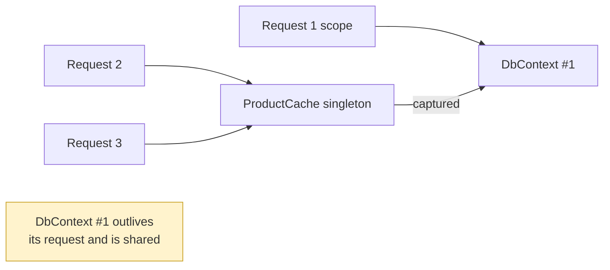

At some point every growing API reaches the same state: a startup method with a hundred and fifty
`services.AddScoped<...>()` lines, sorted by nothing in particular. You add a new service, it fails at
runtime because one of its dependencies isn't registered, you add that one, and the next one is
missing. Somebody once called it "the startup of hell", and the name stuck with me.

This post covers two things that belong together: **lifetimes** (what the container does with your
objects) and **structure** (where registrations live so you can still find them a year later).

## The three lifetimes in one table

| Lifetime | One instance per | Typical use |
|---|---|---|
| `Singleton` | Application | Stateless services, caches, configuration objects, `HttpClient` factories |
| `Scoped` | Request (scope) | `DbContext`, unit of work, per-request context like the current user |
| `Transient` | Resolution | Lightweight, stateless helpers; typed `HttpClient`s |

The rule that keeps you out of trouble: **a service may only depend on services that live at least
as long as itself.** Singleton → singleton is fine. Scoped → singleton is fine. Singleton → scoped is
the problem.

## The captive dependency

```csharp
builder.Services.AddDbContext<ShopDbContext>(...);        // scoped
builder.Services.AddSingleton<ProductCache>();            // singleton

public sealed class ProductCache(ShopDbContext db)         // captured forever
{
    public Task<Product?> GetAsync(int id, CancellationToken ct) =>
        db.Products.FindAsync([id], ct).AsTask();
}
```

The singleton is created once, on first use, and gets **the `DbContext` of whatever request happened
to be first**. That context is never disposed and is now shared by every concurrent request.
`DbContext` isn't thread-safe, so you get sporadic `InvalidOperationException`s under load, stale
change-tracker data, and a memory leak as the tracker grows. None of it shows up in a unit test.



The fixes, in the order I'd consider them:

1. **Fix the lifetime.** Does the cache really need to be a singleton? Often scoped is fine.
2. **Depend on a factory.** Inject `IDbContextFactory<ShopDbContext>` and create a short-lived
   context per operation.
3. **Create a scope explicitly.** Inject `IServiceScopeFactory` and resolve the scoped service inside
   `using var scope = scopeFactory.CreateScope();`. That's the standard pattern for background
   services.

```csharp
public sealed class ProductCache(IDbContextFactory<ShopDbContext> dbFactory, IMemoryCache cache)
{
    public Task<Product?> GetAsync(int id, CancellationToken ct) =>
        cache.GetOrCreateAsync($"product:{id}", async _ =>
        {
            await using var db = await dbFactory.CreateDbContextAsync(ct);
            return await db.Products.AsNoTracking().FirstOrDefaultAsync(p => p.Id == id, ct);
        });
}
```

## Let the container find it: ValidateScopes and ValidateOnBuild

The default container can detect captive scoped dependencies, but only if you ask:

- **`ValidateScopes`** throws when a scoped service is resolved from the root provider, which is
  exactly what happens when a singleton captures it.
- **`ValidateOnBuild`** tries to construct the dependency graph of every registration when the app
  starts, so a missing registration fails **at startup**, not on the first request that happens to
  need it.

`WebApplication.CreateBuilder` turns both on in the `Development` environment. I turn them on
everywhere except in production, where `ValidateOnBuild` costs startup time:

```csharp
builder.Host.UseDefaultServiceProvider((context, options) =>
{
    var strict = !context.HostingEnvironment.IsProduction();
    options.ValidateScopes = strict;
    options.ValidateOnBuild = strict;
});
```

And in a test, so the CI pipeline fails instead of a test environment:

```csharp
[TestMethod]
public void All_registrations_can_be_resolved()
{
    var configuration = new ConfigurationBuilder()
        .AddJsonFile("appsettings.test.json")
        .Build();

    var services = new ServiceCollection();
    services.AddLogging();
    services.AddOrders(configuration);
    services.AddInvoices(configuration);

    using var provider = services.BuildServiceProvider(new ServiceProviderOptions
    {
        ValidateScopes = true,
        ValidateOnBuild = true   // throws AggregateException listing every broken registration
    });
}
```

:::caution[What validation does not catch]
A **transient** captured by a singleton is not detected. Neither are services resolved through a
factory lambda (`sp => new X(sp.GetRequiredService<Y>())`) until the lambda runs, or open generics.
The typed `HttpClient` in a singleton from [the HttpClient post](/blog/2026-httpclient-you-are-using-it-wrong/)
is exactly that gap.
:::

## Structure: one registration extension per feature

Now the second half. The flat list of registrations has a basic flaw: **the consumer of a service has
to know all of its dependencies.** Add a dependency to `OrderPricing`, and someone has to remember to
register it in `Program.cs`.

The pattern I've used across several codebases turns that around: **every service registers its own
dependencies**, in an extension method that sits in the same feature folder (often the same file).

```csharp
namespace MyShop.Orders.Pricing;

public static class AddOrderPricingExtension
{
    public static IServiceCollection AddOrderPricing(
        this IServiceCollection services, IConfiguration configuration)
    {
        // 1. Dependencies: call *their* registration, never register their internals
        services.AddCatalogClient(configuration);
        services.AddTaxRules();

        // 2. Settings this service needs
        services.AddOptions<PricingOptions>()
                .BindConfiguration(PricingOptions.SectionName)
                .ValidateDataAnnotations()
                .ValidateOnStart();

        // 3. The service itself, safe to call multiple times
        services.TryAddScoped<IOrderPricing, OrderPricing>();

        return services;
    }
}

internal sealed class OrderPricing(ICatalogClient catalog, ITaxRules taxRules, IOptions<PricingOptions> options)
    : IOrderPricing
{
    // ...
}
```

And one level up, the feature aggregates its parts:

```csharp
public static class AddOrdersExtension
{
    public static IServiceCollection AddOrders(this IServiceCollection services, IConfiguration configuration) =>
        services.AddOrderPricing(configuration)
                .AddPlaceOrder()
                .AddCancelOrder();
}
```

What you get:

- **`Program.cs` shows features, not classes.** One line per feature.
- **F12 navigation from the top down.** `AddOrders` → `AddOrderPricing` → `AddCatalogClient`. The
  dependency tree is readable in code.
- **Changing an implementation doesn't touch the startup.** If `OrderPricing` gets a new dependency,
  only `AddOrderPricing` changes.
- **The signature tells you about configuration.** `AddOrderPricing(configuration)` shows at the call
  site that this feature reads settings. `AddTaxRules()` doesn't.
- **Tests use the same entry point.** Call `AddOrderPricing(config)`, resolve `IOrderPricing`, done.
  No hand-maintained test container.

### Idempotency: TryAdd is not optional

Because `AddCatalogClient` may be called from five features, every registration must be safe to run
repeatedly. Use the `TryAdd*` family from `Microsoft.Extensions.DependencyInjection.Extensions`:

```csharp
services.TryAddSingleton<ITaxRules, TaxRules>();                                   // first one wins
services.TryAddEnumerable(ServiceDescriptor.Singleton<IOrderRule, MinimumOrderRule>()); // no duplicates in IEnumerable<T>
```

With plain `AddSingleton`, five calls produce five descriptors. Resolving `ITaxRules` still works
(the last one wins), but `IEnumerable<ITaxRules>` returns five instances, and `ValidateOnBuild`
validates the graph five times. I've seen teams write their own `AddSingletonIfNotExists` helper for
this. `TryAdd` already is that helper.

### Keep implementations internal

If `OrderPricing` is `internal` and only `IOrderPricing` and `AddOrderPricing` are public, nobody in
another project can register or new up the implementation directly. The registration extension
becomes **the only way in**, which is exactly the point.

## Comparison

| | Flat registrations in Program.cs | Extension per feature | Assembly scanning |
|---|---|---|---|
| Program.cs size | Grows with every class | One line per feature | Very small |
| Dependency tree visible | ❌ | ✅ via F12 | ❌ |
| Consumer must know dependencies | ✅ (bad) | ❌ | ❌ |
| Testable with the real registration | Hard | ✅ | ✅ |
| Explicit lifetimes per service | ✅ | ✅ | Convention-based |
| Boilerplate | Low per service, high in total | One small method per service | Lowest |

Assembly scanning gets its own post at the end of the series.

## Pitfalls

**Disposable transients.** The container tracks every `IDisposable` it creates and disposes it with
the scope. A disposable transient resolved from the root provider lives until the app shuts down.
Don't resolve transients from the root in a loop.

**Async disposal.** Services implementing `IAsyncDisposable` must be disposed asynchronously. A
synchronous `using var scope = ...` with such a service throws. Use `await using var scope =
scopeFactory.CreateAsyncScope();`.

**Keyed services as a crutch.** .NET 8 added `AddKeyedSingleton` and `[FromKeyedServices]`. They're
useful for a few genuinely interchangeable implementations. If you need ten keys, you usually want a
strategy or a factory instead.

**Too many constructor parameters.** One codebase I worked on had a code rule allowing a maximum of
three dependencies per service, with documented exceptions. That number is arbitrary, but the signal
is real: a service with eight dependencies does too much.

## Enforce it

- **Container validation** in non-production environments and in a test, as shown above.
- **An architecture test** that every public `Add*` extension is actually called from somewhere. In
  one codebase we had exactly that rule: an extension that exists but is never called means a feature
  whose services are missing, and you only notice when someone tries to use it.
- **An analyzer or test** that services in feature folders are `internal`, so the extension stays the
  only entry point. That's the idea behind [self-defending codebases](/blog/2026-self-defending-codebases/).

## Summary

- **A service may only depend on services that live at least as long.** Singleton → scoped is a
  captive dependency.
- Turn on **`ValidateScopes` and `ValidateOnBuild`** outside production and in a test.
- Validation doesn't catch **captured transients** or factory registrations. Know the gap.
- **Every service registers its own dependencies** in an extension method next to the code.
- Use **`TryAdd*`** so registrations are idempotent, and keep implementations **internal**.

*Previous: [Program.cs and the hosting model](/blog/2026-program-cs-and-the-hosting-model/) ·
Next: [Configuration and the Options pattern](/blog/2026-configuration-and-the-options-pattern/)*
