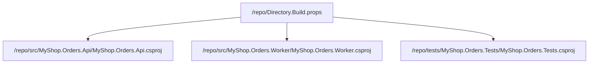

Here's a quick test for any solution: open five random `.csproj` files side by side. Do they agree on
the target framework? On `Nullable`? On whether warnings fail the build? In most codebases I've
reviewed, the answer is "mostly". One project still has nullable disabled because it was created
before the team agreed on it. Another one targets the previous .NET version because the upgrade PR
missed it. A third one has `TreatWarningsAsErrors` switched off, and nobody remembers why.

None of that is anyone's fault. It's what happens when the same setting is copied into thirty files.
The fix has been part of MSBuild for years: `Directory.Build.props`.

## The problem: thirty copies of one decision

A typical project file without a shared baseline:

```xml
<Project Sdk="Microsoft.NET.Sdk.Web">
  <PropertyGroup>
    <TargetFramework>net10.0</TargetFramework>
    <LangVersion>latest</LangVersion>
    <Nullable>enable</Nullable>
    <ImplicitUsings>enable</ImplicitUsings>
    <TreatWarningsAsErrors>true</TreatWarningsAsErrors>
    <EnableNETAnalyzers>true</EnableNETAnalyzers>
    <AnalysisLevel>latest</AnalysisLevel>
    <EnforceCodeStyleInBuild>true</EnforceCodeStyleInBuild>
    <UserSecretsId>3f2c...</UserSecretsId>
  </PropertyGroup>
</Project>
```

Only the last line is actually specific to this project. The rest is a team decision, and every copy
of a team decision is a chance for it to drift. Upgrading .NET becomes a search-and-replace across the
repository, and reviewing a new project means checking that someone copied the right block.

## How Directory.Build.props works

When MSBuild evaluates a project, `Microsoft.Common.props` walks up the directory tree from the project
folder and imports the **first** `Directory.Build.props` it finds. This happens very early, before the
body of your `.csproj` is read. So the file acts like a header that's automatically prepended to every
project below it.



Its sibling, `Directory.Build.targets`, is imported **late**, after the project body. That ordering
difference is the single most important thing to understand:

| File | Imported | Can see properties from the `.csproj`? | Use it for |
|---|---|---|---|
| `Directory.Build.props` | before the project body | ❌ | defaults the project may override |
| `Directory.Build.targets` | after the project body | ✅ | logic that depends on project settings, custom targets |

## A baseline that's worth having

This is roughly what I start with in a new repository today:

```xml
<!-- /Directory.Build.props -->
<Project>
  <PropertyGroup Label="Language and runtime">
    <TargetFramework>net10.0</TargetFramework>
    <LangVersion>latest</LangVersion>
    <Nullable>enable</Nullable>
    <ImplicitUsings>enable</ImplicitUsings>
  </PropertyGroup>

  <PropertyGroup Label="Quality gates">
    <TreatWarningsAsErrors>true</TreatWarningsAsErrors>
    <WarningsAsErrors>$(WarningsAsErrors);nullable</WarningsAsErrors>
    <EnableNETAnalyzers>true</EnableNETAnalyzers>
    <AnalysisLevel>latest-recommended</AnalysisLevel>
    <EnforceCodeStyleInBuild>true</EnforceCodeStyleInBuild>
  </PropertyGroup>

  <PropertyGroup Label="Build output">
    <Deterministic>true</Deterministic>
    <ContinuousIntegrationBuild Condition="'$(CI)' == 'true' or '$(TF_BUILD)' == 'true'">true</ContinuousIntegrationBuild>
    <GenerateDocumentationFile>true</GenerateDocumentationFile>
    <NoWarn>$(NoWarn);CS1591</NoWarn>
  </PropertyGroup>

  <PropertyGroup Label="Package metadata">
    <Authors>MyShop Platform Team</Authors>
    <Company>MyShop</Company>
    <RepositoryUrl>https://github.com/myshop/orders</RepositoryUrl>
    <PackageLicenseExpression>MIT</PackageLicenseExpression>
  </PropertyGroup>
</Project>
```

A few notes on the less obvious lines:

- **`WarningsAsErrors` with `nullable`** makes all nullable warnings errors, even in a project that
  turns `TreatWarningsAsErrors` off. Note the `$(WarningsAsErrors);` prefix: always append to list
  properties, never overwrite them. The SDK puts defaults like `NU1605` in there.
- **`AnalysisLevel`** controls which .NET analyzer rules are on and at what severity. `latest-recommended`
  is a sensible middle ground; `latest-all` is for the brave.
- **`EnforceCodeStyleInBuild`** makes your `.editorconfig` code-style rules (`IDExxxx`) run during
  `dotnet build`, not only in the IDE. That's the bridge to
  [consistent formatting in CI](/blog/2026-consistent-formatting-locally-and-in-ci/).
- **`ContinuousIntegrationBuild`** normalizes file paths in PDBs, which you want for reproducible
  packages and [Source Link](/blog/2026-source-link/). It's conditional on the CI variables of GitHub
  Actions (`CI`) and Azure Pipelines (`TF_BUILD`), because locally it would break debugging paths.
- **`GenerateDocumentationFile` + `NoWarn CS1591`** gives you the XML docs (needed for OpenAPI
  descriptions and packages) without forcing a comment on every public member.

After that, the API project from above becomes this:

```xml
<Project Sdk="Microsoft.NET.Sdk.Web">
  <PropertyGroup>
    <UserSecretsId>3f2c...</UserSecretsId>
  </PropertyGroup>

  <ItemGroup>
    <ProjectReference Include="..\MyShop.Orders.Application\MyShop.Orders.Application.csproj" />
  </ItemGroup>
</Project>
```

Everything that's left in the file is a deliberate, project-specific choice. That makes reviews much
easier: a `.csproj` diff is now always interesting.

## Different rules for different kinds of projects

Test projects usually need a few different settings: no documentation file, no packaging, maybe
relaxed analyzer rules. You can't use `IsTestProject` in `Directory.Build.props`, because the test SDK
sets it later. Two options work well.

**Option 1: a condition on the project name** (fine if you have a naming convention):

```xml
<PropertyGroup Condition="$(MSBuildProjectName.EndsWith('.Tests'))">
  <IsPackable>false</IsPackable>
  <GenerateDocumentationFile>false</GenerateDocumentationFile>
  <NoWarn>$(NoWarn);CA1707</NoWarn> <!-- underscores in test method names -->
</PropertyGroup>
```

**Option 2: a nested file that imports its parent.** Because MSBuild stops at the first
`Directory.Build.props` it finds, a file in `/tests` would *replace* the root file. Import the parent
explicitly to extend it instead:

```xml
<!-- /tests/Directory.Build.props -->
<Project>
  <Import Project="$([MSBuild]::GetPathOfFileAbove('Directory.Build.props', '$(MSBuildThisFileDirectory)../'))" />

  <PropertyGroup>
    <IsPackable>false</IsPackable>
    <GenerateDocumentationFile>false</GenerateDocumentationFile>
  </PropertyGroup>
</Project>
```

For logic that depends on what the project itself declares, use `Directory.Build.targets`:

```xml
<!-- /Directory.Build.targets -->
<Project>
  <!-- Only for projects that produce a NuGet package -->
  <ItemGroup Condition="'$(IsPackable)' == 'true'">
    <None Include="$(MSBuildThisFileDirectory)README.md" Pack="true" PackagePath="\" />
  </ItemGroup>

  <PropertyGroup Condition="'$(IsPackable)' == 'true'">
    <PackageReadmeFile>README.md</PackageReadmeFile>
  </PropertyGroup>
</Project>
```

`IsPackable` is set by the SDK and possibly by the project, so at props time its final value isn't
known yet. In `.targets` it is.

## Alternatives compared

| | Copy into each `.csproj` | `Directory.Build.props` | Custom MSBuild SDK package | `.editorconfig` |
|---|---|---|---|---|
| One place to change | ❌ | ✅ per repository | ✅ across repositories | ✅ per repository |
| Visible in the repo | ✅ | ✅ | ❌ hidden in a package | ✅ |
| Versioned and shared across many repos | ❌ | ❌ copy per repo | ✅ | ❌ |
| Covers build properties | ✅ | ✅ | ✅ | ❌ |
| Covers analyzer severities and code style | partly | partly | partly | ✅ |

`Directory.Build.props` and `.editorconfig` complement each other: build properties go into the props
file, rule severities and style preferences into `.editorconfig`. Once you have many repositories that
should share the same baseline, a custom MSBuild SDK (`<Project Sdk="MyShop.Build.Sdk/1.4.0">`) is the
next step. It's a bigger investment, though. Start with the props file.

## Pitfalls

**The settings don't apply in the container build.** A very common Dockerfile copies only the project
files to restore with a warm cache:

```dockerfile
COPY src/MyShop.Orders.Api/*.csproj src/MyShop.Orders.Api/
RUN dotnet restore src/MyShop.Orders.Api/MyShop.Orders.Api.csproj
```

`Directory.Build.props` and `Directory.Packages.props` aren't in the image at that point, so restore runs
with different settings, or fails, depending on what's missing. Copy them first:

```dockerfile
COPY Directory.Build.props Directory.Packages.props nuget.config ./
```

The same goes for build agents that check out or copy only parts of the repository. Some teams conclude
"the props file only works if you build the solution". The real rule is: it works for every project
that has the file somewhere *above* it on disk at build time.

**A project silently overrides the baseline.** Because the project body comes after the props file,
any property in the `.csproj` wins. That's intentional (it's how exceptions work), but it also means
an old `<Nullable>disable</Nullable>` left in one project quietly undoes your policy. Clean the
duplicated properties out of every project when you introduce the file.

**Overwriting list properties.** `<NoWarn>CS1591</NoWarn>` in a project throws away every `NoWarn`
from the props file. Always write `$(NoWarn);CS1591`.

**Hiding problems with global switches.** It's tempting to put workarounds such as
`ErrorOnDuplicatePublishOutputFiles=false` into the shared file after a framework upgrade. That makes
the error disappear for every project, including those where it points to a real problem. Fix the
duplicate files where possible, and if you need the switch, set it only in the project that needs it,
with a comment.

**Turning everything on at once in a legacy solution.** Enabling `Nullable` plus `TreatWarningsAsErrors`
in a big existing codebase can produce thousands of errors. Introduce the file with today's state of
affairs, then tighten one setting at a time, or enable a setting in the root and opt out temporarily
in the projects that aren't ready yet.

## Enforce it

`Directory.Build.props` defines the baseline, but nothing stops a project from overriding it. If some
properties are non-negotiable, check that no project redefines them:

```csharp
[TestMethod]
public void Projects_do_not_redefine_central_build_properties()
{
    string[] central = ["TargetFramework", "Nullable", "LangVersion", "TreatWarningsAsErrors"];

    var offenders = RepositoryRoot.EnumerateFiles("*.csproj", SearchOption.AllDirectories)
        .SelectMany(project => XDocument.Load(project.FullName)
            .Descendants()
            .Where(e => central.Contains(e.Name.LocalName))
            .Select(e => $"{project.Name}: <{e.Name.LocalName}>"))
        .ToList();

    Assert.AreEqual(0, offenders.Count,
        $"These settings belong in Directory.Build.props: {string.Join(", ", offenders)}");
}
```

To see what a project *actually* ends up with after all imports, ask MSBuild instead of guessing:

```bash
dotnet msbuild src/MyShop.Orders.Api -getProperty:TargetFramework -getProperty:Nullable -getProperty:TreatWarningsAsErrors
dotnet msbuild src/MyShop.Orders.Api -preprocess:evaluated.xml   # the fully expanded project
```

The preprocessed file shows every import in order, which settles any "why doesn't my setting apply?"
discussion in about a minute.

## Summary

- Settings copied into every `.csproj` drift. Put team decisions into **one `Directory.Build.props`**
  at the repository root.
- Props are imported **before** the project body (defaults), targets **after** it (logic that depends
  on project settings).
- A good baseline covers target framework, nullable, warnings as errors, analyzers, code style in build,
  deterministic CI builds and package metadata.
- Nested props files **replace** the parent unless you import it explicitly.
- Watch out for Dockerfiles that don't copy the props files, projects that override the baseline and
  list properties that get overwritten.
- **Enforce** the non-negotiable properties with a test and use `-getProperty` / `-preprocess` to debug.
