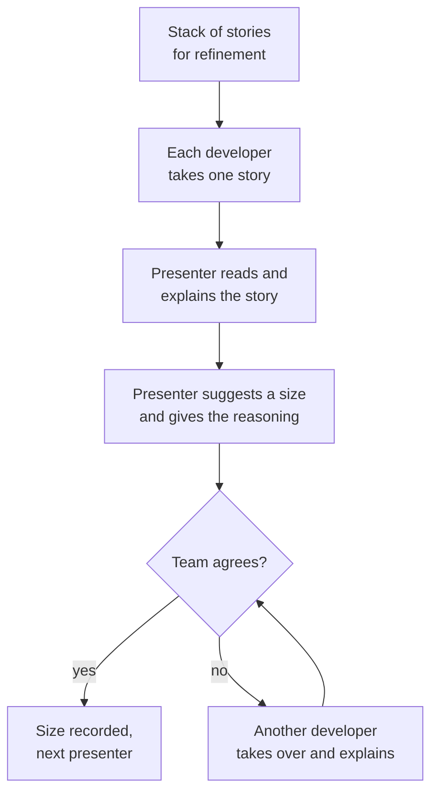

Estimation is the Scrum practice people argue about the most, and often the one where teams spend the
most time for the least value. Few things in a refinement are less useful than a long debate about
whether a story is a 3 or a 5.

In the project with six Scrum teams I spent about four years on, we went through two estimation methods:
**planning poker** at the beginning and **T-shirt sizes** later. We also tried to define **reference
stories**, and learned that the obvious choice for one is useless. This post covers all three.

## Planning poker

At the beginning of the project, we spent a lot of time in planning poker sessions. Usually one Scrum
team, sometimes two when features overlapped.

### How it worked

1. Every developer gets a set of planning poker cards. Sometimes the PO and the Scrum Master played
   along, because they were developers too.
2. For each story, everyone picks a card, and all cards are revealed at the same time.
3. If someone is far from the average, a discussion starts: why so low, why so high? That shares
   knowledge and clears up misunderstandings.
4. After the discussion, the round is repeated, to see whether the estimates have moved closer together.

The simultaneous reveal is the clever part. Nobody anchors on the first number said out loud, and the
quiet person who sees a problem everyone else missed shows a high card without having to argue first.

### Why we moved away from it

Over time, the downsides got bigger than the benefits:

- **It became monotonous.** Card, reveal, discuss, repeat, for every story, every refinement.
- **It took a lot of time**, noticeably more than T-shirt sizing.
- **The discussions became uncoordinated.** Several developers with different perspectives tried to
  explain their understanding at the same time, and the conversation went in all directions.
- **The numbers were too detailed.** That led to pointless discussions about whether something is a 3
  or a 5. The difference between those two numbers is smaller than the uncertainty in either.

## T-shirt sizes

Our refinement sessions usually happened around the middle of the sprint. Depending on the stories,
stakeholders sometimes joined to give more context. A prepared set of items was up for refinement, and
we estimated them with T-shirt sizes (XS, S, M, L, XL).

The sizes themselves aren't the interesting part. The process around them is.

### How it worked

1. **Each team member gets a story**, taken from the stack from top to bottom.
2. **One after another, each developer reads and explains their story** to the rest of the team.
3. **The presenter starts the estimation**: they suggest a size, for example "M", and explain why.
4. **If someone disagrees**, another developer can take over the story and present their perspective
   and reasoning.

### Why it worked better

- **Structured and team-centered.** One person speaks at a time, with a clear role.
- **No more card-game frustration.** Nobody had to sit through endless rounds.
- **Deeper engagement.** Having to explain a story to the team forces you to really understand it.
  You read it differently when you know you're going to present it. That's where most open questions
  surfaced.
- **Ownership.** Each developer took responsibility for one item, which carried over into the sprint.

The trade-off is that the first suggestion can anchor everyone. The "another developer takes over" rule
is what keeps that in check. Disagreement isn't a vote, it's a second explanation.

## Planning poker vs. T-shirt sizes

| | Planning poker | T-shirt sizes with a presenter |
|---|---|---|
| Avoids anchoring | ✅ simultaneous reveal | ⚠️ the presenter goes first |
| Time per story | high | low |
| Structured discussion | ❌ everyone at once | ✅ one presenter, one challenger |
| Granularity | fine, invites false precision | coarse, matches real uncertainty |
| Engagement of every developer | ⚠️ you can just pick a card | ✅ everyone presents a story |
| Converts to hours | directly via points | via a mapping (see below) |

### From sizes to hours

Abstract sizes are fine for refinement, but sprint planning eventually needs hours. Our planning tool
could map sizes to real hours based on more than a year of collected data. That's the honest way to do
it: don't define "M = 16 hours" up front, measure what an M actually turned out to be.
I describe the planning side in [Realistic capacity planning](/blog/2026-realistic-capacity-planning/).

## Reference stories

Relative estimation needs something to be relative *to*. A reference story is a well-understood piece
of work with an agreed size that everyone compares new stories against. We worked on defining these,
and the first candidate taught us what *not* to do.

### Candidate 1: hello world

A console application that prints "Hello World". Open the IDE, create a project, write one line.

- **Pro:** every developer understands it.
- **Con:** it's so far from daily business that it's useless for estimation. Compared to building a real
  API endpoint, the ratio would be something like 1 : 100. Nobody can estimate reliably at that distance.

### Candidate 2: a new web API, in the real environment

A simple REST API with all CRUD operations, using an in-memory list instead of a database. The code is
trivial. Everything around it isn't:

- API documentation that follows the company's conventions
- Integration tests for all endpoints
- Authentication set up, with scopes configured for every endpoint
- All environments set up: DEV, TEST, QA, PROD
- Requests to the platform team for the base infrastructure, accounts and secrets
- Cloud resources provisioned
- Infrastructure as Code scripts in place
- Monitoring and telemetry configured
- Identity provider configured for DEV by the developers, for the other environments by the platform team
- API gateway configured for all environments
- ...and more

- **Pro:** it shows the real challenges of releasing an API in your actual environment, which leads to
  much more realistic relative estimates.
- **Con:** it's specific to teams that build web APIs.

Measured against our regular endpoint stories, this came out as an **XL**.

### Candidate 3: a new endpoint on an existing API

The most useful reference turned out to be the work a team does most often: adding an endpoint to an
existing API, for example "get all orders" or "create an order". The checklist:

- Add the HTTP method to the controller
- API documentation and response types
- Authorization scope for the endpoint
- Query or command handler
- Data access against the backend system
- Mapping
- Validation
- Paging (if needed)
- API tests, plus whatever helper endpoints are needed for testability (for example creating and
  deleting test data by a marker field)
- Publish the updated API to the API gateway
- Logging and telemetry
- Writing data back, if needed

Outcome: **M**.

| Reference story | Size | Useful as reference? |
|---|---|---|
| Hello world console app | – | ❌ too far from real work |
| New endpoint on an existing API | **M** | ✅ the most common real work |
| New web API in the real environment | **XL** | ✅ for teams that build APIs |

### One reference for all, or one per team?

We never fully settled this. A common reference story for all six teams would make sizes comparable
across teams, but the further it is from a team's daily work, the harder it is to relate real stories
to it. The direction we went: **each team, or each development scope, finds its own real-world reference
story**. A frontend team and an API team simply do different work.

## Pitfalls

**Arguing about adjacent numbers.** If the discussion is "3 or 5?", pick one and move on. The time is
better spent on the open questions behind the story.

**Reference stories nobody remembers.** A reference only works if the team actually knows it. Pick
something the team has really built, not a theoretical example.

**Forgetting everything around the code.** The new-API reference shows it clearly: the code is the small
part. Environments, security, infrastructure and monitoring are where the effort is.

**Comparing sizes across teams.** An M in one team isn't an M in another. Sizes are a team's internal
language.

**Fixing the hour mapping up front.** Let it come from data.

## Summary

- **Planning poker** avoids anchoring, but for us it became slow, monotonous and too precise. We spent
  time on 3-vs-5 discussions.
- **T-shirt sizes with a presenter** worked better: each developer explains one story, proposes a size
  with reasoning, and someone who disagrees takes over and explains their view.
- Sizes are for refinement. Map them to hours based on **real historical data**, not definitions.
- A **reference story** must be close to real work. Hello world is useless. A new endpoint on an existing
  API (M) and a new API in the real environment (XL) worked.
- Prefer a reference story **per team or development scope** over one for everyone.
