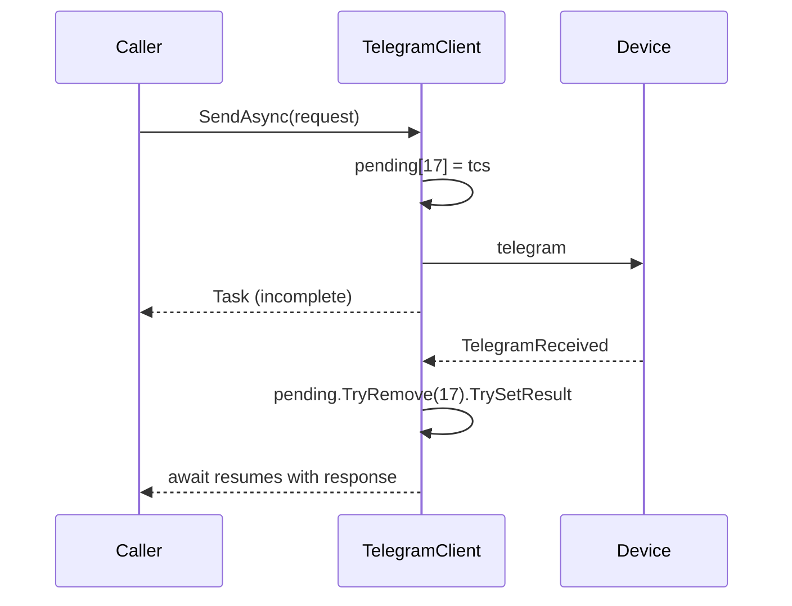

Sooner or later every .NET developer has to talk to an API that wasn't built for `await`. A device
driver that raises `MeasurementCompleted`. A TCP protocol where you send a request telegram and the
answer arrives "at some point" on a receive event. An old SDK with `BeginConnect`/`EndConnect`. A
library that wants an `Action<Result>` callback.

The code that grows around those APIs is always the same: one method starts the operation, another
method handles the event, and a field or a flag connects the two. This post shows how to turn that into
a single awaitable method with `TaskCompletionSource<T>`, and the five details that the naive version
in most wikis gets wrong.

## The problem: one operation, three places

Here's a typical device API. It's simplified, but I've seen this shape many times in industrial
software:

```csharp
public interface IMeasurementDevice
{
    event EventHandler<MeasurementEventArgs>? MeasurementCompleted;
    event EventHandler<DeviceErrorEventArgs>? ErrorOccurred;

    void StartMeasurement(MeasurementRequest request);
}

public sealed record MeasurementRequest(int Channel)
{
    public Guid Id { get; } = Guid.NewGuid();
}
```

And this is what the consuming code tends to look like:

```csharp
public sealed class CalibrationViewModel
{
    private readonly IMeasurementDevice _device;
    private bool _waitingForReference;

    public CalibrationViewModel(IMeasurementDevice device)
    {
        _device = device;
        _device.MeasurementCompleted += OnMeasurementCompleted;
        _device.ErrorOccurred += OnError;
    }

    public void StartCalibration()
    {
        _waitingForReference = true;
        _device.StartMeasurement(new MeasurementRequest(Channel: 1));
    }

    private void OnMeasurementCompleted(object? sender, MeasurementEventArgs e)
    {
        if (!_waitingForReference) return;
        _waitingForReference = false;

        // step 2 of the calibration happens here ...
        // ... and step 3 in yet another handler
    }

    private void OnError(object? sender, DeviceErrorEventArgs e)
    {
        _waitingForReference = false;
        // which operation failed? we can only guess
    }
}
```

What's wrong with it:

- **No sequential flow.** A three-step calibration is spread over three handlers and a state flag.
  Reading it means jumping around and reconstructing the order in your head.
- **The caller can't wait.** `StartCalibration` returns immediately. Whoever calls it has no way to
  know when it's done or whether it worked.
- **Errors lose their context.** The error event doesn't say which request it belongs to.
- **No timeout, no cancellation.** If the device never answers, the flag stays `true` forever.
- **Polling creeps in.** The next developer who needs to "wait for the result" writes
  `while (_waitingForReference) await Task.Delay(50);`.

## Why it happens

Events are a fine mechanism for "something happened, whoever cares can react". They're a poor
mechanism for "I asked a question and want the answer". The second case is a request/response, and in
modern .NET a request/response is a `Task<T>`. The event API just never got that translation layer,
so every consumer builds a small state machine by hand.

`TaskCompletionSource<T>` is that translation layer. It gives you a `Task<T>` that you complete
manually, from whatever callback eventually delivers the result.

## The naive wrapper you'll find in many wikis

```csharp
public Task<Measurement> MeasureAsync(MeasurementRequest request)
{
    var tcs = new TaskCompletionSource<Measurement>();
    _device.MeasurementCompleted += (_, e) => tcs.SetResult(e.Measurement);
    _device.StartMeasurement(request);
    return tcs.Task;
}
```

It looks right and it works in the demo. It also has five problems:

1. **The handler is never removed.** Every call adds another subscription. The second call's event
   triggers the first call's handler too, and `SetResult` on an already completed source throws
   `InvalidOperationException` inside the device's event loop.
2. **Errors are ignored.** If the device raises `ErrorOccurred`, the task never completes.
3. **No cancellation or timeout.** The returned task can hang forever.
4. **Continuations run inline.** By default, `SetResult` runs the awaiting code synchronously on the
   thread that raised the event. Your business logic suddenly runs on the driver's receive thread
   and can block it, or re-enter the device while it's still inside its own event invocation.
5. **No correlation.** If two measurements are in flight, the first answer completes whichever
   handler happens to run first.

## The correct wrapper

```csharp
namespace Factory.Sensors;

public sealed class MeasurementClient(IMeasurementDevice device)
{
    public async Task<Measurement> MeasureAsync(
        MeasurementRequest request, CancellationToken ct = default)
    {
        var tcs = new TaskCompletionSource<Measurement>(
            TaskCreationOptions.RunContinuationsAsynchronously);

        void OnCompleted(object? sender, MeasurementEventArgs e)
        {
            if (e.RequestId == request.Id)
                tcs.TrySetResult(e.Measurement);
        }

        void OnError(object? sender, DeviceErrorEventArgs e)
        {
            if (e.RequestId == request.Id)
                tcs.TrySetException(new DeviceException(e.Code, e.Message));
        }

        device.MeasurementCompleted += OnCompleted;
        device.ErrorOccurred += OnError;
        try
        {
            // subscribe first, then start: a fast device may answer before StartMeasurement returns
            device.StartMeasurement(request);
            return await tcs.Task.WaitAsync(ct);
        }
        finally
        {
            device.MeasurementCompleted -= OnCompleted;
            device.ErrorOccurred -= OnError;
        }
    }
}
```

And the timeout belongs to the caller, not to the wrapper:

```csharp
using var timeout = CancellationTokenSource.CreateLinkedTokenSource(ct);
timeout.CancelAfter(TimeSpan.FromSeconds(5));

var reference = await client.MeasureAsync(new MeasurementRequest(Channel: 1), timeout.Token);
var sample    = await client.MeasureAsync(new MeasurementRequest(Channel: 2), timeout.Token);
var offset    = sample.Value - reference.Value;
```

The calibration is now three lines, top to bottom, with normal `try`/`catch` for errors. Here's what
each detail does:

- **`RunContinuationsAsynchronously`** makes the code after `await` run on the thread pool instead of
  inside the device's event invocation. I set it on every `TaskCompletionSource` I create. The cases
  where inline continuations are what you want are rare and should be a conscious choice.
- **`TrySet*` instead of `Set*`.** Events can arrive late or twice, and cancellation can race with the
  result. `TrySetResult` simply returns `false` if the task is already done.
- **Local functions as handlers** give you a reference you can unsubscribe in `finally`. A lambda
  can't be removed unless you store it in a variable first.
- **`WaitAsync(ct)`** (.NET 6+) handles cancellation and timeouts without a manual
  `ct.Register(() => tcs.TrySetCanceled(ct))`. The caller gets an `OperationCanceledException` or a
  `TimeoutException`, depending on what you pass.
- **Subscribe before you start.** If you start the operation first, a fast device can raise the
  event before your handler is attached, and the result is lost.

:::note[Cancelling the wait vs. cancelling the work]
`WaitAsync` stops *waiting*. It doesn't stop the device. If the API has an abort command, call it in a
`catch (OperationCanceledException)` block or register it on the token. Otherwise the device finishes the
measurement and nobody listens.
:::

## Request/response over a message stream

Telegram-based protocols (TCP, serial, a message bus) don't have one event per operation. They have
**one receive event for everything**, and responses carry a correlation ID. Subscribing and filtering
per call doesn't scale there. Use a dictionary of pending requests instead:

```csharp
namespace Factory.Sensors;

public sealed class TelegramClient : IDisposable
{
    private readonly ITelegramConnection _connection;
    private readonly ConcurrentDictionary<int, TaskCompletionSource<Telegram>> _pending = new();
    private int _nextId;

    public TelegramClient(ITelegramConnection connection)
    {
        _connection = connection;
        _connection.TelegramReceived += OnTelegramReceived;
    }

    public async Task<Telegram> SendAsync(Telegram request, CancellationToken ct = default)
    {
        var id  = Interlocked.Increment(ref _nextId);
        var tcs = new TaskCompletionSource<Telegram>(TaskCreationOptions.RunContinuationsAsynchronously);
        _pending[id] = tcs;
        try
        {
            await _connection.SendAsync(request with { CorrelationId = id }, ct);
            return await tcs.Task.WaitAsync(ct);
        }
        finally
        {
            _pending.TryRemove(id, out _);
        }
    }

    private void OnTelegramReceived(object? sender, Telegram telegram)
    {
        if (_pending.TryRemove(telegram.CorrelationId, out var tcs))
            tcs.TrySetResult(telegram);
        // else: a late answer to a request that already timed out, or an unsolicited message
    }

    public void Dispose()
    {
        _connection.TelegramReceived -= OnTelegramReceived;
        foreach (var tcs in _pending.Values)
            tcs.TrySetException(new ObjectDisposedException(nameof(TelegramClient)));
    }
}
```



Don't forget the `Dispose` part. If the connection drops, every waiting caller should get an exception,
not hang until its timeout. A connection-lost event deserves the same treatment.

## Other shapes of "not async"

Not every legacy API needs a hand-written wrapper:

| API shape | Use |
|---|---|
| One event or callback per operation | `TaskCompletionSource<T>` as shown above |
| One receive event, many requests | `TaskCompletionSource<T>` + `ConcurrentDictionary` keyed by correlation ID |
| `BeginXxx`/`EndXxx` (APM) | `Task.Factory.FromAsync(BeginXxx, EndXxx, state)` |
| Completion without a value | non-generic `TaskCompletionSource` (.NET 5+) |
| An event that fires continuously (sensor values, log lines) | not a `Task` at all: a [`Channel<T>`](/blog/2026-producer-consumer-with-channels/) or `IAsyncEnumerable<T>` |
| A polling API ("is it done yet?") | a loop with `PeriodicTimer` and a cancellation token, wrapped once |

The continuous case matters. A `Task` completes exactly once. If the event represents a stream of
values, wrapping it in a `TaskCompletionSource` loses everything after the first value. Streams belong
in a channel, and very high-frequency streams need throttling as well, which is the topic of
[taming high-frequency events](/blog/2026-taming-high-frequency-events/).

## Pitfalls

**Forgetting `RunContinuationsAsynchronously`.** This is the one that causes the strangest bugs:
deadlocks inside a driver, stack overflows from re-entrancy, or a receive loop that suddenly processes
telegrams one second late because it's busy running your business logic.

**`async void` event handlers in the wrapper.** The handler itself should be synchronous and only
complete the task. If it needs to do async work, that work happens after the `await` in the calling
method. Why `async void` is dangerous is covered in
[async/await pitfalls](/blog/2026-async-await-pitfalls/).

**Blocking on the wrapper.** `MeasureAsync(...).Result` in a UI thread deadlocks the same way any other
sync-over-async does. Once the API is a `Task`, go async all the way up.

**Leaking `TaskCompletionSource` from the API.** The wrapper owns the source. Callers only ever see
`tcs.Task`. Returning or storing the source lets anybody complete your operation.

**Using `Task.Run` to "make it async".** Wrapping a blocking call in `Task.Run` moves the blocking to
another thread. Wrapping an event in a `TaskCompletionSource` doesn't block any thread while waiting.
Those are very different things.

## How to enforce it

- **VSTHRD100/VSTHRD101** from Microsoft.VisualStudio.Threading.Analyzers flag `async void` handlers
  and async lambdas assigned to `void` delegates.
- **VSTHRD002** flags synchronous waits on the resulting tasks.
- A **banned API** entry (BannedApiAnalyzers) for the raw device events outside the wrapper namespace
  keeps people from going back to the handler-and-flag style:

```text
# BannedSymbols.txt
E:Factory.Sensors.IMeasurementDevice.MeasurementCompleted;Use MeasurementClient.MeasureAsync instead
```

Wrappers are easy to test without hardware: a fake device that raises its event after a short delay,
one that raises the error event, and one that never answers. The last test, with a 100 ms timeout,
is the one that proves the `finally` and the cancellation path work:

```csharp
[TestMethod]
public async Task MeasureAsync_times_out_and_unsubscribes_when_device_never_answers()
{
    var device = new SilentFakeDevice();
    var client = new MeasurementClient(device);
    using var cts = new CancellationTokenSource(TimeSpan.FromMilliseconds(100));

    await Assert.ThrowsExceptionAsync<TaskCanceledException>(
        () => client.MeasureAsync(new MeasurementRequest(Channel: 1), cts.Token));

    Assert.AreEqual(0, device.SubscriberCount);
}
```

## Summary

- Event and callback APIs spread one operation across several methods and a flag. Wrap them once and
  give the rest of the code a `Task<T>`.
- Always create `TaskCompletionSource` with **`RunContinuationsAsynchronously`**, and complete it with
  **`TrySet*`**.
- **Subscribe before starting**, **unsubscribe in `finally`**, and handle the **error event** too.
- Use **`WaitAsync(ct)`** for cancellation and timeouts, and let the caller decide the timeout.
- For protocols with one receive event, correlate with a **`ConcurrentDictionary`** of pending
  requests and fail them all on disconnect.
- A `Task` completes once. For streams of events, use a channel instead.
