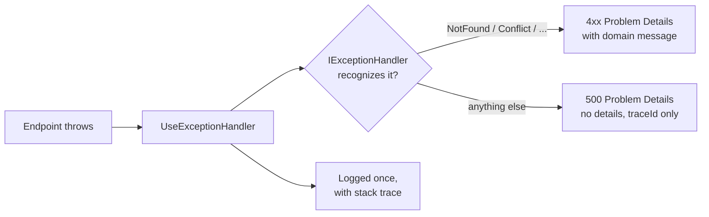

:::note[Series]
Part of the series [*Validation & error handling*](/series/validation-and-error-handling/).
:::

Almost every codebase I review has the same two kinds of exception handling. Half the methods have
a `try`/`catch` that logs "Something went wrong" and carries on. The other half have no handling at
all, and when something fails there, the client gets a 500 with a stack trace in the body. Both
come from the same place: nobody decided **where** exceptions are supposed to be handled, so every
developer decides it again, per method.

Every team I've worked with has some version of "exception handling best practices" in its wiki.
The rules are mostly right. What's usually missing is the architecture that makes them easy to
follow. This post covers both: the rules for the code that throws, and the one central place that
catches.

## The "before": defensive catch blocks everywhere

Here's a composite of what I keep finding:

```csharp
public async Task<OrderDto?> GetOrderAsync(Guid id, CancellationToken ct)
{
    try
    {
        var order = await repository.FindAsync(id, ct);
        try
        {
            var customer = await customers.GetAsync(order.CustomerId, ct);
            return OrderDto.From(order, customer);
        }
        catch (Exception ex)
        {
            logger.LogError("Error: " + ex.Message);
            throw ex;
        }
    }
    catch (Exception)
    {
        return null;
    }
}
```

Count the problems:

- **`throw ex`** resets the stack trace. The log now points at this line instead of the line inside
  `customers.GetAsync` that actually failed.
- **`ex.Message` only.** "Object reference not set to an instance of an object." That's the *what*,
  without the *where* and the *why*. No stack trace, no inner exception.
- **String concatenation in the log call.** No structured properties, so nobody can query for it.
- **The outer catch swallows everything** and returns `null`. The caller can't tell "order doesn't
  exist" from "database is down". The controller turns `null` into a 404, so an outage now looks
  like missing data.
- **`order.CustomerId`** is dereferenced without a null check. The `NullReferenceException` that
  follows is caught, logged badly and then swallowed.

None of these catch blocks *handles* anything. They only change how the failure looks.

## Why it happens

A catch block feels responsible. It says "I thought about failure here". But catching an exception
only makes sense if you can do one of three things:

1. **Recover**: retry, fall back to a default, use a cached value.
2. **Translate**: turn a low-level exception into one that means something at your layer, keeping
   the original as `InnerException`.
3. **Add context** that only this layer knows, and let it continue upwards.

Logging is not on that list on purpose. If the exception keeps travelling upwards, somebody further
up will log it again, and you end up with the same error three times in your logs (more on that in
the [next post](/blog/2026-logging-exceptions-properly/)). If you can't do any of the three, don't
catch.

## The rules for the code that throws

### Use `throw;`, never `throw ex;`

```csharp
catch (DbUpdateConcurrencyException)
{
    // add context, then:
    throw;      // keeps the original stack trace
}
```

If you need to rethrow an exception *later*, outside the catch block (for example after collecting
it from a background task), use `ExceptionDispatchInfo.Capture(ex).Throw()`, which preserves the
original trace too.

### Delete catch blocks that only rethrow

```csharp
try { await SaveAsync(order, ct); }
catch (Exception) { throw; }   // does nothing, remove it
```

It's noise, and it suggests to the next reader that something is being handled here.

### Never swallow silently

An empty catch block is the worst possible outcome: the system is in an unknown state, and there's
no trace of it. If an exception really is expected and harmless, catch the **specific** type and
write down why:

```csharp
try
{
    File.Delete(tempFile);
}
catch (IOException ex)
{
    // Best effort cleanup: the file is in /tmp and the OS removes it anyway.
    logger.LogDebug(ex, "Could not delete temp file {TempFile}", tempFile);
}
```

### Catch specific types, and use filters

`catch (Exception)` belongs in exactly one place: the global handler, and possibly the outermost
loop of a background worker. Everywhere else, catch what you can handle. Exception filters let you
be even more specific without catching and rethrowing:

```csharp
try
{
    return await catalog.GetProductAsync(id, ct);
}
catch (HttpRequestException ex) when (ex.StatusCode == HttpStatusCode.NotFound)
{
    return null;   // a missing product is a valid answer here
}
```

Every other `HttpRequestException` passes through untouched, with its stack intact.

### Translate with context, keep the inner exception

```csharp
catch (SqlException ex) when (ex.Number == 2627)   // unique key violation
{
    throw new DuplicateOrderNumberException(order.Number, ex);
}
```

The new exception says what went wrong in domain terms. The `SqlException` is still there as
`InnerException`, so nothing is lost for whoever debugs it.

### Write messages a human can act on

"An error has occurred" helps nobody. A good message says what was attempted, with which input, and
ideally what to check:

```csharp
throw new InvalidOperationException(
    $"Order {order.Id} cannot be shipped because it is in state {order.State}. " +
    "Only orders in state 'Paid' can be shipped.");
```

Full sentences, ending with a period. And never put secrets, tokens or personal data in the message:
exception messages end up in logs, and sometimes in responses.

### Prefer the built-in types, add custom ones deliberately

`ArgumentException`, `ArgumentNullException`, `ArgumentOutOfRangeException`,
`InvalidOperationException`, `NotSupportedException`, `TimeoutException` cover most programming
errors, and the guard helpers make them one-liners:

```csharp
public void Ship(Order order, int parcels)
{
    ArgumentNullException.ThrowIfNull(order);
    ArgumentOutOfRangeException.ThrowIfNegativeOrZero(parcels);
    // ...
}
```

Custom exceptions earn their place when the **global handler needs to react differently**
(different status code, different response) or when you want to count a specific failure in your
telemetry. A small hierarchy is plenty:

```csharp
public abstract class DomainException(string message, Exception? inner = null)
    : Exception(message, inner);

public sealed class NotFoundException(string resource, object key)
    : DomainException($"{resource} '{key}' was not found.");

public sealed class ConflictException(string message, Exception? inner = null)
    : DomainException(message, inner);
```

I've also seen guidelines that say "never use the .NET exception types, always use ours". I don't
agree with that. Built-in exceptions for programming errors (bad arguments, invalid state) are fine,
and every .NET developer knows what they mean. Custom types are for the cases where the HTTP
response should differ.

### Use `Exception.Data` for extra context

Every exception has a `Data` dictionary, and it's rarely used. It's handy when a layer wants to add
context without wrapping:

```csharp
catch (PaymentDeclinedException ex)
{
    ex.Data["OrderId"] = order.Id;
    ex.Data["PaymentProvider"] = provider.Name;
    throw;
}
```

Be aware that not every logging pipeline exports `Data` automatically. Check that yours does, or
use [logging scopes](/blog/2026-logging-exceptions-properly/) instead, which are usually the better
tool.

### Don't use exceptions for expected outcomes

"Customer not found" during a search, "input is not a number", "the coupon has expired": these are
normal outcomes, not exceptional ones. Exceptions are expensive (capturing the stack trace isn't
free) and they hide control flow.

```csharp
// Expected: the user typed something. Don't throw, check.
if (!int.TryParse(input, out var quantity))
    return TypedResults.ValidationProblem(new Dictionary<string, string[]>
    {
        ["quantity"] = ["Quantity must be a whole number."]
    });
```

For domain operations with several expected outcomes, a result type
(`Result<T>`, `OneOf<...>`, or the `Results<Ok<T>, NotFound, Conflict>` union of minimal APIs) is
clearer than a set of exceptions. The rule of thumb I use: **if the caller is supposed to handle it,
return it. If nobody can handle it locally, throw it.**

### `using` instead of `finally` for cleanup

```csharp
await using var connection = await dataSource.OpenConnectionAsync(ct);
await using var transaction = await connection.BeginTransactionAsync(ct);
```

`finally` is still right for cleanup that isn't `IDisposable`, such as resetting a flag or releasing
a semaphore.

## The one place that catches: a global exception handler

Once the code that throws is clean, you need exactly one place that turns exceptions into HTTP
responses. Since .NET 8, that's `IExceptionHandler` together with Problem Details (RFC 9457):

```csharp
public sealed class DomainExceptionHandler(IProblemDetailsService problemDetails)
    : IExceptionHandler
{
    public async ValueTask<bool> TryHandleAsync(
        HttpContext http, Exception exception, CancellationToken ct)
    {
        var (status, title) = exception switch
        {
            NotFoundException          => (StatusCodes.Status404NotFound, "Resource not found"),
            ConflictException          => (StatusCodes.Status409Conflict, "Conflict"),
            BadHttpRequestException    => (StatusCodes.Status400BadRequest, "Bad request"),
            OperationCanceledException when http.RequestAborted.IsCancellationRequested
                                       => (499, "Client closed request"),
            _ => (0, null)
        };

        if (status == 0)
            return false;   // not ours, let the next handler (or the default) take it

        http.Response.StatusCode = status;

        return await problemDetails.TryWriteAsync(new ProblemDetailsContext
        {
            HttpContext = http,
            Exception = exception,
            ProblemDetails =
            {
                Status = status,
                Title = title,
                Detail = exception is DomainException ? exception.Message : null
            }
        });
    }
}
```

```csharp
builder.Services.AddProblemDetails(options =>
{
    options.CustomizeProblemDetails = ctx =>
    {
        ctx.ProblemDetails.Extensions["traceId"] =
            Activity.Current?.Id ?? ctx.HttpContext.TraceIdentifier;
    };
});
builder.Services.AddExceptionHandler<DomainExceptionHandler>();

var app = builder.Build();

app.UseExceptionHandler();   // must come early in the pipeline
app.UseStatusCodePages();    // Problem Details for empty 4xx/5xx responses too
```

Everything the handler doesn't recognize falls through to the default behaviour: a generic 500 with
a Problem Details body, and the exception is logged once by the exception handler middleware.



### Don't leak internals in production

The default `UseDeveloperExceptionPage` in development is great. In production, a 500 response
should contain **no exception message, no stack trace and no type name**. Those are free
reconnaissance for an attacker: framework versions, table names, file paths. One codebase I worked
on made this an explicit design decision: in production, the response contains a status code and a
correlation ID, and only one dedicated exception type (meant for user-facing, harmless messages) is
allowed to put its message into the response. Everything else lives in the log, findable through
that ID.

That's exactly what the handler above does: `Detail` is only filled for `DomainException`s, whose
messages were written to be shown. The `traceId` connects the response to the log entry.

## Comparison

| Approach | Stack trace kept | Caller can react | Consistent responses | Lines of handling code |
|---|---|---|---|---|
| try/catch + log in every method | often lost (`throw ex`) | ❌ (swallowed or `null`) | ❌ | many |
| Return error codes (`-1`, `null`) | n/a | only if they remember to check | ❌ | many |
| Result types for expected outcomes | n/a | ✅ enforced by the type | ✅ if mapped centrally | some |
| Throw + global `IExceptionHandler` | ✅ | via exception type | ✅ | one class |

In practice I combine the last two: result types for outcomes the caller must handle, exceptions plus
the global handler for everything else.

## Pitfalls

**One giant try around the whole method.** If a method does three things and you catch around all
of them, you don't know which one failed, and you can't react specifically. Put the `try` around the
one call you can actually handle.

**Catching `OperationCanceledException` as an error.** When the client disconnects, cancellation is
expected. Logging it at `Error` level floods your alerts. Handle it separately, as in the handler
above.

**Catching in the wrong order.** More specific `catch` clauses must come before more general ones.
The compiler catches the obvious cases, but filters (`when`) can still shadow each other.

**`async void`.** An exception in an `async void` method can't be caught by the caller and crashes
the process. Only event handlers may be `async void`.

**Fire-and-forget tasks.** `_ = DoSomethingAsync();` swallows exceptions silently. Await it, or hand
it to a background service that observes and logs failures.

**Exceptions as validation.** Throwing `ValidationException` for every invalid field gives you one
error at a time and an expensive round trip per mistake. Validate the whole input and return all
errors in a `ValidationProblem` instead.

## Enforce it

Most of these rules can be checked by the compiler instead of a reviewer:

- **CA2200** (rethrow to preserve stack details) flags `throw ex;`. Raise it to `error` in your
  `.editorconfig`.
- **CA1031** (do not catch general exception types) flags `catch (Exception)`. Suppress it in the
  global handler and in worker loops, with a justification.
- **CA2016** (forward the `CancellationToken`) and **CA1849** (call async methods when in an async
  method) catch related sloppiness.
- **S2486 / S108** from SonarAnalyzer flag empty catch blocks.

```ini
# .editorconfig
dotnet_diagnostic.CA2200.severity = error
dotnet_diagnostic.CA1031.severity = warning
dotnet_diagnostic.CA2016.severity = warning
```

And a test that the global handler behaves the way you think:

```csharp
[TestMethod]
public async Task Unknown_exception_returns_500_without_details()
{
    await using var factory = new WebApplicationFactory<Program>();
    var client = factory.CreateClient();

    var response = await client.GetAsync("/test/throw");   // test-only endpoint that throws

    Assert.AreEqual(HttpStatusCode.InternalServerError, response.StatusCode);
    var body = await response.Content.ReadAsStringAsync();
    Assert.IsFalse(body.Contains("   at "), "Stack trace leaked into the response.");
}
```

That's the idea behind [self-defending codebases](/blog/2026-self-defending-codebases/): the wiki
page with the rules is a start, a failing build is what keeps them alive.

## Summary

- Only catch an exception if you can **recover, translate or add context**. Otherwise let it go.
- `throw;`, never `throw ex;`. No empty catch blocks. No catch blocks that only rethrow.
- Catch **specific types**, use **exception filters**, keep the original as `InnerException`.
- Use exceptions for **unexpected** failures and result types for **expected** outcomes.
- Handle exceptions **centrally** with `IExceptionHandler` and Problem Details, and never leak
  internals in production responses.
- Turn the rules into **analyzer errors** and a test for the global handler.
