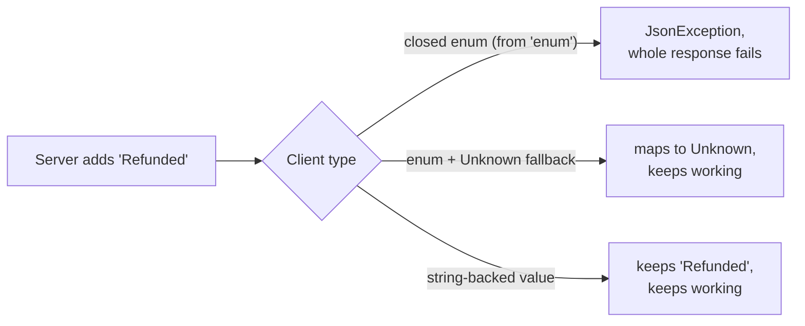

Adding a value to an enum feels like the most harmless change there is. You're not removing
anything, not renaming anything. Old values still mean what they meant.

```csharp
public enum OrderStatus { Pending, Paid, Shipped, Cancelled, Refunded }   // + Refunded
```

Then the first refunded order goes out through `GET /orders`, and a consumer's nightly import fails:

```
System.Text.Json.JsonException: The JSON value could not be converted to MyShop.Client.OrderStatus.
Path: $.items[17].status
```

Their generated client has a C# enum with four members. The fifth value doesn't fit, and the
deserializer gives up on the whole response, not just the one order.

So: **for responses, adding an enum value is a breaking change** for every client that maps your
enum to a closed type. And most generated clients do exactly that, because the OpenAPI document told
them the list was complete.

## Why: `enum` in OpenAPI means "this list is final"

By default, an ASP.NET Core API documents the C# enum like this (Swashbuckle without a string
converter even produced integers):

```json
"OrderStatus": {
  "type": "string",
  "enum": ["Pending", "Paid", "Shipped", "Cancelled"]
}
```

JSON Schema's `enum` is a validation keyword. It says: *the value must be one of these*. A client
generator takes that literally and produces a closed enum. A validating client or gateway rejects
anything else. That's correct for a list that truly never changes (`"asc"`/`"desc"`), and wrong for
almost every business status, type or category, which grow over the life of an API.

## The idea: an open-ended list of values

`x-extensible-enum` is an OpenAPI extension that came out of the Zalando RESTful API guidelines. It
says: *here are the values we know today; expect more later*:

```json
"OrderStatus": {
  "type": "string",
  "x-extensible-enum": ["Pending", "Paid", "Shipped", "Cancelled"]
}
```

The schema is now a plain `string`, so nothing validates it as a closed set. Tools that understand
the extension can still offer the known values for IntelliSense, documentation and examples. Many
organizations' API guidelines require it for every enum in a public API, and I think that's a
reasonable default.

:::note[A word on the standard]
`x-extensible-enum` is a vendor extension, not part of OpenAPI. Tool support varies, and the Zalando
guidelines themselves now describe open-ended value lists via `examples` plus a description. The
mechanics in this post apply to both; use what your organization's guidelines and your consumers'
tools expect.
:::

## Generating it with the built-in OpenAPI support

With `Microsoft.AspNetCore.OpenApi` (.NET 10 shown), a schema transformer turns every enum schema
into an extensible one. First, make sure enums serialize as strings, otherwise the whole exercise is
moot:

```csharp
builder.Services.ConfigureHttpJsonOptions(o =>
    o.SerializerOptions.Converters.Add(new JsonStringEnumConverter()));
```

Then the transformer:

```csharp
public sealed class ExtensibleEnumSchemaTransformer : IOpenApiSchemaTransformer
{
    public Task TransformAsync(OpenApiSchema schema,
        OpenApiSchemaTransformerContext context, CancellationToken ct)
    {
        var type = context.JsonTypeInfo.Type;
        type = Nullable.GetUnderlyingType(type) ?? type;
        if (!type.IsEnum)
            return Task.CompletedTask;

        var values = new JsonArray();
        foreach (var name in Enum.GetNames(type))
            values.Add(JsonNameOf(type, name));

        schema.Enum?.Clear();
        schema.Type = JsonSchemaType.String;
        schema.Format = null;
        schema.Extensions ??= new Dictionary<string, IOpenApiExtension>();
        schema.Extensions["x-extensible-enum"] = new JsonNodeExtension(values);

        return Task.CompletedTask;
    }

    private static string JsonNameOf(Type enumType, string memberName)
    {
        var member = enumType.GetField(memberName)!;
        return member.GetCustomAttribute<JsonStringEnumMemberNameAttribute>()?.Name
            ?? member.GetCustomAttribute<EnumMemberAttribute>()?.Value
            ?? memberName;
    }
}

builder.Services.AddOpenApi(o => o.AddSchemaTransformer<ExtensibleEnumSchemaTransformer>());
```

The `JsonStringEnumMemberName` attribute (new in .NET 9) and the older `[EnumMember]` let you
decouple wire names from C# names (`"on-hold"` instead of `OnHold`). The transformer has to use the
same name the serializer writes, so it reads them in the same order. If you use a naming policy on
the converter (`new JsonStringEnumConverter(JsonNamingPolicy.KebabCaseLower)`), apply it here too.

For Swashbuckle, the same logic lives in an `ISchemaFilter`. The structure is identical: clear
`Enum`, set `Type` to `string`, add the extension.

### Parameters: consider inlining

Enum-typed properties are usually emitted as a `$ref` to a shared component schema, and that's what
you want. For **query parameters**, be careful: some API portals and client generators resolve the
extension correctly on properties, but not on referenced parameter schemas. Teams I've worked with
ended up inlining the full schema for enum parameters so every tool picks it up:

```json
{
  "name": "status",
  "in": "query",
  "schema": { "type": "string", "x-extensible-enum": ["Pending", "Paid", "Shipped", "Cancelled"] }
}
```

Check your tools before deciding; it's a few extra lines in the transformer (or a parameter filter in
Swashbuckle) and only needed if one of them stumbles.

## The other half: tolerant clients

Documenting the list as open is only half the job. The consumers, including your own services that
call each other, have to *behave* openly. A plain C# enum with `JsonStringEnumConverter` still throws
on unknown values.

**Option 1: a fallback member.** A converter that maps anything unknown to a designated value:

```csharp
public sealed class TolerantEnumConverter<TEnum> : JsonConverter<TEnum>
    where TEnum : struct, Enum
{
    private static readonly TEnum Fallback = Enum.Parse<TEnum>("Unknown");

    public override TEnum Read(ref Utf8JsonReader reader, Type typeToConvert,
        JsonSerializerOptions options)
        => Enum.TryParse<TEnum>(reader.GetString(), ignoreCase: true, out var value)
            && Enum.IsDefined(value)
            ? value
            : Fallback;

    public override void Write(Utf8JsonWriter writer, TEnum value, JsonSerializerOptions options)
        => writer.WriteStringValue(value.ToString());
}

[JsonConverter(typeof(TolerantEnumConverter<OrderStatus>))]
public enum OrderStatus { Unknown, Pending, Paid, Shipped, Cancelled }
```

Simple, and the code is forced to think about `Unknown` in every `switch`. The downside: the original
value is lost, so you can't log or forward it. (This version ignores `[JsonStringEnumMemberName]`;
extend it if your wire names differ from the C# names.)

**Option 2: a string-backed value type.** This is the pattern the Azure SDKs call "expandable enums":

```csharp
[JsonConverter(typeof(OrderStatusJsonConverter))]
public readonly record struct OrderStatus(string Value)
{
    public static readonly OrderStatus Pending   = new("Pending");
    public static readonly OrderStatus Paid      = new("Paid");
    public static readonly OrderStatus Shipped   = new("Shipped");
    public static readonly OrderStatus Cancelled = new("Cancelled");

    public bool IsKnown => this == Pending || this == Paid || this == Shipped || this == Cancelled;

    public override string ToString() => Value;
}

public sealed class OrderStatusJsonConverter : JsonConverter<OrderStatus>
{
    public override OrderStatus Read(ref Utf8JsonReader reader, Type t, JsonSerializerOptions o)
        => new(reader.GetString()!);

    public override void Write(Utf8JsonWriter writer, OrderStatus value, JsonSerializerOptions o)
        => writer.WriteStringValue(value.Value);
}
```

Unknown values survive the round trip, can be logged and passed on, and known values still feel like
constants: `if (order.Status == OrderStatus.Shipped)`. This is what I use in client libraries.

## What about requests?

Extensibility is about what the *server* may add later. For **input**, the server should still
validate strictly: a client sending `"status": "Shiped"` must get a 400, not a silently stored typo.
An extensible schema doesn't change that. Validate against the values your server version knows, and
say so in the description.



## Comparison

| Representation | Values documented | Adding a value | Client experience | Notes |
|---|---|---|---|---|
| `integer` enum | numbers only | breaking for closed clients | `Value3` | meaningless on the wire, avoid |
| `string` + `enum` | ✅ | **breaking** for closed clients | real enum | only for truly fixed lists |
| `string` + `x-extensible-enum` | ✅ | non-breaking (if clients are tolerant) | depends on generator | common in org guidelines |
| `string` + `examples` + description | ✅ (informally) | non-breaking | plain string | standard OpenAPI |
| plain `string` | ❌ | non-breaking | no help at all | |

## Pitfalls

**Integers on the wire.** Without a string converter, enums are serialized as numbers. Reordering or
inserting members then silently changes the meaning of existing values. Always serialize enums as
strings in public APIs.

**Renaming a member.** With string serialization, renaming the C# member changes the wire value. That
*is* breaking, for requests and responses. Pin wire names with `[JsonStringEnumMemberName]` once an
API is public.

**Exhaustive `switch` in consumers.** A `switch` expression without a default arm throws a
`SwitchExpressionException` on a new value. Tolerant deserialization doesn't help if the next line
crashes. Always handle the unknown case explicitly.

**Generators that ignore the extension.** Some client generators know nothing about
`x-extensible-enum` and just produce a `string`. That's safe, but your consumers lose IntelliSense.
Check what your consumers' generators do with it, and document the known values in the description as
well.

**Using it everywhere, blindly.** Sort direction, boolean-like flags and HTTP-like verbs won't grow.
A closed `enum` is more honest there and gives clients better types.

## Enforce it

- **Lint the document:** a Spectral rule that fails on any `enum` keyword in a schema of type
  `string` (except in an allow-list) catches enums that slipped through without the transformer.
- **Breaking-change check:** a diff tool that compares the new `openapi.json` with the last released
  one flags added values in closed `enum`s on responses. The
  [OpenAPI diff post](/blog/2026-detecting-breaking-changes-with-openapi-diffs/) shows how.
- **A test for the client side:** deserialize a payload with an invented value (`"status": "Teleported"`)
  in your own client library and assert it doesn't throw.

## Summary

- For **responses**, adding an enum value breaks every client that generated a **closed enum** from
  your OpenAPI `enum`.
- Document business enums as **open-ended**: `type: string` with `x-extensible-enum` (or `examples`,
  depending on your guidelines).
- Generate it with a **schema transformer**, using the same wire names the serializer writes.
- Make **clients tolerant**: an `Unknown` fallback or, better, a **string-backed value type**.
- Still **validate requests strictly**, serialize enums as **strings**, and never rename wire values.
