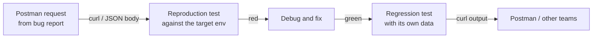

:::note[Series]
Part of the series [*Testing in practice*](/series/testing-in-practice/).
:::

Two messages I get in some form almost every week:

1. *"Your endpoint returns the wrong lines for this order. Here's my Postman request."*
2. *"We want to call your API from our service. Do you have an example payload?"*

The first one needs to become a test. The second one should come *from* a test. In both cases the
question is how much work the translation is. In many codebases it's surprisingly much, and the
reason is how the tests are written.

## The problem: test data that only C# can read

Here's a typical POST test:

```csharp
[TestMethod]
public async Task Should_Create_Order()
{
    var request = new CreateOrderRequest
    {
        CustomerNumber = "C-1000",
        Lines =
        [
            new CreateOrderLine { ProductNumber = "MUG-01", Quantity = 2 },
            new CreateOrderLine { ProductNumber = "PLATE-07", Quantity = 4 }
        ],
        ShippingAddress = new AddressDto { Street = "Main St 1", City = "Springfield", CountryCode = "US" }
    };

    var response = await Client.PostAsJsonAsync("api/v1/orders", request);

    Assert.AreEqual(HttpStatusCode.Created, response.StatusCode);
}
```

Nothing wrong with it as a test. But try to hand that payload to another team. You have to run the
serializer in your head: property naming policy, enum handling, how `null` is written, date formats.
And when the Postman request from the bug report arrives, you go the other way: read JSON, write
object initializers, hope you didn't miss a field.

Every translation step is a chance to test something slightly different from what the user sent.

## Keep test data in the wire format

The fix is boring: **requests and expected responses live as JSON files**, embedded in the test
assembly.

```text
Orders/
  Payloads/
    TwoLines.json
  Results/
    TwoLines.json
```

```csharp
[TestMethod]
public async Task Should_Create_Order_With_Two_Lines()
{
    var response = await Client.PostAsync("api/v1/orders", TestFiles.Json("Orders/Payloads/TwoLines.json"));

    await response.AssertJsonAsync(HttpStatusCode.Created, "Orders/Results/TwoLines.json", "id");
}
```

JSON is the format that's actually on the wire. You can paste it into Postman, curl, an `.http`
file, a ticket or a chat message without touching it. I wrote more about why this decision mattered
in the [retrospective on my test SDK](/blog/2021-aspnetcore-simple-mstest-sdk/); here I want to focus
on the round trip.

## C# → Postman: print every call as curl

Postman imports curl commands (*Import → Raw text*), and so does almost every other HTTP tool. So if
every test call can print itself as a curl command, handing a scenario to someone is copy and paste.

A `DelegatingHandler` on the test client does it:

```csharp
public sealed class CurlLoggingHandler(Uri publicBaseAddress, Action<string> write) : DelegatingHandler
{
    private static readonly HashSet<string> SecretHeaders = new(StringComparer.OrdinalIgnoreCase)
    {
        "Authorization", "Cookie", "X-Api-Key"
    };

    protected override async Task<HttpResponseMessage> SendAsync(HttpRequestMessage request, CancellationToken ct)
    {
        write(await ToCurlAsync(request, ct));
        return await base.SendAsync(request, ct);
    }

    private async Task<string> ToCurlAsync(HttpRequestMessage request, CancellationToken ct)
    {
        // The in-memory test server listens on http://localhost. Print the address people actually use.
        var url = new Uri(publicBaseAddress, request.RequestUri!.PathAndQuery);

        var curl = new StringBuilder($"curl --request {request.Method} '{url}'");

        var headers = request.Headers.Concat(request.Content?.Headers ?? Enumerable.Empty<KeyValuePair<string, IEnumerable<string>>>());
        foreach (var (name, values) in headers)
        {
            var value = SecretHeaders.Contains(name) ? "<redacted>" : string.Join(", ", values);
            curl.Append($" \\{Environment.NewLine}  --header '{name}: {value}'");
        }

        if (request.Content is not null)
        {
            var body = await request.Content.ReadAsStringAsync(ct);   // StringContent can be read again
            curl.Append($" \\{Environment.NewLine}  --data-raw '{body.Replace("'", "'\\''")}'");
        }

        return curl.ToString();
    }
}
```

Plug it into the client the base class creates:

```csharp
Client = _factory.CreateDefaultClient(
    new Uri("https://localhost/"),
    new CurlLoggingHandler(new Uri("https://localhost:5001/"), Console.WriteLine));
```

Every test's output now contains something like:

```bash
curl --request POST 'https://localhost:5001/api/v1/orders' \
  --header 'Authorization: <redacted>' \
  --header 'Content-Type: application/json; charset=utf-8' \
  --data-raw '{"customerNumber":"C-1000","lines":[{"productNumber":"MUG-01","quantity":2}]}'
```

MSTest captures console output per test, so it shows up in the test explorer and in the pipeline's
test results next to the failure.

:::caution[Redact by default]
Tokens in test logs end up in pipeline artifacts, screenshots and chat messages. Redact the
`Authorization` header by default. If someone really needs the token locally, make it an explicit,
local-only opt-in, never the default.
:::

## Postman → C#: reproduce, fix, keep

Now the other direction. The bug report contains a request like this (Postman's *Code → cURL*
export):

```bash
curl --location 'https://staging.shop.example.com/api/v1/orders/ORD-2026-0815/lines' \
  --header 'Authorization: Bearer <token>'
```

The workflow I use:

1. **Write a test with exactly that call.** Same route, same query, same payload as a JSON file.
2. **Run it against the environment where the bug happened** (see
   [testing against multiple environments](/blog/2026-testing-against-multiple-environments/)),
   with the expected result being what the user *expected*.
3. **Watch it fail**, debug, fix.
4. **Move it into the regular suite**, with its own test data instead of the user's order.

Step 1 looks like this:

```csharp
[TestClass]
[TestCategory("Reproduction")]
public sealed class Reproduce_Missing_Order_Lines : ApiTestBase
{
    [TestMethod]
    public async Task Should_Return_All_Three_Lines_Of_Order()
    {
        var response = await Client.GetAsync("api/v1/orders/ORD-2026-0815/lines");

        await response.AssertJsonAsync(HttpStatusCode.OK, "Reproductions/OrderLines/Expected.json");
    }
}
```

Because the expected response is a JSON file, I can often paste the user's actual response into it
and then edit it into what it *should* be. The diff between the two is the bug.

Step 4 matters. A reproduction against someone's real order is a great debugging tool and a
terrible regression test: the order changes, gets archived, or doesn't exist on the next
environment. Once the fix works, I rewrite the test to create its own order (with the same shape of
data that triggered the bug) and delete the reproduction.



## Recording real traffic as test templates

The step further: let a dev or QA environment **record requests** and turn them into test
templates. A tester or product owner clicks through a scenario, and you get the payloads and
responses as files.

ASP.NET Core's built-in HTTP logging can capture both bodies in a single log entry:

```csharp
if (builder.Environment.IsDevelopment() || builder.Environment.IsEnvironment("QA"))
{
    builder.Services.AddHttpLogging(options =>
    {
        options.LoggingFields = HttpLoggingFields.RequestMethod | HttpLoggingFields.RequestPath
                              | HttpLoggingFields.RequestQuery | HttpLoggingFields.RequestBody
                              | HttpLoggingFields.ResponseStatusCode | HttpLoggingFields.ResponseBody;
        options.RequestBodyLogLimit = options.ResponseBodyLogLimit = 64 * 1024;
        options.CombineLogs = true;   // one entry per request with request and response
    });
}

// ...
if (app.Environment.IsDevelopment() || app.Environment.IsEnvironment("QA"))
{
    app.UseHttpLogging();
}
```

From there it's a small tool that reads those entries (from your log sink) and writes
`Payloads/*.json`, `Results/*.json` and a test method skeleton per request. Headers aren't part of
the selected fields, so tokens never end up in the log.

This works well for JSON APIs. For file uploads, streams and multipart requests it doesn't, and I
don't try to force it.

:::caution[Never in production]
Request and response bodies contain personal data. Recording belongs to dev and QA environments with
test data, guarded by an environment check, and preferably behind a feature flag that's off by
default.
:::

## Comparing the approaches

| | C# object initializers | JSON files in the test project | Postman collection as the only test suite |
|---|---|---|---|
| Hand a payload to another team | ❌ serialize in your head | ✅ copy the file or the curl output | ✅ |
| Turn a bug report into a test | ⚠️ manual translation | ✅ paste the body | ✅ |
| Runs in the build, with the code | ✅ | ✅ | ⚠️ separate runner, separate repo state |
| Refactoring support (rename a property) | ✅ compiler helps | ⚠️ search and replace | ❌ |
| Readable diffs in pull requests | ⚠️ | ✅ | ⚠️ large exported JSON |
| Debug into the API from the test | ✅ | ✅ | ❌ |

I don't think Postman collections are bad. They're great for exploration and for consumers. They're
just not where my regression tests live. The tests live next to the code, and Postman gets fed
*from* them.

## Pitfalls

**Strongly typed payloads "for refactoring safety".** The compiler catches a renamed C# property,
but it can't tell you that you just broke every consumer, because the JSON name changed too. A JSON
file that suddenly doesn't match is the warning you actually want.

**Leaking environment details.** Curl output from a test run against staging contains the staging
URL and real IDs. That's fine inside the team, less fine in a public issue tracker.

**Reproductions that never die.** A `Reproduction` category that grows forever turns into a suite of
tests against data that no longer exists. Exclude it from the default run and delete each test once
its regression test exists.

**Serializer drift.** If the test client serializes differently from real consumers (case,
enums as numbers vs strings), your tests pass and consumers fail. Sending raw JSON files avoids
that by design.

## Make it measurable

Two simple checks keep the round trip working:

- **The curl output must run.** Occasionally take one from the test output and run it against a
  local instance. If it doesn't work (missing header, wrong base URL), fix the handler, not the
  command.
- **Count reproduction tests.** The `Reproduction` category should be close to zero most of the
  time. If it isn't, regression tests are missing.

## Summary

- Keep requests and expected responses as **JSON files**: the format that travels to Postman, curl
  and other teams without translation.
- Let every test call **print itself as curl**, with secrets **redacted by default**.
- Turn bug reports into tests by **pasting the request**, reproduce on the right environment, fix,
  then rewrite as a regression test **with its own data**.
- Recording traffic as test templates works well in **dev and QA only**, never in production.
- Postman is a great consumer tool; the regression suite belongs **next to the code**.
