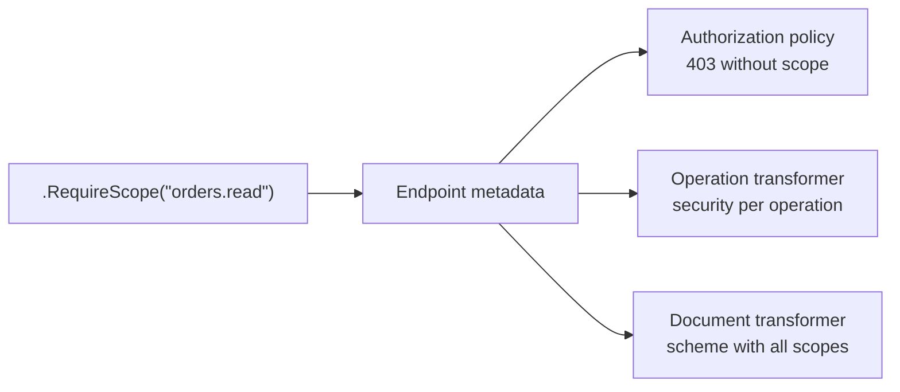

Once an organization has more than a handful of APIs, someone writes API guidelines, and sooner or
later those guidelines get a validator. The API gateway or the publishing pipeline lints every
OpenAPI document before it goes live, and rejects what doesn't comply.

The first time a team hits that validator, the error list is long: no API ID in `info`, missing
contact, operation IDs in PascalCase, no security scheme, scopes not declared, enums as integers,
dates as `date-time` when they're only dates. The tempting fix is to download the generated JSON,
patch it by hand and upload that. It works exactly once. The next release regenerates the document,
and the patches are gone.

The approach that lasts: **every guideline rule becomes either a convention in code or a
transformer in the generator**, and the generated document is compliant by construction. One team I
worked with got to the point where their document passed the organization's validator without any
manual step. This post shows how to get there with the built-in OpenAPI support in .NET 10 (the same
ideas work with Swashbuckle filters).

## A typical rule set

Guidelines differ, but these rules show up almost everywhere, and they're a good representative set:

| Rule | Example |
|---|---|
| `info` contains title, description, version, contact, an API ID and an audience | `x-api-id`, `x-audience: company-internal` |
| One document per major version | `v1`, `v2` |
| Every operation has a camelCase `operationId` and at least one tag | `getOrders`, tag `Orders` |
| OAuth2 security scheme with token URL; every operation declares its scopes | `orders.read` |
| Enums are strings, open-ended | `x-extensible-enum` |
| Dates without time are `string` with `format: date` | `2026-11-25` |
| Internal endpoints (health, diagnostics) are not in the document | no `/health` |

Let's go through them.

## The info block: from configuration

The values differ per version and per environment, so they belong in configuration, not in code:

```json
"ApiDocuments": {
  "v1": {
    "Title": "Orders API",
    "Description": "Place, track and cancel orders.",
    "ApiId": "4c1d5b8e-1f0a-4e5b-9d2c-7a3f6e9b0c11",
    "Audience": "company-internal",
    "ContactName": "Orders team",
    "ContactUrl": "https://wiki.example.com/orders-api"
  }
}
```

```csharp
public sealed class ApiDocumentInfo
{
    public required string Title { get; init; }
    public required string Description { get; init; }
    public required string ApiId { get; init; }
    public required string Audience { get; init; }
    public required string ContactName { get; init; }
    public required Uri ContactUrl { get; init; }
}

internal sealed class InfoTransformer(IOptionsMonitor<ApiDocumentInfo> options)
    : IOpenApiDocumentTransformer
{
    public Task TransformAsync(OpenApiDocument document,
        OpenApiDocumentTransformerContext context, CancellationToken ct)
    {
        var info = options.Get(context.DocumentName);   // named options per document

        document.Info = new OpenApiInfo
        {
            Title = info.Title,
            Description = info.Description,
            Version = context.DocumentName.TrimStart('v'),
            Contact = new OpenApiContact { Name = info.ContactName, Url = info.ContactUrl },
            Extensions = new Dictionary<string, IOpenApiExtension>
            {
                ["x-api-id"] = new JsonNodeExtension(JsonValue.Create(info.ApiId)),
                ["x-audience"] = new JsonNodeExtension(JsonValue.Create(info.Audience))
            }
        };
        return Task.CompletedTask;
    }
}
```

```csharp
foreach (var version in new[] { "v1", "v2" })
{
    builder.Services.AddOptions<ApiDocumentInfo>(version)
        .BindConfiguration($"ApiDocuments:{version}")
        .ValidateDataAnnotations()
        .ValidateOnStart();

    builder.Services.AddOpenApi(version, o => o.AddDocumentTransformer<InfoTransformer>());
}
```

`ValidateOnStart` means a missing API ID fails at startup, not at the gateway three steps later.
Whether you put a team e-mail into `contact` is up to your guideline; a URL to a team page ages better
than a mailbox.

## Operation IDs and tags: conventions in code

Minimal APIs make this easy: `WithName` becomes the `operationId`, `WithTags` the tags.

```csharp
var orders = app.MapGroup("/v1/orders").WithTags("Orders");

orders.MapGet("/", GetOrders).WithName("getOrders").RequireScope("orders.read");
orders.MapGet("/{id:guid}", GetOrder).WithName("getOrder").RequireScope("orders.read");
orders.MapPost("/", PlaceOrder).WithName("placeOrder").RequireScope("orders.write");
```

Explicit names are worth it, because the operation ID becomes the method name in every generated
client (`GetOrdersAsync`). Deriving it from the C# method name means a refactoring rename changes
your public contract, and that's a [breaking change](/blog/2026-detecting-breaking-changes-with-openapi-diffs/)
for every SDK.

Instead of trusting everyone to remember, let a transformer check it while the document is
generated:

```csharp
internal sealed partial class OperationConventionTransformer : IOpenApiOperationTransformer
{
    public Task TransformAsync(OpenApiOperation operation,
        OpenApiOperationTransformerContext context, CancellationToken ct)
    {
        var route = $"{context.Description.HttpMethod} {context.Description.RelativePath}";

        if (operation.OperationId is not { } id || !CamelCase().IsMatch(id))
            throw new InvalidOperationException(
                $"{route}: operationId '{operation.OperationId}' must be camelCase. Use .WithName(\"...\").");

        if (operation.Tags is not { Count: > 0 })
            throw new InvalidOperationException($"{route}: at least one tag is required. Use .WithTags(...).");

        return Task.CompletedTask;
    }

    [GeneratedRegex("^[a-z][a-zA-Z0-9]*$")]
    private static partial Regex CamelCase();
}
```

Throwing in a transformer breaks the document generation, which is exactly what you want in the
build-time generation and in tests. If that's too strict for your taste, collect the violations and
assert on them in a test instead.

## Scopes: one declaration, enforced and documented

This is my favourite part. In many codebases, the scope an endpoint requires is written down twice:
once in an authorization policy, and once in an OpenAPI annotation. Sooner or later the two disagree,
and the document promises `orders.read` while the code checks `orders.write`.

The fix is a single extension method that does both:

```csharp
public sealed record RequiredScopeMetadata(string Scope);

public static class ScopeEndpointExtensions
{
    public static TBuilder RequireScope<TBuilder>(this TBuilder builder, string scope)
        where TBuilder : IEndpointConventionBuilder
        => builder
            .WithMetadata(new RequiredScopeMetadata(scope))
            .RequireAuthorization(policy => policy
                .RequireAuthenticatedUser()
                .RequireAssertion(ctx => HasScope(ctx.User, scope)));

    private static bool HasScope(ClaimsPrincipal user, string scope) =>
        user.FindAll("scope")
            .SelectMany(c => c.Value.Split(' ', StringSplitOptions.RemoveEmptyEntries))
            .Contains(scope, StringComparer.Ordinal);
}
```

The metadata feeds the documentation. An operation transformer declares the scopes per operation:

```csharp
internal sealed class ScopeSecurityTransformer : IOpenApiOperationTransformer
{
    public Task TransformAsync(OpenApiOperation operation,
        OpenApiOperationTransformerContext context, CancellationToken ct)
    {
        var scopes = context.Description.ActionDescriptor.EndpointMetadata
            .OfType<RequiredScopeMetadata>().Select(m => m.Scope).Distinct().ToList();

        if (scopes.Count == 0)
            return Task.CompletedTask;

        operation.Security ??= [];
        operation.Security.Add(new OpenApiSecurityRequirement
        {
            [new OpenApiSecuritySchemeReference("oauth2", context.Document)] = scopes
        });
        return Task.CompletedTask;
    }
}
```

And a document transformer declares the scheme once, with every scope used anywhere in this document
and the token URL from configuration:

```csharp
internal sealed class OAuth2SchemeTransformer(IOptions<AuthOptions> auth)
    : IOpenApiDocumentTransformer
{
    public Task TransformAsync(OpenApiDocument document,
        OpenApiDocumentTransformerContext context, CancellationToken ct)
    {
        var scopes = context.DescriptionGroups
            .SelectMany(g => g.Items)
            .SelectMany(d => d.ActionDescriptor.EndpointMetadata.OfType<RequiredScopeMetadata>())
            .Select(m => m.Scope)
            .Distinct()
            .Order()
            .ToDictionary(s => s, s => $"Grants {s}.");

        document.Components ??= new OpenApiComponents();
        document.Components.SecuritySchemes ??= new Dictionary<string, IOpenApiSecurityScheme>();
        document.Components.SecuritySchemes["oauth2"] = new OpenApiSecurityScheme
        {
            Type = SecuritySchemeType.OAuth2,
            Flows = new OpenApiOAuthFlows
            {
                ClientCredentials = new OpenApiOAuthFlow
                {
                    TokenUrl = auth.Value.TokenEndpoint,
                    Scopes = scopes
                }
            }
        };
        return Task.CompletedTask;
    }
}
```

Now there is exactly one place where an endpoint's scope is defined, and the runtime check and the
document can't drift apart.



:::caution[401 or 403?]
A missing scope on a valid token is **403 Forbidden** (`insufficient_scope` in RFC 6750 terms), not
401. 401 means "I don't know who you are". The authorization policy above produces the right code
automatically: unauthenticated requests get a challenge (401), authenticated ones without the scope
get a 403.
:::

## Enums and dates

**Enums** should be strings with an open-ended list of values. The schema transformer for that is in
the [extensible enums post](/blog/2026-extensible-enums-x-extensible-enum/); register it in the same
`AddOpenApi` call.

**Dates** are mostly a matter of using the right .NET type. `DateOnly` is generated as
`type: string, format: date`, `DateTimeOffset` as `format: date-time`. The common violation is a
`DateTime` property that only ever holds a date, documented as `date-time`. Fix the type, not the
document. A schema transformer that adds an `example` (`2026-11-25`) for `DateOnly` is a nice touch,
because some validators require examples for formatted strings.

## Excluding what isn't part of the API

Health checks, diagnostics and internal callbacks don't belong in a public document:

```csharp
app.MapHealthChecks("/health").ExcludeFromDescription();
```

For controllers, `[ApiExplorerSettings(IgnoreApi = true)]` does the same. If your API has a public and
an internal part, two documents with `ShouldInclude` based on group names are cleaner than one
document with everything.

## Putting it together

```csharp
builder.Services.AddOpenApi(version, o =>
{
    o.AddDocumentTransformer<InfoTransformer>();
    o.AddDocumentTransformer<OAuth2SchemeTransformer>();
    o.AddOperationTransformer<OperationConventionTransformer>();
    o.AddOperationTransformer<ScopeSecurityTransformer>();
    o.AddSchemaTransformer<ExtensibleEnumSchemaTransformer>();
});
```

Five small classes, each responsible for one group of rules, all of them reusable. Put them into a
shared package, and every service in the organization gets compliant documents with one line of
registration. That's where the real payoff is: the guideline is implemented once instead of once per
team.

## Comparison

| Approach | Compliant after the next build? | Effort per service | Drift between code and docs |
|---|---|---|---|
| Patch the JSON by hand before publishing | ❌ lost on regeneration | high, every release | guaranteed |
| Annotations on every endpoint (scope twice, info in code) | ✅ | medium | likely |
| Transformers + conventions, per service | ✅ | medium, once | low |
| Shared package with transformers + `RequireScope` | ✅ | one line | none for covered rules |

## Pitfalls

**Claim mapping.** By default, the JWT bearer handler maps inbound claim types to long
`http://schemas...` URIs. The `scope` claim may arrive under a different name, and your scope check
silently fails for everyone. Set `options.MapInboundClaims = false` on the JWT bearer options.

**Scopes as one claim or many.** Some identity providers send `scope` as one space-separated string,
others as an array (`scp`), which becomes several claims. The `HasScope` helper above handles
multiple claims and space-separated values. Check which claim name your provider uses.

**Case sensitivity.** Scope values are case-sensitive (RFC 6749, section 3.3). Use ordinal comparison,
as above, and keep the casing consistent with what your identity provider issues.

**Validating only in the gateway.** If the first time anyone sees the validator's verdict is when
publishing, every violation is a late surprise. Run the organization's linter ruleset (most validators
are Spectral rulesets or can be exported as one) **in your own CI**, against the document generated at
build time.

**Generator upgrades.** The .NET 9 to 10 upgrade changed the OpenAPI object model substantially (see the
[.NET 9 OpenAPI post](/blog/2026-dotnet-9-openapi-problems-and-fixes/)). Shared transformers need a
version per major framework version, or at least multi-targeting.

## Enforce it

- **Lint in CI:** run the organization's ruleset against the build-time document and block the merge
  on errors.
- **Rule tests:** for rules that need application knowledge, for example "every endpoint that requires
  authorization declares at least one scope", write tests against the parsed document as shown in the
  [breaking-changes post](/blog/2026-detecting-breaking-changes-with-openapi-diffs/).
- **Snapshot:** commit the generated document, so every change to the info block, the scopes or the
  operation IDs is visible in review.

## Summary

- Don't patch generated OpenAPI documents by hand. **Every guideline rule becomes a convention or a
  transformer.**
- The **info block** comes from validated configuration, one set per document version.
- **Operation IDs** and **tags** are explicit in code; a transformer fails the generation when they're
  missing or wrongly cased.
- **One `RequireScope` call** enforces the scope at runtime *and* documents it, per operation and in the
  security scheme.
- Enums as **extensible strings**, dates as **`DateOnly`**, internal endpoints **excluded**.
- Package the transformers once for the whole organization, and run the guideline linter **in your own
  CI**, not only at the gateway.
