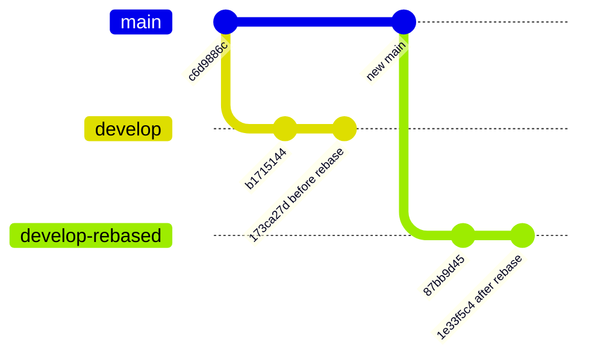

:::note[Series]
Part of the series [*Cloud, DevOps & observability*](/series/cloud-devops-observability/).
:::

Sooner or later, everyone has the moment. You rebased a long-running branch, resolved fifteen conflicts,
pushed with `--force`, and then notice that half of a feature is gone. Or you ran `git reset --hard` on
the wrong branch. Or you deleted a "wip" branch that wasn't merged after all.

The good news: **git almost never deletes commits right away.** It just stops pointing at them. And it
keeps a diary of everywhere your branches and your `HEAD` have pointed: the **reflog**. In one team I
worked with, a short wiki page called "Rebase gone wrong? Use git reflog" got more visits than most
architecture documents. This post is the longer version of it.

## What the reflog is

Every time `HEAD` or a branch moves (commit, checkout, rebase, reset, merge, pull, cherry-pick), git
writes a line into a local log: the old position, the new position, and what caused the move.

```text
$ git reflog
1e33f5c4 (HEAD -> develop) HEAD@{0}: rebase (finish): returning to refs/heads/develop
1e33f5c4 HEAD@{1}: rebase (pick): add new invoice export
87bb9d45 HEAD@{2}: rebase (pick): fix rounding in order totals
3f636004 HEAD@{3}: rebase (continue): refactor order validation
c6d9886c HEAD@{4}: rebase (start): checkout origin/main
173ca27d HEAD@{5}: commit: add new invoice export
b1715144 HEAD@{6}: commit: fix rounding in order totals
...
```

Read it from the top: `HEAD@{0}` is now, `HEAD@{1}` is one move ago, and so on. Every line has the
commit SHA you can go back to. The line just before `rebase (start)` (here `HEAD@{5}`, commit
`173ca27d`) is **your branch exactly as it was before the rebase**.



The old commits (`b1715144`, `173ca27d`) aren't on any branch anymore. But they still exist, and the
reflog knows their SHAs.

## Recovery 1: a rebase gone wrong

**Don't panic, and don't start fixing forward yet.** First, put a name on the old state so it can't get
lost:

```bash
git branch rescue/before-rebase 173ca27d
```

That's the most important command in this post. A branch is just a pointer. Creating one costs nothing,
changes nothing in your working copy, and makes the old commits reachable again, so no cleanup can ever
remove them.

(The original wiki page did it in two steps: check out the old commit, then create a branch there. That
works too, but `git branch <name> <sha>` does it in one step without leaving you in a detached `HEAD`.)

Now you can compare calmly:

```bash
# What's different between the old branch and the rebased one?
git diff rescue/before-rebase develop

# Commit by commit: which commits changed during the rebase, and how?
git range-diff origin/main rescue/before-rebase develop
```

`git range-diff` is underrated. It shows the commits before and after a rebase side by side and
highlights which ones changed. A conflict resolution that dropped a hunk shows up right there.

Then decide:

```bash
# Option A: throw away the rebase and go back entirely
git switch develop
git reset --hard rescue/before-rebase

# Option B: keep the rebase, cherry-pick or re-apply what got lost
git switch develop
git checkout rescue/before-rebase -- src/MyShop.Orders/Invoices/InvoiceExporter.cs
```

Right after a rebase or reset, there's also the shortcut `ORIG_HEAD`, which points to where the branch
was before the last "dangerous" operation:

```bash
git reset --hard ORIG_HEAD
```

It only remembers one step back, though. The reflog remembers everything.

## Recovery 2: you already force-pushed

If the broken rebase is already on the server, recover locally as above, then push the repaired branch.
Use `--force-with-lease`, never plain `--force`:

```bash
git push --force-with-lease origin develop
```

`--force-with-lease` refuses to overwrite the remote branch if someone else pushed in the meantime.
Plain `--force` would silently throw away their commits too, and their commits are not in *your*
reflog.

If a teammate already pulled the broken version, they need to reset their local branch to the repaired
one (`git fetch && git reset --hard origin/develop`) after saving anything of their own.

## Recovery 3: hard reset on the wrong branch

```text
$ git reflog
1a3f7c55 HEAD@{0}: reset: moving to origin/main
cd5c30d6 HEAD@{1}: commit: add payment retry policy
...
```

```bash
git branch rescue/payment-retry cd5c30d6    # or: git reset --hard HEAD@{1}
```

Committed work is never lost by `reset --hard`. **Uncommitted** work is, because it was never a commit.
More on that below.

## Recovery 4: a deleted branch

Deleting a branch deletes the pointer, not the commits. The reflog shows the SHA:

```text
1a3f7c55 HEAD@{26}: delete_branch: wip [b2eb358d109d206644a79109593d2533587fc154]
b2eb358d HEAD@{28}: checkout: moving from qa to wip
```

Some tools (like the one that produced the log above) write the deleted branch's SHA directly into the
reflog. If not, look for the last `checkout: moving from wip to ...` line: the SHA there is the tip of the
branch when you left it.

```bash
git branch wip b2eb358d
```

## Useful reflog variations

```bash
git reflog show develop             # moves of one branch instead of HEAD
git reflog --date=iso               # with timestamps
git log -g --oneline --grep="invoice"   # search reflog entries by commit message
git show develop@{yesterday}        # where was develop yesterday?
git diff develop@{2.hours.ago} develop
git switch -                        # back to the previous branch (uses the reflog too)
```

The `@{...}` syntax works everywhere git accepts a commit: `diff`, `log`, `reset`, `branch`, `switch`.

## Where the reflog can't help

| Situation | Recoverable? | How |
|---|---|---|
| Bad rebase, local or pushed | ✅ | reflog → `git branch rescue/... <sha>` |
| `reset --hard` of committed work | ✅ | reflog |
| Deleted branch | ✅ | reflog |
| Dropped stash | ⚠️ usually | `git fsck --unreachable \| grep commit`, then inspect |
| Commits only on a colleague's machine | ❌ in your reflog | their reflog |
| Uncommitted changes after `reset --hard` / `checkout -- .` | ❌ mostly | IDE local history, maybe `git fsck --lost-found` for staged files |
| Fresh clone | ❌ | the reflog is local and starts empty |
| Older than the expiry | ❌ | default 90 days (30 for unreachable commits) |

Two takeaways from that table:

- **The reflog is local.** It isn't pushed, and a new clone doesn't have one. The person who did the
  rebase is the one who can recover it.
- **Commit early, even messy.** Anything that was ever committed, or even just staged, can usually be
  found. Uncommitted edits in the working tree are the one thing git really can't give back. A
  `wip` commit you squash later is cheap insurance.

## Make the accident less likely

The reflog is the safety net. A few settings and server rules make you need it less:

```bash
git config --global rebase.autoStash true      # stash and re-apply local changes around a rebase
git config --global rebase.updateRefs true     # move stacked branches along during a rebase
git config --global push.default current
git config --global alias.pushf "push --force-with-lease --force-if-includes"
```

On the server side:

- **Protect shared branches.** No force pushes to `main`, `develop` or release branches. Every
  platform supports this (branch protection rules on GitHub, branch policies on Azure DevOps).
- **Review rebases of long-lived branches** with `git range-diff`. The diff of the PR alone doesn't show
  that a commit lost a hunk during conflict resolution.
- **Prefer short-lived branches.** A rebase over three days of changes is a non-event. A rebase over three
  weeks with fifteen conflicts is where accidents happen.

## A small routine before risky operations

Before any rebase or reset on a branch with valuable work:

```bash
git branch backup/$(git branch --show-current)-$(date +%Y%m%d-%H%M)
```

One alias and you don't even need to read the reflog. Delete those
branches once a week.

## Summary

- Git rarely deletes commits. The **reflog** records every position `HEAD` and your branches had.
- After an accident, **first create a branch** at the old SHA: `git branch rescue/x <sha>`. Then
  investigate.
- Use **`git range-diff`** to see what a rebase changed, and `ORIG_HEAD` for a quick one-step undo.
- Push repairs with **`--force-with-lease`**, and protect shared branches from force pushes.
- The reflog is **local** and expires. Uncommitted work isn't in it, so **commit early**.
