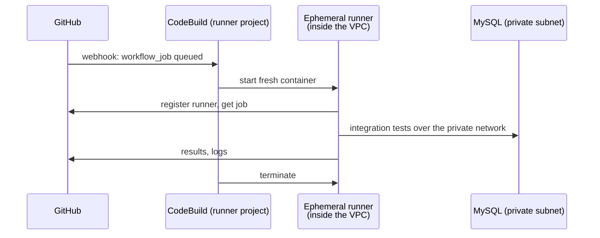

:::note[Series]
Part of the series [*Cloud, DevOps & observability*](/series/cloud-devops-observability/).
:::

GitHub-hosted runners are great until your tests need something that isn't on the internet. In one
platform I worked on, a large .NET backend moved from another CI system to GitHub Actions. The build
was easy. The integration tests weren't: about a thousand of them, many of which talked to a MySQL
database that lived in a private AWS VPC.

This post is about how we got those tests running: the VPN detour that didn't work, the move to AWS
CodeBuild as a self-hosted runner, the configuration details that cost us time, and the benchmark that
showed where the real speed-up came from.

## Attempt 1: GitHub-hosted runner plus VPN

The first idea was the obvious one. Run on a normal runner, open an OpenVPN tunnel into the VPC as the
first step, run the tests.

The results, from the team's benchmark notes:

| Setup | Outcome |
|---|---|
| Hosted runner, **no** VPN | 52 minutes, then failures: *Unable to connect to any of the specified MySQL hosts* |
| Hosted runner, **with** VPN | cancelled manually after 1 h 46 min, no test results |

Every test that touched the database paid the latency of the tunnel, plus the tunnel itself was one more
moving part that could drop mid-run. You could tune that, but the architecture is wrong: the tests
should run **where the data is**, not drag every query across a VPN.

## The idea: bring the runner into the VPC

A self-hosted runner is a machine that registers itself with GitHub and picks up jobs. The classic way is
a long-lived VM with the runner agent installed. That works, and it comes with all the problems of a
pet server: patching, disk filling up with old builds, state leaking from one job to the next, and a
machine that costs money while idle.

AWS CodeBuild can act as a **GitHub Actions runner on demand**. When a job is queued, GitHub sends a
webhook to CodeBuild. CodeBuild starts a fresh container (or EC2 instance) with the runner agent,
registers it for exactly that job, runs the steps from your workflow, reports back and throws the
machine away.



What that gives you:

- **Ephemeral runners.** Every job starts clean. No leftover state, no "works on the second run".
- **Network placement.** The runner sits in a private subnet and reaches the database by its private
  DNS name. No VPN.
- **Pay per build minute.** Nothing runs while nobody pushes.
- **Your workflow files stay normal GitHub Actions.** CodeBuild ignores its own `buildspec.yml` and
  executes the workflow steps.

## Setting it up

### 1. The CodeBuild project

Create a CodeBuild project of type **Runner project**, with GitHub (or GitHub Enterprise) as the source,
and enable the webhook with the event type **`WORKFLOW_JOB_QUEUED`**. Choose a managed image (Amazon
Linux or Ubuntu standard) and a default compute size. Turn on *privileged mode* only if you need Docker
inside the job, for example for Testcontainers.

The project name matters, because it becomes part of the runner label. In infrastructure code (we
used CDK), the relevant part looks roughly like this:

```csharp
var runner = new Project(this, "ShopCiRunner", new ProjectProps
{
    ProjectName = "shop-ci-runner",
    Source = Source.GitHub(new GitHubSourceProps
    {
        Owner = "my-org",
        Repo = "shop-backend",
        Webhook = true,
        WebhookFilters = [FilterGroup.InEventOf(EventAction.WORKFLOW_JOB_QUEUED)],
    }),
    Environment = new BuildEnvironment
    {
        BuildImage = LinuxBuildImage.AMAZON_LINUX_2_5,
        ComputeType = ComputeType.LARGE,
    },
    Vpc = vpc,
    SubnetSelection = new SubnetSelection { SubnetType = SubnetType.PRIVATE_WITH_EGRESS },
    SecurityGroups = [runnerSecurityGroup],
});

database.Connections.AllowDefaultPortFrom(runnerSecurityGroup, "CI runner integration tests");
```

### 2. The workflow

The only change to the workflow is `runs-on`:

```yaml
name: Build & test
on:
  pull_request:
  push:
    branches: [main]

jobs:
  build-and-test:
    runs-on: codebuild-shop-ci-runner-${{ github.run_id }}-${{ github.run_attempt }}
    steps:
      - uses: actions/checkout@v4

      - uses: actions/setup-dotnet@v4
        with:
          dotnet-version: '10.0.x'

      - run: dotnet restore Shop.slnx
      - run: dotnet build Shop.slnx -c Release --no-restore
      - run: dotnet test Shop.slnx -c Release --no-build --settings ci.runsettings
        env:
          ConnectionStrings__Shop: ${{ env.SHOP_DB_CONNECTION }}
```

The label is `codebuild-<project-name>-<run_id>-<run_attempt>`. The run ID and attempt make the label
unique per job, so a re-run doesn't get confused with the previous runner.

You can override image and size per job, right in the label:

```yaml
runs-on:
  - codebuild-shop-ci-runner-${{ github.run_id }}-${{ github.run_attempt }}
    image:arm-3.0
    instance-size:large
```

That's handy for building ARM64 images natively (more on that in
[Linux ARM64 containers](/blog/2026-linux-arm64-containers/)) without a second project.

### 3. Secrets

Secrets that the runner needs inside AWS (like the database connection string) don't have to live in
GitHub at all. Put them in Secrets Manager and reference them as environment variables on the CodeBuild
project with type `SECRETS_MANAGER`. They show up as normal environment variables in the job. Secrets
that are about GitHub (deploy keys, package tokens) stay in GitHub secrets.

## The errors that cost us time

| Symptom | Cause |
|---|---|
| Job stays *Queued* forever | Webhook missing, or its filter doesn't include `WORKFLOW_JOB_QUEUED`. Check repo *Settings → Webhooks → Recent deliveries*. |
| *No runner matching the specified labels* | The label doesn't match the project name exactly. |
| Docker commands fail | Privileged mode is off. |
| Restore fails with timeouts | Private subnet without a NAT gateway: no internet, so no NuGet. |
| `Error while fetching runner token ... 403` | See below. |

The last one is the most misleading:

```text
Error while fetching runner token: error code 400: Runner token unavailable:
POST https://github.example.com/api/v3/repos/<owner>/<repo>/actions/runners/registration-token: 403
Phase complete: DOWNLOAD_SOURCE State: FAILED
```

A 403 looks like a permission problem, and you'll spend an hour on token scopes. With GitHub Enterprise
Server on a private network, it usually means **CodeBuild can't reach the GitHub API at all**. The fix is
networking: put the project in a VPC and subnet that has a route to your GitHub instance (NAT, peering or
Direct Connect), with a security group that allows outbound 443.

For the GitHub connection token itself, the permissions are: contents read, commit statuses read/write,
webhooks read/write, pull requests read, and **administration read/write**. The last one is needed to
register runners, and it's the one people leave out.

## Where the speed actually came from

Once the tests ran in the VPC, the next question was: how fast can we make them? The team benchmarked
compute sizes against MSTest parallelization settings. The full suite, on CodeBuild:

| Parallelization | Compute | Total | Tests |
|---|---|---|---|
| Class level, 1 worker | 2 vCPU, 4 GB | — | 20+ min |
| Class level, 1 worker | 8 vCPU, 16 GB | 15–16 min | 13 min |
| Method level, default workers | 2 vCPU, 4 GB | 30 min | 24 min |
| Method level, default workers | 4 vCPU, 8 GB | 23 min | 19 min |
| Method level, default workers | **8 vCPU, 16 GB** | **15 min** | **10.5 min** |
| Class level, default workers | 8 vCPU, 16 GB | 25 min | 19 min |
| Method level, default workers | 36 vCPU, 72 GB | 15.5 min | 10 min |
| **Matrix of 3 jobs**, method level | 8 vCPU each | **9–12 min** | 5–7 min per shard |

Three things I take away from that table:

1. **The parallelization settings mattered as much as the hardware**, and not always in the obvious
   direction. On the same 8-vCPU machine, method level with default workers was the fastest, class
   level with a single worker came close, and class level with default workers was almost 10 minutes
   slower than both. With a shared database behind the tests, more parallelism can mean more
   contention. You have to measure your own suite.
2. **More cores stop helping early.** 36 vCPUs were no faster than 8. At that point the database was
   the bottleneck, not the CPU.
3. **Sharding across jobs** gave the next real step. Three parallel jobs, each with a third of the tests.

```xml
<!-- ci.runsettings -->
<RunSettings>
  <MSTest>
    <Parallelize>
      <Workers>0</Workers>          <!-- 0 = one per core -->
      <Scope>MethodLevel</Scope>
    </Parallelize>
  </MSTest>
</RunSettings>
```

One warning from the matrix runs: in one attempt, about 150 tests were **missing** from the results. The
shards were split by a filter, and some tests matched no shard. If you shard, add a step that compares
the total number of executed tests with the expected number and fails if they differ. Otherwise a faster
pipeline may simply be running fewer tests.

Method-level parallelism also only works if tests are isolated: no shared rows, no static state, unique
data per test. If your suite gets flaky after switching, that's what it's telling you.

## Alternatives

| | GitHub-hosted | Hosted + VPN | Long-lived VM runner | CodeBuild runner | Actions Runner Controller (Kubernetes) |
|---|---|---|---|---|---|
| Reach private resources | ❌ | ⚠️ slow, fragile | ✅ | ✅ | ✅ |
| Clean environment per job | ✅ | ✅ | ❌ | ✅ | ✅ |
| Maintenance | none | VPN config | patching, disk, scaling | project config | cluster |
| Cost while idle | none | none | yes | none | cluster |
| Good fit | public dependencies | rarely | small teams, special hardware | AWS shops | teams already on Kubernetes |

## Pitfalls

- **Self-hosted runners on public repositories.** A fork's pull request could run arbitrary code inside
  your VPC. Only use self-hosted runners on private repositories, or require approval for workflows from
  outside contributors.
- **Too broad an IAM role.** The CodeBuild service role is what the job can do in your AWS account. It
  needs to read its secrets and write logs. It does not need admin.
- **Integration tests against a shared database.** Parallel runs from several pull requests hit the same
  data. Use a schema or database per run, or containers for the database where possible.
- **Forgetting the NAT gateway.** Private subnet plus no egress means no NuGet, no `setup-dotnet`, no
  actions download.

## Measure it

- Keep the benchmark table. Re-run it when the test suite grows significantly or when you change the
  compute size.
- Watch *queue time* separately from *run time*. In the measurements above, waiting for a runner ranged
  from one second to over two minutes depending on instance size. Large instances took noticeably
  longer to start.
- Fail the pipeline if the executed test count drops unexpectedly. Speed that comes from skipped tests is
  not speed.

## Summary

- Tests that need private resources should run **inside the network**, not through a VPN from a hosted
  runner.
- **AWS CodeBuild runner projects** give you ephemeral, VPC-placed runners with a one-line change to
  `runs-on`.
- The webhook needs **`WORKFLOW_JOB_QUEUED`**, the label must match the project name, and a
  **403 on the runner token usually means networking**.
- **Method-level parallelism** and **sharding** made the suite fast. More cores beyond 8 didn't.
- When you shard, **verify the test count**. Self-hosted runners belong on **private repositories only**.
