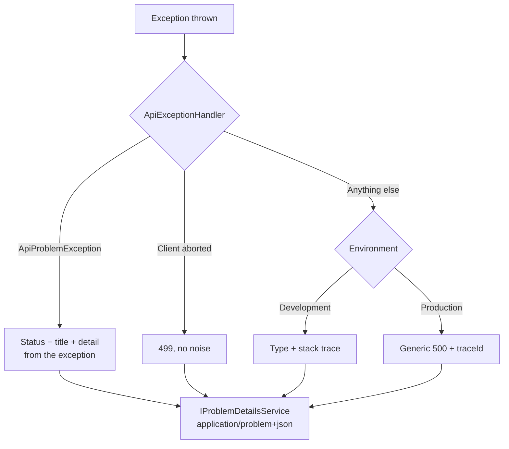

:::note[Series]
Part of the series [*ASP.NET Core from the ground up*](/series/aspnetcore-from-the-ground-up/).
:::

Ask the frontend team of a mature API how they handle errors and you'll often hear: "It depends on
the endpoint." One returns `{ "error": "..." }`, another a plain string, a third a 200 with
`success: false`, and the old ones return whatever `BadRequest(exception.Message)` produced. Every
client needs a different parser, and somewhere a stack trace leaks into a production response.

This post sets up **one** error format for the whole API, produced in **one** place. The next post
covers logging, and the one after that why this lets you delete almost every `try/catch` in your
endpoints.

## The format: ProblemDetails

[RFC 9457](https://www.rfc-editor.org/rfc/rfc9457) (which replaced RFC 7807) defines a standard JSON
error body with the media type `application/problem+json`:

```json
{
  "type": "https://tools.ietf.org/html/rfc9110#section-15.5.10",
  "title": "Order already exists",
  "status": 409,
  "detail": "An order with number 'ORD-2026-0042' already exists.",
  "instance": "POST /orders",
  "traceId": "00-4bf92f3577b34da6a3ce929d0e0e4736-00f067aa0ba902b7-01",
  "orderNumber": "ORD-2026-0042"
}
```

`title` is a short, stable summary. `detail` explains this occurrence. Everything else is an
**extension member**, like `orderNumber` above. ASP.NET Core has a `ProblemDetails` class and
produces this format for its own errors (400 validation errors, 404 from routing) once you turn it on.

## Turning it on

```csharp
builder.Services.AddProblemDetails(options =>
{
    options.CustomizeProblemDetails = context =>
    {
        context.ProblemDetails.Instance =
            $"{context.HttpContext.Request.Method} {context.HttpContext.Request.Path}";

        context.ProblemDetails.Extensions["traceId"] =
            Activity.Current?.Id ?? context.HttpContext.TraceIdentifier;
    };
});

builder.Services.AddExceptionHandler<ApiExceptionHandler>();

var app = builder.Build();

app.UseExceptionHandler();   // first in the pipeline
app.UseStatusCodePages();    // empty 401/404/405 responses become ProblemDetails too
```

Three pieces:

- **`AddProblemDetails`** registers `IProblemDetailsService`, which writes ProblemDetails responses
  for the exception handler, status code pages and the developer exception page.
- **`UseExceptionHandler`** catches unhandled exceptions from everything after it.
- **`IExceptionHandler`** (since .NET 8) is where you decide what an exception means.

The `traceId` extension is the most useful line here. When a user reports an error, that ID leads
directly to the request's logs and traces.

## Exceptions that carry their meaning

The handler needs to know which status code an exception stands for. I use a small hierarchy of
exceptions that carry that information:

```csharp
public abstract class ApiProblemException(
    int statusCode, string title, string? detail = null,
    IReadOnlyDictionary<string, object?>? extensions = null)
    : Exception(detail ?? title)
{
    public int StatusCode { get; } = statusCode;
    public string Title { get; } = title;
    public string? Detail { get; } = detail;
    public IReadOnlyDictionary<string, object?> Extensions { get; } = extensions ?? new Dictionary<string, object?>();
}

public sealed class NotFoundProblem(string title, string? detail = null, IReadOnlyDictionary<string, object?>? extensions = null)
    : ApiProblemException(StatusCodes.Status404NotFound, title, detail, extensions);

public sealed class ConflictProblem(string title, string? detail = null, IReadOnlyDictionary<string, object?>? extensions = null)
    : ApiProblemException(StatusCodes.Status409Conflict, title, detail, extensions);

public sealed class BusinessRuleProblem(string title, string? detail = null, IReadOnlyDictionary<string, object?>? extensions = null)
    : ApiProblemException(StatusCodes.Status422UnprocessableEntity, title, detail, extensions);
```

In business code, throwing one reads like a sentence:

```csharp
if (await orders.ExistsAsync(command.OrderNumber, ct))
{
    throw new ConflictProblem(
        "Order already exists",
        $"An order with number '{command.OrderNumber}' already exists.",
        new Dictionary<string, object?> { ["orderNumber"] = command.OrderNumber });
}
```

One codebase I worked on had a rule I still follow: **describe the error so that someone can fix it
without reading the code.** Not "Invalid input", but which value was expected and which one arrived.

It also avoided throwing framework exceptions like `InvalidOperationException` for domain errors.
Those mean "programming error" and should stay a 500. A domain error deserves its own type.

## The handler

```csharp
internal sealed class ApiExceptionHandler(
    IProblemDetailsService problemDetails,
    IHostEnvironment environment) : IExceptionHandler
{
    public async ValueTask<bool> TryHandleAsync(HttpContext http, Exception exception, CancellationToken ct)
    {
        var problem = exception switch
        {
            ApiProblemException e => FromApiProblem(e),
            BadHttpRequestException e => new ProblemDetails { Status = e.StatusCode, Title = "Bad request" },
            OperationCanceledException when http.RequestAborted.IsCancellationRequested =>
                new ProblemDetails { Status = 499, Title = "Client closed request" },
            _ => Unexpected(exception)
        };

        http.Response.StatusCode = problem.Status ?? StatusCodes.Status500InternalServerError;

        return await problemDetails.TryWriteAsync(new ProblemDetailsContext
        {
            HttpContext = http,
            ProblemDetails = problem,
            Exception = exception
        });
    }

    private static ProblemDetails FromApiProblem(ApiProblemException e)
    {
        var problem = new ProblemDetails { Status = e.StatusCode, Title = e.Title, Detail = e.Detail };
        foreach (var (key, value) in e.Extensions)
            problem.Extensions[key] = value;
        return problem;
    }

    private ProblemDetails Unexpected(Exception exception) => environment.IsDevelopment()
        ? new ProblemDetails
          {
              Status = StatusCodes.Status500InternalServerError,
              Title = exception.GetType().Name,
              Detail = exception.ToString()
          }
        : new ProblemDetails
          {
              Status = StatusCodes.Status500InternalServerError,
              Title = "An unexpected error occurred."
          };
}
```

The important design decision is in `Unexpected`: **in production, an unexpected error says nothing
except "something went wrong" and the trace ID.** One team I worked with was explicit about the
reason: unexpected errors in production are rare under normal use, but an attacker can provoke them
deliberately, and every exception message, type name or SQL fragment in the response is feedback for
optimizing the next attempt. The full details go to the log, correlated by the trace ID.

That team had a third category for exactly that reason: an exception type whose message was
**meant for the user** ("The delivery date must be in the future"). Only that type's text reached
the response in production. That's what `ApiProblemException` is here: anything thrown as one is,
by definition, safe to show.

You can register multiple `IExceptionHandler`s. They run in registration order until one returns
`true`. That's handy for keeping, say, a database-specific mapping in the data access project, but
for most APIs one handler with a `switch` is easier to read.



## Validation errors

For validation, ASP.NET Core already has `ValidationProblemDetails` with an `errors` dictionary:

```json
{
  "title": "One or more validation errors occurred.",
  "status": 400,
  "errors": {
    "Quantity": [ "The field Quantity must be between 1 and 100." ]
  }
}
```

Controllers with `[ApiController]` return this automatically. For minimal APIs, .NET 10 adds built-in
validation with `builder.Services.AddValidation()`, and before that you return
`TypedResults.ValidationProblem(errors)`. Whether invalid input should be 400 or 422 is a debate I'll
leave to the [REST and OpenAPI series](/series/rest-and-openapi-design/); what matters is that you
pick one and use it consistently.

## Comparison

| | try/catch per endpoint | Custom middleware | `IExceptionHandler` + ProblemDetails |
|---|---|---|---|
| One error format | ❌ depends on the developer | ✅ | ✅ |
| Uses framework ProblemDetails for 404/405/validation | ❌ | Partly | ✅ |
| Works with status code pages and dev exception page | ❌ | ❌ | ✅ |
| Production-safe by default | ❌ | If you build it | If you build it (see above) |
| Code to maintain | A lot, spread everywhere | Medium | Small |

Before .NET 8, a custom middleware with a `try/catch` around `next(context)` and a set of
"strategies" per exception type was the standard approach, and I've written several. They work.
`IExceptionHandler` is the same idea with less code, and it integrates with everything else the
framework produces.

## Pitfalls

**The exception handler isn't first.** Anything registered before `UseExceptionHandler()` isn't
covered.

**Response already started.** If an endpoint has started streaming the response, the status code
can't be changed anymore. The handler can only abort. Validate before you start streaming.

**`Results.Problem` vs. throwing.** Returning `TypedResults.Problem(...)` for an expected outcome is
fine and cheaper. Throwing is for when you're deep in a service and the endpoint shouldn't have to
know. Both end up in the same format, which is the point.

**Leaking via extensions.** It's tempting to put the inner exception message into an extension
"for debugging". In production, that's the same leak as a stack trace.

## How to enforce it

- An **integration test** per category: a 404, a 409, a validation error, an unexpected exception.
  Assert `Content-Type: application/problem+json`, the status code and that a `traceId` is present.
- An **unexpected-error test in production mode** (`UseEnvironment("Production")` on the factory)
  that asserts the response contains neither the exception type nor the message.
- A **code rule or analyzer** that bans `throw new Exception(...)` and `InvalidOperationException`
  in feature code, so domain errors use the problem types.

## Summary

- Use **ProblemDetails** (RFC 9457) for every error, so clients need exactly one error parser.
- `AddProblemDetails` + **`IExceptionHandler`** + `UseExceptionHandler()` first in the pipeline.
- Let **exceptions carry their status code** and a description that helps someone fix the problem.
- In production, unexpected errors return **nothing but a generic message and the trace ID**.
- Add the **trace ID** to every problem response, so a user report leads straight to the logs.

*Previous: [Security filters](/blog/2026-security-filters/) ·
Next: [Error logging](/blog/2026-error-logging/)*
