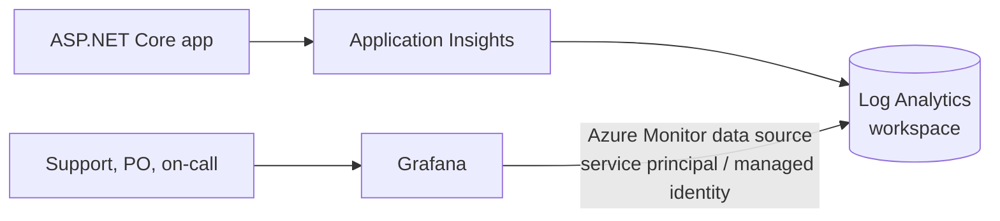

:::note[Series]
Part of the series [*Cloud, DevOps & observability*](/series/cloud-devops-observability/).
:::

The Azure portal is a fine place for developers to investigate an incident. It's a terrible place for
everyone else. Product owners, support engineers and the on-call person from another team don't want
to learn the portal's blade navigation, and often they shouldn't have access to the subscription
anyway.

In one organization I worked with, the answer was Grafana: a central Grafana instance with an Azure
Monitor data source per team, and dashboards built from the same KQL queries the developers already
used. This post covers how to get from a query to a useful dashboard, how variables turn one panel into
a search tool, how to keep those filters fast, and how to stop dashboards from becoming unmaintained
click-art.

## The setup in one picture



Grafana talks to the Log Analytics workspace through the built-in **Azure Monitor data source**,
authenticated with a service principal or, in Azure Managed Grafana, a managed identity that has the
*Log Analytics Reader* role. Users only need access to Grafana, not to Azure.

Because Grafana queries the **workspace**, you use the workspace schema: `AppRequests`, `AppTraces`,
`AppExceptions`, `TimeGenerated`, `Properties`, not the classic `requests`/`timestamp` names. (See
[KQL fundamentals](/blog/2026-kql-fundamentals/) for the mapping.)

## Step 1: develop the query in the portal

Same as for alerts: build it where you have autocomplete and fast feedback.

```kusto
AppTraces
| where TimeGenerated >= ago(12h)
| where SeverityLevel >= 3
| project TimeGenerated, AppRoleName, SeverityLevel, Message
```

## Step 2: a panel, and the `$__timeFilter` macro

In Grafana, create a dashboard, add a visualization, choose the Azure Monitor data source, set the
service to **Logs** (not Metrics), select the workspace as the resource, and paste the query. Then
replace the hard-coded time filter with a **macro**:

```kusto
AppTraces
| where $__timeFilter(TimeGenerated)
| where SeverityLevel >= 3
| project TimeGenerated, AppRoleName, SeverityLevel, Message
| order by TimeGenerated desc
```

`$__timeFilter(TimeGenerated)` expands to a `between` over the dashboard's time picker. Now the panel
follows whatever range the user selects. Other useful macros are `$__timeFrom()`, `$__timeTo()` and
`$__interval`, which gives you a bin size that matches the panel width:

```kusto
AppRequests
| where $__timeFilter(TimeGenerated)
| summarize Requests = count(), Failed = countif(Success == false) by bin(TimeGenerated, $__interval)
| order by TimeGenerated asc
```

Set *Format as* to **Table** for tables and **Time series** for charts. A time series needs a datetime
column, at least one numeric column, and the rows **sorted ascending by time**. Forget the `order by`
and you get odd zig-zag lines.

## Step 3: from table to chart

A table of slow requests is useful. A chart where slow ones are red is better. For one endpoint:

```kusto
AppRequests
| where $__timeFilter(TimeGenerated)
| where Name == "POST Orders/Place"
| project TimeGenerated, DurationMs
| order by TimeGenerated asc
```

Pick the *Time series* visualization, draw style *Bars*, color scheme *From thresholds*, and set a
threshold at 3000 ms. Every request becomes a bar, green below three seconds and red above. People who
have never seen KQL understand that chart in two seconds, and that's the whole point of the exercise.

## Step 4: variables turn a panel into a search tool

The dashboard that got the most use in that organization wasn't a chart. It was a **log search
table** with a handful of text boxes on top: operation ID, request ID, customer number, and a dropdown
for the message type. Support people pasted an ID from a customer ticket and saw everything that
happened in that operation, across requests, traces, events and exceptions.

Grafana variables are defined in the dashboard settings and substituted as plain text into the query
before it runs. The pattern for **optional** filters is: if the variable is empty, the condition is
true.

```kusto
let operationId = "$OperationId";       // text box variable
let customerNo  = "$CustomerNo";        // text box variable
let isValidCustomerNo = customerNo matches regex @"^C-\d{6,}$";
//
union
    (AppRequests   | where $__timeFilter(TimeGenerated) | extend Kind = "Request",   Text = Name),
    (AppTraces     | where $__timeFilter(TimeGenerated) | extend Kind = "Trace",     Text = Message),
    (AppExceptions | where $__timeFilter(TimeGenerated) | extend Kind = "Exception", Text = OuterMessage),
    (AppEvents     | where $__timeFilter(TimeGenerated) | extend Kind = "Event",     Text = Name)
| where $__contains(Kind, $Kind)                                       // multi-value dropdown
| where isempty(operationId) or OperationId == operationId
| where isempty(customerNo) or (isValidCustomerNo and Properties has_cs customerNo)
| top 5000 by TimeGenerated desc
| project TimeGenerated, Kind, OperationId, AppRoleName, Text,
          CustomerNo = tostring(Properties.CustomerNo)
```

Things worth copying from this query:

- **Time filter on every branch of the union, first.** The original version of that dashboard applied
  `$__timeFilter` *after* the union. Kusto is good at pushing filters down, but I don't rely on it for
  a query that scans four tables. Filter early and explicitly.
- **`has_cs` on `Properties` before parsing.** `has` uses the term index on the whole dynamic column.
  `tostring(Properties.CustomerNo) == customerNo` has to parse JSON for every row. Do the cheap indexed
  filter first, and the exact comparison afterwards if you need it.
- **Validate free-text variables.** A regex check means a typo returns nothing quickly instead of
  scanning 90 days for garbage. Variables are text substitution, so validation is also your only
  protection against someone pasting a quote that breaks the query.
- **`$__contains(column, $Var)`** handles multi-value variables, including the *All* option.
- **A hard row limit.** `top 5000` keeps the panel responsive even when someone selects "last 90 days"
  without any filter.

## Don't classify severity in the query

That big log-search query in the original setup had a nested `iif()` sixteen levels deep that mapped
specific exception messages to "Critical", "Error" or "Warning", with a separate list for "is this
something the product owner has to handle or a developer?". It worked, and it was the most fragile part
of the whole dashboard. Every new exception message meant a dashboard change, and a reworded message
in the code silently downgraded it to "Verbose".

The classification belongs at the source. The code that throws or logs knows best how bad it is:

```csharp
public static partial class OrderLog
{
    [LoggerMessage(Level = LogLevel.Critical,
        Message = "Payment provider rejected credentials for tenant {TenantId}")]
    public static partial void PaymentCredentialsRejected(ILogger logger, string tenantId);

    [LoggerMessage(Level = LogLevel.Warning,
        Message = "Order {OrderId} has more lines than the sync allows ({LineCount})")]
    public static partial void OrderTooLargeForSync(ILogger logger, Guid orderId, int lineCount);
}
```

Then the query just reads `SeverityLevel`, and the audience can be a log property (like the
`TargetGroup` scope from [the alert rule post](/blog/2026-kql-in-azure-alert-rules/)). If you do need
a mapping in KQL, use `case()` instead of nested `iif()`, or a `datatable()` lookup joined on the
message. Both are readable. Sixteen closing parentheses aren't.

## Dashboards as code

Dashboards built by clicking have the same problem as infrastructure built by clicking: nobody knows
what changed, when, or why, and nobody dares to touch them. Two practices fixed that for the team:

1. **Store the queries in git**, one `.kql` file per panel, next to the application code. When a PR
   renames a log property, the reviewer sees that the dashboard query has to change too.
2. **Store the dashboard JSON in git.** *Dashboard settings → JSON Model* gives you the full definition.
   Better still, provision dashboards automatically, either with Grafana's file provisioning, the
   Grafana Terraform provider (`grafana_dashboard` with `config_json = file(...)`), or by generating the
   JSON with the Grafana Foundation SDK.

```hcl
resource "grafana_dashboard" "order_logs" {
  folder      = grafana_folder.shop.uid
  config_json = file("${path.module}/dashboards/order-logs.json")
  overwrite   = true
}
```

After that, set the dashboard to **read-only** in the UI (*Settings → General → Editable: Read-only*),
so nobody makes an untracked change that the next deployment overwrites.

## Grafana vs. the alternatives

| | Grafana | Azure Workbooks | Azure Dashboards | Portal *Logs* |
|---|---|---|---|---|
| Users need Azure access | ❌ | ✅ | ✅ | ✅ |
| Combine Azure with other sources (Prometheus, SQL, AWS) | ✅ | limited | ❌ | ❌ |
| Interactive variables / filters | ✅ | ✅ | limited | ❌ |
| As code | JSON, Terraform | ARM/Bicep JSON | ARM/Bicep JSON | saved queries |
| Alerting | ✅ | ❌ | ❌ | via alert rules |
| Extra cost / infrastructure | yes | no | no | no |

If everyone who needs the dashboard already has Azure access, Workbooks are the cheaper choice. If you
have mixed audiences or mixed data sources, Grafana wins.

## Pitfalls

- **Wrong schema.** Classic table names (`requests`) don't exist in the workspace. Use `AppRequests`.
- **Unsorted time series.** Always `order by TimeGenerated asc` for charts.
- **Time zones.** `TimeGenerated` is UTC. Grafana displays it in the browser's time zone by default.
  Say which one in the column header, or set the dashboard time zone explicitly.
- **Query cost.** Every panel runs its query on every refresh, for every viewer. A dashboard with ten
  panels, auto-refresh every 30 seconds and twenty people watching is a lot of queries. Use sensible
  refresh intervals and row limits.
- **Permissions by folder.** Grafana permissions are typically set per folder. Plan the folder structure
  per team up front, or everyone ends up as an admin.

## Summary

- Grafana's Azure Monitor data source runs your **KQL against the Log Analytics workspace**: use the
  `App*` tables.
- Use **`$__timeFilter`** and **`$__interval`** instead of hard-coded time ranges.
- **Variables** with the `isempty(x) or ...` pattern turn a table into a self-service search tool.
  Validate free-text input and keep a row limit.
- Keep filters fast: **time first, indexed `has` before JSON parsing**.
- Classify severity **in the code**, not in a sixteen-level `iif()`.
- Treat dashboards as code: **queries and JSON in git**, provisioned automatically, read-only in the UI.
