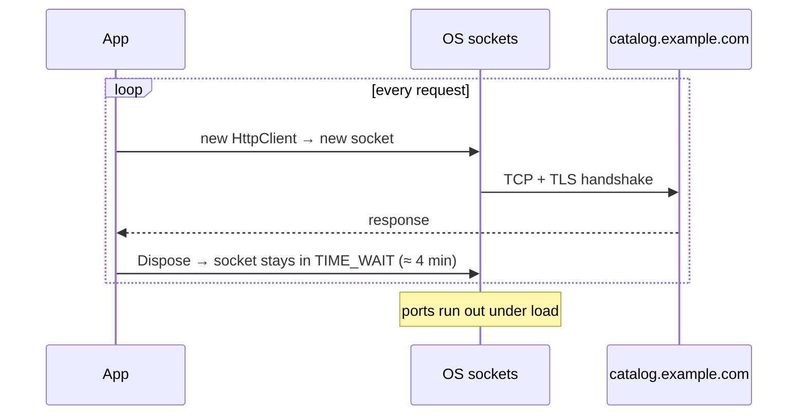

`HttpClient` is probably the most misused class in .NET. It implements `IDisposable`, so everyone
wraps it in `using`. It looks like a lightweight object, so everyone creates a new one per call. Both
instincts are wrong, and the app doesn't break on your machine. It breaks in production, under load,
with errors that point everywhere except at the actual cause.

The famous article [*You're using HttpClient wrong and it is destabilizing your software*](https://www.aspnetmonsters.com/2016/08/2016-08-27-httpclientwrong/)
is from 2016. Ten years later, the same rule still ends up in the coding guidelines of almost every
team I work with. So here's the 2026 version: four mistakes, why each one hurts, and what to do
instead.

## Mistake 1: a new HttpClient per request

```csharp
public async Task<Product?> GetProductAsync(int id, CancellationToken ct)
{
    using var client = new HttpClient();   // looks clean, isn't
    return await client.GetFromJsonAsync<Product>($"https://catalog.example.com/products/{id}", ct);
}
```

Every `HttpClient` gets its own handler, and every handler opens its own TCP connections. Disposing
the client closes the connection, but the operating system keeps the socket in `TIME_WAIT` for up
to four minutes. Under load, new connections pile up faster than old ones are released, until there
are no free ports left:

```
System.Net.Http.HttpRequestException: Only one usage of each socket address
(protocol/network address/port) is normally permitted.
```

On top of that you pay for a fresh TCP and TLS handshake on every single call, because nothing is
ever reused.



## Mistake 2: one static HttpClient forever

The usual reaction to mistake 1 goes to the other extreme:

```csharp
public static class Http
{
    public static readonly HttpClient Client = new();
}
```

That fixes socket exhaustion, because connections are pooled and reused. But a connection that stays
open forever **never resolves DNS again**. If the target moves (a blue/green deployment, a failover,
a load balancer that changes its IPs), your app keeps talking to the old address until it restarts.

A static client is fine **if you limit the lifetime of the pooled connections**:

```csharp
public static class Http
{
    public static readonly HttpClient Client = new(new SocketsHttpHandler
    {
        PooledConnectionLifetime = TimeSpan.FromMinutes(5)   // re-resolve DNS regularly
    });
}
```

That's a valid choice for small tools without dependency injection. In an application with DI,
there's a better option.

## The fix: IHttpClientFactory

`IHttpClientFactory` pools and rotates the underlying handlers for you. A `HttpClient` from the factory
is cheap to create. The expensive part, the handler with its connections, is shared and recycled
(every two minutes by default).

The cleanest way to use it is a **typed client**: a class that encapsulates one downstream API and gets
its preconfigured `HttpClient` injected.

```csharp
public sealed class CatalogClient(HttpClient http)
{
    public Task<Product?> GetProductAsync(int id, CancellationToken ct) =>
        http.GetFromJsonAsync<Product>($"products/{id}", ct);
}
```

```csharp
builder.Services.AddHttpClient<CatalogClient>(client =>
{
    client.BaseAddress = new Uri("https://catalog.example.com/");
    client.Timeout = TimeSpan.FromSeconds(10);
})
.AddStandardResilienceHandler();   // retries, timeouts, circuit breaker
```

What you get:

- **Connection pooling** without socket exhaustion
- **DNS changes are picked up**, because handlers are rotated
- **Configuration in one place**: base address, headers, timeouts
- **Resilience** via `Microsoft.Extensions.Http.Resilience`. `AddStandardResilienceHandler()` gives
  you sensible retry, timeout and circuit-breaker defaults based on Polly v8. That replaces the older
  `AddPolicyHandler` / `Microsoft.Extensions.Http.Polly` approach you'll still find in many wikis.

**Named clients** (`AddHttpClient("catalog", ...)` plus `factory.CreateClient("catalog")`) work too.
Typed clients have the advantage that the consumer depends on `CatalogClient` and not on a magic
string.

:::tip[Do I have to dispose clients from the factory?]
You don't have to, and it doesn't hurt either. Disposing a factory-created `HttpClient` doesn't dispose
the pooled handler. Many guidelines say "never put them in `using`". That's not wrong, but the real
rule is: **never create the handler yourself per request.**
:::

## Mistake 3: a typed client captured by a singleton

This one gets through code review most often, because every single line looks right:

```csharp
builder.Services.AddHttpClient<CatalogClient>(...);   // typed client: registered as transient
builder.Services.AddSingleton<PriceCalculator>();     // singleton...

public sealed class PriceCalculator(CatalogClient catalog)   // ...captures the transient client forever
{
    // ...
}
```

The typed client is meant to be short-lived. Inject it into a singleton, and that one instance (and
with it one handler) lives as long as the process. Handler rotation never happens, and you're back
at mistake 2: stale DNS, without anyone noticing.

The options:

| Consumer lifetime | What to inject |
|---|---|
| Transient / scoped | The typed client directly ✅ |
| Singleton | `IHttpClientFactory` and create the client per operation |
| Singleton, needs a long-lived client | A client with `SocketsHttpHandler { PooledConnectionLifetime = ... }`, configured via `ConfigurePrimaryHttpMessageHandler` |

Turning on scope validation in development catches captured *scoped* services. It doesn't catch
transient typed clients captured by singletons. Here, only awareness or a code rule helps.

## Mistake 4: no timeout, no cancellation, no streaming

Three smaller things that add up:

- **The default timeout is 100 seconds.** For a call between services that's almost always far too
  long. A hanging downstream service then blocks your threads and your callers for well over a minute.
  Set a timeout per client that matches the downstream service.
- **Pass the `CancellationToken` through.** If the caller of your API disconnects, the outgoing call
  should be cancelled too.
- **Large responses: don't buffer them in memory.** For big payloads, use
  `HttpCompletionOption.ResponseHeadersRead` and read the content as a stream, or deserialize as you
  go with `ReadFromJsonAsAsyncEnumerable<T>()`.

```csharp
using var response = await http.GetAsync("products/export", HttpCompletionOption.ResponseHeadersRead, ct);
response.EnsureSuccessStatusCode();

await foreach (var product in response.Content.ReadFromJsonAsAsyncEnumerable<Product>(ct))
{
    // process one item at a time instead of loading the whole export into memory
}
```

## And in a console app or CLI tool?

CLI tools are where you see `new HttpClient()` most often, because "there's no DI here anyway". There
can be, and it costs about a dozen lines:

```csharp
public static class Program
{
    public static async Task<int> Main(string[] args)
    {
        var services = new ServiceCollection();

        services.AddHttpClient<CatalogClient>(c => c.BaseAddress = new Uri("https://catalog.example.com/"))
                .AddStandardResilienceHandler();
        services.AddSingleton<ExportCommand>();

        await using var provider = services.BuildServiceProvider();

        return await provider.GetRequiredService<ExportCommand>().RunAsync(args);
    }
}
```

`ExportCommand` is a singleton here and gets `CatalogClient` injected. Isn't that exactly mistake 3?
For a short-lived CLI run, it doesn't matter: the process ends long before handler rotation would
make a difference. For a long-running worker or daemon, apply the table above.

The bigger benefit of DI in tools is something else: the commands become testable, and the same
typed client can be shared between the API and the tool.

## Make it impossible to get wrong

Guidelines get forgotten. A build that fails doesn't. With
[Microsoft.CodeAnalysis.BannedApiAnalyzers](https://www.nuget.org/packages/Microsoft.CodeAnalysis.BannedApiAnalyzers)
you can ban the constructor across the solution:

```text
# BannedSymbols.txt
M:System.Net.Http.HttpClient.#ctor;Use IHttpClientFactory or a typed client instead
M:System.Net.Http.HttpClient.#ctor(System.Net.Http.HttpMessageHandler);Use IHttpClientFactory or a typed client instead
```

Anyone who writes `new HttpClient()` now gets a warning (or, with `TreatWarningsAsErrors`, an error)
directly in the IDE, along with the reason. The rare legitimate exception, such as the static client
with `PooledConnectionLifetime`, gets a local `#pragma` and a comment explaining why. That's the idea
of [self-defending codebases](/blog/2026-self-defending-codebases/): turn the rule from the wiki into
something the code checks.

## How to tell if you have the problem

- **Sockets:** `netstat -an | find /c "TIME_WAIT"` (Windows) or `ss -s` (Linux) under load. Thousands
  of `TIME_WAIT` entries for the same target are a strong hint.
- **Metrics:** Since .NET 8, `System.Net.Http` publishes metrics such as `http.client.open_connections`
  and `http.client.connection.duration`. Look at them live with
  `dotnet-counters monitor --counters System.Net.Http`, or export them via OpenTelemetry. A connection
  count that grows with the request count means connections aren't being reused.
- **Latency:** If every outgoing call is slow by the same fixed amount, that's often the TLS handshake
  you pay for on every new connection.

## Summary

- **Never** create a `HttpClient` (and with it a handler) per request: that leads to socket exhaustion
  and a handshake on every call.
- **Not** one static client forever, unless it has `PooledConnectionLifetime`. Otherwise DNS changes
  never arrive.
- Use **`IHttpClientFactory` with typed clients** and `AddStandardResilienceHandler()`.
- Watch out for **typed clients inside singletons**: they silently disable handler rotation.
- Set **timeouts**, pass **cancellation tokens** through, and **stream** large responses.
- **Ban `new HttpClient()`** with an analyzer instead of relying on the wiki.
