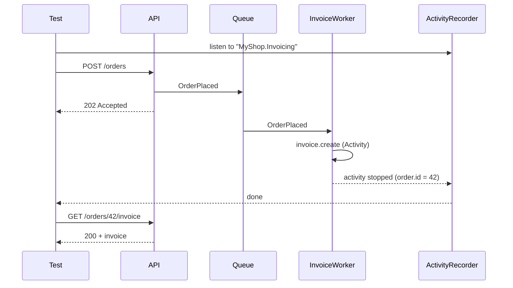

:::note[Series]
Part of the series [*Testing in practice*](/series/testing-in-practice/).
:::

The request-response tests from the earlier posts in this series have one comfortable property: when
the response arrives, the work is done. A lot of real systems don't work that way. You place an order,
the API answers `202 Accepted`, and a background worker creates the invoice, reserves stock and sends
the confirmation e-mail a moment later. Or a moment *much* later, when the build agent is busy.

Testing those flows is where I've seen the most `Task.Delay` calls, the most flaky tests, and in one
codebase, production code that existed only so tests could wait for it. This post covers the
patterns I use instead.

## The problem: the test has no handle on "done"

```csharp
[TestMethod]
public async Task Should_Create_Invoice_After_Order_Was_Placed()
{
    var order = await PlaceOrderAsync("Orders/Payloads/TwoLines.json");

    await Task.Delay(TimeSpan.FromSeconds(5));          // "should be enough"

    var invoice = await Client.GetFromJsonAsync<InvoiceResponse>($"api/v1/orders/{order.Id}/invoice");
    Assert.IsNotNull(invoice);
}
```

This test is wrong in both directions at once:

- **Too slow** when the worker finishes in 50 ms. Every test waits five seconds anyway, and a suite
  with forty such tests waits more than three minutes for nothing.
- **Too fast** when the build agent is under load and the worker needs six seconds. Then the test
  fails, someone re-runs the pipeline, it passes, and everyone learns to ignore red builds.

The underlying issue: the work happens in a background worker the test can't call directly, so
there's no in → out to test. The test needs *some* signal that the work is done.

## The tempting fix: test-only events in production code

The fix I found in that one codebase was to publish in-process events (via a mediator) from the
background worker, purely so tests could subscribe and wait:

```csharp
// in the production worker
await _mediator.Publish(new InvoiceCreatedForTests(order.Id), ct);   // only exists for tests
```

It works, and it's a design smell. Production code now has a dependency, a type and a code path whose
only consumer is the test suite. It costs a little at runtime, it confuses the next reader, and it
tends to grow: soon there's an event for every step, and the tests are coupled to the worker's
internal sequence instead of its outcome.

The team flagged this themselves as a no-go and wrote down a better idea, which I'll get to: the app
already reports what it's doing, for observability. Tests can listen to that.

## Pattern 1: poll the public API until it's true

The simplest correct pattern: ask the API repeatedly until the expected state appears or a timeout
expires.

```csharp
public static class Eventually
{
    public static async Task<T> UntilAsync<T>(
        Func<CancellationToken, Task<T>> probe,
        Func<T, bool> isDone,
        TimeSpan? timeout = null,
        [CallerArgumentExpression(nameof(isDone))] string condition = "")
    {
        using var cts = new CancellationTokenSource(timeout ?? TimeSpan.FromSeconds(30));
        var delay = TimeSpan.FromMilliseconds(50);
        T last = default!;

        while (true)
        {
            try
            {
                last = await probe(cts.Token);
                if (isDone(last)) return last;

                await Task.Delay(delay, cts.Token);
            }
            catch (OperationCanceledException) when (cts.IsCancellationRequested)
            {
                throw new AssertFailedException(
                    $"Condition '{condition}' was not met within {timeout ?? TimeSpan.FromSeconds(30)}.{Environment.NewLine}" +
                    $"Last observed value:{Environment.NewLine}{JsonSerializer.Serialize(last)}");
            }

            delay = TimeSpan.FromMilliseconds(Math.Min(delay.TotalMilliseconds * 2, 1000));   // back off, cap at 1 s
        }
    }
}
```

```csharp
[TestMethod]
public async Task Should_Create_Invoice_After_Order_Was_Placed()
{
    var order = await PlaceOrderAsync("Orders/Payloads/TwoLines.json");

    var response = await Eventually.UntilAsync(
        ct => Client.GetAsync($"api/v1/orders/{order.Id}/invoice", ct),
        r => r.StatusCode == HttpStatusCode.OK);

    await response.AssertJsonAsync(HttpStatusCode.OK, "Invoices/Results/TwoLines.json", "id", "invoiceNumber");
}
```

What makes this version good:

- **Fast when the system is fast.** The first probe after 50 ms usually succeeds.
- **Patient when it's slow**, up to a generous timeout, without making the happy path slower.
- **A useful failure.** If it times out, it tells you which condition wasn't met and what it saw
  last, which turns "flaky test" into "invoice stayed in status `Pending`".
- **Pure black box.** It only uses the public API, so it also works against a
  [deployed environment](/blog/2026-testing-against-multiple-environments/).

Its limit: it only works for outcomes the API exposes. "An e-mail was sent" or "a message was
published to the warehouse" often isn't queryable. And it can't easily prove something did **not**
happen, because "not yet" and "never" look the same.

## Pattern 2: listen to the telemetry the app already emits

A well-observed background worker already reports its work. With OpenTelemetry-style tracing in
.NET, that's an `Activity` from an `ActivitySource`:

```csharp
public static class ShopTelemetry
{
    public static readonly ActivitySource Source = new("MyShop.Invoicing");
}

public sealed class InvoiceWorker(/* ... */) : BackgroundService
{
    private async Task HandleAsync(OrderPlaced message, CancellationToken ct)
    {
        using var activity = ShopTelemetry.Source.StartActivity("invoice.create");
        activity?.SetTag("order.id", message.OrderId);

        try
        {
            var invoice = await _invoices.CreateForAsync(message.OrderId, ct);
            activity?.SetTag("invoice.id", invoice.Id);
        }
        catch (Exception ex)
        {
            activity?.SetStatus(ActivityStatusCode.Error, ex.Message);
            throw;
        }
    }
}
```

That code exists for production: it's what shows up in your tracing backend when someone asks why an
invoice took so long. Nothing in it knows about tests. But because the API runs in-process in
`WebApplicationFactory`, a test can attach a listener to the same `ActivitySource`:

```csharp
public sealed class ActivityRecorder : IDisposable
{
    private readonly ActivityListener _listener;
    private readonly ConcurrentQueue<Activity> _completed = new();
    private event Action<Activity>? Completed;

    public ActivityRecorder(string sourceName)
    {
        _listener = new ActivityListener
        {
            ShouldListenTo = source => source.Name == sourceName,
            Sample = (ref ActivityCreationOptions<ActivityContext> _) => ActivitySamplingResult.AllDataAndRecorded,
            ActivityStopped = activity =>
            {
                _completed.Enqueue(activity);
                Completed?.Invoke(activity);
            }
        };
        ActivitySource.AddActivityListener(_listener);
    }

    public async Task<Activity> WaitForAsync(string name, Func<Activity, bool> match, TimeSpan timeout)
    {
        var tcs = new TaskCompletionSource<Activity>(TaskCreationOptions.RunContinuationsAsynchronously);
        void OnCompleted(Activity a) { if (a.OperationName == name && match(a)) tcs.TrySetResult(a); }

        Completed += OnCompleted;
        try
        {
            // It may already have happened before we started waiting.
            var earlier = _completed.FirstOrDefault(a => a.OperationName == name && match(a));
            if (earlier is not null) return earlier;

            return await tcs.Task.WaitAsync(timeout);
        }
        catch (TimeoutException)
        {
            throw new AssertFailedException($"No completed '{name}' activity matched within {timeout}. " +
                $"Seen: {string.Join(", ", _completed.Select(a => a.OperationName).Distinct())}");
        }
        finally
        {
            Completed -= OnCompleted;
        }
    }

    public void Dispose() => _listener.Dispose();
}
```

The test now waits for the actual event instead of a guessed duration:

```csharp
[TestMethod]
public async Task Should_Create_Invoice_After_Order_Was_Placed()
{
    using var recorder = new ActivityRecorder("MyShop.Invoicing");
    var order = await PlaceOrderAsync("Orders/Payloads/TwoLines.json");

    var activity = await recorder.WaitForAsync("invoice.create",
        a => Equals(a.GetTagItem("order.id"), order.Id),
        timeout: TimeSpan.FromSeconds(30));

    Assert.AreEqual(ActivityStatusCode.Unset, activity.Status, activity.StatusDescription);

    // The signal says "done". The API says "correct".
    var response = await Client.GetAsync($"api/v1/orders/{order.Id}/invoice");
    await response.AssertJsonAsync(HttpStatusCode.OK, "Invoices/Results/TwoLines.json", "id", "invoiceNumber");
}
```



This is the clean solution that team had written down: **no code changes just for testing, and the
same mechanism gives you production insight and test triggers.** As a bonus, an error in the worker
doesn't surface as a vague timeout. The activity carries `ActivityStatusCode.Error` and the exception
message, and the test fails immediately with the real reason.

It also makes **"nothing else happened"** testable: wait for the activity that marks the end of the
flow, then assert that no `email.send` activity for this order was recorded.

If your workers log rather than trace, the same idea works with logs: `FakeLogCollector` from
`Microsoft.Extensions.Diagnostics.Testing` captures log records in-process, and the test waits for
a specific event ID.

## Time-based workers

Some background work isn't triggered by a message but by time: a job that closes unpaid orders every
hour. Waiting an hour is not an option, and lowering the interval via configuration only half-tests
it. If the worker uses `TimeProvider`, the test can control time:

```csharp
public sealed class CloseUnpaidOrdersWorker(TimeProvider time, IServiceScopeFactory scopes) : BackgroundService
{
    protected override async Task ExecuteAsync(CancellationToken ct)
    {
        using var timer = new PeriodicTimer(TimeSpan.FromHours(1), time);
        while (await timer.WaitForNextTickAsync(ct))
        {
            // close orders older than 14 days, measured with time.GetUtcNow()
        }
    }
}
```

Register a `FakeTimeProvider` in the factory (`services.AddSingleton<TimeProvider>(fakeTime)`), and
`fakeTime.Advance(TimeSpan.FromHours(1))` triggers a tick immediately. Combine that with the activity
recorder to know when the tick's work is finished.

## Comparison

| | `Task.Delay` | Test-only events in production code | Polling the public API | Listening to telemetry |
|---|---|---|---|---|
| Fast when the system is fast | ❌ | ✅ | ✅ | ✅ |
| Reliable when the system is slow | ❌ | ✅ | ✅ | ✅ |
| No test-only production code | ✅ | ❌ | ✅ | ✅ |
| Works against deployed environments | ⚠️ | ❌ | ✅ | ❌ in-process only |
| Observes side effects the API doesn't expose | ❌ | ✅ | ❌ | ✅ |
| Fails fast with the real error | ❌ | ⚠️ | ❌ timeout | ✅ error status on the activity |
| Can prove something did not happen | ❌ | ⚠️ | ❌ | ✅ after an end-of-flow signal |

I use both working patterns side by side: polling for tests that must also run against deployed
environments, telemetry for in-process tests that need side effects or fast failure.

## Pitfalls

**Global listeners and parallel tests.** `ActivityListener` sees activities from the whole process,
including other tests running in parallel. Always match on something unique to *this* test, such as
the order ID it created. Never wait for "the next `invoice.create`".

**Subscribing too late.** Create the recorder *before* triggering the action, and check already
completed activities when you start waiting, as `WaitForAsync` does above. Otherwise a fast worker
finishes before the test listens.

**Sampling.** A listener only gets activities it samples. `AllDataAndRecorded` in the listener is
fine for tests; don't rely on the app's production sampling configuration being on.

**Signal is not correctness.** "The activity completed" means the worker finished, not that it did the
right thing. Always assert the outcome through the API afterwards.

**Timeouts tuned to your laptop.** Use generous timeouts (they cost nothing on the happy path) and a
short polling interval. A test that needs a ten-second timeout on CI is fine. A test that sleeps ten
seconds is not.

**Hammering the API.** Polling every millisecond on a deployed environment is a small load test.
Back off and cap the interval.

## Make it visible

- **Ban `Task.Delay` in test projects** (with a banned-API analyzer or a simple architecture test)
  and point the message at `Eventually.UntilAsync`. That's the
  [self-defending](/blog/2026-self-defending-codebases/) way to stop the pattern from coming back.
- **Track test durations.** A test that takes almost exactly its timeout on every run is waiting for
  a signal that never comes and passing for the wrong reason.

## Summary

- `Task.Delay` is **too slow and too flaky** at the same time. Replace it with a real signal.
- Don't add **test-only events** to production code. They couple tests to internals and clutter the
  worker.
- **Poll the public API** with backoff and a generous timeout for black-box tests that also run
  against deployed environments.
- **Listen to the telemetry** (activities or logs) the app already emits for in-process tests: no
  extra production code, fast failure with the real error, and you can prove something didn't happen.
- Match signals on **test-specific IDs**, subscribe **before** acting, and always verify the
  **outcome through the API**.
