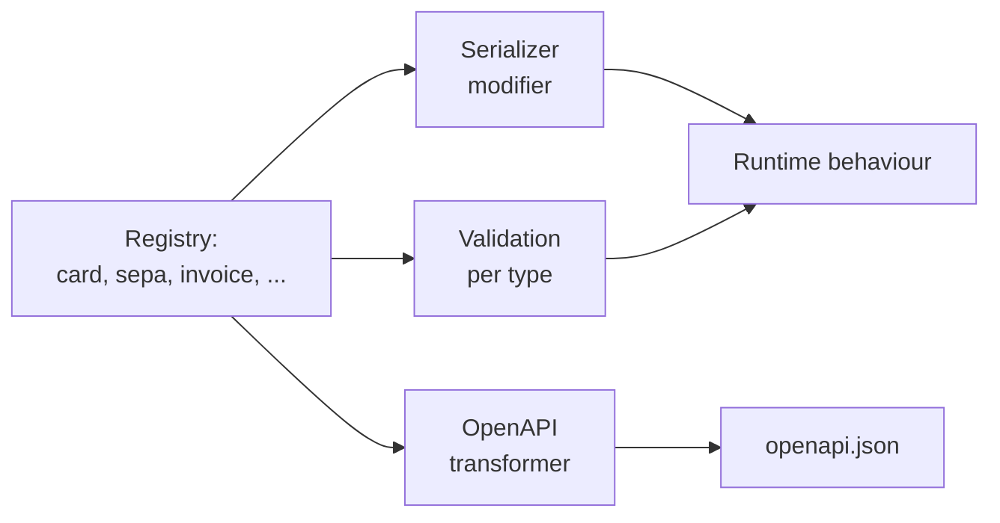

:::note[Series]
Part of the series [*REST & OpenAPI design*](/series/rest-and-openapi-design/).
:::

Most request bodies have one shape. Some don't. A customer adds a payment method, and depending on
what they choose, the body looks completely different:

```json
{ "type": "card",        "holder": "J. Doe", "token": "tok_123", "expiry": "2028-04" }
{ "type": "sepa",        "holder": "J. Doe", "iban": "DE89370400440532013000" }
{ "type": "invoice",     "billingEmailRef": "contact-7" }
```

Same endpoint, `POST /customers/{id}/payment-methods`, three schemas, and a `type` property that
says which one applies. You want three things from your stack: deserialize into the right C#
type, validate each shape properly, and document all of it in OpenAPI so client generators produce
something usable.

For a handful of types, that's easy since .NET 7. It gets interesting when the set of types grows,
or when it's not known at compile time at all, for example in a plugin-based design where every
payment provider brings its own method. One backend design I reviewed had exactly that problem with
a set of types that was expected to grow to dozens, owned by several teams.

## Approach A: static `[JsonPolymorphic]` attributes

System.Text.Json supports polymorphism out of the box:

```csharp
[JsonPolymorphic(TypeDiscriminatorPropertyName = "type",
    UnknownDerivedTypeHandling = JsonUnknownDerivedTypeHandling.FailSerialization)]
[JsonDerivedType(typeof(AddCardRequest), "card")]
[JsonDerivedType(typeof(AddSepaRequest), "sepa")]
[JsonDerivedType(typeof(AddInvoiceRequest), "invoice")]
public abstract record AddPaymentMethodRequest;

public sealed record AddCardRequest(string Holder, string Token, string Expiry)
    : AddPaymentMethodRequest;

public sealed record AddSepaRequest(string Holder, string Iban)
    : AddPaymentMethodRequest;

public sealed record AddInvoiceRequest(string BillingEmailRef)
    : AddPaymentMethodRequest;
```

```csharp
app.MapPost("/customers/{id:guid}/payment-methods",
    (Guid id, AddPaymentMethodRequest request, PaymentMethodService service, CancellationToken ct) =>
        request switch
        {
            AddCardRequest card     => service.AddCardAsync(id, card, ct),
            AddSepaRequest sepa     => service.AddSepaAsync(id, sepa, ct),
            AddInvoiceRequest inv   => service.AddInvoiceAsync(id, inv, ct),
            _ => throw new UnreachableException()
        });
```

The serializer reads `type`, picks the derived type, and fails with a `JsonException` (a 400 in
minimal APIs) for unknown values. The built-in OpenAPI generator turns the hierarchy into a `oneOf`
with a `discriminator` and a `mapping`:

```yaml
AddPaymentMethodRequest:
  oneOf:
    - $ref: '#/components/schemas/AddPaymentMethodRequestCard'
    - $ref: '#/components/schemas/AddPaymentMethodRequestSepa'
    - $ref: '#/components/schemas/AddPaymentMethodRequestInvoice'
  discriminator:
    propertyName: type
    mapping:
      card: '#/components/schemas/AddPaymentMethodRequestCard'
      sepa: '#/components/schemas/AddPaymentMethodRequestSepa'
      invoice: '#/components/schemas/AddPaymentMethodRequestInvoice'
```

That's exactly what you want: compile-time safety, IntelliSense, pattern matching, a correct
contract. For a small, stable set of types, **stop here**. This is the right answer.

### Where it hurts

The base class has to know every derived type. With three types, nobody notices. With thirty, you see
the cost:

- **Information is spread out.** A new payment method touches the request type, the base class
  attributes, probably an enum of type names and the handler switch. Four places, one concept.
- **One hot file.** Every team adding a method edits the same attribute list. Merge conflicts are
  guaranteed.
- **Coupling.** The contracts assembly references every method, including the ones owned by other
  teams.
- **Not extensible at runtime.** A plugin can't add a derived type to an attribute.

## Approach B: register derived types at runtime

What many people don't know: everything the attributes do can also be configured at runtime, through
**contract customization**. A type-info modifier sets `PolymorphismOptions` for the base type, and
the derived types can come from anywhere: assembly scanning, DI registrations, plugin manifests.

Each payment method declares its discriminator next to its own request type:

```csharp
[AttributeUsage(AttributeTargets.Class, Inherited = false)]
public sealed class PaymentMethodAttribute(string discriminator) : Attribute
{
    public string Discriminator { get; } = discriminator;
}

public abstract record AddPaymentMethodRequest;   // no attributes on the base any more

[PaymentMethod("card")]
public sealed record AddCardRequest(string Holder, string Token, string Expiry)
    : AddPaymentMethodRequest;

[PaymentMethod("sepa")]
public sealed record AddSepaRequest(string Holder, string Iban)
    : AddPaymentMethodRequest;
```

A modifier collects them once and configures the base type:

```csharp
public static class PaymentMethodPolymorphism
{
    private static readonly JsonDerivedType[] DerivedTypes = AppDomain.CurrentDomain
        .GetAssemblies()
        .Where(a => a.GetName().Name?.StartsWith("MyShop.Payments") == true)
        .SelectMany(a => a.GetTypes())
        .Where(t => !t.IsAbstract && t.IsSubclassOf(typeof(AddPaymentMethodRequest)))
        .Select(t => new JsonDerivedType(t,
            t.GetCustomAttribute<PaymentMethodAttribute>()?.Discriminator
            ?? throw new InvalidOperationException($"{t.Name} has no [PaymentMethod] attribute.")))
        .ToArray();

    public static IEnumerable<string> Discriminators =>
        DerivedTypes.Select(d => (string)d.TypeDiscriminator!);

    public static void Apply(JsonTypeInfo typeInfo)
    {
        if (typeInfo.Type != typeof(AddPaymentMethodRequest))
            return;

        typeInfo.PolymorphismOptions = new JsonPolymorphismOptions
        {
            TypeDiscriminatorPropertyName = "type",
            UnknownDerivedTypeHandling = JsonUnknownDerivedTypeHandling.FailSerialization
        };

        foreach (var derived in DerivedTypes)
            typeInfo.PolymorphismOptions.DerivedTypes.Add(derived);
    }
}
```

```csharp
builder.Services.ConfigureHttpJsonOptions(o =>
{
    o.SerializerOptions.TypeInfoResolver =
        (o.SerializerOptions.TypeInfoResolver ?? new DefaultJsonTypeInfoResolver())
        .WithAddedModifier(PaymentMethodPolymorphism.Apply);
});
```

From the serializer's point of view, nothing changed: the endpoint still binds
`AddPaymentMethodRequest`, deserialization still picks the right type. And because the built-in
OpenAPI generator builds its schemas from the same `JsonTypeInfo`, the `oneOf` and the discriminator
mapping follow automatically. Verify that with a snapshot of the generated document (more below),
because that's the one thing you can't see in the code any more.

Adding a payment method is now one file, owned by one team. The handler side uses the same idea:
instead of a central `switch`, resolve an `IPaymentMethodHandler<TRequest>` from DI for the runtime
type of the request.

```csharp
app.MapPost("/customers/{id:guid}/payment-methods",
    (Guid id, AddPaymentMethodRequest request, IServiceProvider services, CancellationToken ct) =>
    {
        var handlerType = typeof(IPaymentMethodHandler<>).MakeGenericType(request.GetType());
        var handler = (IPaymentMethodHandler)services.GetRequiredService(handlerType);
        return handler.AddAsync(id, request, ct);
    });
```

## Approach C: one generic request plus a schema transformer

Sometimes the variants don't form a class hierarchy at all. A common shape is a generic envelope
whose `properties` depend on the type:

```csharp
public sealed record AddPaymentMethodRequest(string Type, string DisplayName, JsonObject Properties);
```

Some methods need nothing beyond the envelope, others have a typed properties class. At runtime you
look up the properties type for `Type`, deserialize `Properties` into it and validate. The serializer
is happy, but the OpenAPI document only shows `properties: { type: object }`, which is useless for
clients.

That's where a **schema transformer** comes in: it replaces the generic schema with a `oneOf` of one
schema per registered type, built from the same registry the runtime uses. Shown for .NET 10, where
transformers can ask the generator for schemas of arbitrary types:

```csharp
public sealed class PaymentMethodSchemaTransformer(PaymentMethodRegistry registry)
    : IOpenApiSchemaTransformer
{
    public async Task TransformAsync(OpenApiSchema schema,
        OpenApiSchemaTransformerContext context, CancellationToken ct)
    {
        if (context.JsonTypeInfo.Type != typeof(AddPaymentMethodRequest))
            return;

        var variants = new List<IOpenApiSchema>();
        foreach (var method in registry.All)   // e.g. ("card", typeof(CardProperties))
        {
            var properties = method.PropertiesType is null
                ? new OpenApiSchema { Type = JsonSchemaType.Object }
                : await context.GetOrCreateSchemaAsync(method.PropertiesType, null, ct);

            variants.Add(new OpenApiSchema
            {
                Type = JsonSchemaType.Object,
                Required = new HashSet<string> { "type", "displayName", "properties" },
                Properties = new Dictionary<string, IOpenApiSchema>
                {
                    ["type"] = new OpenApiSchema { Type = JsonSchemaType.String, Const = method.Discriminator },
                    ["displayName"] = new OpenApiSchema { Type = JsonSchemaType.String },
                    ["properties"] = properties
                }
            });
        }

        schema.Properties?.Clear();
        schema.Required?.Clear();
        schema.Type = null;
        schema.OneOf = variants;
    }
}
```

The variants here are inline schemas with a `const` on `type`, which is valid OpenAPI 3.1 and lets
validators pick the right branch. If your consumers' generators need an explicit `discriminator`
with `mapping`, register each variant as a named component schema in a document transformer and
reference those instead.



The important part is the left box: **one registry feeds the serializer, the validation and the
documentation**. As soon as the OpenAPI document is built from a different list than the runtime,
they will drift apart.

## Comparison

| | A: `[JsonDerivedType]` | B: runtime modifier | C: envelope + transformer |
|---|---|---|---|
| Type safety in handlers | ✅ | ✅ | properties only after lookup |
| New type touches shared code | ❌ base class | ✅ no | ✅ no |
| Works with plugins / runtime discovery | ❌ | ✅ (at startup) | ✅ |
| OpenAPI `oneOf` + discriminator | ✅ automatic | ✅ automatic (verify) | manual transformer |
| Visible in code | ✅ attributes | partly | ❌ |
| Debuggability | ✅ | medium | lower |
| Native AOT / source-gen friendly | ✅ | ❌ reflection | ❌ reflection |
| Good for | < ~10 stable types | many types, several teams | heterogeneous shapes |

My default is A. I move to B when several teams own the types, and to C only when the shapes really
don't fit a hierarchy.

## Pitfalls

**A `Type` property on the base class.** If the base record has a property that serializes as `type`
*and* `type` is the discriminator, System.Text.Json throws an `InvalidOperationException` about a
conflicting property name, at the first serialization, not at startup. Let the discriminator be
metadata and don't model it as a property. In handlers, use pattern matching on the C# type instead.

**Discriminator must come first.** By default, the discriminator has to be the first property in the
JSON object. Clients that sort keys alphabetically or put `type` at the end get an error. Since
.NET 9 you can set `AllowOutOfOrderMetadataProperties = true` on the serializer options. It costs
some buffering, and it saves you from a whole category of support tickets.

**Missing discriminator.** A body without `type` tries to instantiate the abstract base and fails
with a `NotSupportedException`, which ends up as a 500 unless your
[exception handler](/blog/2026-exception-handling-best-practices/) maps it. Either map it to a 400, or
validate presence before binding.

**Discriminator values are a contract.** `"card"` is now part of your public API. Renaming the C#
class is fine; changing the discriminator is a breaking change. And for responses, adding a new
value can break clients that switch exhaustively over the known values. That's what
[extensible enums](/blog/2026-extensible-enums-x-extensible-enum/) are for.

**Client generators differ.** Not every generator handles `oneOf` with `discriminator` equally well.
NSwag, Kiota and the OpenAPI Generator all support it, with different quirks. Generate a client in
CI and compile it, so you find out before your consumers do.

**Validation per type.** Attribute validation and FluentValidation work on the runtime type, but only
if your validation pipeline resolves validators for the derived type, not the declared base type.
Test one invalid body per type.

## Test what you can't see

With approaches B and C, the polymorphism is no longer visible in the source. Make it visible in tests:

```csharp
[TestMethod]
public async Task OpenApi_lists_every_registered_payment_method()
{
    await using var factory = new WebApplicationFactory<Program>();
    var json = await factory.CreateClient().GetStringAsync("/openapi/v1.json");
    var document = JsonNode.Parse(json)!;

    var mapping = document["components"]!["schemas"]!["AddPaymentMethodRequest"]!
        ["discriminator"]!["mapping"]!.AsObject();

    var registered = PaymentMethodPolymorphism.Discriminators;
    CollectionAssert.AreEquivalent(registered.ToList(), mapping.Select(p => p.Key).ToList());
}
```

Add a round-trip test per type (serialize, deserialize, compare) and a test that an unknown `type`
returns a 400. Together with a committed `openapi.json` and a
[breaking-change check](/blog/2026-detecting-breaking-changes-with-openapi-diffs/), that covers the
dynamic parts as well as the static ones.

## Summary

- For a **small, stable** set of types, `[JsonPolymorphic]` + `[JsonDerivedType]` is the right
  answer, including a correct OpenAPI `oneOf` with discriminator.
- When **many types and several teams** are involved, register the derived types **at runtime** with
  a type-info modifier. Serializer and OpenAPI generator both follow.
- For **heterogeneous shapes**, use a generic envelope and a **schema transformer**.
- Feed serializer, validation and documentation from **one registry**.
- Watch for the classic traps: a `Type` property clashing with the discriminator, discriminator order,
  missing discriminators, and discriminator values being part of the contract.
- **Snapshot-test the OpenAPI document**, because dynamic polymorphism is invisible in code.
