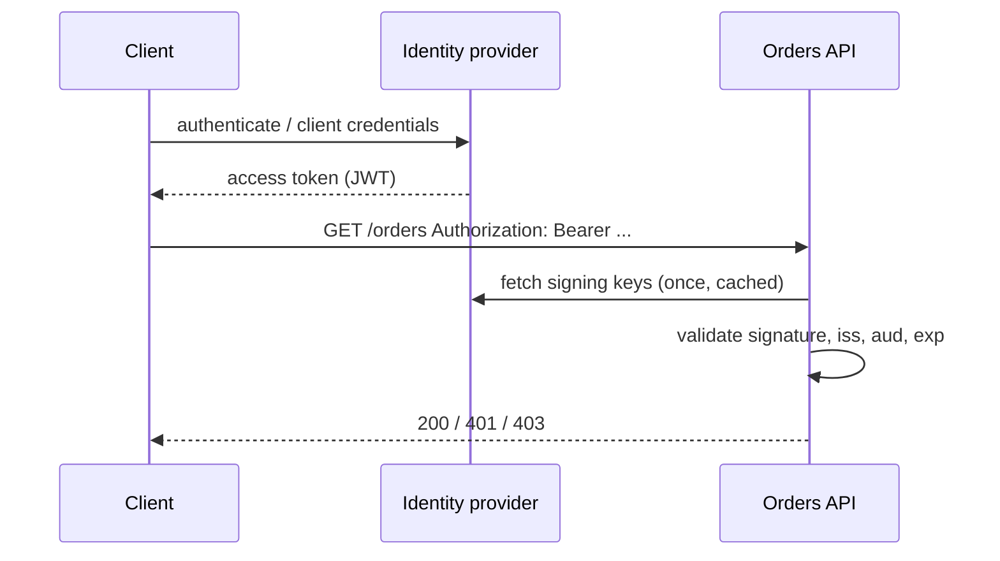

:::note[Series]
Part of the series [*ASP.NET Core from the ground up*](/series/aspnetcore-from-the-ground-up/).
:::

The most common authentication bug I find in reviews isn't a cryptographic one. It's a controller
without `[Authorize]`. Someone added a new endpoint, copied the method but not the class attribute,
and now `GET /orders/export` is public. Nothing fails, every test is green, and the only thing that
would notice is a penetration test.

This post sets up JWT bearer authentication in a way where **forgetting something makes the endpoint
more secure, not less.**

## What the API actually does with a token

Your API doesn't log anyone in. An identity provider (Entra ID, Auth0, Keycloak, Duende
IdentityServer, ...) issues a signed JSON Web Token. The client sends it as
`Authorization: Bearer eyJ...`. Your API's job is only to **validate** it:

1. Is the signature valid, with a key the issuer published?
2. Is the **issuer** (`iss`) the one I trust?
3. Is the **audience** (`aud`) me?
4. Is it within its **lifetime** (`nbf`, `exp`)?

Then it turns the claims into a `ClaimsPrincipal` and authorization decides what the caller may do.



## The setup

```bash
dotnet add package Microsoft.AspNetCore.Authentication.JwtBearer
```

```json
{
  "Authentication": {
    "Schemes": {
      "Bearer": {
        "Authority": "https://login.example.com/",
        "ValidAudiences": [ "orders-api" ]
      }
    }
  }
}
```

```csharp
builder.Services
    .AddAuthentication(JwtBearerDefaults.AuthenticationScheme)
    .AddJwtBearer(options =>
    {
        options.MapInboundClaims = false;   // keep "sub", "scope", "roles" as they are
    });
```

Since .NET 7, `AddJwtBearer` reads `Authentication:Schemes:Bearer` from configuration automatically,
so authority and audience can come from environment variables per stage. You can also set them in
code from your own options class. Both are fine; just don't hard-code a dev tenant URL.

From the **authority**, the handler downloads the OpenID Connect discovery document and the signing
keys, caches them and refreshes them when keys rotate. You never configure a signing key by hand for
tokens issued by a real identity provider.

:::caution[MapInboundClaims]
By default, the handler renames short claim types to long legacy URIs (`sub` becomes
`http://schemas.xmlsoap.org/ws/2005/05/identity/claims/nameidentifier`). That breaks every
`FindFirst("sub")`. Setting `MapInboundClaims = false` keeps the token's claim names, which is what
everybody expects after looking at the token in a debugger.
:::

## Secure by default: the fallback policy

Instead of putting `[Authorize]` on everything and hoping nobody forgets it, make "authenticated" the
default for **every endpoint**:

```csharp
builder.Services.AddAuthorizationBuilder()
    .SetFallbackPolicy(new AuthorizationPolicyBuilder()
        .RequireAuthenticatedUser()
        .Build());
```

The fallback policy applies to every endpoint that has **no** authorization metadata at all. Public
endpoints now have to opt out explicitly:

```csharp
app.MapHealthChecks("/health").AllowAnonymous();
```

That inversion is the most valuable line in this post. A forgotten attribute now means "requires a
login" instead of "public", and `[AllowAnonymous]` shows up in code review because it's rare.

## Scopes: what the caller may do

Authentication says *who* is calling. For APIs, authorization is usually based on **scopes** (what a
client was allowed to do) and sometimes **roles** (what a user is). Define policies once:

```csharp
builder.Services.AddAuthorizationBuilder()
    .SetFallbackPolicy(new AuthorizationPolicyBuilder().RequireAuthenticatedUser().Build())
    .AddPolicy(Scopes.OrdersRead,  p => p.RequireScope(Scopes.OrdersRead))
    .AddPolicy(Scopes.OrdersWrite, p => p.RequireScope(Scopes.OrdersWrite));

public static class Scopes
{
    public const string OrdersRead  = "orders:read";
    public const string OrdersWrite = "orders:write";
}
```

The catch: most identity providers put scopes into **one** claim as a space-separated string
(`"scope": "orders:read orders:write"`), and Entra ID uses `scp` instead of `scope`.
`RequireClaim("scope", "orders:write")` compares the whole string and fails as soon as a token has
two scopes. So write the check once, correctly:

```csharp
public static class ScopePolicyExtensions
{
    private static readonly string[] ScopeClaimTypes = ["scope", "scp"];

    public static AuthorizationPolicyBuilder RequireScope(this AuthorizationPolicyBuilder builder, string scope) =>
        builder.RequireAuthenticatedUser()
               .RequireAssertion(context => context.User.Claims
                   .Where(c => ScopeClaimTypes.Contains(c.Type))
                   .SelectMany(c => c.Value.Split(' ', StringSplitOptions.RemoveEmptyEntries))
                   .Contains(scope, StringComparer.Ordinal));
}
```

Use the policies on endpoints:

```csharp
orders.MapGet("/", GetOrdersAsync).RequireAuthorization(Scopes.OrdersRead);
orders.MapPost("/", PlaceOrderAsync).RequireAuthorization(Scopes.OrdersWrite);
```

```csharp
[HttpPost]
[Authorize(Policy = Scopes.OrdersWrite)]
public Task<PlaceOrderResponse> PlaceOrderAsync(PlaceOrderRequest request, CancellationToken ct) => ...
```

In one codebase I worked on, an internal API guideline required an explicit scope on **every**
endpoint, and a code rule test checked it. That's a good rule: "authenticated" alone means any client
of the identity provider can call any endpoint.

## 401 vs. 403

- **401 Unauthorized**: no token, invalid token, expired token. "I don't know who you are."
- **403 Forbidden**: valid token, missing scope or role. "I know who you are, and no."

The framework does this right out of the box. What I add is a `WWW-Authenticate` header check in
integration tests, because a 401 without it makes client debugging painful, and the JWT handler
includes the reason (`error="invalid_token", error_description="The token expired at ..."`) in it.

## Testing without an identity provider

Two tools I use all the time:

**`dotnet user-jwts`** creates locally signed tokens for development and configures the API to trust
them in `Development`:

```bash
dotnet user-jwts create --audience orders-api --scope "orders:read" --scope "orders:write"
```

**A test authentication handler** in integration tests, so tests don't depend on a real token:

```csharp
public sealed class TestAuthHandler(
    IOptionsMonitor<AuthenticationSchemeOptions> options, ILoggerFactory logger, UrlEncoder encoder)
    : AuthenticationHandler<AuthenticationSchemeOptions>(options, logger, encoder)
{
    public const string Scheme = "Test";

    protected override Task<AuthenticateResult> HandleAuthenticateAsync()
    {
        if (!Request.Headers.TryGetValue("X-Test-Scopes", out var scopes))
            return Task.FromResult(AuthenticateResult.NoResult());

        var identity = new ClaimsIdentity(
            [new Claim("sub", "test-user"), new Claim("scope", scopes.ToString())], Scheme);

        return Task.FromResult(AuthenticateResult.Success(
            new AuthenticationTicket(new ClaimsPrincipal(identity), Scheme)));
    }
}
```

```csharp
factory.WithWebHostBuilder(b => b.ConfigureTestServices(services =>
    services.AddAuthentication(TestAuthHandler.Scheme)
            .AddScheme<AuthenticationSchemeOptions, TestAuthHandler>(TestAuthHandler.Scheme, _ => { })));
```

Now you can write the test that matters most: **every endpoint without a token returns 401.**
Enumerate them from `EndpointDataSource` and call each one. That single test catches the forgotten
`AllowAnonymous` as well as a broken fallback policy.

## Pitfalls

**Validating the audience off.** `ValidateAudience = false` "because it didn't work" means any token
from the same identity provider, issued for any other API, is accepted by yours. Fix the audience
instead.

**Accepting tokens over HTTP.** `RequireHttpsMetadata` is true by default outside development. Leave
it that way.

**Large clock skew.** The default tolerance is five minutes. Don't raise it to "fix" expiry problems,
fix the client's token caching.

**Doing business authorization in the token.** Scopes say "may write orders". Whether *this* user
may change *this* order is a data-level check in your handler, not a claim.

**Order of middleware.** `UseAuthentication()` before `UseAuthorization()`, both after `UseCors()`,
as covered in the first post.

## Summary

- The API only **validates** tokens: signature, issuer, audience, lifetime. Configure the
  **authority** and the keys are handled for you.
- Set **`MapInboundClaims = false`** to keep claim names as they are in the token.
- Make **authenticated the fallback policy**, so public endpoints need an explicit `AllowAnonymous`.
- Check **scopes** with a policy that understands space-separated `scope`/`scp` claims, and require a
  scope on every endpoint.
- Test with **`dotnet user-jwts`** locally and a **test auth handler** in integration tests, and
  assert that every endpoint returns 401 without a token.

*Previous: [User secrets and client secrets](/blog/2026-user-secrets-and-client-secrets/) ·
Next: [CORS done right](/blog/2026-cors-done-right/)*
