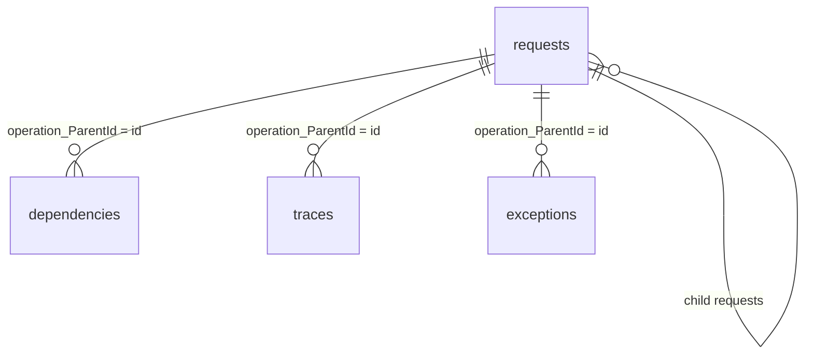

Every team I've worked with that runs on Azure has the same moment. Production behaves strangely, someone
opens Application Insights, clicks through the *Failures* blade for ten minutes, and then says: "Can
anyone write a query for that?" Usually one person can, and that person becomes the bottleneck for
every incident.

The fix is cheap. **Kusto Query Language** (KQL) takes an afternoon to learn well enough for 80% of
what you need during an incident. If you know LINQ, you already know most of the mental model. This
post covers that model, the syntax rules that confuse people in the first week, and the data model
behind Application Insights that makes queries actually useful.

## The one principle: table, pipe, pipe, result

Every KQL query has the same shape: **a source table, then zero or more processing steps, separated
by a pipe `|`**. Whatever is left after the last step is the result.

```kusto
exceptions
| where timestamp > ago(1d)
| where outerMessage has "payment provider"
| summarize Count = count(), LastSeen = max(timestamp) by cloud_RoleName
| order by Count desc
```

Read it top to bottom: take all exceptions, keep the last 24 hours, keep the ones about the payment
provider, count them per service, sort. There's no `SELECT ... FROM ... WHERE` inside-out reading
like in SQL. Each line takes a table and returns a table.

If that looks familiar, it should. It's the same idea as LINQ method syntax:

```csharp
var result = exceptions
    .Where(e => e.Timestamp > DateTime.UtcNow.AddDays(-1))
    .Where(e => e.OuterMessage.Contains("payment provider"))
    .GroupBy(e => e.CloudRoleName)
    .Select(g => new { Service = g.Key, Count = g.Count(), LastSeen = g.Max(e => e.Timestamp) })
    .OrderByDescending(x => x.Count);
```

The simplest valid query is just a table name: `exceptions`. Run that and you get every exception in
the selected time range. Then you add pipes until the result answers your question.

## Where to run it

In the Azure portal, open your Application Insights resource and click **Logs**. Two details that
confuse people:

- **The time range picker** above the editor applies to the whole query. As soon as your query filters
  on `timestamp` (or `TimeGenerated`) itself, the picker switches to *Set in query* and your filter
  wins.
- **Classic names vs. workspace names.** In the Application Insights *Logs* blade, tables are called
  `requests`, `dependencies`, `exceptions`, `traces`, `customEvents`, with columns like `timestamp`
  and `customDimensions`. Application Insights stores its data in a Log Analytics workspace, and if you
  query the **workspace** directly, the same data shows up as `AppRequests`, `AppDependencies`,
  `AppExceptions`, `AppTraces`, `AppEvents`, with `TimeGenerated` and `Properties`. Same data,
  different schema. I use the classic names in this series because they work in the App Insights
  blade, in workbooks and in most alert rules scoped to an App Insights resource.

| Classic (App Insights) | Workspace (Log Analytics) |
|---|---|
| `requests` | `AppRequests` |
| `dependencies` | `AppDependencies` |
| `exceptions` | `AppExceptions` |
| `traces` | `AppTraces` |
| `customEvents` | `AppEvents` |
| `timestamp` | `TimeGenerated` |
| `customDimensions` | `Properties` |
| `operation_Id` | `OperationId` |
| `operation_ParentId` | `ParentId` |

## The syntax rules that trip people up

**Comments are `//`.** There are no block comments.

**Blank lines end the query.** In the portal editor, an empty line separates *different* queries, and
*Run* executes the one your cursor is in. If you put a blank line in the middle of a query for
readability, the second half becomes a separate (and usually invalid) query. Use a `//` line as a
visual separator instead.

**`let` introduces a name, and statements end with `;`.**

```kusto
let window = 1h;
let slowThresholdMs = 2000;     // classic requests.duration is in milliseconds
requests
| where timestamp > ago(window)
| where duration > slowThresholdMs
```

Every `let` statement ends with a semicolon. The last statement, the actual query, doesn't need one.
In fact, **don't** put one there. The portal tolerates it, but some places that embed queries (alert
rules are the classic example) reject the query with a vague error. I covered that in more detail in
[KQL in Azure alert rules](/blog/2026-kql-in-azure-alert-rules/).

**There's no `return`.** The last statement is the result. You can't return two tables from one query.
If you need two results, write two queries or combine them with `union`.

**Strings are never null.** A string column is at worst empty (`""`). Numbers, datetimes and
`dynamic` values can be null. That's why `isnull()` on a string is always false. Use `isempty()` and
`isnotempty()`, which cover both null and empty for any type:

```kusto
traces
| where isnotempty(customDimensions.OrderId)
```

**String operators: prefer `has` over `contains`.** `has` matches whole terms and uses the term index.
`contains` scans for any substring and is much slower on large tables. Both are case-insensitive. The
case-sensitive variants end in `_cs` (`has_cs`, `contains_cs`), and `==` is case-sensitive while `=~`
isn't. That last one surprises C# developers constantly.

## The data model that makes it useful

Writing syntax is the easy part. What makes queries useful is knowing how the tables relate.
Application Insights follows the distributed tracing model:



- Every record has an **`operation_Id`**. That's the trace ID shared by everything that happened as
  part of one logical operation, across services.
- Every record has an **`operation_ParentId`**, which points to the `id` of the request (or dependency)
  it happened in. That's how you go from an exception to the request that caused it.
- A top-level request has no real parent. In that case its parent ID is usually the operation ID
  itself. In other tables, records logged outside any request (a background job without an activity,
  for example) have an **empty** operation ID and parent ID.
- `operation_Name` can be empty on non-request records. If you need the endpoint name reliably, join
  to `requests` and use its `name`, which is always set.

That gives you the most useful join in Application Insights: from an exception to its request.

```kusto
exceptions
| where timestamp > ago(1h)
| join kind=leftouter (
    requests
    | where timestamp > ago(1h)
    | project RequestId = id, Endpoint = name, url, resultCode
  ) on $left.operation_ParentId == $right.RequestId
| project timestamp, Endpoint, resultCode, type, outerMessage
```

Filter both sides of a join by time. Otherwise Kusto drags the entire retention period of `requests`
into the join.

## `customDimensions`: the column you control

Most columns are filled by the SDK. **`customDimensions`** (workspace: `Properties`) is the one your
code decides. It's a `dynamic` column, which you can treat like JSON:

```kusto
traces
| where timestamp > ago(30m)
| extend OrderId = tostring(customDimensions.OrderId),
         CustomerTier = tostring(customDimensions.CustomerTier)
| where CustomerTier == "gold"
```

Where does it come from? From structured logging. Every named placeholder in a message template,
and every value in a logging scope, ends up as a property:

```csharp
public sealed partial class OrderService(ILogger<OrderService> logger)
{
    public async Task PlaceAsync(Order order, CancellationToken ct)
    {
        using var _ = logger.BeginScope(new Dictionary<string, object>
        {
            ["CustomerTier"] = order.Customer.Tier,
        });

        LogPlacingOrder(order.Id, order.Lines.Count);
        // ...
    }

    [LoggerMessage(Level = LogLevel.Information,
        Message = "Placing order {OrderId} with {LineCount} lines")]
    private partial void LogPlacingOrder(Guid orderId, int lineCount);
}
```

This is where the query side and the code side meet. If your log messages are interpolated strings
(`$"Placing order {order.Id}"`), all you can do in KQL is substring searches on `message`. If they're
message templates, you get typed, filterable columns for free. **Good queries start in the logging
code**, not in the portal.

Two things to know about `customDimensions`: values come back as `dynamic`, so cast them with
`tostring()`, `toint()` or `todatetime()` before comparing. And the column is truncated at a size
limit, so don't log whole payloads into it.

## Comparison: KQL vs. SQL vs. LINQ

| | KQL | SQL | LINQ |
|---|---|---|---|
| Reading order | Top to bottom | Inside out | Left to right |
| Filter | `where` | `WHERE` | `.Where()` |
| Add a computed column | `extend` | `SELECT ..., x AS y` | `.Select(x => new { ..., y })` |
| Choose columns | `project` | `SELECT` | `.Select()` |
| Group + aggregate | `summarize ... by` | `GROUP BY` | `.GroupBy()` |
| Default string equality | `==` case-sensitive | depends on collation | case-sensitive |
| Null strings | don't exist | exist | exist |

## Pitfalls

- **No time filter.** Without a `timestamp` filter, the time picker decides. That's fine in the portal
  and dangerous in a saved query or a dashboard, where nobody sees the picker. Always filter time
  explicitly, and do it first.
- **Filtering late.** Put `where` clauses as early as possible, especially on `timestamp`. Kusto is
  fast, but `extend` and `parse` on millions of rows before a filter still cost.
- **Comparing `dynamic` to a string.** `customDimensions.Status == "Failed"` sometimes works and
  sometimes doesn't, depending on the stored type. `tostring(customDimensions.Status) == "Failed"`
  always works.
- **Sampling.** If adaptive sampling is on, `count()` counts *stored* items, not real events. Use
  `sum(itemCount)` for correct numbers.

## How to make the team good at it

- Keep a small library of saved queries ("errors per endpoint", "slowest dependencies", "requests of one
  operation") in the repo, next to the code that produces the telemetry. Queries rot when the code
  changes, and a PR that renames a log property should update the query too.
- Use message templates and `[LoggerMessage]` everywhere. An analyzer like CA2254 (template should be
  a static expression) flags interpolated log messages.
- Pair on queries during the next incident. That's where people learn it fastest.

## Summary

- KQL is **table → pipe → pipe → result**, read top to bottom, very close to LINQ.
- `let` statements end with `;`, the final query doesn't, blank lines split queries, and there's
  no `return`.
- Strings are never null: use **`isempty()`/`isnotempty()`**, prefer **`has`** over `contains`, and
  remember `==` is case-sensitive.
- Know the data model: **`operation_Id`** groups an operation, **`operation_ParentId`** links a record to
  its request.
- `customDimensions` is only as good as your **structured logging**. Use message templates.
