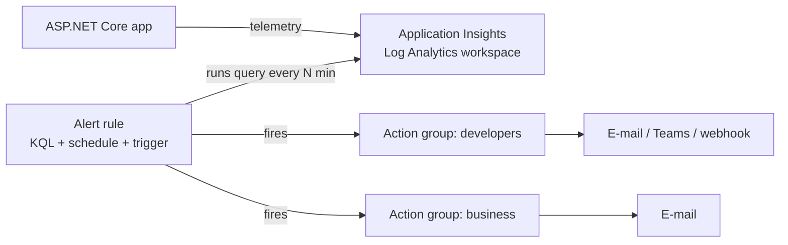

:::note[Series]
Part of the series [*Cloud, DevOps & observability*](/series/cloud-devops-observability/).
:::

A dashboard tells you something is wrong when you look at it. An alert tells you when you don't. Most
teams I've worked with have the first and a vague intention to build the second. Then an incident
happens, someone writes the perfect KQL query during the post-mortem, and the question is: how do we
make sure we find out next time *before* the customer does?

This post walks through that path: from a query in the portal to a **log search alert rule** in
Terraform, with action groups, a trigger that makes sense, and a way to let your application code
decide who gets notified. Plus the trailing semicolon that breaks alert rules with an error message
that tells you nothing.

## The building blocks



- The **alert rule** holds the query, how often it runs, over which time window, and the condition
  that fires it.
- An **action group** is a reusable list of receivers: e-mail, SMS, a webhook, an Azure Function, a
  Logic App that posts to Teams. Rules reference action groups. Action groups don't know about rules.
- The **data** lives in the Log Analytics workspace behind Application Insights.

## Step 1: write and test the query in the portal

Always start in the *Logs* blade. In one codebase I worked on, the team logged business-relevant
errors with two extra properties: who should be told (`TargetGroup`) and how urgently
(`NotificationInterval`). The alert query just filters on them:

```kusto
traces
| where timestamp > ago(15m)
| where severityLevel >= 3                                    // Error and Critical
| where tostring(customDimensions.NotificationInterval) == "Immediate"
| where tostring(customDimensions.TargetGroup) == "Business"
| extend Summary = extract(@"^(.*?)( *Details:.*)?$", 1, message)
| summarize LastOccurrence = max(timestamp), Count = count() by Summary
| order by LastOccurrence desc
| project ["Last occurrence (UTC)"] = LastOccurrence, Message = Summary, Count
```

The `extract()` strips a variable "Details: ..." suffix, so the same error with different details is
grouped into one row instead of fifty.

Run it, check the result, and then **prepare it for the alert rule**:

1. **Remove the time filter.** The alert rule has its own time window and applies it to the query.
   A `where timestamp > ago(15m)` that doesn't match the rule's window gives you confusing results.
2. **Remove the trailing semicolon,** if there is one.

## The semicolon that breaks everything

In KQL, `;` **separates** statements. It doesn't end them. The portal is forgiving and runs a query
with a semicolon after the last statement. The alert rule isn't. You get an error in the portal along
the lines of "the query is invalid" or a failed deployment, with nothing pointing at the semicolon.

```kusto
let threshold = 3;
traces
| where severityLevel >= threshold;   // <- this one breaks the alert rule
```

That team lost the better part of a day to this the first time. It's now the first thing I check when
an alert rule refuses a query that works in the portal.

## Step 2: action groups in Terraform

```hcl
resource "azurerm_monitor_action_group" "developers" {
  name                = "ag-shop-developers-prod"
  resource_group_name = azurerm_resource_group.monitoring.name
  short_name          = "shopdevs"   # 1-12 characters, shown in SMS and e-mails

  email_receiver {
    name                    = "dev-team"
    email_address           = var.developer_distribution_list
    use_common_alert_schema = true
  }
}

resource "azurerm_monitor_action_group" "business" {
  name                = "ag-shop-business-prod"
  resource_group_name = azurerm_resource_group.monitoring.name
  short_name          = "shopbiz"

  email_receiver {
    name                    = "order-operations"
    email_address           = var.business_distribution_list
    use_common_alert_schema = true
  }
}
```

Two recommendations:

- **Use distribution lists, not personal addresses.** The original setup listed individual people
  directly in Terraform. Every team change then needs an infrastructure deployment, and people who left
  keep getting alerts until someone notices. A list or a Teams channel is managed where it belongs.
- **Turn on the common alert schema.** Every alert type then sends the same JSON payload, which makes
  webhooks and Logic Apps much easier to write.

## Step 3: the alert rule

The wiki I learned this from used `azurerm_monitor_scheduled_query_rules_alert`. That resource
targets the old (v1) API and is deprecated. Use **`azurerm_monitor_scheduled_query_rules_alert_v2`**
instead. It supports dimensions, auto-resolve and a proper failing-periods configuration.

```hcl
resource "azurerm_monitor_scheduled_query_rules_alert_v2" "business_errors" {
  name                = "alert-shop-business-errors-prod"
  resource_group_name = azurerm_resource_group.monitoring.name
  location            = azurerm_resource_group.monitoring.location
  description         = "Errors that the order operations team has to act on immediately"
  display_name        = "Shop: immediate business errors"
  severity            = 1                       # 0 = critical ... 4 = verbose
  enabled             = true

  scopes               = [azurerm_application_insights.main.id]
  evaluation_frequency = "PT15M"                # how often the query runs
  window_duration      = "PT15M"                # which time range it sees

  criteria {
    query = <<-QUERY
      traces
      | where severityLevel >= 3
      | where tostring(customDimensions.NotificationInterval) == "Immediate"
      | where tostring(customDimensions.TargetGroup) == "Business"
      | extend Summary = extract(@"^(.*?)( *Details:.*)?$", 1, message)
      | summarize LastOccurrence = max(timestamp), Count = count() by Summary
      QUERY

    time_aggregation_method = "Count"           # count result rows
    operator                = "GreaterThan"
    threshold               = 0

    failing_periods {
      minimum_failing_periods_to_trigger_alert = 1
      number_of_evaluation_periods             = 1
    }
  }

  auto_mitigation_enabled = false               # fire per occurrence, don't wait for "resolved"

  action {
    action_groups = [
      azurerm_monitor_action_group.developers.id,
      azurerm_monitor_action_group.business.id,
    ]
    custom_properties = {
      runbook = "https://wiki.example.com/runbooks/business-errors"
    }
  }
}
```

A few notes on the details:

- **`scopes` decides the schema.** Scoped to the Application Insights resource, the query uses the
  classic tables (`traces`, `customDimensions`). Scoped to the Log Analytics workspace, it uses
  `AppTraces` and `Properties`. Mixing them up gives you a "table not found" error at deploy time.
- **`evaluation_frequency` and `window_duration`.** If the window is shorter than the frequency, you have
  gaps where errors are never seen. If it's longer, the same error fires in several consecutive runs.
  Equal values are the simplest correct choice. Keep in mind that telemetry arrives with a few minutes
  of ingestion delay, so very short windows can miss records.
- **The heredoc.** `<<-QUERY` strips leading indentation, so the query can be indented with the rest of
  the HCL. The closing `QUERY` has to be on its own line.
- **`custom_properties`** end up in the alert payload. A link to the runbook there is worth more than any
  description field.
- **`email_subject`** existed on the old resource and was ignored by Azure for years. Don't rely on it.
  The subject is generated from the rule's name, which is one more reason to choose readable names.

## Let the code decide who gets told

The part I like most about this setup is the routing via log properties. The alert rules are generic.
The **application code** decides, at the point where it knows the most, whether an error is for
developers or for the business, and how urgent it is.

```csharp
public enum AlertTarget { Developers, Business }
public enum AlertUrgency { Immediate, Daily }

public static class AlertLog
{
    public static IDisposable? BeginAlertScope(
        this ILogger logger, AlertTarget target, AlertUrgency urgency) =>
        logger.BeginScope(new Dictionary<string, object>
        {
            ["TargetGroup"] = target.ToString(),
            ["NotificationInterval"] = urgency.ToString(),
        });
}

public sealed partial class InvoiceExportJob(ILogger<InvoiceExportJob> logger)
{
    public async Task RunAsync(CancellationToken ct)
    {
        try
        {
            // ...
        }
        catch (TaxIdMissingException ex)
        {
            using (logger.BeginAlertScope(AlertTarget.Business, AlertUrgency.Immediate))
            {
                LogTaxIdMissing(ex, ex.CustomerId);
            }
        }
    }

    [LoggerMessage(Level = LogLevel.Error,
        Message = "Invoice export skipped: customer {CustomerId} has no tax ID")]
    private partial void LogTaxIdMissing(Exception ex, string customerId);
}
```

Logging scopes end up in `customDimensions` when the Application Insights logger provider has
`IncludeScopes` enabled (it is by default), and with OpenTelemetry when `IncludeScopes = true` is set on
the logging exporter options. Check that once in the portal. A scope that never arrives means an alert
that never fires.

Use enums and one helper, not string literals scattered across the code. A typo like `"Bussiness"`
compiles fine and produces exactly zero alerts.

## Which alert type for what

| Need | Alert type | Why |
|---|---|---|
| Specific error messages, business rules | Log search alert (KQL) | Full query power, any field |
| CPU, memory, request rate | Metric alert | Near real time, cheaper, no query cost |
| Failure rate anomalies | Smart detection / dynamic thresholds | No fixed threshold to tune |
| Resource health, service outages | Activity log / service health alert | Comes from Azure itself |
| "Did the nightly job run at all?" | Log search alert with `count() == 0` | Detects absence |

Log search alerts are billed per rule and evaluation frequency. A rule every minute costs more than one
every 15 minutes, and most business alerts don't need minute-level latency.

## Pitfalls

- **The trailing semicolon.** See above. Check it first.
- **Time filter left in the query.** It fights with `window_duration`.
- **Alerts on absence need a different trigger.** For "no orders in the last hour", keep the query
  simple (`requests | where name == "POST Orders/Place"`), keep `time_aggregation_method = "Count"`,
  and flip the condition to `operator = "LessThan"` with `threshold = 1`. A `GreaterThan 0` rule can,
  by definition, never fire on something that didn't happen.
- **Alert fatigue.** An alert that fires daily for something nobody acts on trains everyone to ignore all
  alerts. Every rule needs an owner and a runbook, or it should be deleted.
- **No test.** A rule that has never fired may not work. Trigger it once on purpose in a test
  environment.

## Make it verifiable

- After deployment, open the rule in *Monitor → Alerts → Alert rules* and use **View results in logs**.
  It opens the query against the exact scope the rule uses. If it errors there, the rule errors too.
- Keep the queries in the repository as `.kql` files and load them with `file("${path.module}/queries/business-errors.kql")`.
  They become reviewable, diffable, and you can run them in CI against a test workspace with the Azure
  CLI (`az monitor log-analytics query`).
- In a test environment, write a small endpoint or test that logs a message with the alert scope, and
  check that the e-mail arrives. Do it once per rule, and again after every change to the logging setup.

## Summary

- An alert = **query + schedule + trigger + action groups**. Build the query in the portal first.
- Before pasting it into Terraform: **remove the time filter and the trailing semicolon.**
- Use **`azurerm_monitor_scheduled_query_rules_alert_v2`**, not the deprecated v1 resource.
- Send alerts to **distribution lists**, not to people, and add a runbook link via `custom_properties`.
- Let the **application code route alerts** with logging scopes, and use enums instead of magic strings.
- Every alert needs an owner, a runbook and one deliberate test firing.
