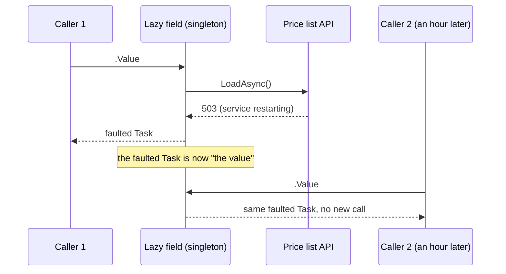

"We need exactly one of these" is one of the first design decisions in many codebases, and one of the
longest-lived. A connection to a machine controller, a loaded price list, a parsed configuration file, an
expensive client. You'll still find wiki pages that present the static singleton as "super simple" and
`Lazy<T>` as "a thread-safe singleton out of the box", with an async variant that's just
`Lazy<Task<T>>`.

All of that is *almost* right. This post is about the "almost": what `Lazy<T>` really guarantees, the
`Lazy<Task<T>>` that keeps a failed initialization forever, and why most singletons should come from the
DI container instead of a static property.

## The "before": three classics

**The static singleton.**

```csharp
public sealed class MachineConnection
{
    public static MachineConnection Instance { get; } = new();

    private MachineConnection()
    {
        _client = new TcpClient("10.0.0.20", 4840);   // where does this come from in a test?
    }

    private readonly TcpClient _client;
    // ...
}

// somewhere deep in a service
var state = MachineConnection.Instance.ReadState();
```

It's thread-safe, because the runtime initializes static fields exactly once. But it's also a global
variable with a nicer name. Every caller has a **hidden dependency** that doesn't show in any
constructor. Tests can't replace it, so every test that touches the service talks to a real machine (or
the code grows a "simulation mode" flag, which is a smell of its own). It can't take configuration,
because the private constructor has nobody to ask. And it lives for the whole process, so its state
leaks from one test into the next.

**The hand-rolled double-checked lock.**

The textbook form: two checks, one lock.

```csharp
private static volatile PriceList? _instance;
private static readonly object Sync = new();

public static PriceList Instance
{
    get
    {
        if (_instance is null)              // 1st check: fast path, no lock once initialized
        {
            lock (Sync)
            {
                if (_instance is null)      // 2nd check: another thread may have won the race
                {
                    _instance = PriceList.Load();
                }
            }
        }
        return _instance;
    }
}
```

And the compact form you'll find in newer code. It's the same pattern: `??=` *is* the second check, it
only assigns when the field is still `null`.

```csharp
private static PriceList? _instance;
private static readonly object Sync = new();

public static PriceList Instance
{
    get
    {
        if (_instance is null)
        {
            lock (Sync)
            {
                _instance ??= PriceList.Load();
            }
        }
        return _instance;
    }
}
```

Note that it's *one* lock, not two. The second check has to happen inside the lock, because two
threads can pass the first check at the same time. The `volatile` in the first version is the portable
way to make the published reference visible to other threads; the .NET memory model already guarantees
that on current runtimes, which is why the second version works without it.

This is a classic interview question, and in .NET it happens to work because of the memory model on
current runtimes. It's also unnecessary. It re-implements what `Lazy<T>` and the static initializer already
do, and variations of it (forgetting the second check, initializing fields after assigning the instance)
break in ways that only show up under load. Don't write your own synchronization when the framework has a
tested version.

**`Lazy<Task<T>>` as an async cache.**

```csharp
public sealed class PriceListProvider(IPriceListClient client)
{
    private readonly Lazy<Task<PriceList>> _priceList =
        new(() => client.LoadAsync());

    public Task<PriceList> GetAsync() => _priceList.Value;
}
```

This looks like the perfect async singleton, and it's the one that bites hardest. More below.

## What `Lazy<T>` really guarantees

`Lazy<T>` runs a factory on first access to `.Value` and returns the same result afterwards. How it
behaves when several threads arrive at the same time depends on `LazyThreadSafetyMode`:

| Mode | Factory runs | Exceptions | Use when |
|---|---|---|---|
| `ExecutionAndPublication` (default) | exactly once; other threads wait | **cached**: every later `.Value` rethrows | The factory is expensive or must not run twice |
| `PublicationOnly` | possibly several times concurrently; first result wins | **not cached**: the next access retries | The factory is cheap and side-effect free, and you want retry on failure |
| `None` | no protection | cached | Single-threaded code only |

Two things in that table surprise people:

1. **Exceptions are cached** in the default mode. If the factory fails once, for example because the
   machine was still booting, the `Lazy` is broken for the rest of its lifetime. Every access rethrows the
   same exception.
2. **"Thread-safe" means the initialization.** `Lazy<T>` guarantees that everyone gets the same instance.
   It says nothing about whether that instance is safe to use from several threads. A `Lazy<List<T>>`
   gives you one shared, non-thread-safe list.

Also keep in mind that `new Lazy<T>()` without a factory calls the parameterless constructor through
reflection. Always pass a factory.

## The `Lazy<Task<T>>` trap

With `Lazy<Task<T>>`, the factory doesn't throw. It returns a task, and the task fails later. From
`Lazy`'s point of view the initialization **succeeded**: it has a value, which happens to be a faulted
task. So it caches that faulted task, and every caller for the rest of the process awaits the same
exception.



`PublicationOnly` doesn't help here, because there is no exception during publication. The fix is an
async lazy that **forgets failed attempts**:

```csharp
namespace MyShop.Common;

public sealed class AsyncLazy<T>(Func<Task<T>> factory)
{
    private readonly Lock _gate = new();
    private Task<T>? _task;

    public Task<T> GetValueAsync(CancellationToken ct = default)
    {
        Task<T> task;
        lock (_gate)
        {
            if (_task is null || _task.IsFaulted || _task.IsCanceled)
                _task = factory();   // start a new attempt; successful and running tasks are kept
            task = _task;
        }
        return task.WaitAsync(ct);
    }

    public bool IsValueCreated => _task?.IsCompletedSuccessfully == true;
}
```

```csharp
public sealed class PriceListProvider(IPriceListClient client)
{
    private readonly AsyncLazy<PriceList> _priceList = new(() => client.LoadAsync(CancellationToken.None));

    public Task<PriceList> GetAsync(CancellationToken ct) => _priceList.GetValueAsync(ct);
}
```

What this does differently:

- **Concurrent callers share one attempt.** While the task is running, everybody awaits the same task.
  No stampede against the price list API.
- **A failed or cancelled attempt is replaced** on the next call, so a temporary outage heals itself.
- **The caller's token cancels the wait, not the shared load.** If the first caller's request is aborted,
  passing its token into the factory would cancel the initialization for everyone else waiting. The
  shared work runs with `CancellationToken.None` (or a token tied to the application lifetime), and each
  caller uses `WaitAsync(ct)` for its own cancellation.

`Lock` is the dedicated lock type from .NET 9. On older targets, a `private readonly object` works the
same way. If you'd rather not own this code, `Nito.AsyncEx` has an `AsyncLazy<T>` with
`AsyncLazyFlags.RetryOnFailure`.

:::note[When caching the failure is right]
Inside a single request, a `Lazy<Task<T>>` is fine, as in the
[Request Context Builder](/blog/2026-request-context-builder/): the request fails anyway, and the next
request gets a new `Lazy`. The trap is a `Lazy<Task<T>>` that lives in a singleton or a static field.
:::

## Per-key lazies and `ConcurrentDictionary`

A common variant is a cache per key. `ConcurrentDictionary.GetOrAdd` with a factory is thread-safe for
the dictionary, but the **factory can run more than once** for the same key when two threads race. The
dictionary keeps one result and throws the others away, but both loads happened.

The standard fix is to store a lazy as the value, so only the cheap wrapper is created twice:

```csharp
private readonly ConcurrentDictionary<string, AsyncLazy<PriceList>> _byRegion = new();

public Task<PriceList> GetAsync(string region, CancellationToken ct) =>
    _byRegion.GetOrAdd(region, r => new AsyncLazy<PriceList>(() => client.LoadAsync(r, CancellationToken.None)))
             .GetValueAsync(ct);
```

Once you need expiry, size limits or a distributed cache, stop building it yourself and use `HybridCache`,
which has stampede protection built in. See
[caching abstractions](/blog/2026-caching-abstractions-memory-redis-hybrid/).

## Singletons belong in the container

The DI container already does what the static singleton promises, without the downsides:

```csharp
builder.Services.Configure<MachineOptions>(builder.Configuration.GetSection("Machine"));
builder.Services.AddSingleton<IMachineConnection, MachineConnection>();
```

```csharp
public sealed class MachineConnection(IOptions<MachineOptions> options, ILogger<MachineConnection> logger)
    : IMachineConnection, IAsyncDisposable
{
    // one instance per container, created on first resolve, disposed on shutdown
}

public sealed class StateMonitor(IMachineConnection machine)   // the dependency is visible
{
    // ...
}
```

- **Lazy by default.** A DI singleton is created on first resolve, not at startup. You don't need
  `Lazy<T>` to get lazy creation.
- **Thread-safe creation.** The container guarantees one instance per container.
- **Configurable.** The constructor can take options, a logger and other services.
- **Replaceable.** A test registers a fake `IMachineConnection`. No simulation flag in production code.
- **Disposed** when the host shuts down, including `IAsyncDisposable`.
- **One per container, not per process.** Two test hosts get two instances, so tests don't leak state
  into each other.

The things to watch are the same as for any singleton: it must be thread-safe itself, and it must not
capture scoped services (the captive dependency, covered in
[DI lifetimes](/blog/2026-di-lifetimes-and-service-registration/)). If a singleton's dependency is
expensive and only needed sometimes, inject a `Lazy<T>`, and register it correctly: the eager-looking
`AddSingleton<Lazy<T>>()` trap is explained in
[startup time and lazy registrations](/blog/2026-startup-time-lazy-registrations/).

## Comparison

| | Static `Instance` | Hand-rolled lock | `Lazy<T>` field | `Lazy<Task<T>>` in a singleton | `AsyncLazy<T>` (retry) | DI singleton |
|---|---|---|---|---|---|---|
| Thread-safe creation | ✅ | ⚠️ easy to break | ✅ | ✅ | ✅ | ✅ |
| Lazy | ⚠️ type init | ✅ | ✅ | ✅ | ✅ | ✅ |
| Recovers from failed init | ❌ type is broken | ✅ | ❌ (default mode) | ❌ | ✅ | ✅ next resolve |
| Configurable / injectable | ❌ | ❌ | ✅ | ✅ | ✅ | ✅ |
| Replaceable in tests | ❌ | ❌ | ⚠️ | ⚠️ | ⚠️ | ✅ |
| Dependency visible | ❌ | ❌ | ✅ | ✅ | ✅ | ✅ |

A static field is still fine for things that are truly global, immutable and free of I/O: a
`JsonSerializerOptions` instance, a lookup table, a `[GeneratedRegex]`. The moment it touches the network,
the file system or configuration, it belongs in the container.

## Pitfalls

**A failing static constructor.** If a static initializer throws, the type throws
`TypeInitializationException` on every access for the rest of the process. That's the static version of
the cached exception, with a worse error message.

**Blocking on async initialization.** `_lazy.Value.Result` in a constructor or a property getter is
sync-over-async, with the usual deadlock and starvation problems
([async/await pitfalls](/blog/2026-async-await-pitfalls/)). Keep the API async: `GetValueAsync`, not a
`Value` property.

**Expensive work in a DI singleton's constructor.** Constructors can't be async, so people block in them.
Make the constructor cheap and do the expensive part lazily with `AsyncLazy<T>`, or warm it up in an
`IHostedService` at startup if the first request must be fast.

**Mutable singleton state.** One instance shared by every thread is shared state. Prefer immutable data
(records, `FrozenDictionary`) that you replace as a whole, over objects that are modified in place under a
lock. That topic gets its own post: [state is the enemy](/blog/2026-state-is-the-enemy/).

**`Lazy<T>` around a scoped service in a singleton.** The `Lazy` makes the captive dependency *later*, not
*correct*.

## How to enforce it

- **An architecture test** that fails on new static `Instance` properties:

```csharp
[TestMethod]
public void No_static_singleton_instances()
{
    var offenders = typeof(Program).Assembly.GetTypes()
        .Where(t => t.GetProperties(BindingFlags.Public | BindingFlags.Static)
                     .Any(p => p.Name == "Instance" && p.PropertyType == t))
        .Select(t => t.FullName)
        .ToList();

    Assert.AreEqual(0, offenders.Count,
        $"Register these as DI singletons instead: {string.Join(", ", offenders)}");
}
```

- **ValidateScopes and ValidateOnBuild** in the host find singletons that capture scoped services.
- **A test for the retry behaviour** of your async lazy: a factory that fails on the first call and
  succeeds on the second, and an assertion that the second `GetValueAsync` returns the value. That test is
  the documentation of why `AsyncLazy<T>` exists, so nobody "simplifies" it back to `Lazy<Task<T>>`.
- **Code review**: any `Lazy<Task<` in a field of a singleton or a static class deserves a question. It's
  a good item for the [code review checklist](/blog/2026-code-review-checklist/).

## Summary

- A **static singleton** is a global variable: hidden dependency, not configurable, not replaceable in
  tests. Use a **DI singleton**, which is lazy and thread-safe as well.
- Don't hand-roll double-checked locking. **`Lazy<T>`** and static initializers already do it correctly.
- `Lazy<T>` in the default mode **caches exceptions**, and its thread-safety covers the initialization,
  not the object.
- **`Lazy<Task<T>>`** in a long-lived object caches a **faulted task forever**. Use an `AsyncLazy<T>` that
  retries failed attempts, and keep the caller's token out of the shared initialization.
- For per-key caches, store lazies in the `ConcurrentDictionary`, and switch to `HybridCache` once you
  need expiry.
