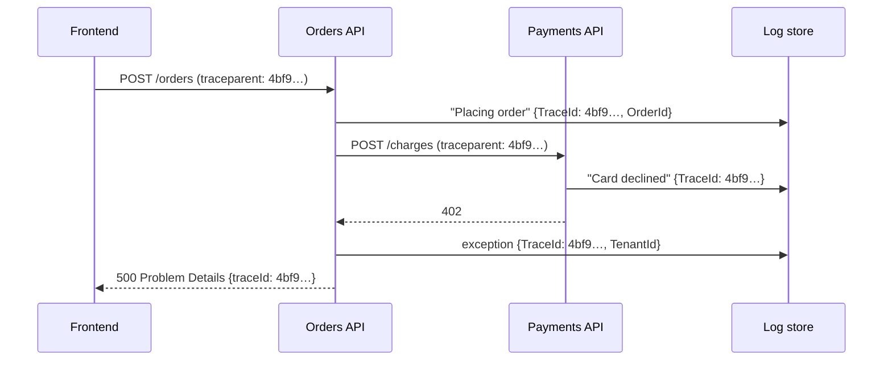

:::note[Series]
Part of the series [*Validation & error handling*](/series/validation-and-error-handling/).
:::

Here's a situation I've been in more than once. A user reports that saving an order failed. You open
the log search, filter for the time window, and find this:

```
ERR  Error: Object reference not set to an instance of an object.
ERR  Saving order failed
ERR  An unhandled exception has occurred while executing the request.
```

Three entries. One has no stack trace, one has no exception at all, and the third has the stack
trace but no idea which order or customer it was about. None of them has anything you could search
for. And since a few hundred other requests were running at the same time, you can't even be sure
the three belong together.

The [previous post](/blog/2026-exception-handling-best-practices/) was about *handling* exceptions.
This one is about *logging* them, so that the person reading the logs six months from now (often
that's you) gets an answer instead of a puzzle.

## Why we log in the first place

Logs serve debugging, auditing and performance analysis. For exceptions, it's almost entirely
debugging: someone has a problem, and somebody else needs to find out what happened. Every logging
decision should be made with that person in mind. "Would this line help them?" is a better filter
than any rule.

## Mistake 1: logging `ex.Message`

```csharp
catch (Exception ex)
{
    logger.LogError("Error: " + ex.Message);
}
```

`ex.Message` is the *what*. The *where* (stack trace) and the *why* (inner exceptions) are gone.
`ToString()` would contain all three, but the right fix is to pass the exception itself to the
logger:

```csharp
catch (PaymentDeclinedException ex)
{
    logger.LogWarning(ex, "Payment for order {OrderId} was declined", order.Id);
}
```

Every `ILogger` method has an overload that takes the `Exception` as the first argument. The
logging provider then records message, type, stack trace and inner exceptions as separate fields,
which also means you can query them separately.

## Mistake 2: string interpolation instead of message templates

```csharp
logger.LogInformation($"Order {order.Id} placed for customer {order.CustomerId}");  // ❌
logger.LogInformation("Order {OrderId} placed for customer {CustomerId}",
    order.Id, order.CustomerId);                                                     // ✅
```

They print the same text. But the second one is **structured**: `OrderId` and `CustomerId` become
properties on the log record. In Application Insights, Azure Monitor, Seq, Elastic or Loki you can
now filter with `OrderId == "..."`, group by `CustomerId` and count. With interpolation you only have
a string, and you're back to `contains`.

The template is also cheaper: the string is only formatted if the log level is enabled. The
analyzer **CA2254** (template should be a static expression) warns about interpolation, and **CA1848**
nudges you toward the next step.

### Even better: source-generated log methods

```csharp
public static partial class OrderLog
{
    [LoggerMessage(Level = LogLevel.Warning,
        Message = "Payment for order {OrderId} was declined by {Provider}")]
    public static partial void PaymentDeclined(
        this ILogger logger, Exception exception, Guid orderId, string provider);

    [LoggerMessage(Level = LogLevel.Information,
        Message = "Order {OrderId} placed for customer {CustomerId}")]
    public static partial void OrderPlaced(this ILogger logger, Guid orderId, Guid customerId);
}

// usage
logger.PaymentDeclined(ex, order.Id, provider.Name);
```

No boxing, no parsing of the template at runtime, typed parameters, and all log messages of a feature
in one file, where a reviewer can see them at a glance. I use this for everything that's logged on a
hot path, and increasingly for everything else too.

## Mistake 3: log and rethrow

This is the one that produces the three entries from the beginning:

```csharp
// Repository
catch (DbException ex)
{
    logger.LogError(ex, "Saving order failed");
    throw;
}

// Service
catch (Exception ex)
{
    logger.LogError(ex, "Error in PlaceOrder");
    throw;
}

// ... and then the exception handler middleware logs it a third time
```

Each layer thinks it's being responsible. The result is noise: three errors for one failure,
alert rules that fire three times, and dashboards that overstate your error rate by a factor of
three.

The rule is simple: **log an exception where you handle it, and nowhere else.** If you rethrow, you
don't log. If the exception reaches the top, the global handler logs it once. That's the reason the
"separate error handling from error logging" approach works so well: a central handler that turns
exceptions into responses, and one central place that logs them, with the same structure for
every error.

If a layer has context the global handler doesn't know, it shouldn't log it. It should *attach* it,
which brings us to scopes.

## Context without duplication: logging scopes

A scope adds properties to **every** log entry written inside it, including the one the global
handler writes when the exception arrives there:

```csharp
public async Task<OrderResult> HandleAsync(PlaceOrder command, CancellationToken ct)
{
    using var _ = logger.BeginScope(new Dictionary<string, object>
    {
        ["OrderId"] = command.OrderId,
        ["CustomerId"] = command.CustomerId,
        ["Channel"] = command.Channel
    });

    logger.LogInformation("Placing order");
    var price = await pricing.CalculateAsync(command, ct);   // logs inside also get the scope
    await payments.ChargeAsync(command, price, ct);          // throws
    // ...
}
```

Every entry written while the scope is open, here and in `pricing` and `payments`, carries
`OrderId`, `CustomerId` and `Channel` without anyone repeating them.

There's one catch: a scope is disposed when its `using` block is left, and that also happens while
an exception unwinds. By the time `UseExceptionHandler` logs the exception further up, the handler's
scope is already gone. So the global log entry only sees scopes that were opened *outside* the
throwing code. For values that must reach that entry, open the scope in middleware or an endpoint
filter:

```csharp
app.Use(async (http, next) =>
{
    var logger = http.RequestServices.GetRequiredService<ILogger<Program>>();
    using var _ = logger.BeginScope(new Dictionary<string, object>
    {
        ["TenantId"] = http.User.FindFirstValue("tenant_id") ?? "unknown",
        ["ClientApp"] = http.Request.Headers["X-Client-App"].ToString()
    });
    await next(http);
});
```

Register it *before* `UseExceptionHandler` so the scope is still open when the exception handler
writes its entry. For values only known deep inside the flow, such as the order ID, tag the current
activity instead (`Activity.Current?.SetTag("order.id", command.OrderId)`). The tag ends up on the
request's trace, and the log entry is connected to that trace through its trace ID, as the next
section shows.

Not every provider records scopes by default. For the console you need
`AddJsonConsole(o => o.IncludeScopes = true)`, and Application Insights and the OpenTelemetry
exporter have their own switches. Check that yours shows up before relying on it.

## Correlation: connecting the log to the request

A response that says "error, sorry" is useless unless the support person can find the matching log
entry. That's what the trace ID is for. With OpenTelemetry (or Application Insights, which builds on
the same `Activity` API), every log entry written during a request carries the `TraceId` and
`SpanId` of that request automatically, and the trace ID is propagated to downstream services via the
W3C `traceparent` header.

Put the same ID into your error responses:

```csharp
builder.Services.AddProblemDetails(o => o.CustomizeProblemDetails = ctx =>
    ctx.ProblemDetails.Extensions["traceId"] =
        Activity.Current?.TraceId.ToString() ?? ctx.HttpContext.TraceIdentifier);
```

Now a user (or the frontend) can report "it failed, trace ID `4bf92f3577b34da6a3ce929d0e0e4736`", and
one query gives you every log entry and every dependency call of that request, across all
services.



## Pick the right level

The level decides who gets woken up. The Microsoft definitions are a good baseline:

| Level | Use it for | Example |
|---|---|---|
| `Trace` / `Debug` | Details for development, off in production | Request payloads, cache hits |
| `Information` | Normal, noteworthy events | Order placed, job finished |
| `Warning` | Unexpected, but handled; nobody needs to act now | Retry succeeded, payment declined, validation failed |
| `Error` | A request or operation failed, someone **should look at it** | Unhandled exception, data inconsistency |
| `Critical` | The application can't continue | Can't connect to the database at startup |

The rule I like best from one team's guidelines: **only log an `Error` if someone on support has to
take action.** A user entering an invalid e-mail address is not an error. It's at most a `Warning`,
often just `Information` or nothing. If your error log is full of validation failures, nobody looks
at it any more, and the real errors drown.

## What never goes into a log

- **Secrets:** access tokens, API keys, passwords, connection strings. Be careful with request
  headers, a full `Authorization` header in a log is a credential leak.
- **Personal data:** names, e-mail addresses, phone numbers, addresses. Log the customer *ID*, not the
  customer.
- **Whole request or response bodies** in production. They almost always contain one of the above.

`Microsoft.Extensions.Compliance.Redaction` together with the `[LogProperties]` and data
classification attributes lets you mark sensitive properties once and have them redacted in every log
call. For anything that is logged as a whole object, that's worth the setup.

## Comparison

| Approach | Stack trace | Queryable | Logged once | Context of the request |
|---|---|---|---|---|
| `LogError("..." + ex.Message)` | ❌ | ❌ | depends | ❌ |
| `LogError(ex, $"... {id}")` | ✅ | ❌ | depends | partly |
| `LogError(ex, "... {OrderId}", id)` | ✅ | ✅ | depends | partly |
| Global handler + scopes + trace ID | ✅ | ✅ | ✅ | ✅ |

## Pitfalls

**Logging in a loop.** A failing item in a batch of 100,000 that logs at `Error` per item will
take down your log ingestion (and your budget). Aggregate: log the first few in detail, then a
summary.

**Category names nobody can filter.** `ILogger<T>` uses the full type name as category, which is
exactly what you want for filtering ("show me everything from `MyShop.Orders.*`"). Avoid injecting a
non-generic `ILogger` or creating loggers with arbitrary strings.

**Expensive arguments.** `logger.LogDebug("State {State}", JsonSerializer.Serialize(order))`
serializes even when `Debug` is off. Guard with `logger.IsEnabled(LogLevel.Debug)`, or use
`[LoggerMessage]`, which checks the level for you before evaluating the template.

**Scopes that never end.** A scope that isn't disposed (missing `using`) leaks into unrelated log
entries on the same async flow. Always `using`.

**Inconsistent property names.** `OrderId`, `orderId`, `OrderID` and `Id` are four different fields in
your log store. Agree on names (a static class with constants or the `[LoggerMessage]` methods help)
and stick to them.

## Make it measurable and enforced

- **Analyzers:** CA2254 (static templates), CA1848 (use `LoggerMessage` delegates) and CA1727 (use
  PascalCase for named placeholders) catch most of the formatting mistakes. Raise CA2254 to `error`.
- **A test for the global log entry:** with `Microsoft.Extensions.Diagnostics.Testing`, register a
  `FakeLogger` in an integration test, trigger an exception and assert there's exactly **one**
  `Error` entry, with an exception and the expected scope properties.

```csharp
[TestMethod]
public async Task Failed_order_is_logged_exactly_once_with_context()
{
    var collector = new FakeLogCollector();
    await using var factory = new WebApplicationFactory<Program>()
        .WithWebHostBuilder(b => b.ConfigureLogging(l =>
            l.ClearProviders().AddProvider(new FakeLoggerProvider(collector))));

    await factory.CreateClient().PostAsJsonAsync("/orders", OrderRequests.WithDeclinedCard());

    var errors = collector.GetSnapshot().Where(r => r.Level >= LogLevel.Error).ToList();
    Assert.AreEqual(1, errors.Count, "The exception was logged more than once.");
    Assert.IsNotNull(errors[0].Exception);
}
```

- **Telemetry hygiene:** look at your error count per operation regularly. A ratio of log errors to
  failed requests well above 1 means someone is logging and rethrowing.

## Summary

- Pass the **exception object** to the logger, never just `ex.Message`.
- Use **message templates** (or `[LoggerMessage]`), not string interpolation, so logs are queryable.
- **Log where you handle, not where you rethrow.** One failure, one error entry.
- Add context with **scopes** instead of extra log lines, and connect everything with the **trace ID**,
  which also goes into the error response.
- Choose levels for the reader: `Error` means someone has to act.
- Never log secrets or personal data, and let **analyzers and tests** keep it that way.
