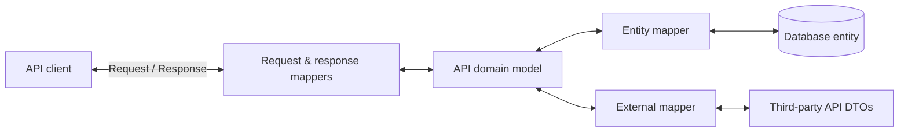

:::note[Series]
Part of the series [*Architecture in practice*](/series/architecture-in-practice/).
:::

A database migration renames `sku` to `product_code`. A harmless refactoring, reviewed and merged.
The next morning a partner's integration is broken, because the API returned the entity directly
and the JSON property changed from `sku` to `productCode`. Nobody touched an endpoint, and still the
public contract changed.

The same thing happens in the other direction. A third-party system you call adds a field or changes
an enum value, and suddenly your domain code has `if (status == "PENDING_V2")` scattered across five
handlers.

Both problems have the same solution, and it's one of the least glamorous classes in any codebase:
the **mapper**. This post explains why I treat mappers as an *anti-corruption layer*, why I prefer
explicit mapping code over reflection magic, and how to make sure a mapper doesn't silently drop
data.

## What "anti-corruption layer" means here

The term comes from Domain-Driven Design. Eric Evans describes it as a translation layer between
two models, so that one model doesn't "corrupt" the other with its concepts and quirks. Originally it
was about integrating legacy systems. The idea applies just as well inside a single service:



There are three boundaries in a typical backend, and each one gets a mapper:

1. **API contract ↔ internal model.** Clients see requests and responses. They never see entities.
2. **Internal model ↔ persistence.** The database can change shape without the API noticing.
3. **Internal model ↔ external systems.** A partner API's naming, enums and oddities stay at the edge.

Each mapper is the only place in the code that knows both sides of its boundary.

## The "before": one type for everything

```csharp
[Table("orders")]
public class Order
{
    [Key] public int Id { get; set; }
    [Column("sku")] public string Sku { get; set; } = "";
    public string Status { get; set; } = "placed";      // free-text, as stored
    public decimal InternalCost { get; set; }            // never meant for clients
    public string? LegacyErpKey { get; set; }            // only the export job needs it
    [JsonIgnore] public Customer Customer { get; set; } = null!;
}

app.MapGet("/orders/{id:int}", async (int id, ShopDbContext db) => await db.Orders.FindAsync(id));
```

This one class is the database schema, the API contract and the domain model at the same time.
Consequences:

- `InternalCost` and `LegacyErpKey` are visible to every client. Someone will start depending on them.
- Renaming a column changes the JSON. Adding a navigation property can cause serialization cycles.
- `Status` is a string because the database stores a string, so the API documents it as "any string".
- `[JsonIgnore]` and `[Column]` on the same class: two unrelated concerns fighting over one type.

## The "after": explicit mappers at each boundary

The API model is a plain record without any infrastructure attributes:

```csharp
namespace MyShop.Api.Orders.V1;

public sealed record Order
{
    public required int Id { get; init; }
    public required string ProductId { get; init; }
    public required OrderStatus Status { get; init; }
    public required DateTimeOffset PlacedAt { get; init; }
}

public enum OrderStatus { Placed, Paid, Shipped, Cancelled }
```

The entity is what the database needs, and nothing else:

```csharp
namespace MyShop.Database.Orders;

internal sealed class OrderEntity
{
    public int Id { get; set; }
    public string Sku { get; set; } = "";
    public string Status { get; set; } = "placed";
    public DateTime PlacedAtUtc { get; set; }
    public decimal InternalCost { get; set; }
    public string? LegacyErpKey { get; set; }
}
```

And the mapper translates, explicitly, property by property:

```csharp
namespace MyShop.Api.Orders.V1;

internal sealed class OrderEntityMapper
{
    public Order ToOrder(OrderEntity entity) => new()
    {
        Id        = entity.Id,
        ProductId = entity.Sku,                                      // naming differs
        Status    = ParseStatus(entity.Status),                      // string → enum
        PlacedAt  = new DateTimeOffset(entity.PlacedAtUtc, TimeSpan.Zero)
        // InternalCost and LegacyErpKey are deliberately not mapped
    };

    public IImmutableList<Order> ToOrders(IEnumerable<OrderEntity> entities) =>
        entities.Select(ToOrder).ToImmutableList();

    private static OrderStatus ParseStatus(string value) => value switch
    {
        "placed"    => OrderStatus.Placed,
        "paid"      => OrderStatus.Paid,
        "shipped"   => OrderStatus.Shipped,
        "cancelled" => OrderStatus.Cancelled,
        _ => throw new InvalidOperationException($"Unknown order status '{value}' in database.")
    };
}
```

Now the column can be renamed: the compiler shows you the one line in the mapper to change. A new
internal field doesn't appear in the API until someone decides it should. The `Status` mapping is
explicit, and an unknown value fails loudly instead of leaking to clients.

## The same for third-party systems

The boundary to an external API is where the anti-corruption layer earns its name. Say a payment
provider returns this:

```csharp
// Shaped by the provider. We don't control it and it will change.
internal sealed record PaymentProviderTransaction(
    string txn_id,
    string state,          // "AUTH", "CAPT", "VOID", "PENDING_V2", ...
    long amount_minor,
    string currency_code);
```

The rest of the code should never see `amount_minor` or `PENDING_V2`:

```csharp
internal sealed class PaymentProviderMapper
{
    public Payment ToPayment(PaymentProviderTransaction source) => new(
        Id:     new PaymentId(source.txn_id),
        Status: source.state switch
        {
            "AUTH"                    => PaymentStatus.Authorized,
            "CAPT"                    => PaymentStatus.Captured,
            "VOID"                    => PaymentStatus.Cancelled,
            "PENDING" or "PENDING_V2" => PaymentStatus.Pending,   // the provider's versioning stays here
            _                         => PaymentStatus.Unknown
        },
        Amount: new Money(source.amount_minor / 100m, source.currency_code));
}
```

When the provider introduces `PENDING_V3`, you change one switch arm. Without the mapper, you'd grep
the whole codebase for string comparisons.

## Hand-written, generated or reflection-based?

There are three ways to implement mappers in .NET:

| | Hand-written | Source-generated (e.g. Mapperly) | Reflection-based (e.g. AutoMapper) |
|---|---|---|---|
| Visible, debuggable code | ✅ | ✅ generated code can be stepped into | ❌ configuration + runtime magic |
| Compile-time errors for unmapped properties | ⚠️ only with `required` / tests | ✅ configurable diagnostics | ❌ runtime `AssertConfigurationIsValid` |
| Native AOT / trimming friendly | ✅ | ✅ | ❌ relies on reflection |
| Runtime cost | none beyond assignments | none beyond assignments | reflection / expression compilation |
| Boilerplate | most | least | little, but in profiles |
| Licensing | n/a | open source | commercial license since v15 for larger companies |

My default is **hand-written**. Mappers are boring code, and boring code is exactly what you want at a
boundary. When a mapping goes wrong, you set a breakpoint in a normal method instead of reverse
engineering a profile. For larger models with dozens of properties, a **source generator** like
[Mapperly](https://github.com/riok/mapperly) gives you the same explicitness without the typing, and
it can turn "target property not mapped" into a build error.

I've stopped using reflection-based mappers in new code. Reasons I share with several teams I've
worked with: they hide what happens, they get in the way of Native AOT, and each third-party
dependency is another upgrade to manage. Also, AutoMapper moved to a commercial license with version
15 in 2025. Smaller companies can still use it for free under the community terms, but it's one
more thing to check.

## Where mappers live

In a feature-sliced API (see [*Anatomy of a minimal endpoint*](/blog/2026-anatomy-of-a-minimal-endpoint/)):

- **Request → entity** mappers belong to their action folder (`Place/PlaceOrderRequestMapper.cs`),
  because every action's request is different.
- **Entity → API model** mappers go to `_Shared_`, because several actions return the same model.
- **External DTO → domain** mappers live next to the typed client of that external system.

Injectable classes or static extension methods? I use injectable classes when the mapper needs
something (`TimeProvider`, a serializer, settings), and static methods otherwise. Both are fine.
Consistency within one codebase matters more than the choice.

## Pitfalls

**Business logic in the mapper.** "If the customer is premium, set the discount" is not mapping. A
mapper translates shapes. It shouldn't call services, and it shouldn't make decisions beyond
format conversions.

**Silently dropped properties.** You add `DeliveryNote` to the request and forget the mapper. Nothing
fails, the value is just gone. Use `required` on target properties, generator diagnostics, or a test
(see below).

**Mapping in both directions with one method.** `ToEntity` and `ToOrder` are separate methods with
separate rules. Some fields only go one way (`Id` is generated by the database). Don't force symmetry.

**Mapping inside LINQ-to-Entities.** `db.Orders.Select(mapper.ToOrder)` pulls whole entities into
memory first, because EF Core can't translate a method call. For read-heavy queries, project with an
expression (`Select(o => new Order { ... })`) and accept that this projection is a second mapping.

**Over-mapping.** An internal admin tool that's the only consumer of its own database doesn't need three
models and two mappers per entity. The anti-corruption layer protects boundaries. No boundary, no
layer.

## Test that nothing gets lost

Hand-written mappers need one kind of test: **is every property mapped?** A generic test can check that
every public property of the target ends up non-default when the source is fully populated:

```csharp
[TestMethod]
public void OrderEntityMapper_maps_every_property()
{
    var entity = new OrderEntity
    {
        Id = 7, Sku = "SKU-1", Status = "paid",
        PlacedAtUtc = new DateTime(2026, 1, 2, 3, 4, 5, DateTimeKind.Utc),
        InternalCost = 1.23m, LegacyErpKey = "X"
    };

    var order = new OrderEntityMapper().ToOrder(entity);

    var unmapped = typeof(Order).GetProperties()
        .Where(p => IsDefault(p.GetValue(order), p.PropertyType))
        .Select(p => p.Name)
        .ToList();

    Assert.AreEqual(0, unmapped.Count, $"Not mapped: {string.Join(", ", unmapped)}");
}

private static bool IsDefault(object? value, Type type) =>
    value is null || (type.IsValueType && value.Equals(Activator.CreateInstance(type)));
```

Careful with enums: if the mapped value happens to be the enum's first member (value `0`), this test
reports it as unmapped. Use a non-default value in the test data, as with `"paid"` above.

With Mapperly, the equivalent is configuration, not a test. Mark unmapped target members as an error in
`.editorconfig` (Mapperly reports them as diagnostics, for example `RMG012` for unmapped target members),
and the build fails as soon as a property is forgotten.

## Summary

- Every boundary gets a mapper: **API contract ↔ internal model ↔ persistence**, and **internal model ↔
  external systems**.
- The mapper is the **only place that knows both sides**. Renames, enum changes and new fields stay
  local.
- Prefer **explicit mapping**: hand-written, or source-generated if the models are large. Avoid
  reflection-based mapping in new code.
- Keep mappers free of business logic, and don't force symmetry between directions.
- **Test or configure** that no property is silently dropped.
