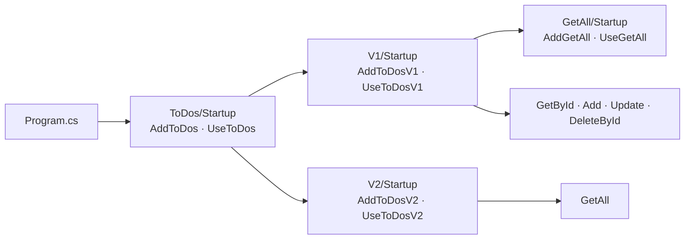

:::note[Series]
Part one of the series [*AspNetCore.MinimalApi.Sdk*](/series/aspnetcore-minimalapi-sdk/). The code is
public at [github.com/RenePeuser/AspNetCore.MinimalApi.Sdk](https://github.com/RenePeuser/AspNetCore.MinimalApi.Sdk).
:::

Every minimal API I've seen in a real project started the same way: a `MapGet` in `Program.cs`, a
lambda, done. It's the best "hello world" ASP.NET Core has ever had. Six months later the same file
has forty lambdas, three of them 60 lines long, two `using` blocks for every domain and a comment
`// TODO: move this somewhere`. Nobody moves it, because nobody agreed on *where*.

[AspNetCore.MinimalApi.Sdk](https://github.com/RenePeuser/AspNetCore.MinimalApi.Sdk) is my answer
to "where". It isn't a NuGet package you install. It's a **reference solution**: a small ToDo API
plus everything I want around a minimal API in production. That means a structure that scales, a
generated typed client, a generated CLI and a set of code rules that keep the structure from eroding.
This first part is about the structure. [Part two](/blog/2026-minimalapi-sdk-typed-client-and-cli/)
covers the client and the CLI, [part three](/blog/2026-minimalapi-sdk-code-rules/) the rules, and
[part four](/blog/2026-minimalapi-sdk-vs-alternatives/) compares the approach with controllers, Carter
and FastEndpoints.

## The "before": everything in Program.cs

This is what a typical minimal API looks like after a few sprints:

```csharp
var builder = WebApplication.CreateBuilder(args);
builder.Services.AddSingleton<TodoRepository>();
builder.Services.AddSwaggerGen();
// ... 30 more registrations, grouped by "whoever added them last"

var app = builder.Build();

app.MapGet("/todos", (TodoRepository repo) => repo.GetAll());
app.MapGet("/todos/{id}", (int id, TodoRepository repo) =>
{
    var todo = repo.Find(id);
    return todo is null ? Results.NotFound() : Results.Ok(todo);
});
app.MapPost("/todos", (Todo todo, TodoRepository repo) => { /* 40 lines of validation and mapping */ });
app.MapGet("/v2/todos", (TodoRepository repo) => /* copy of v1 with one field more */);
// ... and so on, for every domain

app.Run();
```

Nothing here is *wrong*. The problems are all about growth:

- **No home for an endpoint.** Its route, handler, query, models and docs are spread over
  `Program.cs`, a `Services` folder and a `Models` folder.
- **Versioning by copy-paste.** `/v2/todos` is a string, not a concept. Swagger shows one big list.
- **Merge conflicts.** Every feature touches the same file.
- **Contracts are implicit.** Without `Produces`, `WithName` and `WithTags` the OpenAPI document is
  thin, and anything generated from it (clients, CLIs, docs) is thin too.

## The blueprint: one folder per endpoint

In the blueprint every endpoint is a **vertical slice** with a fixed layout. The ToDo domain looks
like this (trimmed):

```text
src/MinimalApi/
├── Program.cs
├── Extensionmethods/SimpleMinimalApiExtensions.cs   ← versioning, Swagger, route group
├── ErrorHandling/                                   ← middleware + handler strategy
└── Api/ToDos/
    ├── Startup.cs                                   ← AddToDos / UseToDos
    ├── V1/
    │   ├── Startup.cs                               ← AddToDosV1 / UseToDosV1
    │   ├── DbContext/ToDoContext.cs
    │   ├── GetAll/
    │   │   ├── Endpoint/GetAllToDoEndpoints.cs      ← MapGetAll
    │   │   ├── Extensions/Startup.cs                ← AddGetAll / UseGetAll
    │   │   ├── Queries/GetAllToDosQuery.cs
    │   │   ├── Models/ToDo.cs
    │   │   ├── JsonSerializers/ToDoArraySerializerContext.cs
    │   │   └── Documentation/GetAllTodoDescription.txt
    │   ├── GetById/   Add/   Update/   DeleteById/
    └── V2/
        └── GetAll/ ...
```

The version is part of the **namespace and the folder**, not part of a class name. `V1.GetAll` and
`V2.GetAll` can both contain a class called `GetAllToDoEndpoints` and a record called `Todo`, and
they never collide. If you've read [folder structure by feature](/blog/2026-folder-structure-by-feature/)
or [vertical slices](/blog/2026-vertical-slices/), this is the same idea, made concrete for minimal
APIs.

## A registration chain instead of a registration pile

`Program.cs` in the blueprint doesn't know a single endpoint:

```csharp
var builder = WebApplication.CreateBuilder(args);

builder.Services.AddSimpleMinimalApiEnvironment();
builder.Services.AddErrorHandlingMiddleware();
builder.Services.AddToDos();

var app = builder.Build();
app.UseSimpleMinimalApiEnvironment(endpoint =>
{
    // API -> Domain -> V1 -> GetAll
    endpoint.UseToDos();
});

app.UseErrorHandling();
app.Run();

// important for api tests !
public partial class Program
{
}
```

Every level has a small `Startup` class with an `Add…` method for services and a `Use…` method for
endpoints, and each level only calls the level below it:



The domain level is two lines per version:

```csharp
internal static class Startup
{
    internal static void AddToDos(this IServiceCollection serviceCollection)
    {
        serviceCollection.AddToDosV1();
        serviceCollection.AddToDosV2();
    }

    internal static void UseToDos(this IEndpointRouteBuilder application)
    {
        application.UseToDosV1();
        application.UseToDosV2();
    }
}
```

and the endpoint level wires exactly what that one endpoint needs:

```csharp
internal static class Startup
{
    internal static void AddGetAll(this IServiceCollection serviceCollection)
    {
        serviceCollection.AddGetAllToDosQuery();
        serviceCollection.AddToDoArraySerializerContext();
        serviceCollection.AddToDoEnumerableSerializerContext();
    }

    internal static void UseGetAll(this IEndpointRouteBuilder routeGroupBuilder)
    {
        routeGroupBuilder.MapGetAll();
    }
}
```

That's more files than a single `Program.cs`. In exchange, adding an endpoint touches **one new
folder and one line** in the version's `Startup`. Deleting an endpoint is deleting a folder and a
line. Code review shows the whole feature in one directory, and two people adding two endpoints
don't conflict.

## Every service brings its own registration

The second convention: a service is registered by an extension method **in the same file** as the
service. The query behind `GetAll` looks like this:

```csharp
internal static class AddGetAllToDosQueryExtension
{
    internal static void AddGetAllToDosQuery(this IServiceCollection services)
    {
        services.AddSingleton<GetAllToDosQuery>();
    }
}

internal sealed class GetAllToDosQuery(TodoRepository todoRepository)
{
    internal IEnumerable<Todo> Execute()
    {
        return todoRepository.GetAll();
    }
}
```

When you move or delete the class, its registration goes with it. Shared dependencies use the
idempotent `AddSingletonIfNotExists` from my [Extensions.Pack](https://www.nuget.org/packages/Extensions.Pack)
package, so several slices can all say "I need the `TodoRepository`" without registering it twice:

```csharp
internal static void AddTodoRepository(this IServiceCollection services)
{
    services.AddSingletonIfNotExists<TodoRepository>();
}
```

This is a manual, explicit alternative to the assembly scanning in
[automatic dependency registration](/blog/2026-automatic-dependency-registration/). It's more typing,
but every registration is findable with "Go to definition", and the code rules in part three can check
that every service has one.

## The endpoint file: the contract lives next to the handler

This is the `GetAll` endpoint of version 1. I removed three duplicate calls (a second `WithSummary`, a
second `WithDescription` and a second `MapToApiVersion`); the pitfalls section below comes back to
them. Everything else is as in the repository:

```csharp
public static class GetAllToDoEndpoints
{
    public static RouteHandlerBuilder MapGetAll(this IEndpointRouteBuilder routeGroupBuilder)
    {
        return routeGroupBuilder.MapGet("todos", ([FromServices] GetAllToDosQuery getAllToDosQuery) =>
                                {
                                    return Results.Ok(getAllToDosQuery.Execute());
                                })
                                .Produces(200, typeof(IEnumerable<Todo>))
                                .Produces(400, typeof(ProblemDetails))
                                .Produces(500, typeof(ProblemDetails))
                                .WithName("getAllToDosV1")
                                .WithSummary("Returns all available ToDos")
                                .WithTags("ToDo")
                                .WithDescriptionFromFile("V1.GetAll.Documentation.GetAllTodoDescription.txt")
                                .WithOpenApi()
                                .MapToApiVersion(1);
    }
}
```

The lambda is one line. It does nothing but delegate to the query, which keeps the endpoint free of
logic (see [anatomy of a minimal endpoint](/blog/2026-anatomy-of-a-minimal-endpoint/) for why that
matters). Everything else is **metadata**, and every piece of it has a consumer:

| Call | Consumer |
|---|---|
| `Produces(200, typeof(...))` | OpenAPI response schema, return type of the generated client method |
| `Produces(400/500, typeof(ProblemDetails))` | documented error shape for every caller |
| `WithName("getAllToDosV1")` | operation ID, the name of the generated client and CLI command |
| `WithTags("ToDo")` | Swagger grouping, the facade (`client.ToDo`) and the CLI group (`myapi todo`) |
| `WithSummary` / `WithDescriptionFromFile` | human-readable docs in Swagger UI |
| `MapToApiVersion(1)` | which versioned route group serves it, and which `V1` class the client gets |

`WithDescriptionFromFile` is a small helper in the blueprint. It reads an embedded `.txt` file from
the slice's `Documentation` folder, so longer endpoint docs live in a file instead of a C# string:

```csharp
public static TBuilder WithDescriptionFromFile<TBuilder>(this TBuilder builder, string embeddedFile)
    where TBuilder : IEndpointConventionBuilder
{
    var fileContent = EmbeddedFile.GetFileContentFrom(embeddedFile);
    return builder.WithDescription(fileContent);
}
```

## Versioning: a route group, not a string

`UseSimpleMinimalApiEnvironment` creates one versioned route group with
[Asp.Versioning](https://github.com/dotnet/aspnet-api-versioning) and hands it to the endpoint
registrations:

```csharp
var apiVersionSet = webApplication.NewApiVersionSet()
                                  .HasApiVersion(new ApiVersion(1))
                                  .HasApiVersion(new ApiVersion(2))
                                  .ReportApiVersions()
                                  .Build();

var basePath = webApplication.MapGroup("api/v{apiVersion:apiVersion}")
                             .WithApiVersionSet(apiVersionSet);

endpointRegistration(basePath);
```

Endpoints only declare the relative route (`"todos"`) and their version (`MapToApiVersion(1)`).
The `api/v1.0/todos` and `api/v2.0/todos` URLs fall out of the group. On the services side,
`AddSimpleMinimalApiEnvironment` configures a `UrlSegmentApiVersionReader` and an API explorer with
`GroupNameFormat = "'v'V"`, and a small `IConfigureNamedOptions<SwaggerGenOptions>` creates one
Swagger document per version. Swagger UI then shows a "V1" and a "V2" dropdown instead of one list
with duplicated routes.

## JSON source generation per slice

Each slice that returns data registers its own `JsonSerializerContext` into the HTTP JSON options:

```csharp
internal static void AddToDoArraySerializerContext(this IServiceCollection services)
{
    services.ConfigureHttpJsonOptions(options =>
        options.SerializerOptions.TypeInfoResolverChain.Add(ToDoArraySerializerContext.Default));
}

[JsonSerializable(typeof(Todo[]))]
internal sealed partial class ToDoArraySerializerContext : JsonSerializerContext
{
}
```

Source-generated serialization avoids reflection at runtime and is the prerequisite for trimming and
Native AOT. Putting the context *in the slice* means the slice that introduces a type also introduces
its serialization metadata. Nobody has to remember a central `AppJsonContext` with 200
`[JsonSerializable]` lines.

## Errors: one middleware, a chain of specific handlers

Endpoints don't catch exceptions (the reasoning is in
[no try/catch in endpoints](/blog/2026-no-try-catch-in-endpoints/)). A middleware catches everything
and hands it to a strategy, which asks a list of specific handlers in registration order:

```csharp
public static void AddErrorHandling(this IServiceCollection services)
{
    if (services.IsAlreadyRegistered<IErrorHandlingStrategy>())
    {
        return;
    }

    services.AddErrorHandlingMiddleware();

    services.AddSecurityProblemExceptionHandler();
    services.AddProblemDetailsExceptionHandler();
    services.AddValidationProblemDetailsExceptionHandler();

    // Must be the last one, order of registrations means priority of handling exception type !!!
    services.AddDefaultExceptionHandler();
}
```

Domain code throws a `ProblemDetailsException` or a `ValidationProblemDetailsException` with a status,
a title and extension values, and the matching handler writes it as `application/json`. The default
handler maps the rest: `ValidationException` and `FormatException` become 400,
`UnauthorizedAccessException` 401, `NotImplementedException` 501, anything else 500. The
[global error handling post](/blog/2026-global-error-handling-with-problemdetails/) covers the
ProblemDetails side in depth.

## Pitfalls I found while re-reading the sample

The blueprint is from May 2024. Reading it again for this series, a few things stood out, and they're
instructive because each one is easy to miss in your own code too:

- **`AddErrorHandlingMiddleware` is not `AddErrorHandling`.** `Program.cs` calls the former, which
  registers the middleware and the strategy but **no specific handlers**. The strategy then loops over
  an empty list, and the exception disappears: the client gets a `200` with an empty body. I saw
  exactly that when I ran the client test for this post. After switching to `AddErrorHandling()` the
  same failure came back as a proper ProblemDetails response. One wrong method name, and errors become
  silent.
- **"Not found" that isn't.** `GetById` returns `NotFound()` when the query returns `null`, but the
  repository uses `First()`, which throws instead. The `404` branch is dead code, and a missing ToDo
  becomes a `500`.
- **The contract says one, the code returns many.** The V2 `GetAll` endpoint declares
  `.Produces(200, typeof(Todo))` but returns a list. Swagger, and everything generated from it,
  believes the single object. Part two shows what that does to the generated client.
- **Duplicate metadata.** In the repository, V1 `GetAll` calls `WithSummary("Get all ToDos")` before
  `WithSummary("Returns all available ToDos")`, and `WithDescriptionFromFile(...)` before
  `WithDescription("Legacy version")`. The last call wins, so the file-based description is silently
  replaced by "Legacy version", and the helper looks broken when it isn't.

None of these breaks the build. That's the point of part three: rules that turn this kind of drift
into a failing test.

## Summary

- Give every endpoint a **home**: one folder with endpoint, registration, query or command, models,
  JSON context and docs.
- Replace the registration pile with a **chain**: `Program` → domain → version → endpoint, each level
  with an `Add…` and a `Use…` method.
- Let every service **bring its own registration** in the same file, idempotent where it's shared.
- Treat endpoint metadata (`Produces`, `WithName`, `WithTags`, `MapToApiVersion`) as the
  **contract**. It feeds Swagger, the client and the CLI.
- Version through a **route group and namespaces**, not through copied strings and class names.
- And check the wiring. A blueprint is only as good as the conventions that are enforced, which is
  where [the code rules](/blog/2026-minimalapi-sdk-code-rules/) come in.
