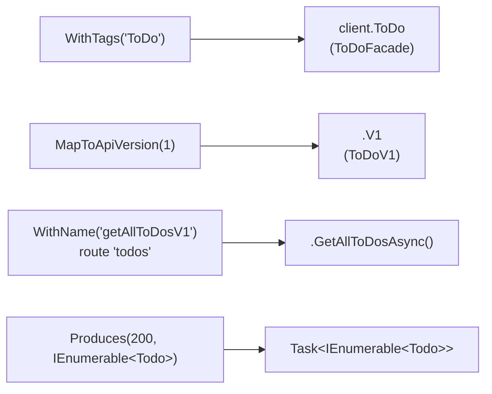

:::note[Series]
Part two of the series [*AspNetCore.MinimalApi.Sdk*](/series/aspnetcore-minimalapi-sdk/). Code:
[github.com/RenePeuser/AspNetCore.MinimalApi.Sdk](https://github.com/RenePeuser/AspNetCore.MinimalApi.Sdk).
:::

An API rarely has one caller. In the projects I've worked on there were at least three: another
service calling it from .NET, the integration tests, and a human (a developer, support, QA) who just
wants to "quickly call that endpoint". Each of them usually gets its own copy of the contract: a
hand-written `HttpClient` wrapper, a test helper with URL strings, a Postman collection or a curl
snippet in a wiki. Each copy drifts in its own way.

[Part one](/blog/2026-minimalapi-sdk-a-blueprint-for-minimal-apis/) made the endpoint metadata
(`Produces`, `WithName`, `WithTags`, `MapToApiVersion`) the contract. This part shows what you get
for that discipline in the blueprint: a **typed .NET client** and a **dotnet CLI**, both generated
from the same metadata by my [ClientGenerator](/blog/2024-clientgenerator-runjit-rulejit/) and checked
into the repository so you can read every line.

## The "before": three hand-written copies

```csharp
// Service A
var response = await _http.GetAsync("api/v1/todos");
var todos = await response.Content.ReadFromJsonAsync<List<TodoDto>>();

// Integration test
var response = await client.GetAsync("/api/v1.0/todos");      // ".0" or not? depends who wrote it
response.EnsureSuccessStatusCode();

// Wiki
// curl -H "Authorization: Bearer <token>" https://dev.example.com/api/v1.0/todos
```

Three URL strings, three DTOs, three ideas of error handling. When V2 arrives, someone has to find
all of them.

## From endpoint to client method

The server side declares the endpoint once:

```csharp
routeGroupBuilder.MapGet("todos", ([FromServices] GetAllToDosQuery getAllToDosQuery) =>
                 {
                     return Results.Ok(getAllToDosQuery.Execute());
                 })
                 .Produces(200, typeof(IEnumerable<Todo>))
                 .Produces(400, typeof(ProblemDetails))
                 .Produces(500, typeof(ProblemDetails))
                 .WithName("getAllToDosV1")
                 .WithTags("ToDo")
                 .MapToApiVersion(1);
```

The generated client maps each piece of that metadata to a piece of C#. The tag becomes a **facade**,
the version becomes a **class**, the operation becomes a **method**, and the `200` type becomes the
**return type**:



This is the generated version class for V1, as it is in the repository:

```csharp
public class ToDoV1
{
    private readonly IHttpCallHandler _httpCallHandler;

    public ToDoV1(IHttpCallHandler httpCallHandler)
    {
        _httpCallHandler = httpCallHandler;
    }

    public Task<Todo> AddToDoAsync(Todo todo)
    {
        return _httpCallHandler.CallAsync<Todo>(HttpMethod.Post, "api/v1.0/todos", todo, CancellationToken.None);
    }

    public Task DeleteToDoByIdAsync(int id)
    {
        return _httpCallHandler.CallAsync(HttpMethod.Delete, $"api/v1.0/todos/{id}", null, CancellationToken.None);
    }

    public Task<IEnumerable<Todo>> GetAllToDosAsync()
    {
        return _httpCallHandler.CallAsync<IEnumerable<Todo>>(HttpMethod.Get, "api/v1.0/todos", null, CancellationToken.None);
    }

    public Task<Todo> GetToDoByIdAsync(int id)
    {
        return _httpCallHandler.CallAsync<Todo>(HttpMethod.Get, $"api/v1.0/todos/{id}", null, CancellationToken.None);
    }

    public Task<Todo> UpdateToDoByIdAsync(int id, Todo todo)
    {
        return _httpCallHandler.CallAsync<Todo>(HttpMethod.Put, $"api/v1.0/todos/{id}", todo, CancellationToken.None);
    }
}
```

and the call site reads like the URL, but typed:

```csharp
IEnumerable<Todo> todos = await client.ToDo.V1.GetAllToDosAsync();
Todo created            = await client.ToDo.V1.AddToDoAsync(newTodo);
```

When V2 adds or changes an endpoint, the generator adds `client.ToDo.V2`. Callers migrate one call
at a time, and both versions stay discoverable through IntelliSense. There's no URL string left in
consumer code.

## One call handler, pluggable response handling

The generated methods are deliberately dumb. All HTTP work goes through one `IHttpCallHandler`:

```csharp
public interface IHttpCallHandler
{
    Task CallAsync(HttpMethod httpMethod,
                   string url,
                   object? payload,
                   CancellationToken cancellationToken,
                   [CallerArgumentExpression(nameof(payload))] string payloadParameterName = "");

    Task<TResult> CallAsync<TResult>(HttpMethod httpMethod,
                                     string url,
                                     object? payload,
                                     CancellationToken cancellationToken,
                                     [CallerArgumentExpression(nameof(payload))] string payloadParameterName = "");
}
```

How a response is turned into a `TResult` is a **strategy**. Four handlers are registered: one for
non-success status codes, one for JSON, one for `byte[]` and one for file streams. The strategy picks
the single handler whose `CanHandle<TResult>` matches, and it refuses to guess if there are none or
several:

```csharp
var responseHandlers = _responseHandlers.Where(handler => handler.CanHandle<TResult>(responseMessage)).ToImmutableList();
if (responseHandlers.IsEmpty())
{
    throw new ClientProblemDetailsException("No response handler was found to handle expected response",
        $"No response handler was found to handle expected response type: '{typeof(TResult).Name}'",
        ("Response type", typeof(TResult).Name));
}

if (responseHandlers.Count > 1)
{
    throw new ClientProblemDetailsException("More than one reponse handlers was found for expected response type",
        $"For response type: '{typeof(TResult).Name}' {responseHandlers.Count} response handler was found",
        ("Response type", typeof(TResult).Name),
        ("ResponseHandlers", responseHandlers.Select(handler => handler.GetType().Name).ToImmutableList()));
}
```

The non-success handler is what callers actually experience. Instead of an `HttpRequestException`
with a status code and nothing else, it throws a `ClientProblemDetailsException` that carries the
method, the absolute URL and the **server's response body**, which is a ProblemDetails document when
the API follows [part one](/blog/2026-minimalapi-sdk-a-blueprint-for-minimal-apis/):

```csharp
throw new ClientProblemDetailsException("Client call to endpoint was not successfull",
    $"The http call: {httpMethod.Method} {url} was not succesfull",
    ("HttpMethod", httpMethod.Method),
    ("Url", absoluteUrl),
    ("Error", content));
```

That's the difference between "the ToDo service returned 500" in a log and "GET
`http://.../api/v1.0/todos` failed with `InvalidOperationException was thrown.` and this detail".

## Creating the client: three entry points

`IAspNetCoreMinimalApiSdkClientFactory` builds a client from whatever the caller has:

```csharp
public interface IAspNetCoreMinimalApiSdkClientFactory
{
    AspNetCoreMinimalApiSdkClient CreateFrom(HttpClient sourceClient);
    AspNetCoreMinimalApiSdkClient CreateFrom(HttpRequest httpRequest);
}
```

`CreateFrom(HttpClient)` is for tests, where `WebApplicationFactory` hands you an in-memory client.
`CreateFrom(HttpRequest)` is for service-to-service calls inside an API. It copies an allowlist of
incoming headers (`User-Agent`, `Authorization`, `Referer` and anything containing `x-`) to the
outgoing call, so the caller's token and correlation headers travel with it:

```csharp
private readonly string[] _allowedHeadersToCopy = { "User-Agent", "Authorization", "x-", "Referer" };

public AspNetCoreMinimalApiSdkClient CreateFrom(HttpRequest httpRequest)
{
    var httpClient = _httpClientFactory.CreateClient();
    httpRequest.Headers.ForEach(headerEntry =>
    {
        // Important not content and host header copy
        if (_allowedHeadersToCopy.Any(allowedHeader => headerEntry.Key.Contains(allowedHeader, StringComparison.OrdinalIgnoreCase)))
        {
            httpClient.DefaultRequestHeaders.Add(headerEntry.Key, headerEntry.Value.FirstOrDefault() ?? string.Empty);
        }
    });

    httpClient.BaseAddress = new Uri(_AspNetCoreMinimalApiSdkClientSettings.BaseAddress);
    // ...
}
```

The base address comes from configuration (`AspNetCoreMinimalApiSdkClientSettings`), with a local
default, and the `HttpClient` comes from `IHttpClientFactory`, which avoids the socket problems from
[HttpClient, you're using it wrong](/blog/2026-httpclient-you-are-using-it-wrong/).

## Testing the API *through* the client

The client test project starts the real API in memory once per test assembly and talks to it only
through the generated client. It uses `ApiTestBase<Program>` from my
[AspNetCore.Simple.MsTest.Sdk](/blog/2021-aspnetcore-simple-mstest-sdk/), which is also why
`Program.cs` ends with `public partial class Program`:

```csharp
[AssemblyInitialize]
public static Task AssemblyInitializeAsync(TestContext _)
{
    _customWebApplicationFactory = new ApiTestBase<Program>("", (services, config) =>
    {
        services.AddAspNetCoreMinimalApiSdkClient();
        services.AddAspNetCoreMinimalApiSdkClientFactory(config);
    });

    var serviceProvider = _customWebApplicationFactory.Services;
    _httpClient = _customWebApplicationFactory.CreateClient(new WebApplicationFactoryClientOptions { AllowAutoRedirect = false });

    // Add your client authentication here !

    var aspNetCoreMinimalApiSdkClientFactory = serviceProvider.GetOrThrowMissingException<IAspNetCoreMinimalApiSdkClientFactory>();
    AspNetCoreMinimalApiSdkClient = aspNetCoreMinimalApiSdkClientFactory.CreateFrom(_httpClient);

    return Task.CompletedTask;
}
```

A test is then one call and one comparison against an expected JSON file that's embedded in the test
project:

```csharp
[TestMethod]
public async Task Should_Return_All_Todos()
{
    var result = await AspNetCoreMinimalApiSdkClient.ToDo.V1.GetAllToDosAsync().ConfigureAwait(false);

    Assert.That.ObjectsAreEqual("Api.ToDos.V1.GetAll.Responses.GetAllToDosOkResponse.json", result);
}
```

This tests two things at once: the endpoint's behaviour, and the fact that the generated client can
actually call it and deserialize the answer. If someone changes a route, a status code or a model
property, the test that breaks is the one that uses the client exactly like a real consumer.

## The CLI: the same contract for humans

The third consumer is a person in a terminal. The repository contains a generated .NET global tool
(`PackAsTool`, `ToolCommandName` = `myapi`) whose command tree mirrors the client:

```text
myapi
├── config
│   ├── get                     print the settings (base address): ./appsettings.json or the embedded default
│   └── set <json>              write ./appsettings.json in the current directory
└── todo
    ├── v1
    │   ├── getalltodos
    │   ├── gettodobyid <json>
    │   ├── addtodo <json>
    │   ├── updatetodobyid <json>
    │   └── deletetodobyid <json>
    └── v2
        └── getalltodos
```

Every operation command takes the same three options, `--format` (`Json`, `JsonIndented`,
`JsonAsString`), `--output <file>` and `--token`, plus one JSON argument that carries route
parameters and payload:

```bash
myapi todo v1 gettodobyid '{"id": 1}' --format JsonIndented
myapi todo v1 addtodo '{"todo": {"id": 2, "title": "Buy milk"}}' --token $TOKEN --output created.json
```

The [2024 ClientGenerator post](/blog/2024-clientgenerator-runjit-rulejit/) explains the decision behind that
shape: the version is a subcommand, and everything else goes into one JSON argument. That keeps the
help output short at every level, and new parameters don't change the command signature.

Each command is built from small generated parts: an options builder, an argument builder and a
handler. The handler for `addtodo` shows the whole flow:

```csharp
internal sealed class AddToDoHandler(OutputService outputService, MyApiHttpClientFactory myApiHttpClientFactory)
{
    public async Task HandleAsync(AddToDoParameters parameters)
    {
        // 1. create client
        var httpCallHandler = myApiHttpClientFactory.CreateFrom(parameters.Token);
        // 2. Convert into target type
        var callInfos = parameters.Json.FromJsonStringAs<Dictionary<string, object?>>();
        // 3. Setup all needed variables
        var todo = callInfos["todo"]; // Mandatory
        // Get the response as string -> only OK responses are provided here, error will be handled as exception
        var stringResponse = await httpCallHandler.CallAsync(HttpMethod.Post, $"api/v1.0/todos", todo, CancellationToken.None).ConfigureAwait(false);
        // 3. Write the formatted string to the output
        await outputService.WriteAsync(stringResponse, parameters.Output, parameters.Format).ConfigureAwait(false);
    }
}
```

Output formatting is a strategy again (one class per `FormatType`, exactly one must match), so adding
a YAML or table format is one new class.

### Testing a CLI like an API

The CLI tests don't start a process. `Program.Main` is public, and a `CliRunner` redirects
`Console.Out` into a `StringWriter`, runs `Main` in-process and returns output and exit code. The
tests then compare the output with an embedded expected file, just like the API tests compare JSON:

```csharp
[DataTestMethod]
[DataRow("Json")]
[DataRow("JsonIndented")]
[DataRow("JsonAsString")]
public Task Get_Config_Test_With_Specific_Format(string format)
{
    return Cli.AssertRunAsync($"myapi config get --format {format}",
                              $"MyApi.Config.Get.Output.GetAs{format}.json");
}
```

Because it runs in-process, you can set a breakpoint in a command handler and debug the test, which
is much nicer than debugging a spawned `dotnet myapi.dll`.

## A lesson from the repository: generators trust the contract

Here's the generated V2 class, unchanged:

```csharp
public class ToDoV2
{
    // ...
    public Task<Todo> GetAllToDosAsync()
    {
        return _httpCallHandler.CallAsync<Todo>(HttpMethod.Get, "api/v2.0/todos", null, CancellationToken.None);
    }
}
```

`GetAllToDosAsync` returns **one** `Todo`. The endpoint returns a list. The generator didn't make a
mistake: the V2 endpoint declares `.Produces(200, typeof(Todo))`, and the generator believed it. The
server compiles, Swagger renders, the client compiles. The first call fails at runtime when a JSON
array can't be deserialized into an object.

That's the core trade-off of contract-driven generation. Every consumer becomes as correct as the
metadata, and no more. One wrong `typeof` is copied into the OpenAPI document, the client and the CLI.
You can't fix that in the generator. You fix it at the source, with a check that compares what an
endpoint declares with what it returns, or at least with a client test per endpoint (V2 has none in
the repository, which is exactly why this slipped through). Part three is about those checks.

## Pitfalls

- **`CancellationToken.None` everywhere.** The generated methods don't accept a token, so a caller
  can't cancel a slow request. If you generate clients, put a `CancellationToken cancellationToken =
  default` parameter into the template.
- **Substring header matching.** `"x-"` matches any header *containing* `x-`, not just headers
  starting with it. An allowlist should compare prefixes or exact names.
- **Generated code is still code.** Check it in and review the diff when it's regenerated. A changed
  return type in a generated client is a breaking change for every consumer, and the diff is where you
  see it (the [OpenAPI diff post](/blog/2026-detecting-breaking-changes-with-openapi-diffs/) shows the
  same idea on the contract itself).
- **Old dependencies age fast.** The CLI is built on a 2020 alpha of `System.CommandLine`, whose API
  has changed several times since. A generator template needs the same dependency updates as
  hand-written code.

## Summary

- Endpoint metadata is enough to generate a **typed, versioned client** (`client.ToDo.V1.GetAllToDosAsync()`)
  and a **CLI** (`myapi todo v1 getalltodos`) with the same structure.
- Keep generated methods thin: one **call handler**, a **response strategy**, and errors that carry
  the server's ProblemDetails instead of a bare status code.
- **Test the API through the client.** It checks the endpoint and the consumer in one go.
- Test the CLI **in-process**, with output compared against expected files.
- Generators **amplify** the contract, mistakes included. Pair generation with rules, which is the
  topic of [part three](/blog/2026-minimalapi-sdk-code-rules/).
