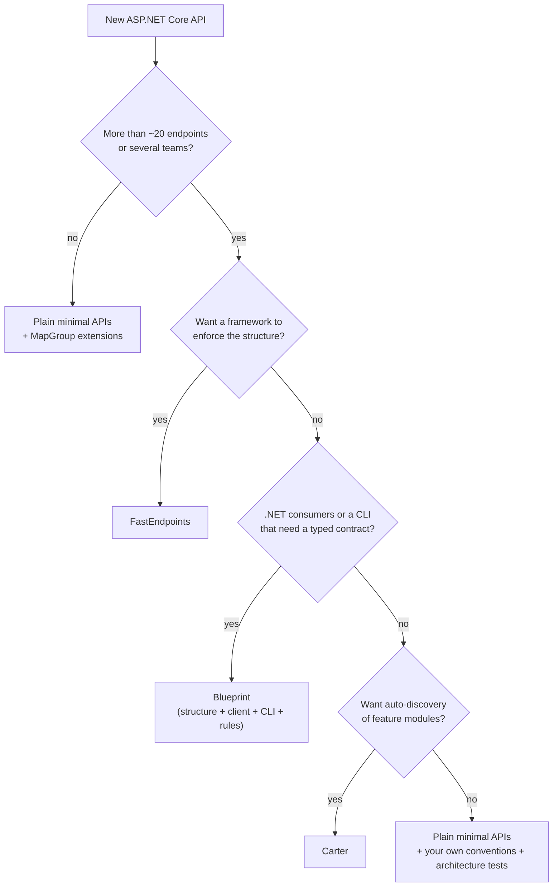

:::note[Series]
Part four of the series [*AspNetCore.MinimalApi.Sdk*](/series/aspnetcore-minimalapi-sdk/). Code:
[github.com/RenePeuser/AspNetCore.MinimalApi.Sdk](https://github.com/RenePeuser/AspNetCore.MinimalApi.Sdk).
:::

The first three parts of this series showed what
[AspNetCore.MinimalApi.Sdk](https://github.com/RenePeuser/AspNetCore.MinimalApi.Sdk) does: a
[folder-per-endpoint structure](/blog/2026-minimalapi-sdk-a-blueprint-for-minimal-apis/), a
[generated client and CLI](/blog/2026-minimalapi-sdk-typed-client-and-cli/) and
[code rules](/blog/2026-minimalapi-sdk-code-rules/) that enforce the conventions. That's a lot of
machinery, and it's fair to ask whether you need it. Plenty of good APIs run on something much
simpler.

So this part is the comparison I'd want to read before choosing: the common options for structuring
an ASP.NET Core API, side by side, with the blueprint judged by the same criteria as everything else.

## The options

**1. Plain minimal APIs with route groups and extension methods.** What the ASP.NET Core docs point
you to: one static class per feature with a `MapXyz(this IEndpointRouteBuilder app)` method, a
`MapGroup` for the shared prefix, everything wired explicitly in `Program.cs`.

```csharp
public static class TodoEndpoints
{
    public static RouteGroupBuilder MapTodos(this IEndpointRouteBuilder app)
    {
        var group = app.MapGroup("/todos").WithTags("ToDo");
        group.MapGet("/", (TodoRepository repo) => repo.GetAll());
        group.MapGet("/{id:int}", (int id, TodoRepository repo) => repo.Find(id));
        return group;
    }
}
```

**2. Carter.** A small library that adds *modules*. Each module implements `ICarterModule` and
registers its routes. `AddCarter()` finds the modules by assembly scanning, and `MapCarter()` maps
them all:

```csharp
public class TodoModule : ICarterModule
{
    public void AddRoutes(IEndpointRouteBuilder app)
    {
        app.MapGet("/todos", (TodoRepository repo) => repo.GetAll());
    }
}
```

It's essentially option 1 with discovery, so you don't touch `Program.cs` for a new module.

**3. FastEndpoints.** A framework built around the REPR pattern (request, endpoint, response): one
class per endpoint, deriving from a generic base class with the request and response types, with
route and configuration in a `Configure()` method and the logic in a `HandleAsync` method. It brings
its own conventions for validation, OpenAPI, versioning and more. It's the most opinionated of the
library options, and the most complete.

**4. Controllers.** Attribute routing, model binding, filters, `[ApiController]` conventions, and
the familiarity of a decade of tutorials. The trade-offs against minimal APIs are covered in
[controllers vs. minimal APIs](/blog/2026-controllers-vs-minimal-apis/).

**5. The blueprint.** Plain minimal APIs (option 1) plus a fixed vertical-slice layout, a
domain → version → endpoint registration chain, versioned route groups, a generated client and CLI,
and a rule set that keeps all of it consistent. It's not a library. It's a reference solution you
clone or generate with [RunJit](/blog/2024-clientgenerator-runjit-rulejit/).

## Side by side

| | Plain + groups | Carter | FastEndpoints | Controllers | Blueprint |
|---|---|---|---|---|---|
| Extra dependency | none | small library | framework | none (MVC) | none at runtime; tooling to generate |
| Where an endpoint lives | your convention | a module | one class | a controller action | one folder per endpoint, fixed layout |
| Discovery | explicit | assembly scan | assembly scan | assembly scan | explicit chain, checked by rules |
| Versioning | add Asp.Versioning yourself | yourself | built-in support | Asp.Versioning attributes | versioned route group + namespace per version |
| Typed .NET client | via OpenAPI tools | via OpenAPI tools | via its client generation support or OpenAPI tools | via OpenAPI tools | generated from endpoint metadata, versioned facade |
| CLI for the API | no | no | no | no | generated `dotnet` tool |
| Convention enforcement | review | review | the framework's base class | `[ApiController]` conventions | 109 rules as tests |
| Learning curve | lowest | low | medium | low, but MVC is big | medium, many conventions |
| Lock-in | none | low | high | low | low (it's your code), but you own it |

Two rows deserve a closer look.

**Typed clients.** Every option can produce an OpenAPI document, and NSwag, Kiota or
`dotnet-openapi` can generate a client from it. That's a good default. The blueprint goes a different
way: it generates from the endpoint metadata directly, which gives a client with the same shape as the
API (`client.ToDo.V1.GetAllToDosAsync()`), the same error type everywhere, and a matching CLI. The
price is that you depend on a generator you maintain yourself.

**Enforcement.** FastEndpoints enforces structure through its base class: an endpoint can't forget its
route, because `Configure()` is where the route goes. The blueprint enforces structure *after the
fact*, with tests over the parsed solution. That's more flexible (rules can check anything, including
project files and naming) and more fragile (part three showed text-matching false positives). Plain
minimal APIs and Carter enforce nothing, and that's fine in a small team with good reviews.

## What the blueprint costs

I built it, so here's the honest list:

- **More files per endpoint.** A typical slice has an endpoint file, a registration file, a query or
  command, models, a JSON context and a docs file. The ToDo V1 CRUD resource in the repository is 21 files. It
  pays off at fifty endpoints and feels heavy at five.
- **You own the code.** There's no `dotnet add package` and no update path except regenerating parts
  with RunJit. Bug fixes in the error handling or the client handler are yours to make.
- **It's from 2024.** It targets .NET 8 with Swashbuckle. Since .NET 9, ASP.NET Core ships its own
  OpenAPI document generation (`Microsoft.AspNetCore.OpenApi`), which I'd use today, see
  [the .NET 9 OpenAPI post](/blog/2026-dotnet-9-openapi-problems-and-fixes/). The CLI uses an early
  alpha of `System.CommandLine` whose API has changed since.
- **Rules need care.** Running the rules against the blueprint gave 20 failures out of 132, most of
  them false positives or contradictions between rules and generators. Unmaintained rules are noise.
- **The sample has bugs.** Parts one and two showed a silently swallowed exception, a dead `404`
  branch and a wrong `Produces` type. They're instructive, but they're bugs.

## What the blueprint gives you that the others don't

- **One contract, three consumers.** Server, .NET client and CLI come from the same metadata and
  share the same version structure. For an API that other teams consume from .NET, that removes a
  whole class of drift.
- **Conventions as code.** The rules turn "how we build endpoints here" into failing tests with a
  corrected sample in the message, readable by new team members and by AI agents (the idea behind
  [self-defending codebases](/blog/2026-self-defending-codebases/)).
- **Versioning that scales.** V1 and V2 live in separate folders and namespaces, can reuse class
  names, and show up as separate Swagger documents and separate client classes.
- **No runtime framework.** Everything is plain ASP.NET Core minimal APIs. If you drop the blueprint
  tomorrow, the endpoints keep working. You lose the generators and rules, not the API.

## When I'd pick which



A few notes on that chart:

- **Small API, one team:** plain minimal APIs with route groups. Anything else is overhead.
- **Large API, framework welcome:** FastEndpoints. Its base class gives you structure without having
  to write rules, and its ecosystem covers validation and documentation.
- **Large API consumed by other .NET services:** this is where the blueprint is strongest. A typed,
  versioned client and a CLI generated from the same contract, plus rules that keep the contract
  complete. Take the structure and the rules even if you generate clients with Kiota instead.
- **Existing controller codebase:** stay on controllers until there's a reason to move. The rule set
  has 29 controller rules for exactly that situation, and the
  [controllers vs. minimal APIs post](/blog/2026-controllers-vs-minimal-apis/) covers migration.
- **Carter:** a good fit when you like option 1 but want modules to be discovered automatically. It
  doesn't add much beyond that, and that's its charm.

You can also mix. The structure (folder per endpoint, registration chain, versioned groups) works with
any client generator, and the rules work with any structure you can describe as a query. The parts of
the blueprint are separable on purpose.

## Summary

- For a small API, **plain minimal APIs with route groups** are enough. Don't add structure before you
  need it.
- **Carter** adds module discovery, **FastEndpoints** adds a full framework with enforced structure,
  **controllers** add MVC's conventions and familiarity.
- **AspNetCore.MinimalApi.Sdk** adds a scalable vertical-slice structure, a **generated typed client
  and CLI** from the same metadata, and **conventions as tests**, without a runtime dependency.
- Its costs are real: more files, code you own, a 2024 baseline and rules that need maintenance.
- Pick by **team size, number of consumers and how much you want enforced**, and feel free to take only
  the parts you need.
