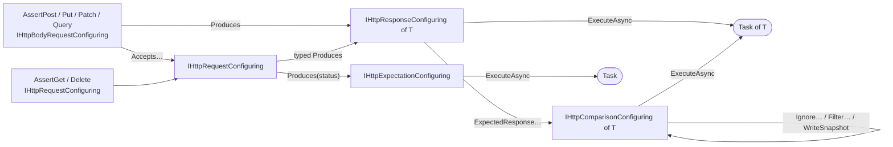

Here is a test that passes. Every time, on every machine, whatever the endpoint does:

```csharp
[TestMethod]
public void Should_Create_Person()
{
    Client.AssertPost("api/v1/persons")
          .Accepts(person)
          .Produces<Person>(HttpStatusCode.Created)
          .ExpectedResponse(expectedPerson);
}
```

The chain builds an assertion and then throws it away. No request is sent, nothing is compared, and
because the builder isn't a `Task`, the compiler doesn't even emit its usual `CS4014` warning. It's the
worst failure mode a test library can have: **a green test that tests nothing.**

When I added a fluent API to [AspNetCore.Simple.MsTest.Sdk](https://github.com/RenePeuser/AspNetCore.Simple.MsTest.Sdk)
in version 10.1, that bug was the first thing to design against. This post shows the fluent API, the
type-state design that makes wrong chains uncompilable, and the Roslyn analyzers and code fixes that
ship inside the [NuGet package](https://www.nuget.org/packages/AspNetCore.Simple.MsTest.Sdk/) to close
the gaps the type system can't.

## The fluent API mirrors the endpoint

The classic API from [part one](/blog/2026-mstest-sdk-api-tests-in-one-line/) is one call with
positional arguments. The fluent API spells the same contract out, in the vocabulary of ASP.NET Core
minimal API metadata. Put the endpoint and the test side by side:

```csharp
// Endpoint (src/MinimalApi/.../CreatePersonEndpoint.cs, trimmed)
routeBuilder.MapPost("persons", (Person person) => Results.Created($"persons/{person.Id}", person))
            .Accepts<Person>(MediaTypeNames.Application.Json)
            .Produces<Person>(StatusCodes.Status201Created)
            .Produces<ProblemDetails>(StatusCodes.Status400BadRequest);
```

```csharp
// Test (src/MinimalApi.Test/.../PersonCreateTests_Fluent.cs)
return Client.AssertPost("api/v1/persons")
             .Accepts(person)                                     // request contract
             .Produces<Person>(HttpStatusCode.Created)            // status + response type
             .ExpectedResponseFromEmbeddedJson("CreatePersonFull.json")
             .ExecuteAsync();                                     // the only terminal
```

| Endpoint | Fluent test |
|---|---|
| `MapPost("persons")` | `AssertPost("api/v1/persons")` |
| `.Accepts<Person>(...)` | `.Accepts(person)` |
| `.Produces<Person>(StatusCodes.Status201Created)` | `.Produces<Person>(HttpStatusCode.Created)` |
| `Results.Created(..., person)` | `.ExpectedResponse…(...)` |

A reviewer who knows the endpoint can read the test without knowing the SDK. And the expected status
code is explicit in the test instead of being hidden in a snapshot file.

Both APIs run the same pipeline: same diffs, same endpoint validation, same `curl` output
([part two](/blog/2026-mstest-sdk-failures-that-explain-themselves/)). You can mix them in one suite
and migrate test by test.

## Type-state: wrong chains don't compile

A naive fluent builder returns `this` from every method, so every method is available at every step.
That's how you end up with a `GET` that has a body, or ignore rules configured before there's anything
to compare.

The SDK's builders are a small state machine expressed in interfaces. Each method returns the interface
for the *next* valid step:



The consequences are compile errors, not runtime surprises:

- `AssertGet(url).Accepts(body)` doesn't compile. `AssertGet` returns `IHttpRequestConfiguring`, which
  has no `Accepts`.
- `.Accepts(a).Accepts(b)` doesn't compile. `Accepts` returns `IHttpRequestConfiguring` too, so a body
  can be set once.
- `IgnoreProperty`, `IgnorePaths`, `FilterDifferences` and `WriteSnapshot` only exist on
  `IHttpComparisonConfiguring<T>`, which you only reach *after* stating an expected response. Ignore rules
  without a comparison would be meaningless, so they're unreachable.

What the type system can't express is checked at runtime, immediately and with guidance. A header or
parameter name given twice fails before the request is sent. A placeholder parameter that nothing
consumes fails with `PLACEHOLDER PARAMETER NOT USED` and tells you which call to use instead, for example
that `WithQueryParameter("name", "$Name$")` sends its value literally and you meant
`.WithQueryParameter("name", "Goku")`.

## What the chain can do

The full vocabulary, verified against the interfaces in the repository:

```csharp
await Client.AssertPost("api/v1/persons")
            .AcceptsFromEmbeddedJson("CreatePersonParameterized.json")
            .WithParameters(("Name", "Son"), ("Age", 42))    // $Name$ / $Age$ substitution
            .WithHeader("X-Correlation-Id", "test-42")
            .Produces<Person>(HttpStatusCode.Created)
            .ExpectedResponseFromEmbeddedJson("CreatePerson.json")
            .IgnoreProperty(p => p.Id)
            .IgnoreDifferencesWhere(d => d.MemberPath.Contains("timestamp"))
            .ExecuteAsync();
```

A few of these deserve a closer look.

**Three input shapes, each explicit.** `Accepts(object)`, `AcceptsFromJsonString(string)` and
`AcceptsFromEmbeddedJson(fileName)`, mirrored by `ExpectedResponse`, `ExpectedResponseFromJsonString`
and `ExpectedResponseFromEmbeddedJson`. No heuristic guesses whether a string is a file name or JSON.

**Type-safe ignore.** `IgnoreProperty(p => p.Address.Street)` ignores exactly that path, not every
property called `street` anywhere in the response, and it honours `[JsonPropertyName]`. Collections work
too: `p => p.Emails.Select(e => e.EmailAddress)` covers that property in every element. When you'd rather
copy the path from a failure table, `IgnorePaths("content.value.address.street")` accepts it verbatim.

**Per-request credentials.** Integration test suites usually share one `HttpClient` for the whole run,
and parallel tests make changing its `DefaultRequestHeaders` a race. `WithBearerToken` and
`WithoutAuthorization` set the `Authorization` header on the request message only:

```csharp
return Client.AssertGet("api/v1/persons/echo-authorization")
             .WithBearerToken("abc")
             .Produces<EchoAuthorizationResponse>(HttpStatusCode.OK)
             .ExpectedResponse(new EchoAuthorizationResponse("Bearer abc"))
             .ExecuteAsync();
```

The shared client keeps its own token before, during and after the call. That fixed a real bug in the
classic API, where `Assert…AsUnauthorizedAsync` used to change the shared client's credentials. If
you test with specific users, [testing with specific user tokens](/blog/2026-testing-with-specific-user-tokens/)
covers where those tokens come from.

**Body-less checks.** `Produces(HttpStatusCode.Created)` without `<T>` asserts the status only. The
route is still validated, so a typo in the URL is "endpoint not found", not a green `404`.

## The analyzers: closing the gaps the type system leaves

Type-state prevents wrong chains. It can't prevent an unfinished one. That's what the three analyzers
are for. They live in `AspNetCore.Simple.MsTest.Sdk.Analyzers`, their code fixes in
`AspNetCore.Simple.MsTest.Sdk.CodeFixes`, and both are packed into the SDK's NuGet package under
`analyzers/dotnet/cs`. Installing the SDK is enough; there's no second package to remember.

| ID | Severity | What it catches |
|---|---|---|
| `MSTESTSDK001` | Error | A fluent chain that never reaches `ExecuteAsync()`. The request is never sent. |
| `MSTESTSDK002` | Error | `ExecuteAsync()` is called but not awaited or returned. The assertion runs detached. |
| `MSTESTSDK003` | Warning, Release only | `WriteSnapshot()` left on a chain. It would re-record the snapshot on every Debug run. |

### MSTESTSDK001: the dangling chain

The descriptor, straight from `DanglingFluentChainAnalyzer.cs`:

```csharp
private static readonly DiagnosticDescriptor Rule = new(
    "MSTESTSDK001",
    "Fluent assertion chain never executed",
    "Assertion chain is never executed — the terminal 'ExecuteAsync()' is missing. " +
    "The request is never sent and the test can pass silently.",
    "Reliability",
    DiagnosticSeverity.Error,
    isEnabledByDefault: true);
```

It's an **error**, not a warning. A test that silently doesn't run is never acceptable, so there's no
reason to let the build pass.

How does the analyzer know a type is a fluent builder without referencing the SDK assembly? Every
builder interface carries a `[FluentBuilder]` marker attribute, and the analyzer recognizes it by name:

```csharp
private const string FluentBuilderAttributeName = "AspNetCore.Simple.MsTest.Sdk.FluentBuilderAttribute";

internal static bool CarriesFluentBuilderAttribute(ITypeSymbol? type)
{
    if (type is null)
    {
        return false;
    }

    // The concrete builders are internal and reached through their marked interfaces.
    return HasAttribute(type) || type.AllInterfaces.Any(HasAttribute);
}
```

The analysis itself is deliberately small. It looks at expression statements only: if a bare statement
`chain;` evaluates to a marked builder type, it's dangling. Awaited, returned or assigned chains consume
the value and are left alone:

```csharp
private static void AnalyzeExpressionStatement(SyntaxNodeAnalysisContext context)
{
    var expressionStatement = (ExpressionStatementSyntax)context.Node;

    // Only bare "chain();" statements can dangle. await/return/assignment consume the value.
    if (expressionStatement.Expression is not InvocationExpressionSyntax invocation)
    {
        return;
    }

    var type = context.SemanticModel.GetTypeInfo(invocation, context.CancellationToken).Type;

    if (!FluentBuilderMarker.CarriesFluentBuilderAttribute(type))
    {
        return;
    }

    context.ReportDiagnostic(Diagnostic.Create(Rule, /* invocation + semicolon */ location));
}
```

That conservatism is a design decision. A chain stored in a variable and executed later is *not*
reported, because flagging it would produce false positives, and an analyzer people suppress is worse
than none. The same diagnostic also covers one sneaky variant: configuring a stored builder *after* it
has already run (`await chain.ExecuteAsync(); chain.IgnoreProperty(...);`), which configures nothing.

### The code fix: one click to a compiling test

The light bulb offers **"Terminate chain with 'await …ExecuteAsync()'"**. It does three things: appends
`.ExecuteAsync()`, prefixes `await`, and makes the enclosing method, local function or lambda `async`,
turning `void` into `Task` so the result compiles. The test for that last case, from
`DanglingFluentChainCodeFixProviderTests.cs`, written with `Microsoft.CodeAnalysis.Testing`:

```csharp
[TestMethod]
public Task Converts_Void_Method_To_Async_Task()
{
    var test = Stub + """
        public class Tests
        {
            public void Run()
            {
                [|Client.AssertGet("api/persons")
                    .WithHeader("X-Trace", "1")
                    .Produces(HttpStatusCode.NoContent);|]
            }
        }
        """;

    var fixedCode = Stub + """
        public class Tests
        {
            public async Task Run()
            {
                await Client.AssertGet("api/persons")
                    .WithHeader("X-Trace", "1")
                    .Produces(HttpStatusCode.NoContent).ExecuteAsync();
            }
        }
        """;

    return VerifyFixAsync(test, fixedCode);   // CSharpCodeFixTest<Analyzer, CodeFix, DefaultVerifier>
}
```

(Namespaces and usings trimmed.) The `[| … |]` markup marks where the diagnostic must appear. The test
fails if the analyzer reports anywhere else, or if the fix produces anything but `fixedCode`, trivia
and line endings included. The fixer goes out of its way to preserve the document's own line endings
instead of letting the Roslyn formatter rewrite them.

### MSTESTSDK002: terminated, but not awaited

Once `ExecuteAsync()` is there, the statement's type is a `Task` and no longer a marked builder, so
MSTESTSDK001 is silent. In an `async` method the compiler would warn about the unawaited task, but in a
synchronous test method it doesn't:

```csharp
[TestMethod]
public void Should_Create_Person()
{
    Client.AssertPost("api/v1/persons")
          .Accepts(person)
          .Produces<Person>(HttpStatusCode.Created)
          .ExpectedResponse(expectedPerson)
          .ExecuteAsync();          // MSTESTSDK002: runs detached, a failure never fails the test
}
```

MSTESTSDK002 reports exactly this, and its code fix shares the rewrite logic with the first one; it just
doesn't append a terminal because one is already there.

### MSTESTSDK003: the recording switch you forgot

`WriteSnapshot()` records the actual response into the expected file. That's how you create snapshots,
and it's deliberately Debug-only: in Release the SDK ignores it. Committed by accident, though, it keeps
the test green on every developer's Debug run, because the expected file is rewritten from the actual
response each time.

The analyzer handles that with a nice trick: it registers its syntax action only when the compilation's
optimization level is `Release`:

```csharp
private static void OnCompilationStart(CompilationStartAnalysisContext context)
{
    // Debug is where WriteSnapshot() is meant to be used - stay silent there.
    if (context.Compilation.Options.OptimizationLevel != OptimizationLevel.Release)
    {
        return;
    }

    context.RegisterSyntaxNodeAction(AnalyzeInvocation, SyntaxKind.InvocationExpression);
}
```

Silent while you record and debug, loud in the Release build your CI runs. Only `WriteSnapshot()` and
`WriteSnapshot(true)` are reported; a non-constant argument is treated as a deliberate switch. The
message also points to the right tool for bulk updates: `TestSdkSettings__WriteResponse=true`.

## Why ship analyzers with a library at all?

Because documentation doesn't scale and conventions don't enforce themselves. The README says "always
end with `ExecuteAsync()`". The analyzer makes it impossible not to. It's the same idea I wrote about in
[self-defending codebases](/blog/2026-self-defending-codebases/): if a rule matters, put it where it
runs, ideally in the compiler. My first steps with that were a
[Roslyn analyzer and code fix back in 2017](/blog/2017-roslyn-analyzers-and-argument-checks/); this is
what it looks like a few years and many mistakes later.

| Guard | Catches | When |
|---|---|---|
| Type-state interfaces | Impossible chains (GET with body, double body, ignore without comparison) | While typing, compile error |
| `MSTESTSDK001` / `002` | Chains that never run or run detached | While typing, build error, one-click fix |
| `MSTESTSDK003` | Snapshot recording left in the code | Release build |
| Runtime guidance | Duplicate names, unused placeholders | First test run, with a what/why/fix message |
| Endpoint validation | Test doesn't match the endpoint contract | Every test run |

## Pitfalls

- **Expecting the analyzer to see everything.** Stored chains executed later aren't analyzed by design.
  If you build chains in helpers, return them and await at the call site.
- **Error chains aren't fluent yet.** One chain covers one path. The `400` path of the endpoint above
  needs its own test, and until the fluent error chain lands, that's the classic
  `AssertPostAsErrorAsync<ProblemDetails>(...)`.
- **Old IDEs.** An analyzer only loads into a host whose Roslyn version is at least the one it was
  compiled against. The command line build will report the diagnostic either way; for squiggles and the
  light bulb, keep the IDE reasonably current.

## Summary

- The fluent API **mirrors endpoint metadata**: `AssertPost` → `Accepts` → `Produces<T>` →
  `ExpectedResponse` → `ExecuteAsync`.
- **Type-state interfaces** make impossible chains uncompilable, and runtime checks catch the rest with
  guidance instead of exceptions.
- Three analyzers ship **inside the package**: a dangling chain and an unawaited terminal are **build
  errors** with one-click fixes, and a forgotten `WriteSnapshot()` is flagged in Release builds only.
- The analyzers are conservative on purpose; zero false positives beat broad coverage.

Last part: [how the SDK compares to hand-written WebApplicationFactory tests](/blog/2026-mstest-sdk-vs-hand-written-tests/),
and when you shouldn't use it.
