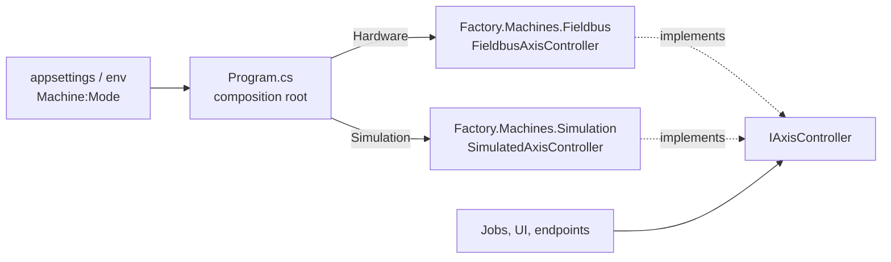

Software that talks to hardware almost always needs to run without it. Developers don't have a
machine controller on their desk, the CI agent certainly doesn't, and sales wants a demo that runs on
a laptop. So someone adds a setting called `Simulation`, and from then on a lot of methods start with
the same `if`.

I've seen this in several codebases, and it never stays small. In this post I'll show why the flag
is the wrong place to make that decision, where the decision belongs instead, and how to make sure
test and simulation code doesn't end up in the assemblies you ship.

## The problem: two programs in one class

Here's a typical axis controller for a machine. It talks to the controller through some fieldbus
client, unless simulation is on:

```csharp
public sealed class AxisController(
    MachineSettings settings,
    IFieldbusClient fieldbus,
    ILogger<AxisController> logger)
{
    private readonly Dictionary<int, double> _simulatedPositions = new();

    public async Task MoveToAsync(int axis, double position, CancellationToken ct)
    {
        if (settings.Simulation)
        {
            await Task.Delay(200, ct);              // "feels like a real move"
            _simulatedPositions[axis] = position;
            return;
        }

        logger.LogInformation("Moving axis {Axis} to {Position}", axis, position);
        await fieldbus.WriteAsync(Registers.TargetPosition(axis), position, ct);
        await fieldbus.WriteAsync(Registers.StartMove(axis), 1, ct);
    }

    public async Task<double> ReadPositionAsync(int axis, CancellationToken ct)
    {
        if (settings.Simulation)
            return _simulatedPositions.GetValueOrDefault(axis);

        return await fieldbus.ReadAsync<double>(Registers.ActualPosition(axis), ct);
    }
}
```

Two methods, and it's already uncomfortable. In a real driver there are thirty methods, and each one
has the same fork. What goes wrong:

- **Two responsibilities in one class.** The real protocol and a fake state machine live side by
  side. Every change to one risks the other, and every reader has to mentally skip half of the code.
- **The fake leaks into production.** `_simulatedPositions` exists in every production instance.
  The simulation branch ships to every customer, and one misconfigured setting switches a real machine
  into "pretend" mode.
- **Dependencies for both worlds.** The class needs an `IFieldbusClient` even in simulation, so the
  fake mode still has to construct the real client, or someone passes `null!` "because it isn't used".
- **The check runs on every call.** It's cheap, but it's a runtime decision for something that can't
  change while the process runs.
- **It spreads.** Once the flag exists, it shows up in the UI ("hide this button in simulation"), in
  the logging, in the persistence layer. After a while, nobody can say what simulation mode actually
  does.

## Why it happens

Nobody plans this. The first `if` is the fastest way to get the demo running. The class already
exists, the setting is one line, and a separate implementation feels like over-engineering for "just
a few lines".

There's also an older reason: in codebases without dependency injection, there was no single place to
make the choice. Every class created its own collaborators, so every class had to check the flag
itself. With a DI container, that excuse is gone.

## The fix: decide once, at the composition root

The question "real hardware or simulation?" has exactly one answer per process. So it should be
answered exactly once, where the application is put together: `Program.cs`, the composition root.

First, give the capability a name that both worlds can implement:

```csharp
namespace Factory.Machines;

public readonly record struct AxisId(int Value);

public sealed record AxisState(AxisId Axis, double Position, bool IsMoving);

public interface IAxisController
{
    Task MoveToAsync(AxisId axis, double position, CancellationToken ct);
    Task<AxisState> ReadStateAsync(AxisId axis, CancellationToken ct);
}
```

The real implementation only knows the protocol. No flag, no dictionary, no "just in case":

```csharp
namespace Factory.Machines.Fieldbus;

internal sealed class FieldbusAxisController(
    IFieldbusClient fieldbus,
    ILogger<FieldbusAxisController> logger) : IAxisController
{
    public async Task MoveToAsync(AxisId axis, double position, CancellationToken ct)
    {
        logger.LogInformation("Moving axis {Axis} to {Position}", axis.Value, position);
        await fieldbus.WriteAsync(Registers.TargetPosition(axis), position, ct);
        await fieldbus.WriteAsync(Registers.StartMove(axis), 1, ct);
    }

    public async Task<AxisState> ReadStateAsync(AxisId axis, CancellationToken ct)
    {
        var position = await fieldbus.ReadAsync<double>(Registers.ActualPosition(axis), ct);
        var moving   = await fieldbus.ReadAsync<bool>(Registers.IsMoving(axis), ct);
        return new AxisState(axis, position, moving);
    }
}
```

The simulation lives in its **own project**, `Factory.Machines.Simulation`. It's a proper
implementation with its own options, and it uses `TimeProvider` instead of hard-wired delays, so
tests can make it instant:

```csharp
namespace Factory.Machines.Simulation;

public sealed class SimulationOptions
{
    public TimeSpan MoveDuration { get; set; } = TimeSpan.FromMilliseconds(200);
}

internal sealed class SimulatedAxisController(
    IOptions<SimulationOptions> options,
    TimeProvider time) : IAxisController
{
    private readonly ConcurrentDictionary<AxisId, double> _positions = new();

    public async Task MoveToAsync(AxisId axis, double position, CancellationToken ct)
    {
        await Task.Delay(options.Value.MoveDuration, time, ct);
        _positions[axis] = position;
    }

    public Task<AxisState> ReadStateAsync(AxisId axis, CancellationToken ct) =>
        Task.FromResult(new AxisState(axis, _positions.GetValueOrDefault(axis), IsMoving: false));
}
```

Each project offers one registration method:

```csharp
namespace Factory.Machines.Fieldbus;

public static class FieldbusServiceCollectionExtensions
{
    public static IServiceCollection AddFieldbusMachine(this IServiceCollection services)
    {
        services.AddSingleton<IFieldbusClient, TcpFieldbusClient>();
        services.AddSingleton<IAxisController, FieldbusAxisController>();
        return services;
    }
}
```

```csharp
namespace Factory.Machines.Simulation;

public static class SimulationServiceCollectionExtensions
{
    public static IServiceCollection AddSimulatedMachine(this IServiceCollection services)
    {
        services.AddOptions<SimulationOptions>().BindConfiguration("Simulation");
        services.TryAddSingleton(TimeProvider.System);
        services.AddSingleton<IAxisController, SimulatedAxisController>();
        return services;
    }
}
```

And the host makes the decision, once:

```csharp
var builder = WebApplication.CreateBuilder(args);

var mode = builder.Configuration.GetValue("Machine:Mode", MachineMode.Hardware);

_ = mode switch
{
    MachineMode.Hardware   => builder.Services.AddFieldbusMachine(),
    MachineMode.Simulation => builder.Services.AddSimulatedMachine(),
    _ => throw new InvalidOperationException($"Unknown machine mode '{mode}'.")
};

var app = builder.Build();
app.Logger.LogWarning("Machine mode: {Mode}", mode);   // make the mode impossible to miss
```



Everything else in the application depends on `IAxisController` and has no idea which one it got.
That's the point. The flag still exists, but it's read in exactly one place.

If the simulation should never reach a customer, go one step further: build two hosts (or two
publish profiles), and only the development or demo host references `Factory.Machines.Simulation`.
Then the fake doesn't merely stay unused in production, it isn't in the package at all.

:::tip[The same seam beats other flags too]
`if (testMode) now = new DateTime(2026, 1, 1)` is the same smell in miniature. Inject
`TimeProvider` (built in since .NET 8) and use `FakeTimeProvider` from
`Microsoft.Extensions.TimeProvider.Testing` in tests. The same goes for scattered
`env.IsDevelopment()` checks deep in business code: decide in `Program.cs`, inject the result.
:::

## Test code doesn't belong in production assemblies either

A close relative of the simulation flag: production projects that reference test assemblies. You'll
find a `Helpers.Tests` project referenced by the main application "because it has those handy
builders", a mocking library in a production `.csproj`, or a reference wrapped in a
`Condition="'$(Configuration)' == 'Debug'"` so that it "doesn't ship".

All three are problems:

- A referenced test assembly **ships to customers**, together with its dependencies.
- Conditional references mean Debug and Release are **different programs**. Code that compiles in
  one configuration breaks in the other, and refactoring tools only see one of them.
- Test helpers in production code invite production code to **call** them.

The rule is boring and effective: every kind of test (unit, integration, component, system) goes into
a separate test project. Always. Test projects reference production projects, never the other way
round. If a test needs access to internals, `InternalsVisibleTo` is fine: it points from production
to test without creating a dependency.

Shared test builders go into their own test-support project (`MyShop.Orders.Testing`), referenced
only by test projects.

## Comparison

| | Runtime flag in the class | `#if SIMULATION` | Selection at the composition root | Separate host / package |
|---|---|---|---|---|
| Real code readable on its own | ❌ | ❌ | ✅ | ✅ |
| Fake can't run by accident in production | ❌ | ✅ | ⚠️ needs config discipline | ✅ |
| One binary for all modes | ✅ | ❌ | ✅ | ❌ |
| Both modes compiled and refactored together | ✅ | ❌ | ✅ | ✅ |
| Fake can be tested on its own | ❌ | ❌ | ✅ | ✅ |

The composition root is my default. When a fake must never reach a customer, a separate host is the
safer upgrade. `#if` is the worst of both worlds: the code is still tangled, and half of it isn't
even compiled in a normal build.

## Pitfalls

**The simulation drifts away from reality.** Two implementations of one interface can quietly start
to behave differently: the real controller rejects positions outside the travel range, the fake
accepts anything. Write the expected behaviour down once as a **contract test** and run it against
both:

```csharp
public abstract class AxisControllerContract
{
    protected abstract IAxisController CreateController();

    [TestMethod]
    public async Task Reading_after_a_move_reports_the_target_position()
    {
        var controller = CreateController();
        var axis = new AxisId(1);

        await controller.MoveToAsync(axis, 42.5, CancellationToken.None);
        var state = await controller.ReadStateAsync(axis, CancellationToken.None);

        Assert.AreEqual(42.5, state.Position, delta: 0.001);
    }
}

[TestClass]
public sealed class SimulatedAxisControllerTests : AxisControllerContract
{
    protected override IAxisController CreateController() =>
        new SimulatedAxisController(
            Options.Create(new SimulationOptions { MoveDuration = TimeSpan.Zero }),
            TimeProvider.System);
}

[TestClass]
[TestCategory("Hardware")]   // runs only on the rig that has a controller attached
public sealed class FieldbusAxisControllerTests : AxisControllerContract
{
    protected override IAxisController CreateController() => HardwareRig.CreateAxisController();
}
```

(`SimulatedAxisController` is `internal`, so the test project gets `InternalsVisibleTo`.)

**A fake that's too perfect.** If the simulation never fails, nobody ever sees how the UI behaves
when an axis times out. Give the simulation options for latency and failure injection, so it can
be used to test the unhappy paths too.

**The flag survives next to the interface.** I've seen the interface introduced and then
`settings.Simulation` still checked in three consumers "for the special cases". Each such case is a
missing member on the interface, or a decision that belongs in `Program.cs`.

**One fake per mode explodes.** If you need several independent switches (simulated axes, real
camera), register each capability separately instead of building one giant "simulation module".

**Silent mode.** Log the mode at startup, show it in the UI and in the health endpoint. Nobody should
have to guess whether the machine on the screen is real.

## Enforce it

Conventions erode, so let the build check them.

An **architecture test** that production assemblies don't reference test frameworks:

```csharp
[TestMethod]
public void Production_assemblies_do_not_reference_test_libraries()
{
    string[] forbidden = ["Moq", "NSubstitute", "FakeItEasy", "xunit", "nunit",
                          "Microsoft.VisualStudio.TestPlatform", "Factory.Machines.Simulation"];

    var offenders =
        from assembly in new[] { typeof(FieldbusServiceCollectionExtensions).Assembly }
        from reference in assembly.GetReferencedAssemblies()
        where forbidden.Any(f => reference.Name!.StartsWith(f, StringComparison.OrdinalIgnoreCase))
        select $"{assembly.GetName().Name} -> {reference.Name}";

    Assert.AreEqual(0, offenders.Count(), string.Join(", ", offenders));
}
```

The compiler only records references that are actually used, so this catches usage, not an unused
package. For that, an **MSBuild check** in `Directory.Build.targets` fails the build when a non-test
project pulls in a test package:

```xml
<Target Name="ForbidTestPackagesInProductionProjects"
        BeforeTargets="Build"
        Condition="'$(IsTestProject)' != 'true'">
  <ItemGroup>
    <_ForbiddenPackage Include="@(PackageReference)"
                       Condition="'%(Identity)' == 'Moq' Or '%(Identity)' == 'NSubstitute' Or '%(Identity)' == 'MSTest.TestFramework' Or '%(Identity)' == 'xunit'" />
  </ItemGroup>
  <Error Condition="'@(_ForbiddenPackage)' != ''"
         Text="Test packages in a production project: @(_ForbiddenPackage)" />
</Target>
```

And for library projects that should never look at the environment themselves, the
**BannedApiAnalyzers** can ban `HostEnvironmentEnvExtensions.IsDevelopment` and friends. More on that
style of rule in [self-defending codebases](/blog/2026-self-defending-codebases/).

The same idea, choosing implementations instead of branching on them, comes back in this series in
[replacing switch chains with strategies](/blog/2026-replace-switch-chains-with-strategies/) and
in the [null object pattern](/blog/2026-null-object-pattern-and-nullable-reference-types/).

## Summary

- An `if (Simulation)` in every method means **two programs in one class**, and the fake ships to
  every customer.
- "Real or fake?" has one answer per process. Answer it **once, at the composition root**, and let
  everything else depend on an interface.
- Put the simulation in **its own project**. If it must never ship, reference it only from a
  development or demo host.
- Keep **all test code in test projects**. Production never references tests;
  `InternalsVisibleTo` is the only arrow that points the other way.
- Keep both implementations honest with **contract tests**, and enforce the boundaries with an
  architecture test and an MSBuild check.
