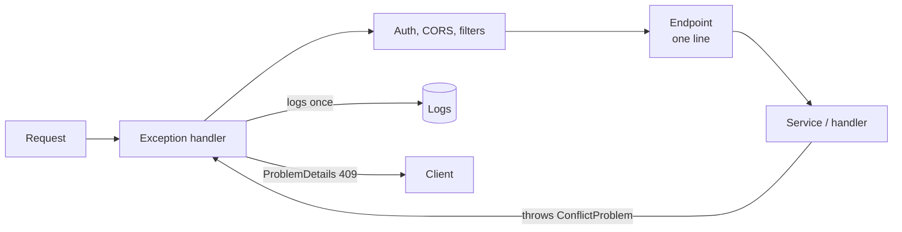

This is one of the first things I look for in a code review of an API, and one of the most common
findings:

```csharp
[HttpGet("{permissionId}")]
public async Task<ActionResult<IEnumerable<PermissionDto>>> GetPermission(int projectId, int permissionId)
{
    try
    {
        stopwatch.Start($"projects/{projectId}/permissions/{permissionId}", currentUser.Id);
        var result = await permissionManager.GetPermissionValueAsync(projectId, permissionId, currentUser.Id);
        stopwatch.Log();
        return Ok(result);
    }
    catch (Exception ex)
    {
        return BadRequest(apiHelper.LogError(ex, Request));
    }
}
```

That's an anonymized version of real code from a codebase I worked on, and it was everywhere: every
endpoint, its own timing, its own `try/catch`, every failure turned into a `400 Bad Request`.

The previous posts in this series built everything needed to delete it: a
[global exception handler with ProblemDetails](/blog/2026-global-error-handling-with-problemdetails/)
and [centralized error logging](/blog/2026-error-logging/). This post is about *why* the
`try/catch` should go, and where it legitimately stays.

## What's wrong with it

**Every error becomes a 400.** A database timeout is not the client's fault. Returning 400 tells the
client "fix your request", which they can't, and it hides a server problem from every dashboard
that counts 5xx responses. Your error rate looks great while the database is on fire.

**Every developer invents a format.** `apiHelper.LogError` returns one shape, the next endpoint
returns `ex.Message`, the one after that a custom object. Clients need a parser per endpoint.

**It leaks.** `ex.Message` on a SQL exception contains table names, sometimes values. In production
that's feedback for an attacker.

**Cross-cutting concerns in every method.** Timing, logging and error mapping are copied into every
endpoint. Forget one, and that endpoint behaves differently. Change the format, and you change a
hundred methods.

**It's noise.** The one line that matters, the call to `GetPermissionValueAsync`, is buried in
eight lines of ceremony.

The guideline that came out of that codebase listed the same points: code full of `try/catch`, no
central place to decide what an exception means per environment, poor maintainability, responses
that depend on the developer, and an endpoint doing work that isn't its responsibility.

People also mention performance. Exceptions are expensive when thrown, and a `try` block itself costs
almost nothing on modern .NET. Performance is not the argument. Consistency and correctness are.

## The "after"

```csharp
projects.MapGet("/{projectId:int}/permissions/{permissionId:int}",
    (int projectId, int permissionId, GetPermissionQuery query, CancellationToken ct) =>
        query.ExecuteAsync(projectId, permissionId, ct));
```

Or as a controller action:

```csharp
[HttpGet("{permissionId:int}")]
public Task<PermissionResponse> GetPermissionAsync(int projectId, int permissionId, CancellationToken ct) =>
    mediator.Send(new GetPermission(projectId, permissionId), ct);
```

Where did everything go?

| Concern | Before | After |
|---|---|---|
| Error → status code | `catch` → always 400 | `IExceptionHandler` maps by exception type |
| Error format | Per developer | ProblemDetails everywhere |
| Error logging | `apiHelper.LogError` per endpoint | Logging exception handler, once |
| Timing | Manual stopwatch per endpoint | OpenTelemetry / ASP.NET Core metrics, automatic |
| "Not found" | Return value checked in the endpoint | `NotFoundProblem` thrown where it's detected, or `TypedResults.NotFound()` |

The endpoint is back to being a gateway: HTTP in, a call, HTTP out.



## "But I need to return 404 when it's not found"

You have two good options, and neither needs a `try/catch`:

**Return a typed result** when the endpoint itself is the natural place to decide:

```csharp
private static async Task<Results<Ok<OrderResponse>, NotFound>> HandleAsync(
    int id, IOrderQueries orders, CancellationToken ct) =>
    await orders.FindAsync(id, ct) is { } order
        ? TypedResults.Ok(order)
        : TypedResults.NotFound();
```

**Throw a problem exception** when the "not found" is detected deep in a service, three calls away
from the endpoint:

```csharp
var customer = await customers.FindAsync(command.CustomerId, ct)
    ?? throw new NotFoundProblem("Customer not found", $"No customer with id '{command.CustomerId}'.");
```

The anti-pattern is the mix: a service throws, the endpoint catches it, and converts it into a
result. That's the global handler's job, done badly in one place.

## Where try/catch is right

"No `try/catch` in endpoints" doesn't mean "no `try/catch` anywhere". It means: **don't catch what
you can't handle.** Catching is right when you actually do something meaningful with the exception:

- **Translating at a boundary.** A repository catches the database driver's unique-constraint
  violation and throws `ConflictProblem("Order already exists")`. The low-level exception becomes a
  domain error with meaning, at the one place that understands both.
- **Recovering.** A fallback to a cached value when a non-critical downstream call fails. (Usually
  better expressed as a resilience strategy than a hand-written `catch`.)
- **Turning failure into a status.** Health checks, as in the health endpoint post.
- **Per-item isolation in loops.** A background job processing 1,000 messages shouldn't stop at the
  first bad one. Catch per item, log, dead-letter, continue.
- **Cleanup.** But `using`/`await using` is almost always the better tool than `finally`.

What these have in common: the `catch` **adds information or changes behavior**. A `catch` that only
logs and rethrows, or only logs and swallows, does neither.

### Cancellation

One special case: when the client disconnects, `RequestAborted` is cancelled and you'll see
`OperationCanceledException`s. Don't catch them in endpoints. Pass the `CancellationToken` through,
and let the global handler recognize them (status 499, `Debug` log level), as shown in the previous
two posts.

## Make it a rule the build checks

A rule like "no try/catch in endpoints" erodes the moment nobody checks it: one urgent fix, one new
team member, and the pattern is back. A code rule test with Roslyn takes a few lines:

```csharp
[TestMethod]
public void Endpoints_do_not_contain_try_catch()
{
    var endpointFiles = Directory.EnumerateFiles(SolutionPaths.Api, "*Endpoint.cs", SearchOption.AllDirectories)
        .Concat(Directory.EnumerateFiles(SolutionPaths.Api, "*Controller.cs", SearchOption.AllDirectories));

    var violations = endpointFiles
        .SelectMany(file => CSharpSyntaxTree.ParseText(File.ReadAllText(file))
            .GetRoot()
            .DescendantNodes()
            .OfType<TryStatementSyntax>()
            .Select(node => $"{Path.GetFileName(file)}:{node.GetLocation().GetLineSpan().StartLinePosition.Line + 1}"))
        .ToList();

    Assert.AreEqual(0, violations.Count,
        "Endpoints must not catch exceptions; throw an ApiProblemException and let the global handler respond:"
        + Environment.NewLine + string.Join(Environment.NewLine, violations));
}
```

The error message matters as much as the check: it tells the developer what to do instead. The
codebases I learned this from had exactly that style of rule message, including a sample of the
correct code.

The next step up is a Roslyn **analyzer** that flags `try` inside endpoint classes directly in the
IDE, with a code fix. That's the [self-defending codebase](/blog/2026-self-defending-codebases/)
version of the same rule.

Two companion rules that close the loopholes:

- **Ban `catch (Exception)` without rethrow** in feature code, except in explicitly allowed places
  (background loops, health checks).
- **Ban `throw new Exception(...)`** in feature code, so domain errors use the problem types and the
  handler can map them.

## Pitfalls

**Moving the try/catch one level down.** The endpoint is clean, but the service it calls catches
everything and returns `null`. Now the endpoint returns 404 for a database outage. Same bug, better
hidden.

**Catching to add context.** `catch (Exception ex) { throw new Exception("Loading order failed", ex); }`
adds a layer to the stack trace and nothing useful. Logging scopes add context without touching the
control flow.

**Expected outcomes as exceptions in hot paths.** An endpoint that "fails" regularly by design
(a lookup that is often empty) should return a result, not throw. Exceptions are for exceptional
paths.

## Summary

- `try/catch` in endpoints makes **every error a 400**, invents a format per developer, leaks details
  and repeats cross-cutting code.
- The **global exception handler**, **ProblemDetails** and **centralized logging** replace it
  completely.
- Use **typed results** for outcomes the endpoint decides, **problem exceptions** for errors detected
  deeper down.
- `try/catch` is right where it **adds meaning or changes behavior**: boundary translation, recovery,
  health checks, per-item loops.
- **Enforce it** with a code rule test or analyzer, with a message that shows the correct pattern.

*Previous: [Controllers vs. minimal APIs](/blog/2026-controllers-vs-minimal-apis/) ·
Next: [Automatic dependency registration](/blog/2026-automatic-dependency-registration/)*
