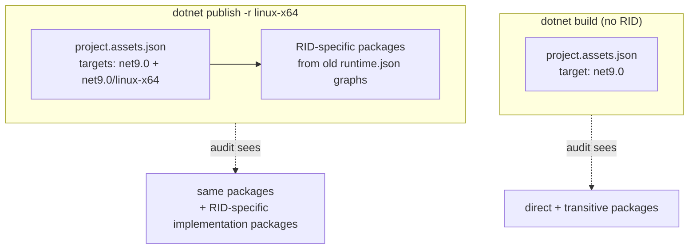

:::note[Series]
Part of the series [*Code quality & tooling*](/series/code-quality-and-tooling/).
:::

Here's a situation I ran into in one codebase: `dotnet restore` succeeds, `dotnet build` succeeds, all tests
pass. Then the release pipeline runs `dotnet publish` for a Linux deployment and fails:

```
error NU1903: Package 'System.Private.Uri' 4.3.0 has a known high severity vulnerability,
https://github.com/advisories/GHSA-5f2m-466j-3848
```

Nobody in the team had ever referenced `System.Private.Uri`. It's not in any project file, not in
`Directory.Packages.props`, and `dotnet list package` on a developer machine doesn't show it either. Still,
with `TreatWarningsAsErrors` on, the release is blocked.

This post covers how NuGet audit works, why publish sees things build doesn't, how to track down who pulls
in a transitive package, and how to deal with findings properly. Spoiler: the first explanation that got
written down for this case was wrong, and the real fix was simpler.

## How NuGet audit works

Since .NET 8, NuGet checks your dependencies against a vulnerability database (the GitHub Advisory
Database, served through nuget.org) **during restore**. Every vulnerable package becomes a warning:

| Code | Severity |
|---|---|
| `NU1901` | low |
| `NU1902` | moderate |
| `NU1903` | high |
| `NU1904` | critical |

Configure it once in [Directory.Build.props](/blog/2026-directory-build-props/):

```xml
<PropertyGroup>
  <NuGetAudit>true</NuGetAudit>
  <NuGetAuditMode>all</NuGetAuditMode>      <!-- direct and transitive packages -->
  <NuGetAuditLevel>low</NuGetAuditLevel>    <!-- report everything, decide per finding -->
</PropertyGroup>
```

`NuGetAuditMode=all` matters. The default has changed between SDK versions, and with `direct` you only see
problems in packages you reference yourself, which are rarely the ones that are outdated. The vulnerable
stuff hides in the transitive graph.

If you restore only from a private feed that doesn't provide vulnerability data, add nuget.org as an
**audit source** in `nuget.config`. It's used for the vulnerability data only, not for downloading packages:

```xml
<auditSources>
  <clear />
  <add key="nuget.org" value="https://api.nuget.org/v3/index.json" />
</auditSources>
```

For reports outside the build, for example a nightly job:

```bash
dotnet list package --vulnerable --include-transitive     # .NET 8/9
dotnet package list --vulnerable --include-transitive     # .NET 10 syntax
```

These commands only report. They don't fail anything, so use the restore-time audit as your gate.

## Why publish finds what build doesn't

The key insight: **NuGet audit audits a restore graph, and `dotnet publish -r linux-x64` restores a different
graph than `dotnet build`.**



Two things combine:

1. **Audit runs only when a restore happens.** `dotnet build` often reuses an existing `project.assets.json`
   and doesn't restore at all, so no audit runs.
2. **A RID-specific restore adds packages.** With a runtime identifier, NuGet also resolves RID-specific
   assets. Old packages from the .NET Core 1.x / .NET Standard 1.x era (`System.Runtime 4.3.0`,
   `System.Net.Http 4.3.0` and friends) declare platform-specific implementation packages through a
   `runtime.json`. Those only appear in the graph when a RID is set, and that's where `System.Private.Uri 4.3.0`
   comes from.

You can reproduce the publish behaviour locally without publishing:

```bash
dotnet restore src/MyShop.Orders.Api -r linux-x64 --force
```

## Who pulls it in?

`dotnet nuget why` (SDK 8.0.400 and later) shows the dependency paths to a package, based on the assets file.
Restore with the RID first, so the RID-specific graph is in there:

```bash
dotnet restore src/MyShop.Orders.Api -r linux-x64
dotnet nuget why src/MyShop.Orders.Api System.Private.Uri
```

The output is a tree from your direct references down to the package. In the typical case it looks like this:

```
[net9.0/linux-x64]
 └─ LegacyPdfLib (v2.1.0)
    └─ System.Net.Http (v4.3.0)
       └─ runtime.unix.System.Private.Uri (v4.3.0)
          └─ System.Private.Uri (v4.3.0)
```

If you need more detail, `obj/project.assets.json` is the ground truth. Search for the package, then look at
which entries in the `targets` section list it as a dependency.

:::caution[A wrong turn worth knowing about]
The first analysis of this case concluded that `System.Private.Uri` is part of the .NET runtime pack, can't be
changed by the application, and should simply be suppressed with `NoWarn NU1903`. That's not right.
`System.Private.Uri 4.3.0` is a real NuGet package from the old .NET Core 1.x package graph, brought in by an
outdated library, and it can be fixed like any other transitive dependency. The runtime pack ships its own,
current `System.Private.Uri.dll`. The telltale sign is the version: **4.3.0** has nothing to do with a .NET 9
runtime.
:::

## Fixing it, in order of preference

**1. Update or remove the package at the top of the chain.** In the tree above, `LegacyPdfLib` is the
culprit. A newer version that targets `netstandard2.0` or a modern .NET no longer drags in the 1.x packages.
That's the real fix.

**2. Pin the transitive package to a patched version.** If there's no newer version of the top-level package,
pin the vulnerable package. With [Central Package Management](/blog/2026-central-package-management/) and
transitive pinning:

```xml
<!-- Directory.Packages.props -->
<PropertyGroup>
  <CentralPackageTransitivePinningEnabled>true</CentralPackageTransitivePinningEnabled>
</PropertyGroup>
<ItemGroup>
  <!-- Pinned: transitive via LegacyPdfLib 2.1 → System.Net.Http 4.3.0 (GHSA-5f2m-466j-3848). Remove after upgrading. -->
  <PackageVersion Include="System.Private.Uri" Version="4.3.2" />
</ItemGroup>
```

Without CPM, a direct `PackageReference` to the patched version in the affected project has the same effect.

**3. Suppress one advisory, consciously.** Sometimes a finding doesn't apply. For a modern .NET app, the
framework's own assembly usually wins over the old package's DLL at runtime anyway, so the vulnerable code may
never execute. If you decide to accept a finding, suppress **exactly that advisory**, not the whole warning
code:

```xml
<ItemGroup>
  <!-- Accepted: see ADR-0042. Re-evaluate when LegacyPdfLib is replaced. -->
  <NuGetAuditSuppress Include="https://github.com/advisories/GHSA-5f2m-466j-3848" />
</ItemGroup>
```

`NuGetAuditSuppress` (NuGet 6.11+) silences one advisory and nothing else. A new vulnerability in the same
package, or anywhere else, still fails the build. That also means one item per advisory: `System.Private.Uri
4.3.0` has several of them, so suppressing just one won't make the build green. It's a good reminder that
pinning 4.3.2 is the cheaper option here.

| | Fixes the cause | Keeps future findings visible | Effort |
|---|---|---|---|
| Upgrade/replace top-level package | ✅ | ✅ | medium |
| Pin patched transitive version | partly | ✅ | low |
| `NuGetAuditSuppress` for one advisory | ❌ | ✅ | low |
| `NoWarn NU1903` | ❌ | ❌ hides all high findings | trivial, don't |
| `NuGetAudit=false` | ❌ | ❌ | trivial, really don't |

## Make build and publish see the same graph

The other half of the fix is in the pipeline. If restore runs once, with the RID you deploy, there's only one
graph and one audit result, and nothing can surprise you in the publish step:

```bash
dotnet restore src/MyShop.Orders.Api -r linux-x64
dotnet build   src/MyShop.Orders.Api -c Release -r linux-x64 --no-restore
dotnet test    tests/MyShop.Orders.Tests -c Release
dotnet publish src/MyShop.Orders.Api -c Release -r linux-x64 --no-restore --no-build -o artifacts/api
```

Do the same restore in the **pull request build**, not only in the release pipeline. Then a vulnerable
RID-specific dependency fails the PR that introduced it, not a release two weeks later. The same applies to
[ReadyToRun](/blog/2026-publishing-readytorun/) and self-contained publishes, which also change the restore.

## Pitfalls

**New advisories break old commits.** The vulnerability database changes daily. A commit that built
yesterday can fail today without any code change. That's the point, but it surprises people. Decide whether a
hotfix branch may temporarily suppress a new finding, and write the decision down.

**`TreatWarningsAsErrors` without a process.** Turning audit warnings into errors is right, but someone has to
own the findings. Otherwise the first blocked release ends with `NuGetAudit=false` in a hurry.

**Private feeds without vulnerability data.** If none of your sources provide audit data, NuGet warns with
`NU1905` and checks nothing. Add an audit source.

**Suppressions that outlive their reason.** Every `NuGetAuditSuppress` and every pin needs a comment and a
reason to be removed. Review them when you touch `Directory.Packages.props`.

## Keep watching

- **Restore-time audit** in every PR build, with `NuGetAuditMode=all` and warnings as errors.
- **A scheduled pipeline** that restores `main` nightly. It catches new advisories for code that isn't changing.
- **Dependabot or Renovate** security updates, which open PRs for vulnerable packages and understand CPM.
- **A short ADR per accepted finding**, linked from the suppression comment.

## Summary

- NuGet audit checks packages during **restore**, including transitive ones with `NuGetAuditMode=all`.
- `dotnet publish -r <rid>` restores a **different graph** than `dotnet build`. Old .NET Standard 1.x packages
  add RID-specific dependencies that only show up there.
- Reproduce with `dotnet restore -r <rid> --force`, trace with **`dotnet nuget why`** and `project.assets.json`.
- Fix by **upgrading the top-level package**, then by **pinning** a patched version, and only then by
  **suppressing one advisory** with `NuGetAuditSuppress`. Never switch off a whole warning code.
- **Restore once, with the deployment RID**, in PR builds and releases, so build and publish see the same graph.
