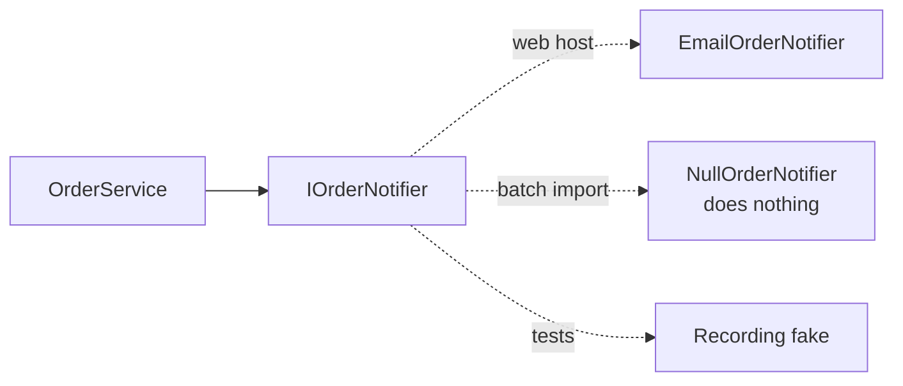

Open a class that has been maintained for a few years and count the `?.` operators. In one codebase
I worked on, a central service had optional collaborators for notifications, auditing and metrics,
and every method started with a little ritual: `_audit?.Write(...)`, `if (_metrics != null)`,
`_notifier?.Send(...)`. Nobody ever decided that these were allowed to be missing. It just happened,
one constructor overload at a time.

There are two tools that clean this up, and they work best together. The **null object pattern**
replaces "nothing" with an object that does nothing. **Nullable reference types** make the compiler
track the nulls that are left. This post is about when to use which, and about the one way a null
object can make things worse.

## The problem: optional dependencies everywhere

```csharp
public sealed class OrderService
{
    private readonly IOrderRepository _orders;
    private readonly IOrderNotifier? _notifier;
    private readonly IAuditLog? _audit;

    public OrderService(IOrderRepository orders,
                        IOrderNotifier? notifier = null,
                        IAuditLog? audit = null)
    {
        _orders = orders;
        _notifier = notifier;
        _audit = audit;
    }

    public async Task PlaceAsync(Order order, CancellationToken ct)
    {
        await _orders.AddAsync(order, ct);

        if (_audit != null)
            await _audit.WriteAsync($"Order {order.Id} placed", ct);

        if (_notifier != null)
            await _notifier.OrderPlacedAsync(order, ct);
    }

    public IReadOnlyList<OrderLine>? GetLines(OrderId id) { /* null if the order has no lines */ }
}
```

What's wrong with it:

- **Every use needs a check**, and the one place that forgets it throws a `NullReferenceException`
  in production, usually in the configuration nobody tested.
- **The interesting logic drowns.** `PlaceAsync` has one line of business logic and four lines about
  things that might not exist.
- **"Optional" isn't a decision.** Was the notifier left out on purpose (a batch import that shouldn't
  send e-mails), or is it a misconfiguration? The code can't tell.
- **`null` for a list** forces every caller to distinguish "no lines" from "no list", which is almost
  never a meaningful difference.

## Why it happens

`null` is the default value of every reference, so it's the path of least resistance. An optional
constructor parameter is quicker than thinking about what "no notifier" should mean. Before C# 8 the
compiler didn't care either: `IOrderNotifier` could be null or not, and the type said nothing.

## The null object: "nothing" as a real implementation

When the honest answer to "what should happen if there's no notifier?" is **"nothing"**, write that
down as a class:

```csharp
namespace MyShop.Orders;

public interface IOrderNotifier
{
    Task OrderPlacedAsync(Order order, CancellationToken ct);
}

public sealed class NullOrderNotifier : IOrderNotifier
{
    public static NullOrderNotifier Instance { get; } = new();

    private NullOrderNotifier() { }

    public Task OrderPlacedAsync(Order order, CancellationToken ct) => Task.CompletedTask;
}
```

Now the dependencies are mandatory, and the service is about orders again:

```csharp
public sealed class OrderService(
    IOrderRepository orders,
    IOrderNotifier notifier,
    IAuditLog audit)
{
    public async Task PlaceAsync(Order order, CancellationToken ct)
    {
        await orders.AddAsync(order, ct);
        await audit.WriteAsync($"Order {order.Id} placed", ct);
        await notifier.OrderPlacedAsync(order, ct);
    }

    public IReadOnlyList<OrderLine> GetLines(OrderId id) { /* empty list if there are none */ }
}
```

The choice of "do nothing" moves to where it belongs, the composition root. A library can register
the null object as a default and let the host override it:

```csharp
public static IServiceCollection AddOrders(this IServiceCollection services)
{
    services.AddScoped<OrderService>();
    services.TryAddSingleton<IOrderNotifier>(NullOrderNotifier.Instance);
    services.TryAddSingleton<IAuditLog>(NullAuditLog.Instance);
    return services;
}
```

```csharp
builder.Services.AddSingleton<IOrderNotifier, EmailOrderNotifier>();   // real one in the web host
builder.Services.AddOrders();                                          // TryAdd keeps it
```

The batch importer simply doesn't register a notifier and gets the null object. That's the same idea
as choosing a [simulated implementation at the composition root](/blog/2026-no-simulation-flags-in-production-code/)
instead of branching on a flag inside the class.



### You already use null objects every day

The BCL and the `Microsoft.Extensions` libraries are full of them, which is a good hint that the
pattern works:

- `NullLogger<T>.Instance` and `NullLoggerFactory.Instance`: a logger that discards everything. Perfect
  for tests and for libraries that accept an optional `ILogger`.
- `Stream.Null` and `TextWriter.Null`: write as much as you like, nothing happens.
- `Array.Empty<T>()`, `Enumerable.Empty<T>()`, `[]`: the null object for collections.
- `CancellationToken.None`: a token that never cancels.

### Null objects for behaviour, too

The pattern isn't limited to infrastructure. Whenever a domain rule has a "no-op" case, it's often
cleaner as an object than as a `null` check:

```csharp
public interface IDiscountPolicy
{
    Money Apply(Money subtotal, Customer customer);
}

public sealed class NoDiscount : IDiscountPolicy
{
    public static NoDiscount Instance { get; } = new();
    private NoDiscount() { }

    public Money Apply(Money subtotal, Customer customer) => subtotal;
}
```

`customer.DiscountPolicy.Apply(subtotal, customer)` now works for every customer, with or without a
contract. That's the same structural move as the
[strategy pattern](/blog/2026-replace-switch-chains-with-strategies/): the null object is just the
strategy that does nothing. In device code, a `PassThroughFilter` for a sensor signal without
smoothing plays the same role.

## Where nullable reference types come in

A null object isn't the answer to every `null`. Sometimes "missing" is information the caller needs.
That's where nullable reference types do the work: they let the type say whether `null` is possible,
and the compiler enforces it. (The details of getting a codebase to zero warnings are in
[take nullability warnings seriously](/blog/2026-nullability-warnings/).)

I use a simple decision table:

| What does "missing" mean? | Use | Example |
|---|---|---|
| A bug or broken data | Throw early, non-nullable type | `GetOrder(id)` for an order that must exist |
| A normal outcome the caller must decide on | `T?` and let the compiler force the check | `FindCustomerByEmail(email)` returns `Customer?` |
| "Do nothing" | Null object, non-nullable type | `IOrderNotifier`, `IDiscountPolicy` |
| "No items" | Empty collection, never `null` | `GetLines(id)` returns `[]` |
| Expected failure with a reason | Result type | Parsing, validation, see [out parameters vs. result types](/blog/2026-out-parameters-vs-result-types/) |

With nullable reference types enabled, this table becomes visible in the signatures. A dependency typed
as `IOrderNotifier` (not `IOrderNotifier?`) can't be `null` without a warning, so nobody adds the
`?.` back. A method returning `Customer?` can't be dereferenced without a check. The two tools
complement each other: null objects remove the nulls that never meant anything, and the compiler
guards the ones that remain.

## The trap: null objects for data

The pattern has a bad twin. You'll find it in older wikis as the textbook example:

```csharp
public sealed class NullPerson : IPerson
{
    public string Name { get; set; } = "Unknown";
}
```

This doesn't remove the problem, it hides it. Sooner or later "Unknown" ends up on an invoice, in a
report or in the database, and now you have to check `person is NullPerson` or
`Name == "Unknown"`, which is a null check with extra steps. Worse, the bug that caused the person to
be missing never surfaces.

My rule: **null objects are for behaviour, not for data.** "Notify nobody", "apply no discount" and
"log nothing" are meaningful behaviours. "A customer who doesn't exist" isn't a customer. If the data
is missing, the type should say so (`Customer?`), or the code should fail.

There are rare exceptions where a special-case object is a real domain concept, such as an anonymous
guest customer in a shop. Then give it a real name (`GuestCustomer`), real rules, and treat it as a
first-class case, not as a placeholder.

## Pitfalls

**Silent misconfiguration.** A null object that's registered by default means a forgotten
registration doesn't fail, it just does nothing. For things that must be there in production, don't
register a default. Let the container fail at startup (`ValidateOnBuild = true`), or log which
implementation was chosen.

**Stateful null objects.** A null object shared as a singleton must be stateless. If it counts calls
or caches anything, it's not a null object any more, and it's a concurrency bug in waiting.

**`is NullX` checks.** If consumers start asking "is this the null object?", the abstraction is
leaking. Either the interface is missing a member (`bool IsEnabled`), or the decision belongs in the
composition root.

**Null objects that return null.** A `NullRepository` whose `GetAll()` returns `null` instead of `[]`
just moves the problem one level down. Every member of a null object should return the neutral value
for its type: an empty collection, a completed task, the unchanged input.

**`TryAdd` and `IEnumerable<T>`.** If the library registers its default *before* the host adds the
real implementation, single resolution gets the real one (last registration wins), but
`IEnumerable<IOrderNotifier>` contains both. Register the real implementation first, or use `Replace`.

## Enforce it

Turn nullability into a build error, not a suggestion, in `Directory.Build.props`:

```xml
<PropertyGroup>
  <Nullable>enable</Nullable>
  <WarningsAsErrors>$(WarningsAsErrors);nullable</WarningsAsErrors>
</PropertyGroup>
```

Validate the container in a test, so a missing mandatory registration fails in CI rather than at the
first request:

```csharp
[TestMethod]
public void Batch_import_host_resolves_all_services()
{
    var services = new ServiceCollection().AddOrders().AddBatchImport();

    using var provider = services.BuildServiceProvider(new ServiceProviderOptions
    {
        ValidateOnBuild = true,
        ValidateScopes = true
    });

    Assert.IsInstanceOfType<NullOrderNotifier>(provider.GetRequiredService<IOrderNotifier>());
}
```

And give every null object a tiny test that it really does nothing and returns neutral values. It
takes a minute and catches the "returns null" regression.

## Summary

- Optional dependencies with `?.` everywhere are an **undecided design**, not a feature.
- When "missing" means **"do nothing"**, write a null object, make the dependency mandatory, and choose
  the implementation at the composition root.
- The framework already does this: `NullLogger<T>`, `Stream.Null`, `Array.Empty<T>()`,
  `CancellationToken.None`.
- **Null objects are for behaviour, not for data.** A fake "Unknown" customer hides bugs.
- Use **nullable reference types** for the nulls that carry meaning, empty collections instead of
  `null` lists, and result types for failures with a reason. Make nullable warnings build errors.
