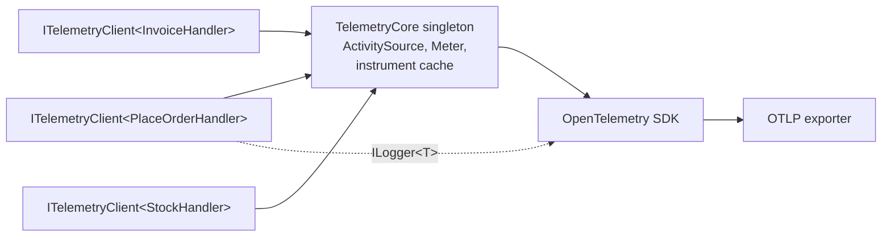

:::note[Series]
Part of the series [*Cloud, DevOps & observability*](/series/cloud-devops-observability/).
:::

OpenTelemetry in .NET is well designed. Logs go through `ILogger<T>`, traces through `ActivitySource`
and `Activity`, metrics through `Meter` and its instruments. Each API is the right tool for its signal.
And yet, when I review handlers in teams that adopted OpenTelemetry, I keep finding the same bugs:

```csharp
logger.LogInformation($"Order {order.Id} placed for {customer.Id}");     // structure gone
meter.CreateCounter<long>($"orders.{order.Channel}.placed").Add(1);    // new instrument per call,
                                                                       // dynamic metric name
histogram.Record(elapsed.TotalMilliseconds, new("order.id", order.Id)); // unbounded tag cardinality
activity.SetStatus(ActivityStatusCode.Error);                          // activity may be null
```

None of these are exotic. They happen because every developer has to know the rules of three APIs:
message templates, instrument caching, units, which tags are safe, when to set span status, and that
`StartActivity` returns `null` when nobody listens.

In one platform team I worked with, this led to an architecture proposal: a **telemetry facade**. Not
to replace OpenTelemetry, but to put one small, governed interface in front of it. This post is my
version of that design, with the trade-offs we discussed.

## What the facade is not

Before the code, the non-goals, because they matter more than the goals:

- It does **not** reimplement OpenTelemetry. Logs are still `ILogger`, spans are still `Activity`,
  metrics are still `Meter`. The export is still OTLP, configured with the standard `OTEL_*`
  environment variables.
- It does **not** know the backend. Whether you send to Azure Monitor, Grafana, Honeycomb or anything
  else that speaks OTLP is configuration, not code.
- It does **not** allow arbitrary metric names. That's the point.

## The design options

| Option | Example | Verdict |
|---|---|---|
| A. Native APIs directly | `ILogger<T>` + `IMeterFactory` + static `ActivitySource` | Pure, but every consumer needs all the knowledge |
| B. One non-generic `ITelemetryClient` | singleton | Simple, but all logs end up in **one logger category**, so namespace filtering breaks |
| C. Generic `ITelemetryClient<TCategory>` | like `ILogger<T>` | Keeps categories, one dependency per consumer |
| D. Non-generic + business categories in definitions | `"shop.orders"` | Fine if you want business categories instead of namespaces |
| E. Find the caller via stack walking | reflection | Rejected: slow, breaks with inlining, async and AOT |
| F. Source generator injects the caller type | interceptors | Possible later, too much machinery for now |

We picked **C**. It looks exactly like `ILogger<T>`, so nobody has to learn a new mental model, and log
filtering by namespace (`"MyShop.Orders": "Debug"`) keeps working.



There can be many generic facade instances, but they're thin views: an `ILogger<TCategory>` and a
reference to **one** shared core with one `ActivitySource`, one `Meter` and one instrument cache.

## Step 1: definitions instead of strings

A facade only controls syntax. If it accepts any string as a metric name, you get dynamic names
again. So metrics, events and operations are **defined once**, in code, per domain:

```csharp
public sealed record CounterDefinition(string Name, string Unit, string Description, params string[] AllowedTags);
public sealed record HistogramDefinition(string Name, string Unit, string Description, params string[] AllowedTags);
public sealed record EventDefinition(string Name);
public sealed record OperationDefinition(string Name);

public static class TelemetryTags
{
    public const string Channel = "order.channel";        // web, app, marketplace
    public const string PaymentMethod = "payment.method"; // card, invoice, paypal
    public const string Result = "result";                // success, failure
}

public static class OrderTelemetry
{
    public static readonly OperationDefinition Place = new("PlaceOrder");

    public static readonly EventDefinition Placed = new("shop.order.placed");

    public static readonly CounterDefinition PlacedTotal = new(
        "shop.orders.placed", "{order}", "Number of placed orders",
        TelemetryTags.Channel, TelemetryTags.PaymentMethod, TelemetryTags.Result);

    public static readonly HistogramDefinition PlaceDuration = new(
        "shop.orders.place.duration", "s", "Time to place an order",
        TelemetryTags.Channel, TelemetryTags.Result);
}
```

What you get from this small amount of upfront work:

- **All names are in one place** and visible in code review. A rename becomes a deliberate change to
  your telemetry schema, not a side effect.
- **Units can't vary per call site.** Durations are seconds, following the OpenTelemetry semantic
  conventions, everywhere.
- **Allowed tags are part of the definition**, so they can be checked.

## Step 2: the shared core

```csharp
public sealed class TelemetryCore(IMeterFactory meterFactory, IHostEnvironment env) : IDisposable
{
    public const string Name = "MyShop";

    public ActivitySource ActivitySource { get; } = new(Name);
    private readonly Meter _meter = meterFactory.Create(Name);   // owned by the factory, don't dispose
    private readonly ConcurrentDictionary<string, object> _instruments = new();

    public Counter<long> Counter(CounterDefinition d) =>
        Get(d.Name, () => _meter.CreateCounter<long>(d.Name, d.Unit, d.Description));

    public Histogram<double> Histogram(HistogramDefinition d) =>
        Get(d.Name, () => _meter.CreateHistogram<double>(d.Name, d.Unit, d.Description));

    private T Get<T>(string name, Func<T> create) where T : class =>
        _instruments.GetOrAdd(name, _ => create()) as T
        ?? throw new InvalidOperationException($"Metric '{name}' is already registered with a different instrument type.");

    public TagList ToTags(ReadOnlySpan<(string Key, object? Value)> tags, string[] allowed, string metric)
    {
        var list = new TagList();
        foreach (var (key, value) in tags)
        {
            if (Array.IndexOf(allowed, key) < 0)
            {
                if (env.IsDevelopment() || env.IsEnvironment("Test"))
                    throw new InvalidOperationException($"Tag '{key}' is not allowed on metric '{metric}'.");
                continue;   // production: drop it, never fail the business operation
            }
            list.Add(key, value);
        }
        return list;
    }

    public void Dispose() => ActivitySource.Dispose();
}
```

Two rules are encoded here:

1. **Instruments are created once and cached.** The same name with a different instrument type is a
   bug and fails loudly.
2. **Unknown metric tags fail in development and test, and are dropped in production.** Telemetry must
   never break a real order. (In the real implementation, also log a warning once per metric and tag,
   so the drop is visible.)

## Step 3: the facade

```csharp
public interface ITelemetryClient<TCategory>
{
    void Information(string message, ReadOnlySpan<(string Key, object? Value)> details = default,
        [CallerMemberName] string member = "", [CallerFilePath] string file = "", [CallerLineNumber] int line = 0);

    void Error(string message, Exception? exception = null, ReadOnlySpan<(string Key, object? Value)> details = default,
        [CallerMemberName] string member = "", [CallerFilePath] string file = "", [CallerLineNumber] int line = 0);

    void Event(EventDefinition definition, ReadOnlySpan<(string Key, object? Value)> details = default,
        [CallerMemberName] string member = "", [CallerFilePath] string file = "", [CallerLineNumber] int line = 0);

    void Increment(CounterDefinition definition, ReadOnlySpan<(string Key, object? Value)> tags = default, long value = 1);

    void Record(HistogramDefinition definition, double value, ReadOnlySpan<(string Key, object? Value)> tags = default);

    ITelemetryOperation StartOperation(OperationDefinition definition, ReadOnlySpan<(string Key, object? Value)> tags = default);
}
```

The **caller attributes** fill in the source location at compile time, with no stack walking. They go
on logs and events as the standard attributes `code.function.name`, `code.file.path` and
`code.line.number`, and **never** on metrics, where a line number would be a cardinality bomb. Note
that caller attributes must be on the interface: the compiler uses the declaration the call site
binds to.

The implementation of the log part shows why the facade is worth it. Messages are passed as plain
text, **not** as templates, so a message containing `{` can't break anything, and details become
structured attributes:

```csharp
internal sealed class TelemetryClient<TCategory>(ILogger<TCategory> logger, TelemetryCore core)
    : ITelemetryClient<TCategory>
{
    public void Information(string message, ReadOnlySpan<(string Key, object? Value)> details = default,
        string member = "", string file = "", int line = 0) =>
        Log(LogLevel.Information, message, null, details, member, file, line);

    public void Error(string message, Exception? exception = null, ReadOnlySpan<(string Key, object? Value)> details = default,
        string member = "", string file = "", int line = 0) =>
        Log(LogLevel.Error, message, exception, details, member, file, line);

    public void Event(EventDefinition definition, ReadOnlySpan<(string Key, object? Value)> details = default,
        string member = "", string file = "", int line = 0)
    {
        Log(LogLevel.Information, definition.Name, null,
            [("event.name", definition.Name), .. details], member, file, line);
        Activity.Current?.AddEvent(new ActivityEvent(definition.Name));
    }

    public void Increment(CounterDefinition d, ReadOnlySpan<(string Key, object? Value)> tags = default, long value = 1) =>
        core.Counter(d).Add(value, core.ToTags(tags, d.AllowedTags, d.Name));

    public void Record(HistogramDefinition d, double value, ReadOnlySpan<(string Key, object? Value)> tags = default) =>
        core.Histogram(d).Record(value, core.ToTags(tags, d.AllowedTags, d.Name));

    public ITelemetryOperation StartOperation(OperationDefinition d, ReadOnlySpan<(string Key, object? Value)> tags = default)
    {
        var activity = core.ActivitySource.StartActivity(d.Name, ActivityKind.Internal);
        foreach (var (key, value) in tags)
            activity?.SetTag(key, value);
        return new TelemetryOperation(activity);
    }

    private void Log(LogLevel level, string message, Exception? exception,
        ReadOnlySpan<(string Key, object? Value)> details, string member, string file, int line)
    {
        if (!logger.IsEnabled(level))
            return;

        var state = new List<KeyValuePair<string, object?>>(details.Length + 3)
        {
            new("code.function.name", $"{typeof(TCategory).FullName}.{member}"),
            new("code.file.path", file),
            new("code.line.number", line),
        };
        foreach (var (key, value) in details)
            state.Add(new(key, value));

        logger.Log(level, default, state, exception, (_, _) => message);
    }
}
```

The operation wraps an `Activity` and handles everything people get wrong: null activities, status,
exceptions, double completion.

```csharp
public interface ITelemetryOperation : IDisposable
{
    void Succeed();
    void Fail(string reason, Exception? exception = null);
}

internal sealed class TelemetryOperation(Activity? activity) : ITelemetryOperation
{
    private int _completed;

    public void Succeed()
    {
        if (Interlocked.Exchange(ref _completed, 1) == 0)
            activity?.SetStatus(ActivityStatusCode.Ok);
    }

    public void Fail(string reason, Exception? exception = null)
    {
        if (Interlocked.Exchange(ref _completed, 1) != 0)
            return;
        if (exception is not null)
            activity?.AddException(exception);
        activity?.SetStatus(ActivityStatusCode.Error, reason);
    }

    public void Dispose() => activity?.Dispose();
}
```

`Fail("Credit limit exceeded")` without an exception is a first-class case. Business failures are often
not exceptions, and they should still show up as failed spans. (`Activity.AddException` is available
since .NET 9. On older versions, use the `RecordException` extension from the OpenTelemetry API package.)

Registration:

```csharp
builder.Services.TryAddSingleton<TelemetryCore>();
builder.Services.TryAddSingleton(typeof(ITelemetryClient<>), typeof(TelemetryClient<>));

builder.Services.AddOpenTelemetry()
    .WithTracing(t => t.AddSource(TelemetryCore.Name).AddAspNetCoreInstrumentation().AddHttpClientInstrumentation())
    .WithMetrics(m => m.AddMeter(TelemetryCore.Name).AddAspNetCoreInstrumentation())
    .WithLogging()
    .UseOtlpExporter();   // endpoint, protocol and headers from OTEL_EXPORTER_OTLP_*
```

## What a handler looks like now

```csharp
public sealed class PlaceOrderHandler(ITelemetryClient<PlaceOrderHandler> telemetry, IOrderRepository orders)
{
    public async Task<OrderId> HandleAsync(PlaceOrder command, CancellationToken ct)
    {
        using var operation = telemetry.StartOperation(OrderTelemetry.Place, [(TelemetryTags.Channel, command.Channel)]);
        var started = Stopwatch.GetTimestamp();

        try
        {
            var id = await orders.AddAsync(command, ct);

            telemetry.Increment(OrderTelemetry.PlacedTotal,
                [(TelemetryTags.Channel, command.Channel), (TelemetryTags.PaymentMethod, command.PaymentMethod), (TelemetryTags.Result, "success")]);
            telemetry.Record(OrderTelemetry.PlaceDuration, Stopwatch.GetElapsedTime(started).TotalSeconds,
                [(TelemetryTags.Channel, command.Channel), (TelemetryTags.Result, "success")]);
            telemetry.Event(OrderTelemetry.Placed, [("order.id", id.Value)]);   // high-cardinality is fine on events

            operation.Succeed();
            return id;
        }
        catch (Exception ex)
        {
            operation.Fail("Placing the order failed", ex);
            telemetry.Increment(OrderTelemetry.PlacedTotal,
                [(TelemetryTags.Channel, command.Channel), (TelemetryTags.Result, "failure")]);
            throw;
        }
    }
}
```

One dependency. No instrument caching, no null checks on activities, no units. And `order.id` goes on
the **event**, where it belongs, not on the counter, where the facade would reject it.

## The trade-offs we accepted

- **Some source-generated logging performance is lost.** `[LoggerMessage]` is faster than a list of
  key/value pairs. For hot paths that are *measured* to matter, add a specialized API later. Don't
  optimize the 99% that log a few times per request.
- **Boxing.** `object?` values box. `ReadOnlySpan` avoids the array allocation for the tuple list, not
  the boxing. Measure before you worry.
- **One small facade per category.** They're two references each. Negligible.
- **Mocking becomes awkward** because of the caller parameters. Ship a `FakeTelemetryClient<T>` that
  records semantic entries (`Event`, `Increment` with tags) instead. Tests then read like
  `fake.Events.Should().ContainSingle(e => e.Definition == OrderTelemetry.Placed)`.
- **`CallerFilePath` can leak build-machine paths.** Set `<ContinuousIntegrationBuild>true</ContinuousIntegrationBuild>`
  (conditioned on `CI`) and `<Deterministic>true</Deterministic>`, then check in the real pipeline
  output that paths look like `/_/src/Orders/PlaceOrderHandler.cs`.

## Pitfalls

- **High-cardinality metric tags.** Order IDs, user IDs, request IDs, URLs with query strings, exception
  messages. Each unique value creates a new time series. Good tags have a small, known set of values.
- **Wrappers that swallow the call site.** If a domain helper calls the facade, the caller info points to
  the helper. Forward `member`, `file` and `line` explicitly with named arguments if you want the original
  call site.
- **A facade nobody is forced to use.** Then you have four APIs instead of three.

## Make it stick

The facade creates consistency only if bypassing it is hard. Two enforcement layers:

```text
# BannedSymbols.txt, for all application projects (not the telemetry project itself)
T:System.Diagnostics.ActivitySource;Use ITelemetryClient<T>.StartOperation
T:System.Diagnostics.Metrics.Meter;Define a metric in a *Telemetry class and use ITelemetryClient<T>
T:System.Diagnostics.Metrics.IMeterFactory;Use ITelemetryClient<T>
```

Whether you also ban `ILogger<T>` depends on how strict you want to be. Plenty of teams keep `ILogger`
for plain diagnostic logs and use the facade for everything that's queried, counted or alerted on.
Add an architecture test as a second layer, so a project that forgot to import the central analyzer
config is caught too. That's the
[self-defending codebases](/blog/2026-self-defending-codebases/) idea again.

## Summary

- OpenTelemetry's three APIs are correct, and they spread a lot of rules across every handler.
- A **thin generic facade**, `ITelemetryClient<TCategory>`, gives developers one dependency and keeps
  logger categories intact.
- **Metric, event and operation definitions** make names, units and allowed tags reviewable in one place.
- One **shared core** caches instruments and validates tags: fail in development, drop in production.
- Caller attributes add source location to logs and events, **never** to metrics.
- Keep OTLP and the backend in configuration. **Enforce** the facade with banned APIs and architecture tests.
