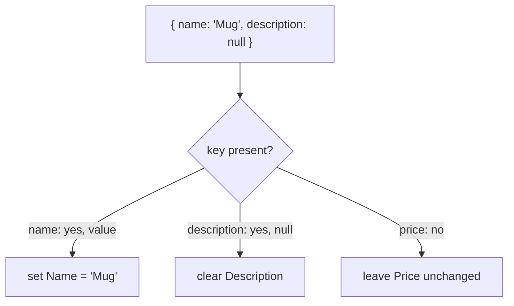

Sooner or later every API gets a `PATCH` endpoint, and the first version almost always looks like
this:

```csharp
public sealed record ProductPatch(string? Name, string? Description, decimal? Price);

app.MapPatch("/products/{id:guid}", async (Guid id, ProductPatch patch, ShopDbContext db,
    CancellationToken ct) =>
{
    var product = await db.Products.FindAsync([id], ct);
    if (product is null) return Results.NotFound();

    if (patch.Name is not null)        product.Name = patch.Name;
    if (patch.Description is not null) product.Description = patch.Description;
    if (patch.Price is not null)       product.Price = patch.Price.Value;

    await db.SaveChangesAsync(ct);
    return Results.NoContent();
});
```

It works in the demo. Then a product manager asks how to *remove* a description, and you realize
there's no way. `{ "description": null }` and `{}` produce exactly the same `ProductPatch`. "null
means don't touch it" and "null means clear it" are indistinguishable once the JSON has been bound
to a C# object.

That's the core problem of `PATCH`, and it's worth solving properly, because a half-working `PATCH`
is worse than none.

## Pick a format: JSON Merge Patch

There are two standards for `PATCH` bodies in JSON:

| | JSON Patch (RFC 6902) | JSON Merge Patch (RFC 7386) |
|---|---|---|
| Content type | `application/json-patch+json` | `application/merge-patch+json` |
| Body | array of operations: `[{ "op": "replace", "path": "/name", "value": "..." }]` | partial document: `{ "name": "..." }` |
| Clear a value | `{ "op": "remove", "path": "/description" }` | `{ "description": null }` |
| Array operations (insert at index, move) | ✅ | ❌ arrays are replaced as a whole |
| Test-and-set (`test` op) | ✅ | ❌ |
| Effort for clients | high: build operations and paths | low: send the fields you want to change |
| Can set a value to `null` | ✅ | ❌ `null` always means "remove" |

For typical business APIs I go with **JSON Merge Patch**. The rules fit in three lines:

- **Property omitted** → leave it unchanged.
- **Property present with `null`** → clear it.
- **Property present with a value** → set it (and for nested objects, merge recursively).

A client sends exactly what it wants to change, in the same shape it gets from `GET`. No operation
arrays, no JSON Pointer paths. The two limitations (arrays are replaced as a whole, and you can't
*set* something to `null` as a value) rarely matter for business resources. If they do, for example
for large lists that clients edit concurrently, model the list as a sub-resource instead.

## Why it's hard in C#

System.Text.Json deserializes into a type. A `string?` property is `null` both when the JSON contained
`null` and when the key was missing. You lose exactly the information Merge Patch depends on.

There are three common ways around it:

1. **An `Optional<T>` wrapper** for every property, with a custom converter that sets `HasValue`
   when the key is present. Precise, but every DTO and every validator has to deal with the wrapper,
   and OpenAPI generators show `Optional<T>` as a weird nested object.
2. **Bind only to `JsonObject`/`JsonElement`.** You have full presence information, but you lose
   typing, validation and the OpenAPI schema.
3. **Both**: a typed DTO for validation and documentation, plus the raw JSON object for presence.

Option 3 is what I use. The DTO stays a plain record, and the presence check is a dictionary lookup.

## The implementation

Instead of reading the body twice (which ASP.NET Core doesn't allow by default, more on that in the
[next post](/blog/2026-rereading-raw-json-body-minimal-apis/)), I read it **once** into a
`JsonObject` and deserialize the typed DTO from that. Minimal APIs let a parameter type bind itself
through a static `BindAsync` method, which makes this a reusable wrapper:

```csharp
public sealed class MergePatch<T> where T : class
{
    public required T Value { get; init; }
    public required JsonObject Json { get; init; }

    /// <summary>True if the client sent the property, even with a null value.</summary>
    public bool Has(string jsonPropertyName) => Json.ContainsKey(jsonPropertyName);

    public static async ValueTask<MergePatch<T>?> BindAsync(HttpContext http)
    {
        var options = http.RequestServices
            .GetRequiredService<IOptions<JsonOptions>>().Value.SerializerOptions;

        if (!http.Request.HasJsonContentType())
            throw new BadHttpRequestException(
                "Expected Content-Type application/merge-patch+json.",
                StatusCodes.Status415UnsupportedMediaType);

        try
        {
            var node = await JsonNode.ParseAsync(http.Request.Body,
                cancellationToken: http.RequestAborted);

            if (node is not JsonObject json)
                throw new BadHttpRequestException("A merge patch must be a JSON object.");

            var value = json.Deserialize<T>(options)
                ?? throw new BadHttpRequestException("The request body could not be read.");

            return new MergePatch<T> { Value = value, Json = json };
        }
        catch (JsonException ex)
        {
            throw new BadHttpRequestException("The request body is not valid JSON.", ex);
        }
    }
}
```

The endpoint gets typed values *and* presence information, from a single read of the body:

```csharp
public sealed record ProductPatch(
    [property: StringLength(200, MinimumLength = 1)] string? Name,
    [property: StringLength(4000)] string? Description,
    [property: Range(0.01, 1_000_000)] decimal? Price);

app.MapPatch("/products/{id:guid}", async Task<Results<Ok<ProductDto>, NotFound, ValidationProblem>> (
    Guid id, MergePatch<ProductPatch> patch, ShopDbContext db, CancellationToken ct) =>
{
    var product = await db.Products.FindAsync([id], ct);
    if (product is null)
        return TypedResults.NotFound();

    var errors = new Dictionary<string, string[]>();

    if (patch.Has("name"))
    {
        if (patch.Value.Name is null)
            errors["name"] = ["Name is required and can't be removed."];
        else
            product.Name = patch.Value.Name;
    }

    if (patch.Has("description"))
        product.Description = patch.Value.Description;   // null clears it

    if (patch.Has("price"))
    {
        if (patch.Value.Price is not { } price)
            errors["price"] = ["Price can't be removed."];
        else
            product.Price = price;
    }

    if (errors.Count > 0)
        return TypedResults.ValidationProblem(errors);

    await db.SaveChangesAsync(ct);
    return TypedResults.Ok(ProductDto.From(product));
})
.Accepts<ProductPatch>("application/merge-patch+json")
.WithName("PatchProduct");
```

`HasJsonContentType()` accepts any `+json` media type, so `application/merge-patch+json` passes.
The `Accepts` metadata does two things: it documents the content type, and the routing layer uses it
to answer requests with a different content type with `415 Unsupported Media Type`.

:::tip[Property names]
`Has("name")` uses the JSON name, not the C# name. If your serializer uses camelCase (the ASP.NET
Core default), stick to camelCase in the checks, or derive the name with
`options.PropertyNamingPolicy.ConvertName(nameof(ProductPatch.Name))` so a rename can't silently
break it.
:::

### Validate only what's present

In a merge patch, *every* property is optional. A required `Name` in the resource doesn't make `name`
required in the patch, it makes **`"name": null`** invalid. That's why the checks above look at
presence first. Format and length rules on the DTO still work: run them on `patch.Value` (with
`Validator.TryValidateObject` or a FluentValidation validator), and since absent properties are
`null` and `[StringLength]` or `[Range]` ignore `null`, only the fields that were sent are checked.
Don't rely on automatic parameter validation here; a type that binds itself via `BindAsync` isn't
necessarily covered by it.

Return `422 Unprocessable Entity` or `400 Bad Request` with a `ValidationProblem` and the JSON path of
the field. Pick one and use it consistently across your API.

### Nested objects

Merge Patch is recursive. `{ "dimensions": { "weight": 2.5 } }` changes only the weight and keeps the
width and height. With the wrapper above, `patch.Json["dimensions"]` is again a `JsonObject`, so the
same `ContainsKey` check works one level down. For deeply nested resources, a small generic
"apply this `JsonObject` to that object" helper pays off. For two levels, explicit code is easier to
read.



## OpenAPI: getting a useful schema

The runtime is the easy part. The documentation is where it gets fiddly. Because `MergePatch<T>`
binds itself, the OpenAPI generator doesn't infer a request body from it. `.Accepts<T>()` with a
custom content type is supposed to fill that gap, but depending on generator and version it doesn't
always produce the schema you expect. And edits made with `WithOpenApi(op => ...)` can be overwritten
by later generator passes (it's deprecated in .NET 10 anyway).

There are two pragmatic options.

**Option A: a loose schema.** Document the body as `application/merge-patch+json` with
`type: object`. Zero code, and clients that already know the resource shape from `GET` don't need
more. Consumers of the Swagger UI won't see the individual fields, though.

**Option B: one small operation transformer.** Mark the endpoints that need a real schema, and let a
transformer put the generated schema of `T` under the merge-patch media type (shown for
`Microsoft.AspNetCore.OpenApi` in .NET 10):

```csharp
public sealed record MergePatchBodyAttribute(Type BodyType);

public sealed class MergePatchBodyTransformer : IOpenApiOperationTransformer
{
    public async Task TransformAsync(OpenApiOperation operation,
        OpenApiOperationTransformerContext context, CancellationToken ct)
    {
        var marker = context.Description.ActionDescriptor.EndpointMetadata
            .OfType<MergePatchBodyAttribute>().FirstOrDefault();
        if (marker is null)
            return;

        var schema = await context.GetOrCreateSchemaAsync(marker.BodyType, null, ct);

        operation.RequestBody = new OpenApiRequestBody
        {
            Required = true,
            Description = "JSON Merge Patch (RFC 7386): omitted properties stay unchanged, null removes a value.",
            Content = new Dictionary<string, OpenApiMediaType>
            {
                ["application/merge-patch+json"] = new() { Schema = schema }
            }
        };
    }
}

// registration
builder.Services.AddOpenApi(o => o.AddOperationTransformer<MergePatchBodyTransformer>());

// on the endpoint
.WithMetadata(new MergePatchBodyAttribute(typeof(ProductPatch)));
```

One transformer, opt-in per endpoint, no per-type code. On .NET 9, `GetOrCreateSchemaAsync` isn't
available yet; there you either generate the schema with a JSON schema library or stay with option A.
The [.NET 9 OpenAPI post](/blog/2026-dotnet-9-openapi-problems-and-fixes/) has more on those
differences.

## Comparison of approaches

| Approach | Omitted vs `null` | Typed validation | OpenAPI schema | Effort |
|---|---|---|---|---|
| Plain DTO, "null = unchanged" | ❌ can't clear values | ✅ | ✅ | minimal |
| `PUT` with full resource | n/a (everything sent) | ✅ | ✅ | low, but lost updates and big payloads |
| `Optional<T>` wrappers | ✅ | awkward | ❌ odd shapes | high |
| `JsonObject` only | ✅ | ❌ | ❌ | low |
| DTO + `JsonObject` (`MergePatch<T>`) | ✅ | ✅ | ✅ with a transformer | low |
| JSON Patch (RFC 6902) | ✅ explicit ops | per operation | operation schema only | high for clients |

## Pitfalls

**Forgetting the content type.** A client sending `application/json` to a merge-patch endpoint gets a
`415`. That's correct, but surprising. Document it, and make the generated client set it.

**Mass assignment.** Merge Patch makes it easy to accept "whatever fields were sent". Only apply
properties you explicitly handle. Read-only fields such as `id`, `status` or `createdAt` must not be
patchable, even if a client sends them. (Lifecycle changes belong in
[action endpoints](/blog/2026-property-updates-vs-action-endpoints/) anyway.)

**Lost updates.** Two clients patch the same product at the same time, and the second silently
overwrites part of the first. Return an `ETag` on `GET` and require `If-Match` on `PATCH`; answer a
mismatch with `412 Precondition Failed`.

**Arrays.** `{ "tags": ["new"] }` replaces *all* tags. Clients that expect "append" will be
surprised. Say it explicitly in the operation description.

**Over-validating.** Running "required" validators on a patch DTO rejects every request that doesn't
contain all fields. Required means "can't be removed" in a patch.

## Test it

The test checklist I use for every merge-patch endpoint:

- omitted field → unchanged
- field with `null` → cleared (or `422` if the field can't be removed)
- field with value → updated
- invalid value → `422`/`400` with the correct field name
- wrong content type → `415`
- `openapi.json` contains the operation with `application/merge-patch+json` and the schema

```csharp
[TestMethod]
public async Task Null_clears_description_and_omitted_fields_stay_unchanged()
{
    var id = await SeedProductAsync(name: "Mug", description: "Blue", price: 9.90m);

    using var content = new StringContent("""{ "description": null }""",
        Encoding.UTF8, "application/merge-patch+json");
    var response = await client.PatchAsync($"/products/{id}", content);

    response.EnsureSuccessStatusCode();
    var product = await client.GetFromJsonAsync<ProductDto>($"/products/{id}");
    Assert.IsNull(product!.Description);
    Assert.AreEqual("Mug", product.Name);
    Assert.AreEqual(9.90m, product.Price);
}
```

## Summary

- A C# DTO can't distinguish **omitted** from **`null`**. That's the whole problem of `PATCH`.
- Use **JSON Merge Patch** (`application/merge-patch+json`): omitted = unchanged, `null` = remove,
  value = set.
- Read the body **once** into a `JsonObject`, deserialize the typed DTO from it, and check
  **presence** with `ContainsKey`. A `MergePatch<T>` with `BindAsync` makes that reusable.
- Validate **only present properties**. "Required" means "can't be set to `null`".
- For OpenAPI, accept a loose schema or add **one opt-in operation transformer**.
- Protect against **lost updates** with `ETag`/`If-Match`, and never patch read-only fields.
