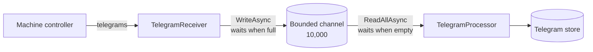

Producer/consumer is one of the oldest concurrency patterns, and one of the most useful. A machine
controller pushes telegrams faster than you can store them. An endpoint accepts orders that need slow
follow-up work. A file watcher finds files that need parsing. In every case, one side produces work, the
other side processes it, and a queue in between decouples their speeds.

You'll still find wiki pages that recommend `BlockingCollection<T>` or TPL Dataflow's `BufferBlock<T>`
for this. Both work. Neither is what I'd pick in 2026. This post shows why, and how
`System.Threading.Channels` does the job better.

## The "before": three versions I keep finding

**Version 1: a queue and a lock.**

```csharp
private readonly Queue<Telegram> _queue = new();

public void Add(Telegram t) { lock (_queue) _queue.Enqueue(t); }

private void ConsumerLoop()
{
    while (_running)
    {
        Telegram? next = null;
        lock (_queue)
        {
            if (_queue.Count > 0) next = _queue.Dequeue();
        }
        if (next is null) { Thread.Sleep(10); continue; }   // polling
        Process(next);
    }
}
```

Polling with `Thread.Sleep`, a `_running` flag that isn't `volatile`, no limit on the queue size, and
no clean way to say "no more items, finish what's there". It's the classic case of building your own
thread-safe collection, and the rule is simple: don't. The framework has tested ones.

**Version 2: `BlockingCollection<T>`.**

```csharp
private readonly BlockingCollection<Telegram> _queue = new(boundedCapacity: 1_000);

public void Add(Telegram t) => _queue.Add(t);           // blocks when full

private void ConsumerLoop()
{
    foreach (var t in _queue.GetConsumingEnumerable())  // blocks when empty
        Process(t);
}
```

This is correct, bounded, and supports completion via `CompleteAdding()`. Its problem is in the name:
it **blocks**. `GetConsumingEnumerable` holds a thread for the whole lifetime of the consumer, even when
the queue is empty. `Add` blocks the producer when the queue is full, which on a UI thread freezes the
UI and on a server ties up a thread-pool thread. And the moment `Process` needs to call a database or
an HTTP API asynchronously, you're stuck: you either block on it (see
[async/await pitfalls](/blog/2026-async-await-pitfalls/)) or you rebuild the loop.

**Version 3: `BufferBlock<T>`.**

```csharp
private readonly BufferBlock<Telegram> _buffer = new();

public void Add(Telegram t) => _buffer.Post(t);   // returns false if declined, nobody checks

public async Task ConsumeAsync(CancellationToken ct)
{
    while (await _buffer.OutputAvailableAsync(ct))
    {
        var t = await _buffer.ReceiveAsync(ct);
        await ProcessAsync(t, ct);
    }
}
```

This one is async, which is a real improvement. But it pulls in the whole TPL Dataflow package for what
is really just a queue, `Post` silently returns `false` when a bounded block is full, and the
`OutputAvailableAsync`/`ReceiveAsync` pair you find in most samples is two calls where one would do. Dataflow is a great library
for building processing *pipelines* with linked blocks. As a plain queue it's overkill.

## Why it keeps happening

The guidance most teams learned predates `System.Threading.Channels`, which shipped with .NET Core 3.0
and is part of the base library today. Old samples get copied, and `BlockingCollection` "just works"
until the consumer needs to do I/O. The fix isn't a new idea. It's the same pattern with a primitive
that was designed for `async`.

## The solution: `Channel<T>`

A channel is a queue with two ends: a `ChannelWriter<T>` for producers and a `ChannelReader<T>` for
consumers. Waiting is asynchronous on both sides, so no thread is held while the queue is empty or
full.

```csharp
namespace Factory.Telegrams;

public sealed class TelegramQueue
{
    private readonly Channel<Telegram> _channel = Channel.CreateBounded<Telegram>(
        new BoundedChannelOptions(capacity: 10_000)
        {
            FullMode     = BoundedChannelFullMode.Wait,  // backpressure on the producer
            SingleReader = true,                         // enables a faster implementation
            SingleWriter = false,
        });

    public ChannelWriter<Telegram> Writer => _channel.Writer;
    public ChannelReader<Telegram> Reader => _channel.Reader;
}
```

The producer side, for example a connection that receives telegrams:

```csharp
public sealed class TelegramReceiver(ITelegramConnection connection, TelegramQueue queue)
    : BackgroundService
{
    protected override async Task ExecuteAsync(CancellationToken stoppingToken)
    {
        try
        {
            await foreach (var telegram in connection.ReadAllAsync(stoppingToken))
                await queue.Writer.WriteAsync(telegram, stoppingToken);   // waits if full

            queue.Writer.TryComplete();
        }
        catch (Exception ex) when (ex is not OperationCanceledException)
        {
            queue.Writer.TryComplete(ex);   // the consumer sees the error
            throw;
        }
    }
}
```

The consumer side:

```csharp
public sealed class TelegramProcessor(
    TelegramQueue queue,
    IServiceScopeFactory scopes,
    ILogger<TelegramProcessor> logger) : BackgroundService
{
    protected override async Task ExecuteAsync(CancellationToken stoppingToken)
    {
        await foreach (var telegram in queue.Reader.ReadAllAsync(stoppingToken))
        {
            try
            {
                await using var scope = scopes.CreateAsyncScope();
                var store = scope.ServiceProvider.GetRequiredService<ITelegramStore>();
                await store.SaveAsync(telegram, stoppingToken);
            }
            catch (Exception ex) when (ex is not OperationCanceledException)
            {
                logger.LogError(ex, "Failed to store telegram {TelegramId}", telegram.Id);
            }
        }
    }
}
```

```csharp
builder.Services.AddSingleton<TelegramQueue>();
builder.Services.AddHostedService<TelegramReceiver>();
builder.Services.AddHostedService<TelegramProcessor>();
```



What you get:

- **No blocked threads.** Both sides `await`. An idle consumer costs nothing.
- **Backpressure.** When the store is slow, the channel fills up and `WriteAsync` makes the receiver
  wait instead of eating memory.
- **Completion.** `TryComplete()` means "no more items". `ReadAllAsync` drains what's left and then ends
  the loop. `TryComplete(ex)` passes an error to the consumer, which sees it as an exception from
  `ReadAllAsync`.
- **Cancellation** everywhere, through the standard `CancellationToken`.
- **A clear API surface.** Hand out only the `ChannelWriter<T>` to producers and only the
  `ChannelReader<T>` to consumers, and nobody can accidentally do both.

## Choosing the full mode

`BoundedChannelFullMode` decides what happens when the channel is full. This is a business decision, not
a technical detail:

| Full mode | Behaviour | Good for |
|---|---|---|
| `Wait` | `WriteAsync` waits, `TryWrite` returns `false` | Data you must not lose: orders, telegrams that get persisted |
| `DropOldest` | Removes the oldest item to make room | "Latest state" streams: sensor values, UI updates |
| `DropNewest` | Removes the newest item already in the channel | Rare; when the queued backlog matters more than the latest value |
| `DropWrite` | Discards the item being written | Best-effort telemetry where overload should simply shed load |

For the drop modes, `Channel.CreateBounded` has an overload with an `itemDropped` callback (.NET 6+).
Use it to count dropped items in a metric. Silent data loss is the worst kind.

## Channels vs. the alternatives

| | `Queue` + `lock` | `BlockingCollection<T>` | `BufferBlock<T>` | `Channel<T>` |
|---|---|---|---|---|
| Async waiting | ❌ polling | ❌ blocks threads | ✅ | ✅ |
| Bounded with backpressure | ❌ manual | ✅ blocking | ✅ but `Post` returns `false` silently | ✅ `WriteAsync` waits |
| Drop policies | ❌ | ❌ | ❌ | ✅ |
| Completion with error | ❌ | ❌ | ✅ | ✅ |
| `await foreach` consumer | ❌ | ❌ | ✅ `ReceiveAllAsync` (Dataflow 5+) | ✅ `ReadAllAsync` |
| Extra package | no | no | yes (Dataflow) | no |
| Linked pipelines, built-in parallel blocks | ❌ | ❌ | ✅ | manual |

TPL Dataflow still has a place: when you really need a graph of transform and batch blocks with
per-block parallelism, `TransformBlock` and `ActionBlock` save you code. For a queue between a producer
and a consumer, a channel is simpler and faster.

## Multiple consumers

If the processing is the bottleneck and items are independent, start several readers on the same
channel. Each item is delivered to exactly one of them:

```csharp
protected override Task ExecuteAsync(CancellationToken stoppingToken) =>
    Task.WhenAll(Enumerable.Range(0, 4).Select(_ => ConsumeAsync(stoppingToken)));
```

Set `SingleReader = false` in that case. And remember that ordering is gone: with four consumers, item
11 can finish before item 10. If order matters per machine or per customer, partition into one channel
per key instead of sharing one.

## Pitfalls

**Unbounded channels.** `Channel.CreateUnbounded<T>()` is tempting because writes never wait. It also
means a slow consumer turns into a memory leak that only shows up under load. Default to bounded. Use
unbounded only when the producer is naturally limited.

**Writing with `TryWrite` and ignoring the result.** On a bounded channel in `Wait` mode, `TryWrite`
returns `false` when it's full. That's the same silent-drop bug as `BufferBlock.Post`. Use
`WriteAsync`, or handle the `false`.

**Exceptions that kill the consumer.** If `ProcessAsync` throws and you don't catch it, the
`BackgroundService` stops and nobody reads the channel any more. Producers then wait forever on a full
channel. Catch per item, log, and decide whether to retry or dead-letter the item.

**Not completing the writer.** Without `TryComplete()`, `ReadAllAsync` waits forever, and on shutdown
the remaining items are just dropped. If items must survive a restart, an in-process channel isn't
enough. That's what an outbox table or a broker is for.

**Using `Reader.Count` for logic.** It's a snapshot that's outdated the moment you read it. Fine for a
metric, wrong for "if empty then …".

**Capturing scoped services.** The channel is a singleton. Don't put a scoped `DbContext` in it or in
its items. Create a scope per item in the consumer, as shown above. The background is in
[DI lifetimes](/blog/2026-di-lifetimes-and-service-registration/).

## How to enforce and measure

- **BannedApiAnalyzers** can ban `BlockingCollection<T>` and `System.Threading.Tasks.Dataflow` in
  projects that should use channels:

```text
# BannedSymbols.txt
T:System.Collections.Concurrent.BlockingCollection`1;Use System.Threading.Channels instead
N:System.Threading.Tasks.Dataflow;Use System.Threading.Channels unless you need a dataflow pipeline
```

- **VSTHRD002** and **CA1849** catch blocking calls inside the consumer.
- **Metrics.** Expose the queue length (`Reader.Count` is fine here) and dropped items as
  `System.Diagnostics.Metrics` instruments. A queue that grows steadily means the consumer can't keep up.
- **Tests.** A channel is easy to test: write ten items, complete the writer, run the consumer, and
  assert all ten were stored. Then make the store throw on item five and assert items six to ten are still
  processed.

## Summary

- Don't build your own thread-safe queue. And in 2026, don't reach for `BlockingCollection<T>` or
  `BufferBlock<T>` for a plain producer/consumer queue either.
- **`Channel<T>`** is async on both ends, part of the base library and has completion and cancellation
  built in.
- Prefer **bounded** channels and choose the **full mode** deliberately: `Wait` for data you can't lose,
  `DropOldest` for "latest value" streams.
- Hand out **writer and reader separately**, complete the writer, and catch exceptions **per item**.
- Use several readers for throughput, one channel per key when order matters.
- For high-frequency sources where you only need a fraction of the values, see
  [taming high-frequency events](/blog/2026-taming-high-frequency-events/).
