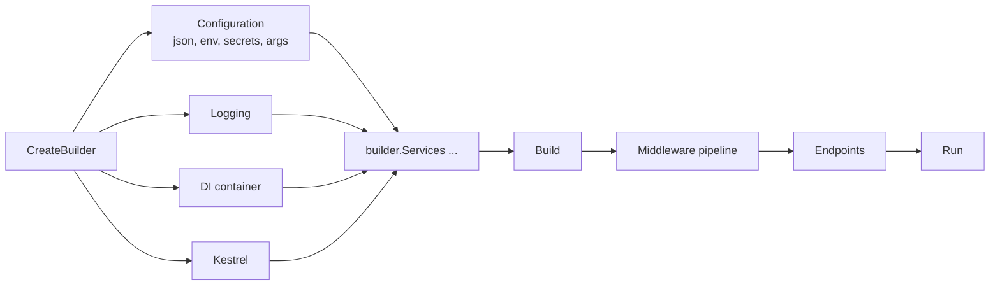

Every ASP.NET Core project starts with the same handful of lines in `Program.cs`. Most people never
look at them again, until the file has grown to 400 lines of registrations, nobody dares to touch the
middleware order, and a configuration value "sometimes" comes from the wrong place.

This is the first post of a step-by-step series on setting up a production-ready API. Before we
add authentication, error handling or OpenAPI, it's worth understanding what the host does for you,
because almost every later topic builds on it.

## Where we came from: Program + Startup

If you've worked on ASP.NET Core projects older than .NET 6, this looks familiar:

```csharp
public static class Program
{
    public static void Main(string[] args) =>
        CreateHostBuilder(args).Build().Run();

    public static IHostBuilder CreateHostBuilder(string[] args) =>
        Host.CreateDefaultBuilder(args)
            .ConfigureWebHostDefaults(web => web.UseStartup<Startup>());
}

public sealed class Startup(IConfiguration configuration)
{
    public void ConfigureServices(IServiceCollection services)
    {
        services.AddControllers();
        // ...
    }

    public void Configure(IApplicationBuilder app, IWebHostEnvironment env)
    {
        app.UseRouting();
        app.UseAuthorization();
        app.UseEndpoints(e => e.MapControllers());
    }
}
```

Two classes, a callback-based builder and a convention (`ConfigureServices`, `Configure`) that the
runtime finds by reflection. It still works on .NET 10, and I see it in a lot of codebases that were
upgraded step by step. Nothing forces you to migrate. But for new projects, the "minimal hosting"
model is the default, and it's simpler to reason about.

## The modern version

```csharp
var builder = WebApplication.CreateBuilder(args);

builder.Services.AddControllers();

var app = builder.Build();

app.UseAuthorization();
app.MapControllers();

app.Run();
```

Same result, fewer moving parts. Two phases are visible now:

1. **Builder phase:** everything on `builder` configures the host. Services, configuration, logging.
2. **App phase:** after `Build()`, the service container is frozen and you describe the request
   pipeline (middleware) and the endpoints.

Once `Build()` has run, adding a service throws. That's a feature: it makes the "registrations first,
pipeline second" order explicit instead of hiding it in two methods of a class.

## What CreateBuilder does before your first line

`WebApplication.CreateBuilder(args)` is not just a constructor. It wires up a lot of defaults:

**Configuration sources**, in this order (later ones win):

1. `appsettings.json`
2. `appsettings.{Environment}.json`
3. User secrets, **only in the `Development` environment**
4. Environment variables
5. Command-line arguments

**Logging** with console, debug and EventSource providers, configured from the `Logging` section.

**Dependency injection** with the default container. In `Development`, it turns on
`ValidateScopes` and `ValidateOnBuild`, which catch a whole class of lifetime bugs at startup.
That's the topic of the next post.

**Kestrel** as the web server, with URLs from `ASPNETCORE_URLS`, `launchSettings.json` or
configuration.

**The environment** from `ASPNETCORE_ENVIRONMENT` (or `DOTNET_ENVIRONMENT`), defaulting to
`Production` if nothing is set.

That last default matters more than it looks. If you forget to set the environment on a test server,
the app runs as `Production`: no user secrets, no developer exception page, production log levels.
That's the safe direction to fail in, and it's why I never default to `Development` in a container
image.



### The other builders

| Builder | What you get | When I use it |
|---|---|---|
| `WebApplication.CreateBuilder` | All defaults above | Almost always |
| `WebApplication.CreateSlimBuilder` | Reduced defaults (no HTTPS/HTTP3, fewer logging providers), trimming-friendly | Native AOT, very small services |
| `WebApplication.CreateEmptyBuilder` | Nothing, you add everything yourself | Rarely, for full control |
| `Host.CreateApplicationBuilder` | Same hosting without the web part | Workers, queue consumers, CLI tools with DI |

## Adding your own configuration sources

A pattern I like for local development: an optional, git-ignored file per environment that each
developer can use to override settings without touching the checked-in ones.

```csharp
var builder = WebApplication.CreateBuilder(args);

builder.Configuration.AddJsonFile(
    $"appsettings.{builder.Environment.EnvironmentName}.Local.json",
    optional: true,
    reloadOnChange: true);
```

```text
# .gitignore
appsettings.*.Local.json
```

Be aware of the ordering: sources added here come **after** environment variables and command-line
arguments, so they win over them. If you want environment variables to keep the last word, add them
again afterwards:

```csharp
builder.Configuration.AddEnvironmentVariables();
```

That kind of subtlety is exactly why I want all configuration tweaks in one visible place at the top
of `Program.cs`, and not scattered across extension methods.

## Keeping Program.cs readable

`Program.cs` should read like a table of contents. You should see **which features** the API has,
not **which classes** a feature needs. In one codebase I worked on, the rule was simple: you can
switch off a whole feature by commenting out one line.

```csharp
var builder = WebApplication.CreateBuilder(args);

// Cross-cutting
builder.Services.AddApiDefaults(builder.Configuration);   // ProblemDetails, OpenAPI, auth, CORS

// Features
builder.Services.AddOrders(builder.Configuration);
builder.Services.AddCustomers();
builder.Services.AddInvoices(builder.Configuration);

var app = builder.Build();

app.UseApiDefaults();

app.MapOrders();
app.MapCustomers();
app.MapInvoices();

app.Run();
```

Each `AddOrders` lives next to the orders code and registers everything that feature needs. We'll
look at how to write those extension methods properly in the next post, because there are a few
traps (double registrations, hidden lifetimes).

What I explicitly **don't** want in `Program.cs`:

- `services.AddScoped<IOrderRepository, SqlOrderRepository>()` lines for individual classes
- Business logic, or `if` cascades on configuration values
- Endpoint implementations (lambdas with ten lines of code)

The "unoptimized" alternative, with dozens of flat `AddScoped` lines, has the same problems
everywhere I've seen it: nobody knows which feature needs which class, deactivating an endpoint
means archaeology, and every implementation change touches the startup.

## The middleware order is not cosmetic

Middleware runs in the order you add it. Getting it wrong doesn't throw. It just silently doesn't
work.

```csharp
var app = builder.Build();

app.UseExceptionHandler();          // 1. catches everything below it
app.UseStatusCodePages();

if (!app.Environment.IsDevelopment())
{
    app.UseHsts();
}

app.UseHttpsRedirection();

app.UseCors();                      // 2. before auth, so preflight requests get answered
app.UseAuthentication();            // 3. who are you?
app.UseAuthorization();             // 4. are you allowed?

app.MapControllers();               // 5. endpoints
app.MapHealthChecks("/health");

app.Run();
```

Since .NET 6, `WebApplication` adds `UseRouting` and `UseEndpoints` for you. You only call
`UseRouting()` explicitly if something has to run **before** routing.

Typical mistakes I've seen in reviews:

- **Exception handler too late.** Anything that throws before it reaches the handler produces a bare
  500 without ProblemDetails.
- **CORS after authorization.** Preflight requests don't carry tokens, so they get a 401 and the
  browser reports a CORS error that has nothing to do with CORS.
- **Authorization before authentication.** Every user is anonymous.

## Making Program testable

Integration tests with `WebApplicationFactory<Program>` need to see the `Program` class. With
top-level statements, the compiler generates it as `internal`. On .NET 10, a source generator makes
it public for you. On older versions, add this at the end of `Program.cs`:

```csharp
public partial class Program;
```

Then a smoke test that starts the whole host is a few lines:

```csharp
[TestMethod]
public async Task Host_starts_and_health_endpoint_answers()
{
    await using var factory = new WebApplicationFactory<Program>();
    using var client = factory.CreateClient();

    var response = await client.GetAsync("/health");

    Assert.AreEqual(HttpStatusCode.OK, response.StatusCode);
}
```

That single test catches more than you'd expect: missing registrations, broken configuration
binding, middleware that throws on startup. It's the first test I add to every new API.

## Pitfalls

**Reading configuration too early.** `builder.Configuration["X"]` before you've added your custom
sources returns the old value. Add sources first, read afterwards.

**Building the service provider yourself.** `builder.Services.BuildServiceProvider()` inside
`Program.cs` creates a **second** container with its own singletons. The analyzer warning ASP0000
exists for a reason.

**Environment-specific code everywhere.** A few `if (app.Environment.IsDevelopment())` blocks are
fine. If you have dozens, move the differences into configuration.

**Forgetting graceful shutdown.** When the orchestrator stops your container, the host stops accepting
requests and waits for running ones up to `HostOptions.ShutdownTimeout` (30 seconds by default since
.NET 6). Long-running background work has to honour the `CancellationToken` it gets, or it will be
killed mid-operation.

## Summary

- `WebApplication.CreateBuilder` sets up configuration, logging, DI (with validation in
  `Development`) and Kestrel before your first line runs.
- The two phases, **builder** and **app**, make "register first, build the pipeline second" explicit.
- Keep `Program.cs` a **table of contents**: one line per feature, details in feature extension
  methods.
- **Middleware order matters**: exception handler first, CORS before auth, authentication before
  authorization.
- A **smoke test** with `WebApplicationFactory<Program>` catches startup problems before deployment.

*Next: [Service registration and DI lifetimes](/blog/2026-di-lifetimes-and-service-registration/)*
