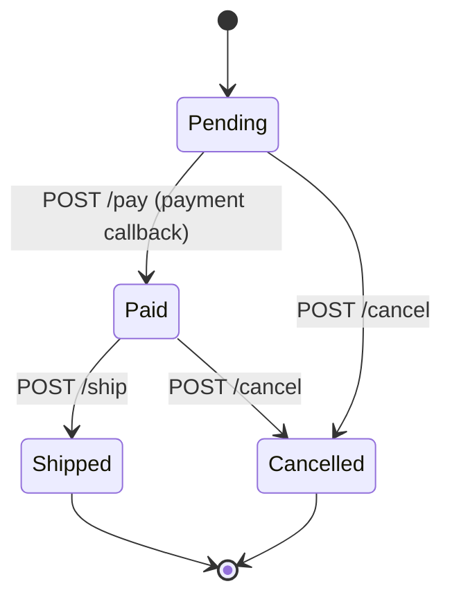

:::note[Series]
Part of the series [*REST & OpenAPI design*](/series/rest-and-openapi-design/).
:::

Every API that models something with a lifecycle hits this question sooner or later. Orders get
paid, shipped and cancelled. Invoices get issued and voided. Deployments get started and completed.
And someone has to decide what the HTTP call for "ship this order" looks like.

The first draft is almost always this:

```http
PATCH /orders/42
Content-Type: application/merge-patch+json

{ "status": "Shipped" }
```

It looks clean and "pure REST": `status` is a property of the order, so you update it with `PATCH`.
It's also, in most cases, the wrong design. Here's why, and the rule I use to decide.

## The problem: business logic hidden behind a field

Follow the `PATCH` into the backend:

```csharp
app.MapPatch("/orders/{id:guid}", async (Guid id, OrderPatch patch, ShopDbContext db,
    IShippingService shipping, IMailer mailer, CancellationToken ct) =>
{
    var order = await db.Orders.FindAsync([id], ct);
    if (order is null) return Results.NotFound();

    if (patch.Status is { } newStatus && newStatus != order.Status)
    {
        if (newStatus == OrderStatus.Shipped)
        {
            if (order.Status != OrderStatus.Paid)
                return Results.Conflict("Only paid orders can be shipped.");

            await shipping.BookCarrierAsync(order, ct);
            await mailer.SendShippingConfirmationAsync(order, ct);
        }
        else if (newStatus == OrderStatus.Cancelled)
        {
            // refund, release stock, notify warehouse ...
        }
        else if (newStatus == OrderStatus.Paid)
        {
            return Results.BadRequest("Status 'Paid' can't be set by clients.");
        }

        order.Status = newStatus;
    }

    if (patch.Note is not null) order.Note = patch.Note;
    if (patch.DeliveryAddress is not null) order.DeliveryAddress = patch.DeliveryAddress;

    await db.SaveChangesAsync(ct);
    return Results.NoContent();
});
```

That's one endpoint doing four different jobs. A generic update has turned into a dispatcher for
business operations, keyed on the *new value* of a field. And the problems pile up:

- **The contract lies.** The OpenAPI document says `status` is a writable string. In reality, only
  two of its five values may be written, only from specific states, and each one triggers different
  side effects. None of that is visible to a consumer.
- **Validation is awkward.** "Can I go from A to B?" is a state-machine question. Expressing it as
  "is this new property value allowed?" leads to exactly the `if`/`else` cascade above.
- **Combined changes are ambiguous.** What does `{ "status": "Shipped", "deliveryAddress": {...} }`
  mean? Ship to the old address and then change it? The other way round? Both in one transaction,
  while a carrier was already booked for the old address?
- **Auditing is weak.** The audit log says "status changed from Paid to Shipped". It doesn't say that
  someone *shipped* the order, which is what the business cares about.
- **Authorization is coarse.** Warehouse staff may ship, but only support may cancel. With one
  `PATCH` endpoint you're inspecting the body to decide who's allowed to call it.

## The rule: a property describes state, an action expresses intent

The question to ask isn't "is this a property?" Everything is a property somewhere. The question is
whether the change is a **business operation**:

| Question | If yes |
|---|---|
| Does the change trigger business logic or a workflow? | Action endpoint |
| Does it have side effects (messages, e-mails, calls to other systems, cleanup)? | Action endpoint |
| Is it only allowed in certain states? | Action endpoint |
| Does the client express an *intent* rather than set a *value*? | Action endpoint |
| Is it a plain data change the client fully controls? | `PATCH` / `PUT` |

That lines up with the public guidelines of the large API producers. Google's
[AIP-136](https://google.aip.dev/136) says to prefer standard methods but use custom methods for
behaviour that isn't a simple update. The
[Microsoft Azure REST guidelines](https://github.com/microsoft/api-guidelines/blob/vNext/azure/Guidelines.md)
describe the same "perform an action" pattern with `POST`.

## The pattern: read-only state, explicit actions

**1. State becomes read-only in the resource.**

```json
{
  "id": "42",
  "status": "Paid",
  "note": "Leave at the door",
  "deliveryAddress": { "street": "Main St 1", "city": "Springfield" }
}
```

`status` is returned, never accepted. In the OpenAPI document it's marked `readOnly: true`, and the
request DTOs simply don't have it.

**2. Plain data stays a `PATCH`.**

```http
PATCH /orders/42
Content-Type: application/merge-patch+json

{ "note": "Ring twice" }
```

**3. Business operations get their own endpoints.**

```http
POST /orders/42/ship       { "carrier": "parcel-express" }
POST /orders/42/cancel     { "reason": "customer-request" }
```

Google's style uses a colon instead (`POST /orders/42:ship`), which avoids collisions with
sub-resources. Both work. Pick one and put it in your guideline; I use the slash because it routes
without escaping and every tool handles it.

**4. The backend decides the outcome.** The client says "ship it". Whether that's allowed, what
happens and which state the order ends up in is the domain's job.

### In code

The domain object owns the state machine:

```csharp
public sealed class Order
{
    public Guid Id { get; init; }
    public OrderStatus Status { get; private set; }
    public string? Note { get; set; }
    public Address DeliveryAddress { get; set; } = null!;
    public string? Carrier { get; private set; }

    public void Ship(string carrier, TimeProvider clock)
    {
        if (Status != OrderStatus.Paid)
            throw new InvalidOrderTransitionException(Id, Status, "ship");

        Carrier = carrier;
        Status = OrderStatus.Shipped;
        ShippedAt = clock.GetUtcNow();
    }

    public void Cancel(string reason)
    {
        if (Status is OrderStatus.Shipped or OrderStatus.Cancelled)
            throw new InvalidOrderTransitionException(Id, Status, "cancel");

        Status = OrderStatus.Cancelled;
        CancellationReason = reason;
    }

    public DateTimeOffset? ShippedAt { get; private set; }
    public string? CancellationReason { get; private set; }
}

public enum OrderStatus { Pending, Paid, Shipped, Cancelled }
```

Each action endpoint is small and has one job:

```csharp
var orders = app.MapGroup("/orders/{id:guid}").WithTags("Orders");

orders.MapPost("/ship", async Task<Results<Ok<OrderDto>, NotFound, Conflict<ProblemDetails>>> (
    Guid id, ShipOrder request, ShopDbContext db, IShippingService shipping,
    TimeProvider clock, CancellationToken ct) =>
{
    var order = await db.Orders.FindAsync([id], ct);
    if (order is null)
        return TypedResults.NotFound();

    try
    {
        order.Ship(request.Carrier, clock);
    }
    catch (InvalidOrderTransitionException ex)
    {
        return TypedResults.Conflict(new ProblemDetails
        {
            Title = "Invalid state transition",
            Detail = ex.Message,
            Status = StatusCodes.Status409Conflict
        });
    }

    await shipping.BookCarrierAsync(order, ct);
    await db.SaveChangesAsync(ct);   // an outbox publishes OrderShipped for the e-mail
    return TypedResults.Ok(OrderDto.From(order));
})
.RequireAuthorization("orders:ship")
.WithName("ShipOrder");

public sealed record ShipOrder(string Carrier);
```

Notice what you get for free: a dedicated authorization policy per action, an operation ID
`ShipOrder` that becomes `ShipOrderAsync()` in a generated client, a precise request schema, and a
`409 Conflict` with a meaningful message for invalid transitions. (Whether you map the exception in
the endpoint or in a [global exception handler](/blog/2026-exception-handling-best-practices/) is a
matter of taste. I usually do the latter.)



The diagram is also a good test of the design: **every arrow is an action endpoint, every box is a
read-only status value.** If you can't draw it, the domain isn't understood well enough yet, and
no choice of HTTP verb will fix that.

### Use explicit lifecycle states

If an action kicks off something that takes a while (booking a carrier, provisioning infrastructure),
model the intermediate states instead of jumping straight to the end result:
`Paid → Shipping → Shipped`, plus a failure state like `ShippingFailed`. Return `202 Accepted` with
a `Location` header pointing to the order, so the client can poll the status. That's far more honest
than a `PATCH` that claims `Shipped` the moment the request arrives.

## Comparison

| | `PATCH { status }` | Action endpoint |
|---|---|---|
| Contract shows what's allowed | ❌ "status is a writable string" | ✅ one operation per transition |
| State-transition validation | `if`/`else` on the new value | Domain method with guard |
| Authorization per operation | ❌ inspect the body | ✅ policy per endpoint |
| Audit: *what* happened | "status changed" | "order shipped" |
| Request schema per operation | ❌ shared, everything optional | ✅ `ShipOrder { carrier }` |
| Number of endpoints | fewer | more |
| Purist REST | ✅ | slightly RPC-style |

The trade-off is real: more endpoints and a bit of RPC flavour. For anything with a lifecycle, it's
worth it.

## Pitfalls

**Over-correcting into RPC.** Not every field change is a business operation. Changing an order's
note or a customer's phone number is a `PATCH`. If your API ends up with `POST /customers/7/change-phone`,
you've gone too far. Apply the decision table, don't make everything an action.

**Verbs that are really sub-resources.** "Add a comment" isn't an action on the order, it's
`POST /orders/42/comments`, creating a resource. Only use action endpoints for things that don't
create or replace a resource.

**Leaving `status` writable "for admins".** It starts as an escape hatch for support and ends up as
the way a frontend team works around a missing action. If support needs to fix data, give them a
dedicated, audited admin endpoint.

**Non-idempotent actions without protection.** `POST /ship` retried after a timeout could book two
carriers. The state guard already helps (the second call gets a 409), but for actions with external
side effects, support an `Idempotency-Key` header so retries return the original result.

**Delete is not an action.** "Soft delete" is still a `DELETE`, as described in the
[previous post](/blog/2026-soft-delete-in-rest-apis/). Restore, on the other hand, is a perfectly good
action.

## Enforce it

- **OpenAPI lint:** a Spectral rule that fails if a schema property called `status` or `state` is not
  `readOnly` in a request body. That catches the most common regression.
- **Architecture test:** domain entities with a lifecycle expose `Status` with a private setter.
  NetArchTest or a simple reflection test over your domain assembly checks that in a few lines.
- **Contract tests:** for every arrow in the state diagram, one test for the allowed transition and
  one for a forbidden one (expecting 409). The diagram becomes your test plan.

## Summary

- **A property describes state, an action expresses intent.**
- If a change triggers logic, has side effects or is only allowed in certain states, model it as an
  **action endpoint** (`POST /orders/{id}/ship`), not as `PATCH { status }`.
- Make lifecycle state **read-only** in the resource. Plain data stays a `PATCH`.
- Put the **state machine in the domain**, return **409** for invalid transitions, and use
  intermediate states plus **202** for long-running operations.
- Don't over-correct: sub-resources are resources, and simple field changes stay updates.
