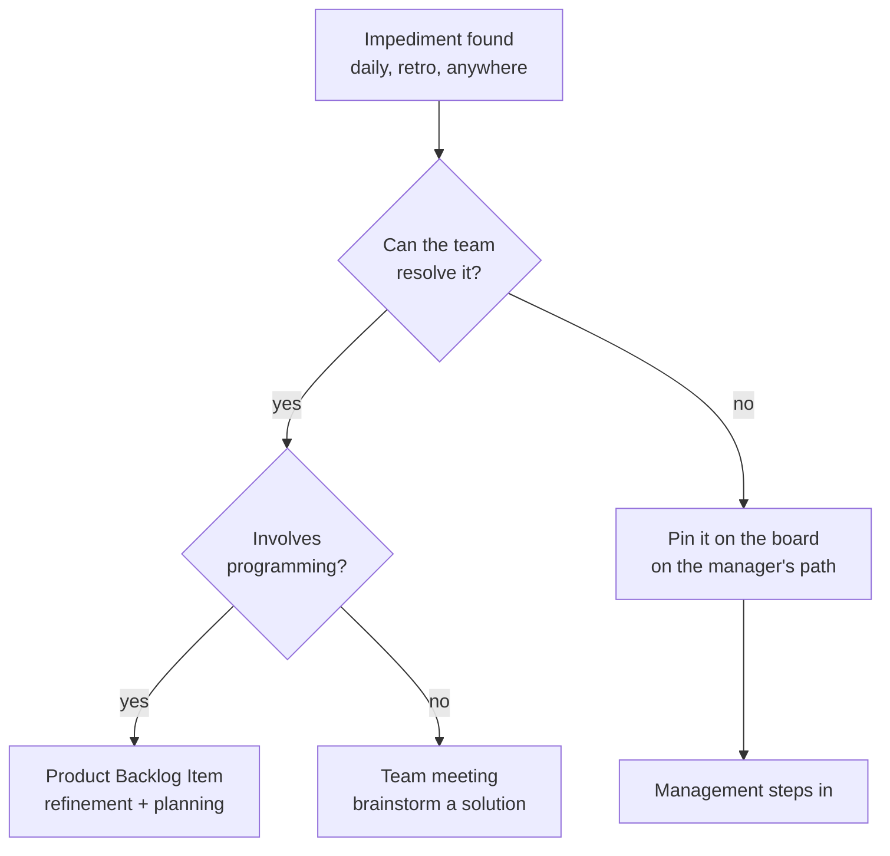

Every team has a list of things that slow it down. A test environment that's never available. A
permission that takes three weeks to get. A dependency on another department that nobody owns. These
things come up in the retro, everyone nods, somebody writes them down, and then they come up again in
the next retro.

In the project with six Scrum teams I worked on for about four years, we broke that loop with a very
low-tech trick. But the trick only works because of a distinction that comes first: **can the team
fix this itself, or not?**

## What an impediment is

Our working definition: an impediment is anything that **prevents the team, or a member of the team,
from doing the work planned for the current sprint**, or from working effectively in general.

That's broader than "a blocked task". A blocked task is a symptom. The impediment is the reason it's
blocked, and often the reason the same kind of task will be blocked again next sprint.

## Two kinds of impediments

We dealt with impediments in two categories, and we treated them completely differently.

### Team-resolvable impediments

These are problems the team can solve on its own. For those we had two paths:

- **It involves programming** (a missing tool, a fragile build script, a test setup that takes too
  long): it becomes a **Product Backlog Item** and goes through refinement and planning like any other
  work.
- **It doesn't** (unclear responsibilities inside the team, a meeting that doesn't work, a recurring
  misunderstanding): the team **sets up a meeting**, brainstorms and agrees on a solution.

The key point is that team-resolvable impediments don't get escalated. Escalating something you could
fix yourself wastes everyone's time and teaches the team that problems are someone else's job.

### Non-team-resolvable impediments

These are problems outside the team's control: organizational decisions, budget, access rights,
dependencies on other departments, environment provisioning by another group. The team can describe
them perfectly, but it can't fix them.

For those, we used a **physical board next to the agile manager's office**. Critical items that needed
management to step in were pinned there. The board was placed so that it was **on the manager's daily
path**. They walked past it every day, several times. Problems that needed their attention were
impossible to miss.

## Why the board worked

It sounds almost too simple. There are a few reasons it worked better than the usual alternatives.

**Visibility without escalation.** An e-mail with the subject "Escalation" puts people on the
defensive. A card on a board is just a fact. Nobody is accusing anyone.

**It's persistent.** An e-mail is read once and then sinks in the inbox. A card stays on the board
until someone takes it down. Every day it's still there is a quiet reminder.

**It's on the right person's path.** The board wasn't in the team room, where the team already knew
about the problems. It was where the person who could solve them walked by. Place information where
the decision-maker is, not where the reporter is.

**It filters by itself.** Only critical items that really needed management went there. Because the
board wasn't cluttered with things the team could solve, each card carried weight.

## Impediment card template

Whether it's a paper card or a work item, a good impediment description answers a few questions. This
is the shape I'd use, filled with a made-up example:

| Field | Example |
|---|---|
| **Title** | Test environment for the payment integration unavailable |
| **Impact** | Two stories in the current sprint can't be tested; Definition of Done can't be met |
| **Since** | Start of the sprint |
| **What we tried** | Asked the owning group twice, no response yet |
| **What we need** | A decision who provides and maintains this environment |
| **Who can decide** | The manager, or whoever they delegate to |
| **Team contact** | One developer who can explain the details |

The fields "what we tried" and "what we need" are the most important ones. They show that it really
is out of the team's reach, and they make it easy for the manager to act without a long meeting first.

## Blocked work items

On the board inside the team, a blocked item should be visible too. We used a `#blocked` tag on tasks
and backlog items with two rules:

1. The **reason must always be documented** in the item's discussion.
2. The tag is **removed as soon as possible** once the item isn't blocked any more.

A blocked tag without a reason is noise. A blocked tag that stays on an item for weeks after the
problem was solved is worse, because it trains people to ignore the tag.

The `#blocked` tag answers "what is stuck?". The impediment answers "why, and who can fix it?". If the
same reason shows up on several blocked items, that's a strong candidate for the manager's board.

## Comparing the options

| | E-mail escalation | Item in a tracker | Status meeting | Board on the manager's path |
|---|---|---|---|---|
| Visible without anyone looking for it | ❌ | ❌ | ⚠️ once per meeting | ✅ every day |
| Stays visible until solved | ❌ | ✅ if someone opens it | ❌ | ✅ |
| Feels like blame | ⚠️ often | ✅ neutral | ⚠️ can | ✅ neutral |
| Effort for the team | low | low | high | low |
| Works for distributed teams | ✅ | ✅ | ✅ | ❌ physical |

The obvious weakness of a physical board is that it only works if people share an office. For a
distributed setup, the principle still applies: put the impediments **where the decision-maker
already looks every day**. That might be a pinned section in a dashboard they open every morning, or
the first item in a recurring one-on-one. A separate tool nobody opens is the digital version of a
board in a basement.

## Pitfalls

**Everything goes on the manager's board.** If the team escalates things it could fix itself, the
board loses its weight and the team loses its autonomy. Be strict about the first question.

**Cards without context.** "Environment broken" doesn't help anyone. Use the template, or at least
impact and what you need.

**Nobody takes cards down.** A board full of old cards looks like nothing ever gets solved. Remove
resolved items right away, and say thank you when you do.

**Using it as a complaint wall.** The board is for impediments that block work, not for general
frustration. That belongs in the retro.

**Forgetting team-resolvable impediments.** They don't get a board, so they're easy to forget. Treat
the backlog items like any other work, and follow up on team agreements in the next retro.

## How to know it's working

- The same impediment doesn't show up in retro after retro.
- Cards on the manager's board have a short life.
- The number of blocked items in the sprint goes down over time.
- The team stops saying "we can't do anything about it" and starts sorting problems into the two
  categories by itself.

## Summary

- An impediment is whatever keeps the team from doing its planned work, not just a blocked task.
- Split strictly: **team-resolvable** impediments become backlog items (if they involve programming)
  or team meetings. **Non-team-resolvable** impediments go to management.
- We pinned critical non-team-resolvable impediments on a board **right on the manager's daily path**.
  Visible, persistent and neutral.
- Document why something is blocked, remove the tag as soon as it isn't, and keep the manager's board
  for what really needs them.
- For distributed teams, keep the principle: put impediments where the decision-maker already looks.
